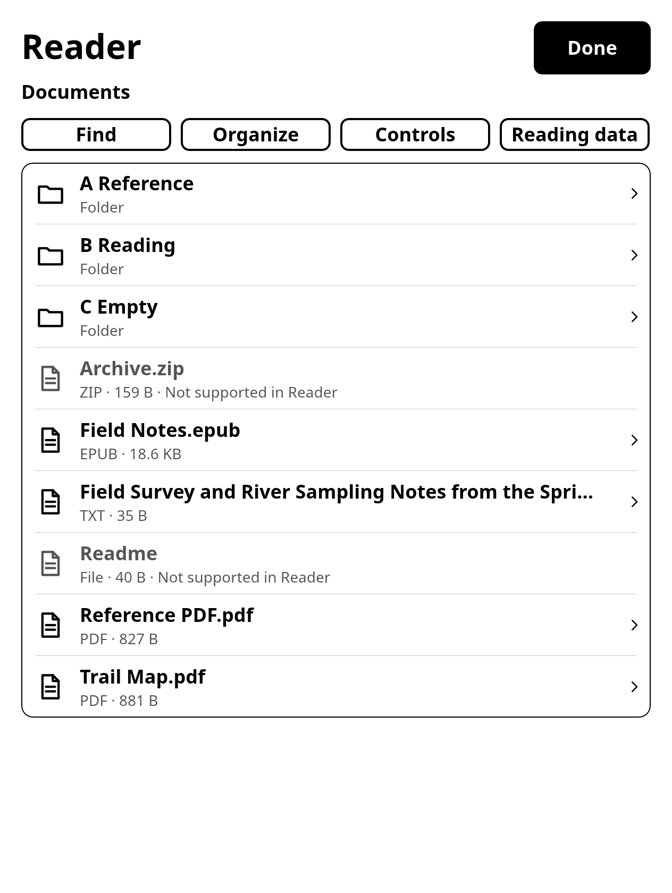

# Reader for PrimitiveOS

Reader is a native Rust book and document reader for PrimitiveOS on Kindle.
It uses Parley for reflowable books and Hayro for PDF pages. The reading
workflows and format coverage are being compared with KOReader on the same
Kindle. [EPUB feasibility results](docs/epub-probe-results.md)

## Preview

| Documents | Reading | Reading bars | Dictionary |
| --- | --- | --- | --- |
|  |  |  |  |

These captures use Reader's Kindle interface in the desktop simulator.
[Selection popup](docs/screenshots/selection.png)

## Reading on Kindle

Install Reader from PrimitiveOS Store or follow the manual install guide.
[Release downloads](https://github.com/PrimitiveOS/kindle-primitive-reader/releases) · [Install guide](INSTALL.md)

- Browse Documents one folder at a time. Rows show a folder or file icon and
  each file's type and size. Files Reader cannot open are labelled and disabled.
  Use **Up** to return to the parent folder, or **Find** to search all Documents.
  **Continue reading** on the Documents screen returns to your saved passage.
- Tap near the upper center of a page to reveal both reading bars. The top
  bar offers **Library**, **Pages**, **Controls**, and **Exit**. Use **Pages**
  for thumbnails, a quick bookmark, available links, and previous locations.
  The lower bar keeps Contents, Bookmarks, Highlights, Find, and Go to in
  consistent positions. Choose Text, View, or Scan for the current format's
  adjustments. Tap the center of the footer to open Text or View directly.
  Tap the page to hide the bars. **Done** is available while the bars are closed.
- Use the Kindle's page buttons, tap the outer thirds of the page, or swipe.
  Text settings switch between paged and continuous reading in horizontal EPUBs.
  Supported `vertical-rl` chapters use right-to-left columns and page turns.
- Controls offers a full E Ink refresh every page, every five pages, or every
  ten pages in paged reading. Default uses the normal refresh behavior.
- Tap Pages on the reading bar to browse thumbnails across EPUB chapters or
  a fixed-page document. Open a preview and return with Previous location.
- Open Contents and choose Generated outline to browse EPUB headings or chapter
  starts when the publisher's contents are missing or incomplete.
- Long-press a framed panel in a single-page comic view to inspect it at a
  larger size. Done returns to the same page and zoom.
- At the end of a comic, Next comic opens the following archive in the same
  folder in natural filename order.
- Hold a word to select it, then tap another word to extend the selection.
  Use the selection popup to add a highlight or note, or look up a word in an
  installed offline dictionary.
  Definitions open over the current page, away from the selected words when
  space allows. Expand a longer result to read it at full size.
  Choose a preferred installed dictionary under Controls.
- Hold a local EPUB illustration to open it for zoom and pan. Done returns
  to the same passage.
- Search with or without case matching. Title and filename search also covers
  authors cached as books are opened.
- Hold a book in Library to set its reading status, add it to Favorites, or
  organize it into collections. Create collections from **Organize**.
  Book details shows available EPUB series information, the cover preview, and
  local time spent on the reading screen.
- Open Controls on the reading bar to invert page colors, mirror touch zones,
  enlarge the toolbar, or lock page touch while keeping physical buttons and Done.
- Copy a TTF or OTF of up to 12 MB to `reader/data/fonts/`. Pick it from Text ›
  Reading font. Use the font override in Text settings to apply the reading font
  when the book specifies its own fonts.
- Save a named preset in Text › Reading profiles and apply it to another book.

## Development status

Reader 0.1.0 passed 249 ARMHF tests on a Kindle Oasis 3 running firmware 5.18.2.
An automated session opened Markdown and DOCX from Files 0.1.2, checked page
turns and resume, and returned to Launcher using both exit controls. The
bundled English OCR worker also recognised a grayscale test passage on the
device. [Reading parity and device results](docs/reading-parity-plan.md)

| Format | Current implementation |
| --- | --- |
| EPUB 2 and EPUB 3 reflow | Publisher navigation, local links, saved text positions, per-book typography, bookmarks, search and notes. Linked static SVG and short horizontal ruby annotations render within documented limits. |
| Fixed-layout EPUB 3 | Static XHTML and supported SVG spine pages, contents, zoom and rotation. Publisher page progression and facing-page hints control spreads. |
| PDF | Page turns or continuous scrolling, printed page labels, local outlines and links, bookmarks, passwords, page, width and height fit, crop, zoom, pan and rotation. Embedded text supports search, selection, highlights and notes. |
| DjVu | Fixed pages, crop, and embedded text with search and annotations |
| CBZ, CBT, CBR, JPEG, PNG, BMP, GIF and portable anymaps | Natural comic page order, single pages or two-page spreads, and selectable reading direction. CBT accepts standard uncompressed USTAR entries. CBR accepts supported single-volume, non-solid RAR4 and RAR5. Animated GIF shows its first frame. Portable anymaps include PBM, PGM, PPM and PAM. |
| SVG | Static geometry and local gradients in standalone files, linked EPUB illustrations, and fixed-layout EPUB pages. |
| WebP and TIFF | Lossy, single-image VP8 WebP. Single-page uncompressed strip-based TIFF with top-left orientation and 1-bit or 8-bit grayscale. |
| TXT, HTML/XHTML, HTMLZ, Markdown and FB2 | Shared text search and reading positions. Single-document HTMLZ archives use local illustrations and stylesheets. FB2 preserves section navigation and supported embedded images, including ZIP and gzip packages. Markdown builds a contents list from headings. |
| MOBI, PalmDOC and AZW3 | Text and metadata from supported DRM-free legacy files. Standalone reflowable KF8/AZW3 with UTF-8 text, reconstructed chapters, supported local links, and JPEG or PNG illustrations. |
| DOCX | Macro-free Strict and Transitional Word documents. Text, headings, basic emphasis, table reading order, and title and author metadata. |
| CHM | Static help topics in single archives, with nested contents, headings, links and local JPEG or PNG illustrations. |
| RTF and TCR | RTF preserves paragraphs and basic character styling. TCR opens bounded 8-bit dictionary-compressed text in the reflow reader. |
| StarDict | Local dictionaries in `reader/data/dictionaries/`, including gzip indexes, indexed dictzip data and optional synonym entries. |

In Library, open Reading data to export or preview and restore a local backup
of progress, per-book settings, bookmarks and annotations.
From Highlights, export quotations and notes as text, Markdown or HTML. Reader
can import visible embedded highlights from supported unencrypted PDFs up to
16 MiB and save a separate annotated PDF with the original annotations intact.
Use Go to with a physical page number, a printed PDF or EPUB label, or a document percentage
such as `75%`. When both numbers and labels are numeric, type `label ` before
the printed number. For reflowable books, Reader estimates the whole-book
position from chapter lengths. The Pages grid browses other chapters while
keeping your place until you choose a thumbnail. Use History to return to
an earlier jump.

Find results offer previous and next match controls. Previous location returns
to the passage where you began exploring the results. Use Reading controls to
disable page turn taps while keeping swipes and physical page buttons available.

Use Contrast on the fixed-page reading bar for dim scans.
Columns enlarges each side of a clear two-column PDF or DjVu scan. Use the page
buttons to move between the columns and Done to return to the saved view.
PDF and DjVu can open in a reflowed text view that advances across pages with
embedded or previously recognized text. The OCR build bundles English and can
use additional locally installed Tesseract models to recognize scans.
Reflow scan uses the original word images from a page after OCR and supports
horizontal left-to-right text. [Offline OCR build](docs/ocr-build.md)

Highlights can also import KOReader JSON annotations for the open reflowable
book. Reader previews uniquely matched quotations and reports unresolved
entries before applying the import. [KOReader JSON exporter](https://github.com/koreader/koreader/blob/042d9b39d4835408121970229cc37624e4f794bc/plugins/exporter.koplugin/target/json.lua)

For KOReader progress, copy the book's `metadata.<format>.lua`
to `reader/data/koreader-progress.lua`. Open the matching document, then choose
Controls › Import KOReader position. Reader checks KOReader's sampled
fingerprint and previews the destination. Fixed-page imports also check the
source page count. Reflowable EPUB imports require a supported EPUB CFI from a
newer KOReader sidecar. A legacy CREngine pointer can only show progress as a
percentage when that value is available.

The formats and workflows above are development features. The
[reading parity plan](docs/reading-parity-plan.md) lists the remaining work and
the acceptance checks for each feature. See [packaging instructions](INSTALL.md)
for a local ARMHF build.

## Design documents

| Document | Contents |
|---|---|
| [System architecture](docs/architecture.md) | Rendering, document positions, persistence, and Kindle integration |
| [Requirements and KOReader parity](docs/requirements.md) | Kindle workflows, parity scope, and acceptance criteria |
| [Execution plan](docs/execution-plan.md) | EPUB feasibility experiments, device verification, and release milestones |
| [Reading parity plan](docs/reading-parity-plan.md) | Feature-by-feature Kindle implementation and acceptance checks |
| [EPUB probe](docs/epub-probe.md) | Commands for comparing the two renderers on desktop and Kindle |
| [EPUB feasibility results](docs/epub-probe-results.md) | Oasis 3 measurements, current engine choice, and remaining validation |

## Licence

Project-owned software uses [PolyForm Noncommercial 1.0.0](LICENSE). Project-owned
documentation and artwork use [CC BY-NC-SA 4.0](LICENSE-DOCS). Third-party
dependencies retain their own terms.
