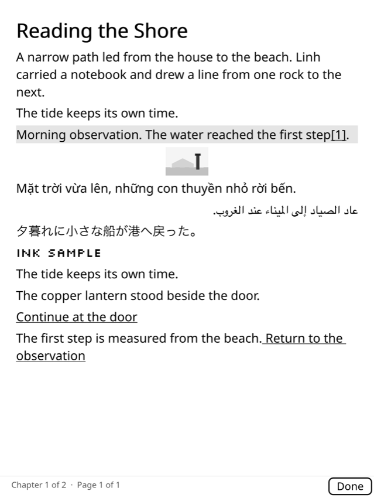

# Reader for PrimitiveOS

Reader is a native Rust book and document reader for PrimitiveOS on Kindle.
It uses Parley for reflowable books and Hayro for PDF pages. The reading
workflows and format coverage are being compared with KOReader on the same
Kindle. [EPUB feasibility results](docs/epub-probe-results.md)

## Preview

| Reading | Reading bars |
| --- | --- |
|  |  |

These captures use Reader's Kindle interface in the desktop simulator.

## Reading on Kindle

- Open a document from Reader's library or use Continue Reading to return to
  the saved passage.
- Tap near the upper center of a page to reveal the reading bars. The bottom
  bar opens Contents, Bookmarks, Highlights, Find, Text and Go to. The top
  bar opens Library, saves a bookmark, or exits Reader. Tap the page to hide
  the bars. Done is also available from the reading view.
- Use the Kindle's page buttons, tap the outer thirds of the page, or swipe.
  Text settings switch between paged and continuous reading.
- Hold a word to select it, then tap another word to extend the selection.
  Add a highlight or note, or look up a word in an installed offline dictionary.

## Development status

| Format | Current implementation |
| --- | --- |
| EPUB 2 and EPUB 3 reflow | Publisher navigation, local links, saved text positions, per-book typography, bookmarks, search and notes |
| Fixed-layout EPUB 3 | Static XHTML pages, contents, zoom and rotation |
| PDF | Fixed pages, local outlines and links, bookmarks, passwords, page jumps, fit page or width, manual and automatic crop, zoom, pan and rotation. Embedded text supports search, selection, highlights and notes. |
| DjVu | Fixed pages, crop, and existing embedded text with search and annotations |
| CBZ, JPEG and PNG | Natural comic page order, selectable reading direction for comics, and the fixed-page reading controls |
| TXT, HTML/XHTML, Markdown and FB2 | Shared text search and reading positions. FB2 preserves section navigation and supported embedded images, including ZIP and gzip packages. Markdown builds a contents list from headings. |
| Legacy MOBI and PalmDOC | Unencrypted text and metadata from supported legacy files |
| StarDict | Local dictionaries in `reader/data/dictionaries/`, including gzip indexes and indexed dictzip data |

In Library, open Reading data to export or preview and restore a local backup
of progress, settings, bookmarks and annotations.
Highlights can also import KOReader JSON annotations for the open reflowable
book. Reader previews uniquely matched quotations and reports unresolved
entries before applying the import. [KOReader JSON exporter](https://github.com/koreader/koreader/blob/042d9b39d4835408121970229cc37624e4f794bc/plugins/exporter.koplugin/target/json.lua)

The formats and workflows above are development features. The
[reading parity plan](docs/reading-parity-plan.md) lists the remaining work and
the acceptance checks for each feature. See [packaging instructions](INSTALL.md)
for a local ARMHF build.

## Design documents

| Document | Contents |
|---|---|
| [System architecture](docs/architecture.md) | Rendering, document positions, persistence, and Kindle integration |
| [Requirements and KOReader parity](docs/requirements.md) | Kindle workflows, parity scope, and acceptance criteria |
| [Execution plan](docs/execution-plan.md) | EPUB feasibility experiments, device verification, and release milestones |
| [Reading parity plan](docs/reading-parity-plan.md) | Feature-by-feature Kindle implementation and acceptance checks |
| [EPUB probe](docs/epub-probe.md) | Commands for comparing the two renderers on desktop and Kindle |
| [EPUB feasibility results](docs/epub-probe-results.md) | Oasis 3 measurements, current engine choice, and remaining validation |

## Licence

Project-owned software uses [PolyForm Noncommercial 1.0.0](LICENSE). Project-owned
documentation and artwork use [CC BY-NC-SA 4.0](LICENSE-DOCS). Third-party
dependencies retain their own terms.
