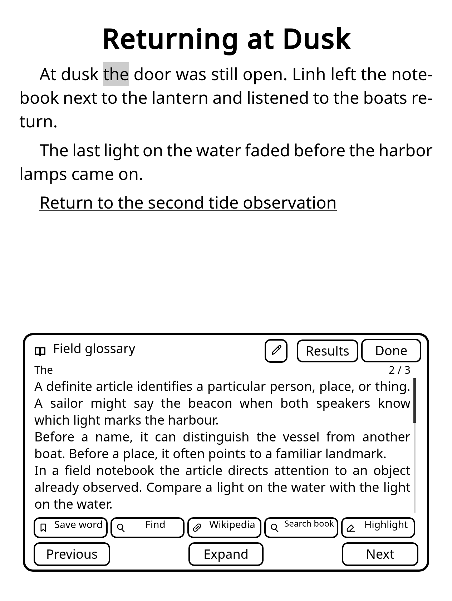

# Reader

**A native reader for books and documents on Kindle.**

[**Download**](https://github.com/PrimitiveOS/kindle-primitive-reader/releases/latest) ·
[**Install guide**](INSTALL.md)

---

Reader is a native Rust book and document reader for PrimitiveOS on Kindle.
It uses Parley for reflowable books and Hayro for PDF pages. The reading
workflows and format coverage are being compared with KOReader on the same
Kindle. [EPUB feasibility results](docs/epub-probe-results.md)

At fit page, Reader can decode large print-color PDF photographs at the resolution needed for the Kindle screen. Zoom selects the resolution again to preserve detail. [PDF image rendering](docs/print-image-decoding.md)

## Preview

| Documents | Reading | Reading bars | Dictionary |
| --- | --- | --- | --- |
|  |  |  |  |

These captures use Reader's Kindle interface in the desktop simulator. The [current desktop workflow review](docs/simulation-review.md) records the combined tests, updated reading controls and pending Kindle checks.
[Top navigation](docs/screenshots/navigation.png) · [Bottom page settings](docs/screenshots/page-settings.png) · [Selection popup](docs/screenshots/selection.png)

When you long-press an inflected English word, Reader looks up its base form in each enabled dictionary. If the spelling and word forms have no entry, the popup suggests nearby spellings. You can close the popup while the search runs. Set the library or book preference in Dictionaries. [Dictionary popup and settings](docs/dictionary-word-forms.md)

**Text › Spacing › Word expansion** redistributes part of the space on a justified line into the words. [Word expansion](docs/word-expansion.md)

At the end of a book, Reader can show actions, mark the book as finished, open the next readable file or return to Library. [End-of-book actions](docs/document-end.md)

Choose when Reader saves your position, bookmarks and notes, or save them immediately from the reading tools. [Save reading data](docs/metadata-save.md)

Browse page bookmarks, highlights and notes across books from **Library › Bookmark browser**. Choose History, collections, selected books, archived records or a folder. Select books by author, series, language or keyword, and inspect available covers and descriptions. Preview a mark, then tap **View in book** to open its passage. [Bookmark browser](docs/bookmark-browser.md)

Open **Tools › Reading statistics** for daily reading history, a month calendar and hourly day timelines. Older screen-time totals remain explicitly undated. [Reading statistics and limits](docs/reading-statistics.md)

Publisher numeric references for quotation marks and dashes follow CREngine's compatibility table while preserving older saved positions. [Numeric character references](docs/numeric-character-references.md)

EPUB chapters can start a section on a fresh page and keep a heading with its opening paragraph when the publisher requests it. [Publisher page breaks](docs/publisher-page-breaks.md)

Use **Navigation › Custom hidden flows** to skip long notes or other source ranges while keeping links and explicit jumps available. Boundaries follow source locations when typography changes. [Controls, screenshots and comparison](docs/custom-hidden-flows.md)

In fixed-page books, Book map shows where you are and where you saved bookmarks and highlights. Open a group to see individual pages. [Book map on the Oasis display](docs/screenshots/fixed-book-map.png)

Preview a saved KOReader position before applying it, or extend a saved passage while keeping its note. [Position preview](docs/screenshots/koreader-position-preview.png) · [Extend an EPUB highlight](docs/screenshots/extend-epub-highlight.png) · [Extend a PDF highlight](docs/screenshots/extend-pdf-highlight.png)

Tap a PDF web link to inspect its address over the current page. **Copy** makes it available in Reader’s search and note fields for this session. **QR code** lets you scan it with another device. [Address preview](docs/screenshots/pdf-link-address.png) · [QR display](docs/screenshots/pdf-link-code.png)

**Controls › Reading status bar › Overlap status bar** lets books, PDFs and comics fill the screen. Tap **Status** to reveal progress over the same page. [Status bar settings and screenshots](docs/status-bar-overlap.md)

Publisher styling can keep a paragraph’s first or last lines together at a page break. [Paragraph settings and two-page comparison](docs/paragraph-ends.md)

Use **Settings › Highlight style** to set how new passages appear. Tap a saved highlight and choose **Style** under its actions to change that passage. [Four highlight styles on a reading page](docs/highlight-drawing-styles.md) · [Named colors and margin note markers](docs/highlight-colors-and-note-markers.md)

Tap a saved passage to read its note. When marks overlap, Reader shows the matching passages so you can choose one. In **Find**, the arrows start at your current passage. [Overlapping highlights](docs/screenshots/overlapping-highlights.png) · [Note on the page](docs/screenshots/tapped-note.png) · [Find from this passage](docs/screenshots/nearby-find.png)

Read with publisher fonts on supported Kindle editions, or find the previous or next matching page directly from the current PDF or DjVu view. [Embedded font support](docs/kf8-publication-fonts.md) · [Fixed-page search](docs/fixed-page-search.md)

The upper **Tools** menu includes **Read timer** for a countdown or a local clock alarm. You can repeat an interval or dismiss the message and return to the same passage. [Read timer controls](docs/read-timer.md)

The reading footer can estimate how long the current chapter or book will take. Superscripts and subscripts follow the publisher's text, keeping footnotes and formulas legible. [Reading time](docs/reading-time-estimates.md) · [Sample reading page](docs/screenshots/inline-scripts.png)

Browse configured online book catalogs from **Library › Online catalogs**. Choose a publication format and a destination in Documents, then keep the completed book for offline reading. The development candidate supports OPDS Atom/JSON and direct calibre Content server acquisition. [Protocols, controls and verification](docs/opds-acquisition.md)

## Reading on Kindle

Install Reader from PrimitiveOS Store or follow the manual install guide.
[Release downloads](https://github.com/PrimitiveOS/kindle-primitive-reader/releases) · [Install guide](INSTALL.md)

- Browse Documents one folder at a time. Rows show a folder or file icon and
  each file's type and size. Reader labels unsupported types, oversized files and
  protected AZW books in the list. A damaged book can report an error when opened.
  Use **Up** to return to the parent folder, or **Find** to search all Documents.
  **Continue reading** on the Documents screen returns to your saved passage.
  Inside an extracted `.epub` folder, **Read this book** opens the publication.
  Choosing one of its XHTML chapters opens that chapter with its illustrations and links.
- Tap the upper center of the page to show the reading bars. For the upper menu
  alone, use the default downward swipe just below Launcher’s system gesture area.
  Reading controls can set this gesture to open both bars. Start at the
  left, center, or right to open Navigation, the last-used tab, or Library. Navigation has
  contents, bookmarks, location history, a book map, page previews, and
  automatic page turns. Search has full-text and bookmark search, recent
  queries, a typed dictionary lookup, and [vocabulary review](docs/vocabulary-review.md)
  with reading context, due dates and per-word undo.
- Swipe up from the bottom edge to reopen the last formatting panel for the
  current format. Text controls include font size, line and word spacing,
  [CJK character width](docs/cjk-width.md),
  [independent page margins](docs/reflow-page-margins.md), facing pages,
  [numeric contrast and weight](docs/font-contrast-and-weight.md), screen settings, and font profiles. Fixed-page
  controls include fit, zoom, rotation, scroll mode, and available scan tools.
  Make adjustments with the page visible. Tap the upper center to show both
  bars. Tap the page to dismiss them. **Exit** returns to Launcher.
- Use the Kindle's page buttons, tap the outer thirds of the page, or swipe.
  Text settings switch between paged and continuous reading in horizontal EPUBs.
  Supported `vertical-rl` chapters use right-to-left columns and page turns.
- Controls offers a full E Ink refresh every page, every five pages, or every
  ten pages in paged reading. Default uses the normal refresh behavior.
- Tap Pages on the reading bar to browse thumbnails across EPUB chapters or
  a fixed-page document. Open a preview and return with Previous location.
- Open **Contents** from either reading bar. For EPUBs that omit their main table of
  contents, Reader can show the publisher's landmarks or printed page numbers.
  Choose **Generated outline** to browse book headings or chapter starts.
  [Landmark navigation and screenshot](docs/epub-landmarks.md)
- Long-press a framed panel in a single-page comic view to inspect it at a
  larger size. Done returns to the same page and zoom.
- At the end of a comic, Next comic opens the following archive in the same
  folder in natural filename order.
- Open a protected PDF with its document or owner password. Reader remembers
  your reading position and asks for the password again when you reopen the book.
  [Supported PDF encryption and password prompt](docs/protected-pdf.md)
- In a PDF or DjVu, search forward or backward from the visible page. **From start** and **From end** jump to the first earlier or last later match. Reader highlights each matching word and can return to the original viewport. **Find all** lists up to 5,000 occurrences, with page buttons and first/last shortcuts. [Fixed-page search](docs/fixed-page-search.md)
- In **Find all**, matching words appear in bold. Hold a result for its page and chapter path, then dismiss it with a tap or page button to return to the same row. [Result list and context preview](docs/search-result-context.md)
- Open **Search › Find bookmarks**, or **Bookmarks › Find bookmarks** on the lower bar, to search page marks, highlighted passages and notes. Select the categories you want and switch on **Case sensitive** for an exact-case match. A result opens its passage in an EPUB or PDF.
- Hold a word to select it, then tap another word to extend the selection. Tap **Find** to search for the selected words throughout the book. A long selection opens an editable search excerpt.
  Use the selection popup to add a highlight or note, or look up a word in an
  installed offline dictionary.
  Definitions open over the current page, away from the selected words when
  space allows. Tap **Results** to choose a headword and dictionary. Swipe up
  to read more of an entry or sideways to switch results. **Find** jumps to
  matching text in the current definition. Hold a word inside a definition
  for another lookup. **Back** retraces the lookups and **Done** returns to
  the selected passage. **Wikipedia** previews the current headword before
  sending a request. Choose a preferred installed dictionary under Controls.
  [Result chooser](docs/screenshots/dictionary-sources.png) · [Find in a definition](docs/screenshots/dictionary-find.png) · [Nested lookup](docs/screenshots/dictionary-nested.png)
- **Wikipedia and translation** open over the selected passage. Search also includes
  typed Wikipedia topics, online lookup history and Translate page for selectable
  documents. The sheet previews the text and names the provider. Tap Search or
  Translate to send it. Choose the Wikipedia edition or translation languages
  before sending. Google Translate supports automatic source detection. MyMemory
  requires a source and target language. Cancel returns to the book.
  Wikipedia shows ranked introductions, the full article when available and
  paged text. Both providers can limit requests. Reader sends a request to the
  provider you choose. Online history lets you clear saved queries and switch
  recording off.
- Hold a local EPUB illustration to open it for zoom and pan. Done returns
  to the same passage.
- Search with or without case matching. **Ignore accents** finds a word such as
  *café* when you type *cafe*, and highlights its original spelling. Title and filename search also covers
  authors cached as books are opened.
- Hold a book in Library to set its reading status, add it to Favorites, or
  organize it into collections. Create collections from **Organize**.
  Book details shows available EPUB series information, the cover preview, and
  local time spent on the reading screen.
- Open **Settings** on the top bar to change the interface palette and portrait
  orientation, adjust supported frontlight and warmth, refresh the screen,
  switch the status display, or configure touch. Swipe horizontally over a
  light control or tap its + and − buttons to adjust it. Locking touch keeps
  physical page buttons and Done available.
- Copy a TTF or OTF of up to 12 MB to `reader/data/fonts/`. Pick it from Text ›
  Reading font. Use the font override in Text settings to apply the reading font
  when the book specifies its own fonts.
- Text › Hyphenation offers Automatic, Authored and Off. In horizontal text,
  Automatic uses the book’s US or British English spelling, including local
  language changes. Search and selection keep the original word across lines.
  In Text › Style, turn on Custom rules to edit a selected word’s breaks for
  its language. Long-press the word and tap Hyphenate.
  [Compare both page layouts](docs/english-hyphenation.md) · [Word break editor](docs/screenshots/custom-hyphenation.png)
- Save a named preset in Text › Reading profiles and apply it to another book.

Open Contents from either reading bar to see your current section in a long EPUB or PDF. Following a PDF link with an authored position brings that point into view when zoomed. [Current section](docs/screenshots/current-contents.png) · [PDF link target](docs/screenshots/pdf-link-destination.png)

Numbered and bulleted lists preserve their markers and nesting. In supported EPUB and Kindle tables, text stays under its column heading as the type size changes. Links, selection and bookmarks use the same source positions in both layouts. [List example](docs/screenshots/publisher-lists.png) · [Table example](docs/screenshots/publisher-table.png)

## Development status

The [KOReader controls checklist](docs/koreader-controls-parity.md) traces
Reader's controls to the KOReader v2026.07.1 source and the Oasis captures.

Reader 0.1.0 passed 249 ARMHF tests on a Kindle Oasis 3 running firmware 5.18.2.
An automated session opened Markdown and DOCX from Files 0.1.2, checked page
turns and resume, and returned to Launcher using both exit controls. The
bundled English OCR worker also recognised a grayscale test passage on the
device. [Reading parity and device results](docs/reading-parity-plan.md)

| Format | Current implementation |
| --- | --- |
| EPUB 2 and EPUB 3 reflow | [Publisher page numbers](docs/publisher-page-numbers.md), [character-count pages and per-book defaults](docs/character-count-pages.md), publisher navigation, local links, saved text positions, per-book typography, bookmarks, search and notes. Embedded GIF diagrams retain their intrinsic dimensions and open at full size. Linked static SVG and short horizontal ruby annotations render within documented limits. [GIF illustrations and limits](docs/epub-gif-illustrations.md) |
| Fixed-layout EPUB 3 | Static XHTML and supported SVG spine pages, contents, zoom and rotation. Publisher page progression and facing-page hints control spreads. |
| PDF | Page turns or continuous scrolling, printed page labels, local outlines and links, bookmarks, passwords, page, width and height fit, crop, zoom, pan and rotation. Embedded text supports search, selection, highlights and notes. |
| DjVu | Fixed pages, crop, embedded text with search and annotations, and [publisher contents](docs/djvu-contents.md) with named page destinations |
| CBZ, CBT, CBR, JPEG, PNG, BMP, GIF and portable anymaps | Natural comic page order, single pages or two-page spreads, and selectable reading direction. CBT accepts standard uncompressed USTAR entries. CBR accepts supported single-volume, non-solid RAR4 and RAR5. Animated GIF shows its first frame. Portable anymaps include PBM, PGM, PPM and PAM. |
| SVG | Static geometry and local gradients in standalone files, linked EPUB illustrations, and fixed-layout EPUB pages. |
| JPEG 2000 (.jp2 and .j2k) | Open a grayscale or color still image directly from Library or read it as a comic page. Supports lossless and lossy Part 1 images with up to 16 bits per component. [Simulated Kindle page](docs/screenshots/jpeg2000-beacon.png) |
| WebP and TIFF | Lossy, single-image VP8 WebP. Single-page uncompressed strip-based TIFF with top-left orientation and 1-bit or 8-bit grayscale. |
| TXT, HTML/XHTML, HTMLZ, Markdown and FB2 | Shared text search and reading positions. Single-document HTMLZ archives use local illustrations and stylesheets. FB2 preserves section navigation and supported embedded images, including ZIP and gzip packages. Markdown builds a contents list from headings. |
| MOBI, PalmDOC and AZW3 | DRM-free legacy MOBI with publisher contents, paragraph alignment, HTML font sizes, embedded illustrations and local links, and PalmDOC text. Hybrids open their readable legacy edition and can fall back to supported KF8. Legacy MOBI and reflowable KF8/AZW3 open uncompressed, PalmDOC and HUFF/CDIC text. KF8 supports nested publisher contents with in-chapter destinations, local links, KindleGen stylesheets, JPEG, PNG, first-frame GIF and supported SVG artwork. Large chapters open in bounded sections that retain link destinations. |
| DOCX | Macro-free Strict and Transitional Word documents. Text, headings, basic emphasis, table reading order, and title and author metadata. |
| CHM | Static help topics in single archives, with nested contents, headings, links and local JPEG or PNG illustrations. |
| RTF and TCR | RTF preserves paragraphs and basic character styling. TCR opens bounded 8-bit dictionary-compressed text in the reflow reader. |
| StarDict | Reader discovers existing dictionaries in `koreader/data/dict/` and `koreader/data/dict_ext/` alongside `reader/data/dictionaries/`. Select a word to see its offline definitions. In reading settings, choose the default sources and their order, or prefer dictionaries for one book. Gzip indexes, indexed dictzip data and synonym entries are supported. [Offline dictionaries](docs/shared-dictionaries.md) |

In Library, open Reading data to export or preview and restore a local backup
of progress, per-book settings, bookmarks and annotations.
Choose **Reading data › Export highlights** to collect quotations and notes from
History, selected books or collections. Export KOReader JSON, text, Markdown or
HTML with source locations and saved creation times. [Library exports](docs/library-highlights-export.md)
From Highlights, export quotations and notes as text, Markdown or HTML. Reader
can import visible embedded highlights from supported unencrypted PDFs up to
16 MiB and save a separate annotated PDF with the original annotations intact.
Use Go to with a physical page number, a printed PDF or EPUB label, or a document percentage
such as `75%`. When both numbers and labels are numeric, type `label ` before
the printed number. For reflowable books, Reader estimates the whole-book
position from chapter lengths. The Pages grid browses other chapters while
keeping your place until you choose a thumbnail. Use History to return to
an earlier jump.

Find results offer previous and next match controls. Previous location returns
to the passage where you began exploring the results. Use Reading controls to
disable page turn taps while keeping swipes and physical page buttons available.

Use Contrast on the fixed-page reading bar for dim scans.
Columns enlarges each side of a clear two-column PDF or DjVu scan. Use the page
buttons to move between the columns and Done to return to the saved view.
PDF and DjVu can open in a reflowed text view that advances across pages with
embedded or previously recognized text. The OCR build bundles English and can
use additional locally installed Tesseract models to recognize scans.
Reflow scan uses the original word images from a page after OCR and supports
horizontal left-to-right text. [Offline OCR build](docs/ocr-build.md)

Highlights can also import KOReader JSON annotations for the open reflowable
book. Reader previews uniquely matched quotations and reports unresolved
entries before applying the import. [KOReader JSON exporter](https://github.com/koreader/koreader/blob/042d9b39d4835408121970229cc37624e4f794bc/plugins/exporter.koplugin/target/json.lua)

To bring in marks kept beside an EPUB, open **Highlights › Import marks saved beside this book**. Reader previews the bookmarks and exact highlighted passages it can locate in this edition. Review them and tap **Add matched marks**. Repeating the import keeps a single copy. If a saved highlight points to different text, it counts as unavailable. [Annotation preview](docs/screenshots/koreader-mark-preview.png)

Open a book and choose **Controls › Import KOReader position**. Reader looks for KOReader’s metadata beside the book. For example, `Harbor.epub` uses `Harbor.sdr/metadata.epub.lua`. Preview the destination and choose **Apply reading position** to move there. Reader checks the edition fingerprint and leaves KOReader’s data in place. For metadata kept elsewhere, copy it to `reader/data/koreader-progress.lua` and choose **Reading data › Import a copied KOReader position**. Fixed-page imports also check the page count. For reflowable EPUBs, Reader understands supported EPUB CFIs and normalized CREngine positions saved with DOM version 20240114. [Verified EPUB imports](docs/real-document-verification.md#restoring-koreader-epub-positions)

To extend a saved highlight, open it in **Highlights**, select **Extend highlight**, turn to the other end of the passage, and tap a word. **Apply** saves the expanded highlight with its note. **Cancel** returns to the original selection. Text selections can cross chapters. In supported fixed-page books they can cross pages with selectable text.

The formats and workflows above are development features. The
[reading parity plan](docs/reading-parity-plan.md) lists the remaining work and
the acceptance checks for each feature. See [packaging instructions](INSTALL.md)
for a local ARMHF build.

## Reading controls

| Reading task | How it works |
| --- | --- |
| Preview an EPUB footnote | In the top Navigation panel, turn on **Footnote previews** and tap a note reference. Hold a word for its definition, close the note to keep reading, or choose **Open in book** and use **Previous location** to return. [Footnote preview](docs/screenshots/footnote-preview.png) |
| Track progress | Tap the footer for progress or time left in the chapter or book. Hold it to skim and return to your place. [Reading-time estimates](docs/reading-time-estimates.md) · [Footer screenshot](docs/screenshots/reading-footer.png) |
| Customize touch | Assign an action to a corner tap, hold or edge swipe in Reading gestures. [Gesture grid](docs/screenshots/reading-gestures.png) |
| Edit the outline | Add a named entry at a reading location and jump back from Contents. [Custom contents](docs/screenshots/custom-contents.png) |
| Read a scan | Straighten a tilted PDF or DjVu page. Run offline OCR when the embedded text is missing or inaccurate. [Scan controls](docs/scan-controls.md) |
| Look up a passage | Open a dictionary, Wikipedia or translation from the selection sheet. Online lookup requires choosing a provider action. [Lookup controls and privacy](docs/online-lookups.md) |

## Design documents

| Document | Contents |
|---|---|
| [System architecture](docs/architecture.md) | Rendering, document positions, persistence, and Kindle integration |
| [Requirements and KOReader parity](docs/requirements.md) | Kindle workflows, parity scope, and acceptance criteria |
| [Execution plan](docs/execution-plan.md) | EPUB feasibility experiments, device verification, and release milestones |
| [Reading parity plan](docs/reading-parity-plan.md) | Feature-by-feature Kindle implementation and acceptance checks |
| [EPUB probe](docs/epub-probe.md) | Commands for comparing the two renderers on desktop and Kindle |
| [EPUB feasibility results](docs/epub-probe-results.md) | Oasis 3 measurements, current engine choice, and remaining validation |

## Downloads

The badge at the top shows the number of Store downloads. It counts GitHub downloads of this app's release packages, across all versions and architectures, and is refreshed daily from the [Store catalog](https://primitiveos.github.io/kindle-primitive-catalog/v1/index.json).

## Licence

Project-owned software uses [PolyForm Noncommercial 1.0.0](LICENSE). Project-owned
documentation and artwork use [CC BY-NC-SA 4.0](LICENSE-DOCS). Third-party
dependencies retain their own terms.
