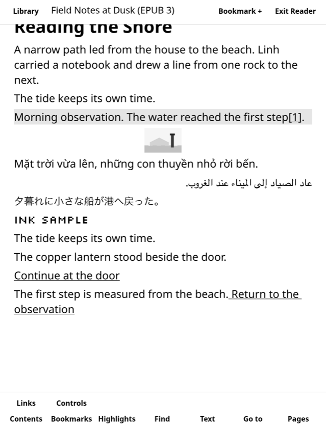

# Reader for PrimitiveOS

Reader is a native Rust book and document reader for PrimitiveOS on Kindle.
It uses Parley for reflowable books and Hayro for PDF pages. The reading
workflows and format coverage are being compared with KOReader on the same
Kindle. [EPUB feasibility results](docs/epub-probe-results.md)

## Preview

| Reading | Reading bars |
| --- | --- |
|  |  |

These captures use Reader's Kindle interface in the desktop simulator.

## Reading on Kindle

- Open a document from Reader's library or use Continue Reading to return to
  the saved passage.
- Tap near the upper center of a page to reveal the reading bars. The bottom
  bar opens Contents, Bookmarks, Highlights, Find, Text and Go to. The top
  bar opens Library, saves a bookmark, or exits Reader. Tap the page to hide
  the bars. Done is also available from the reading view.
- Use the Kindle's page buttons, tap the outer thirds of the page, or swipe.
  Text settings switch between paged and continuous reading.
- Tap Pages on the reading bar to preview pages in the current EPUB chapter
  or fixed-page document. Open a preview and return with Previous location.
- Hold a word to select it, then tap another word to extend the selection.
  Add a highlight or note, or look up a word in an installed offline dictionary.
- Hold a local EPUB illustration to open it for zoom and pan. Done returns
  to the same passage.
- Search with or without case matching. Title and filename search also covers
  authors cached as books are opened.
- Hold a book in Library to set its reading status, add it to Favorites, or
  organize it into collections. Create collections from Organize library.
  Book details also shows local time spent on the reading screen.
- Open Controls on the reading bar to invert page colors, mirror touch zones,
  enlarge the toolbar, or lock page touch while keeping physical buttons and Done.
- Copy a TTF or OTF of up to 12 MB to `reader/data/fonts/`. Pick it from Text ›
  Reading font. Use the font override in Text settings to apply the reading font
  when the book specifies its own fonts.
- Save a named preset in Text › Reading profiles and apply it to another book.

## Development status

| Format | Current implementation |
| --- | --- |
| EPUB 2 and EPUB 3 reflow | Publisher navigation, local links, saved text positions, per-book typography, bookmarks, search and notes |
| Fixed-layout EPUB 3 | Static XHTML pages, contents, zoom and rotation |
| PDF | Page turns or continuous scrolling, printed page labels, local outlines and links, bookmarks, passwords, page, width and height fit, crop, zoom, pan and rotation. Embedded text supports search, selection, highlights and notes. |
| DjVu | Fixed pages, crop, and embedded text with search and annotations |
| CBZ, CBT, JPEG, PNG, BMP, GIF and portable anymaps | Natural comic page order, single pages or two-page spreads, and selectable reading direction. CBT accepts standard uncompressed USTAR entries. Animated GIF shows its first frame. Portable anymaps include PBM, PGM, PPM and PAM. |
| TXT, HTML/XHTML, HTMLZ, Markdown and FB2 | Shared text search and reading positions. Single-document HTMLZ archives use local illustrations and stylesheets. FB2 preserves section navigation and supported embedded images, including ZIP and gzip packages. Markdown builds a contents list from headings. |
| Legacy MOBI and PalmDOC | Unencrypted text and metadata from supported legacy files |
| RTF and TCR | RTF preserves paragraphs and basic character styling. TCR opens bounded 8-bit dictionary-compressed text in the reflow reader. |
| StarDict | Local dictionaries in `reader/data/dictionaries/`, including gzip indexes and indexed dictzip data |

In Library, open Reading data to export or preview and restore a local backup
of progress, settings, bookmarks and annotations.
From Highlights, export quotations and notes as text, Markdown or HTML. Reader
can import visible embedded highlights from supported unencrypted PDFs up to
16 MiB and save a separate annotated PDF with the original annotations intact.
Use Go to with a physical page number, a printed label, or a document percentage
such as `75%`. When both numbers and labels are numeric, type `label ` before
the printed number. The percentage in a reflowable book refers to the current
chapter. Use Contrast on the fixed-page reading bar for dim scans.
Columns enlarges each side of a clear two-column PDF or DjVu scan. Use the page
buttons to move between the columns and Done to return to the saved view.
PDF and DjVu can open in a reflowed text view that advances across pages with
embedded or previously recognized text. The OCR build bundles English and can
use additional locally installed Tesseract models to recognize scans. [Offline OCR build](docs/ocr-build.md)
Highlights can also import KOReader JSON annotations for the open reflowable
book. Reader previews uniquely matched quotations and reports unresolved
entries before applying the import. [KOReader JSON exporter](https://github.com/koreader/koreader/blob/042d9b39d4835408121970229cc37624e4f794bc/plugins/exporter.koplugin/target/json.lua)

For fixed-page KOReader progress, copy the book's `metadata.<format>.lua`
to `reader/data/koreader-progress.lua`. Open the matching document, then choose
Controls › Import KOReader position. Reader checks KOReader's sampled fingerprint
and the source page count and previews the destination before applying it.
Reflowable KOReader locations can be previewed with their saved percentage when
available. Mapping those locations to passages remains open.

The formats and workflows above are development features. The
[reading parity plan](docs/reading-parity-plan.md) lists the remaining work and
the acceptance checks for each feature. See [packaging instructions](INSTALL.md)
for a local ARMHF build.

## Design documents

| Document | Contents |
|---|---|
| [System architecture](docs/architecture.md) | Rendering, document positions, persistence, and Kindle integration |
| [Requirements and KOReader parity](docs/requirements.md) | Kindle workflows, parity scope, and acceptance criteria |
| [Execution plan](docs/execution-plan.md) | EPUB feasibility experiments, device verification, and release milestones |
| [Reading parity plan](docs/reading-parity-plan.md) | Feature-by-feature Kindle implementation and acceptance checks |
| [EPUB probe](docs/epub-probe.md) | Commands for comparing the two renderers on desktop and Kindle |
| [EPUB feasibility results](docs/epub-probe-results.md) | Oasis 3 measurements, current engine choice, and remaining validation |

## Licence

Project-owned software uses [PolyForm Noncommercial 1.0.0](LICENSE). Project-owned
documentation and artwork use [CC BY-NC-SA 4.0](LICENSE-DOCS). Third-party
dependencies retain their own terms.
