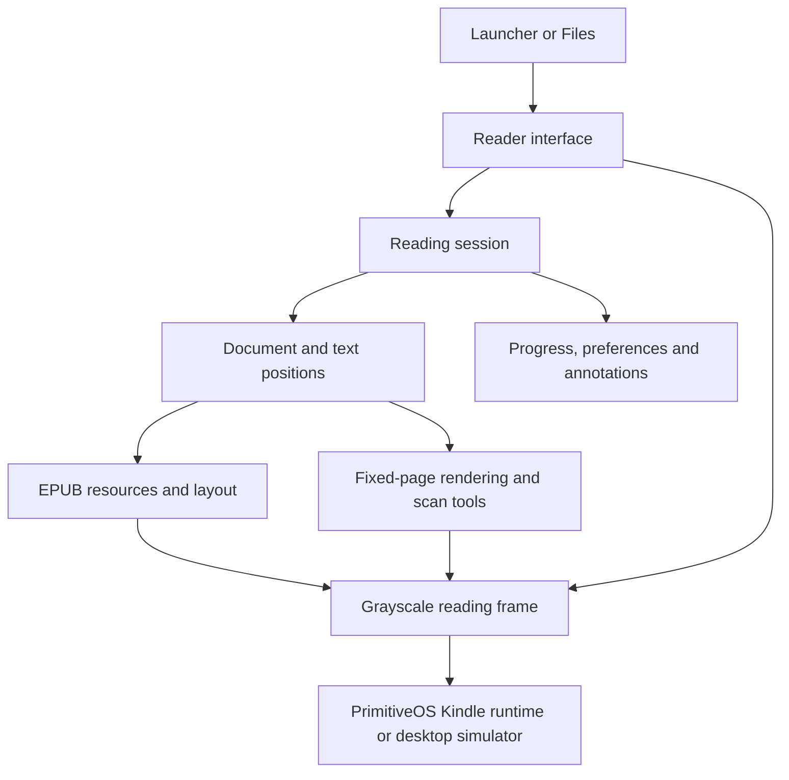

# Reader system architecture

Reader is a standalone, offline-first Rust app for PrimitiveOS. The first hardware
target is the ARMHF Kindle Oasis 3 running firmware 5.18.2. The desktop simulator
and the Kindle build exercise the same document, layout, and reading-state
logic. The [Oasis 3 measurements](epub-probe-results.md) selected Parley with
direct grayscale drawing as the EPUB engine. The optional Blitz probe
provides a comparison for publisher styling and rendering quality. The
[requirements](requirements.md) define the Kindle workflows this architecture
must support.

## Application and platform

| Area | Responsibility |
|---|---|
| Reader interface | Library and Continue Reading, nearly full-screen reading, tap-to-show controls, navigation, and selection |
| Reading session | Current book, position, and layout settings. Touch and physical buttons resolve to the same reading actions. |
| Document and rendering | Publication metadata, resource access, table of contents, text selection, and pagination. Reflowable EPUB and fixed-page documents have format-specific layout paths. |
| Persistence | Versioned per-book state, reading history, and annotations in Reader-owned storage |
| Runtime | Shared `primitive-app` lifecycle, storage leases, input, rendering, and device profiles. A desktop driver sends the same actions and captures frames. |

The engines run in the simulator and native test harness without a Kindle
display. The PDF path uses Hayro for rasterization. Reader's standalone
package uses the existing Launcher entry point and supervised `--open`
handoff from Files.
[PrimitiveOS Tools](https://github.com/PrimitiveOS/kindle-primtitive-tools) ·
[Viewer](https://github.com/PrimitiveOS/kindle-primitive-viewer) ·
[Files](https://github.com/PrimitiveOS/kindle-primitive-files)

## EPUB resources and layout

1. Read the EPUB package and resolve the manifest, spine reading order, and
   navigation document. Associate resource references and fragments with their
   source content document.
2. Load the active content document and its local styles, fonts, and images under
   bounded resource limits. Limit decompressed data, decoded image sizes, and
   retained chapter data. Keep book processing offline and disable scripting.
3. Apply publisher styles and reader preferences, shape text with font fallback,
   and paginate for the viewport. Retain the relationship between rendered lines
   and their source text ranges so taps and selections can resolve to the book.
4. Paint the visible page in grayscale. Use a bounded cache for adjacent pages,
   prioritize the current frame, and discard stale pagination after a layout
   change. Tune cache limits with device measurements.

Use EPUB 2 and 3 fixtures to validate the package reader. The first gate focuses on
reflowable, DRM-free EPUB on a Kindle-sized viewport. Candidate renderers are the
Browser's offline HTML and CSS path and a smaller book layout path using Parley for
text shaping and line layout. Both need book pagination and a mapping back to
source text. Test publisher styling, complex scripts, illustrations, and long
chapters before picking the implementation.
[EPUB 3.3](https://www.w3.org/TR/epub-33/) ·
[EPUB Reading Systems 3.3](https://www.w3.org/TR/epub-rs-33/) ·
[Browser architecture](https://github.com/PrimitiveOS/kindle-primitive-browser/blob/main/docs/02-architecture.md) ·
[Parley](https://github.com/linebender/parley)

## Reading positions and storage

- Identify a publication and its content revision independently of the currently
  rendered page. Record a position as a spine item and a stable document text
  location within that item. Store text context with bookmarks and annotations
  to assist recovery when content changes. Define how ranges and offsets are
  encoded before persisting them.
- Derive visual page numbers from the current pagination. After a font, margin,
  or orientation change, resolve the saved position and render the page
  containing it. Use the same location model for search hits, annotations, and
  navigation history. Keep fixed-page coordinates as a separate position type.
- Save state atomically using the shared storage lease. Close document and
  resource handles when USB exports the user volume, pause file access, and
  revalidate the current document on return. Handle a removed or changed file
  with an actionable notice and recover any saved state that still resolves.
- Keep live reading records in the library. The optional book metadata
  archive writes a versioned record to a chosen Documents folder on book
  close or deletion. Restore verifies the edition and saves its live record
  before consuming the matching snapshot. [Book metadata archive](book-metadata-archive.md)
- Treat KOReader migration as an explicit, read-only import. Resolve exported
  highlights by uniquely matched quotation. Check fixed-page sidecar progress
  using the sampled fingerprint and page count. Reflowable import verifies
  the fingerprint and maps a supported EPUB CFI or normalized CREngine
  DocFragment pointer to an anchor bound to the original XHTML revision.
  When both resolve, their source anchors must agree. The preview reports
  ambiguous nodes and unsupported DOM versions.
  [KOReader position handling](https://github.com/koreader/koreader/blob/master/frontend/apps/reader/modules/readerrolling.lua)

## Boundaries and dependencies

Reader's interface and code will be developed independently from published
standards, original test fixtures, and observable KOReader workflows. Review
licences and notices for the renderer, fonts, and compiled dependencies before
choosing the engine. Project-owned code and resources follow the repo's
[licence terms](../README.md#licence).
[KOReader licence](https://github.com/koreader/koreader/blob/master/COPYING)
