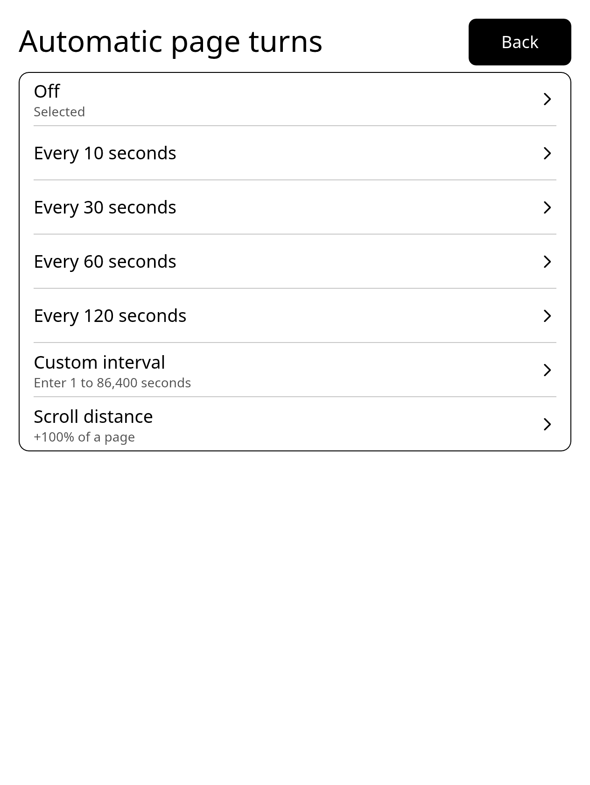
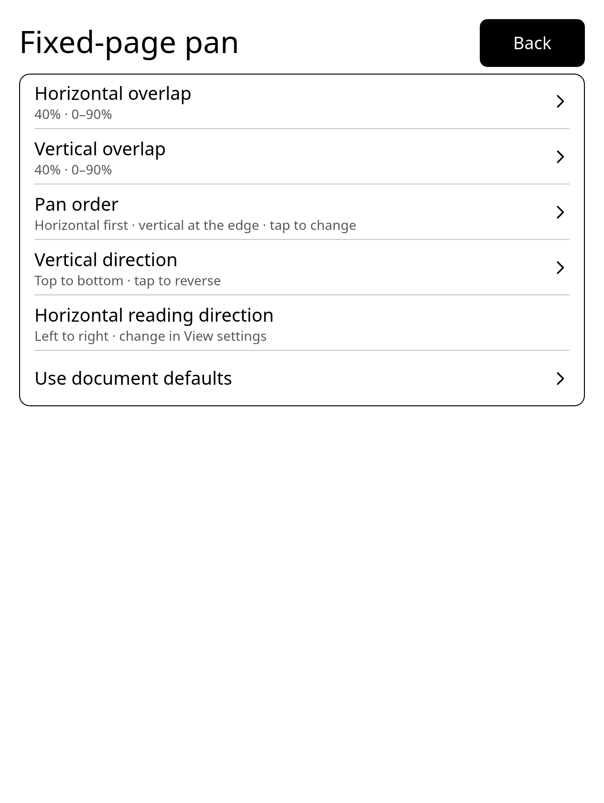
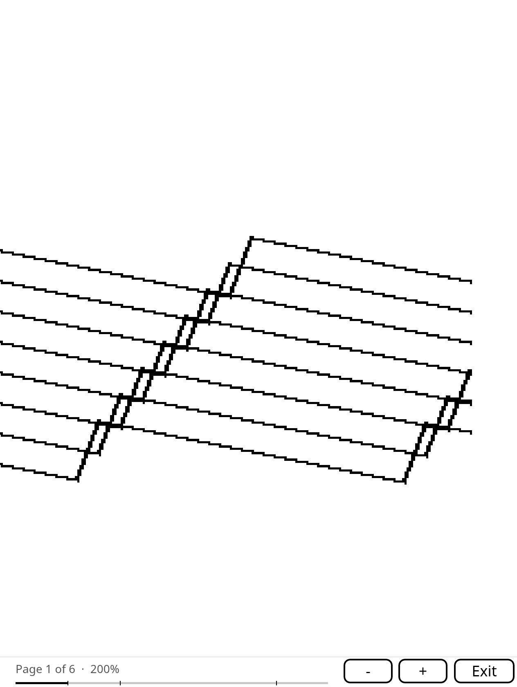

# Automatic page-turn parity

## KOReader reference

Compared against the checked out KOReader `v2026.07.1` source at commit
`9192014d8bd82a91dc1012473be0f238dedfdb54`, specifically
[`autoturn.koplugin/main.lua`](https://github.com/koreader/koreader/blob/v2026.07.1/plugins/autoturn.koplugin/main.lua).
The plug-in stores the timeout, enabled state and movement distance. It starts
its clock on activation, resets the inactivity point on input, and advances one
relative view only when Reader is the top visible widget. It unschedules on
suspend or close and starts a fresh timeout on resume. Its timeout picker accepts
up to one day; a held menu action configures the signed fractional scroll
distance. The setting spans −20.0 to +20.0 page heights, changes in 0.1
increments, and changes in 0.5 increments while held. [The paging module]
(https://github.com/koreader/koreader/blob/v2026.07.1/frontend/apps/reader/modules/readerpaging.lua)
maps this distance to continuous scrolling or relative page movement. Its
fixed-page pan advances by 60% of the visible area using the default 40% zoom
overlap and the configured reading direction. [Zoom overlap and direction
defaults](https://github.com/koreader/koreader/blob/9192014d8bd82a91dc1012473be0f238dedfdb54/frontend/apps/reader/modules/readerzooming.lua#L68-L83) · [Fixed-page movement](https://github.com/koreader/koreader/blob/9192014d8bd82a91dc1012473be0f238dedfdb54/frontend/apps/reader/modules/readerpaging.lua#L957-L1084)

## PrimitiveOS Reader implementation

The Navigation group offers the existing presets (Off, 10, 30, 60 and 120
seconds), a **Custom interval** keyboard entry and a **Scroll distance**
control. Custom intervals accept 1 to 86,400 seconds. Distance moves in 10% or
50% steps within −2,000% to +2,000% of a visible page. Both preferences are
stored in `reading-controls.json` and restored when another book opens or
Reader restarts. **Off** disables automatic turns but keeps the last interval
for the next time they are enabled. User input resets the deadline; a late
scheduler tick performs one movement without catching up. Menus and other
non-reading screens pause the timer, and Kindle Sleep pauses it until Wake.

In continuous EPUB and PDF views, the selected distance moves that fraction of
the content viewport and negative values reverse direction. Paginated EPUB
turns whole pages, rounding any nonzero distance away from zero. Noncontinuous
fixed pages use saved per-book horizontal and vertical overlap settings, each
from 0% through 90%, with the KOReader default of 40%. The fixed-page pan
settings expose horizontal-first or vertical-first traversal and top-to-bottom
or bottom-to-top movement; horizontal reading direction is shared with the
existing View settings. Reading direction determines the starting edge, and
movement changes to the second axis at each row or column edge before turning
the page. Both overlaps and direction persist with the book. **Document
Defaults › Save current** carries them to new fixed-page documents without
copying crop or view offset. This matches the source's separate physical-axis
overlaps and traversal order. [Zoom overlap and direction controls](https://github.com/koreader/koreader/blob/v2026.07.1/frontend/apps/reader/modules/readerzooming.lua#L1788-L1804) · [Axis traversal and direction mapping](https://github.com/koreader/koreader/blob/v2026.07.1/frontend/apps/reader/modules/readerpaging.lua#L3886-L3947)

Physical page buttons and page-turn tap zones on zoomed fixed pages use the same
per-book overlap and axis order. They pan to the next visible region, then the
next row or column, and advance the source page at the edge. Returning across a
page boundary starts from that page's matching edge. Continuous fixed-page
reading retains its normal scroll behavior; spreads retain spread-by-spread
turning. This gives manual and timed turns the same fixed-page reading path.

The interval is global to Reader, as in KOReader. Device-level frontlight,
rotation and sleep behavior remain owned by Primitive Launcher and the app kit.

## Desktop evidence

The functional test `custom_auto_turn_interval_is_validated_saved_and_restored_on_reopen`
exercises the settings row, 1..86,400 validation, persistence, reopening the
book, sleep/wake pause, and return to the last book. A second test exercises the
distance controls and persistence. Focused fixed-page tests cover 0%, 40% and
90% overlap on both screen axes, vertical-first traversal with physical-axis
overlap preserved, bottom-to-top traversal, RTL, signed reversal and page-edge
transitions. Document-default tests cover legacy settings and round-tripping
the new fields. Session tests cover signed fractional EPUB scroll, fixed PDF
scrolling and multi-page movement. The `AutoTurn` unit tests cover activity
resetting the deadline, paused timer behavior, disabling, and a late tick
producing exactly one turn. The simulator functional test captures the
screenshots above. `manual_fixed_page_turns_pan_to_page_edges_before_changing_pages`
checks physical turns in both directions, saved overlap and page-edge
transition; the DjVu app test exercises page-button and tap input paths and
checks return history after resume. After removing the out-of-scope OPDS and remote progress-sync
modules, the desktop gate passes 887 library tests with 61 ignored, the Kindle
binary test, 14 package tests, four layout probes and doc tests. The ARMHF
release binary builds as a static executable with SHA-256
`b7fb46c2acf8f809ccbb058ac728dc0ca7b361bbbac100539db62adb5fcd5223`.
Kindle installation and acceptance for this candidate are still pending.

## Remaining parity work

- Compare the new overlap and traversal controls with KOReader on Kindle, including mixed page shapes and resumed per-book preferences.
- Compare USB handoff and actual sleep/resume timing on the Kindle. This Mac simulator check does not validate physical panel refresh or deep-suspend timing.
- Device acceptance for the current Reader build is pending.
