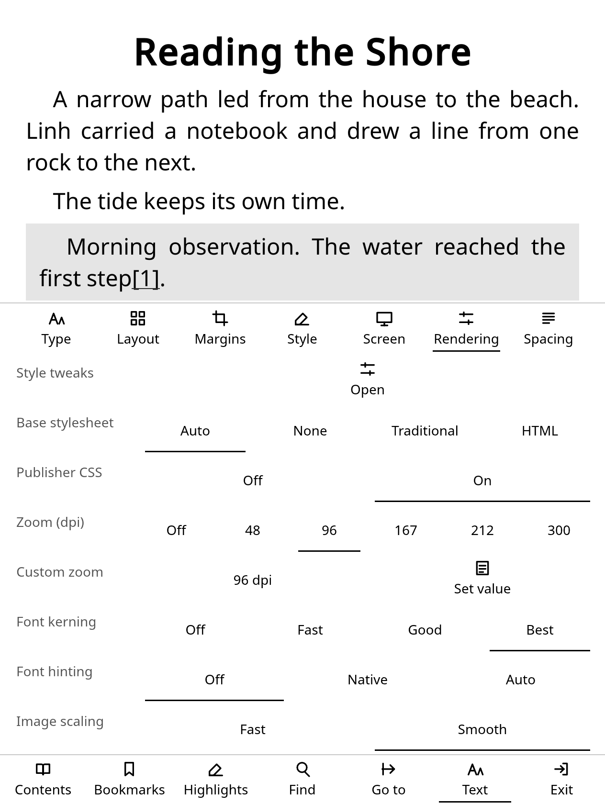

# Base stylesheet choices

Reader's Text → Rendering panel now provides per-book **Auto**, **None**,
**Traditional**, **HTML**, and format-appropriate **FB2** or **FB3** choices. The controls
follow KOReader's selectable base stylesheet workflow in the pinned
[Typeset module](https://github.com/koreader/koreader/blob/9192014d8bd82a91dc1012473be0f238dedfdb54/frontend/apps/reader/modules/readertypeset.lua#L185-L283).
The panel uses native Reader controls and keeps the current document visible.

| Choice | Reader behavior |
| --- | --- |
| Auto | Uses the Traditional subset for EPUB and other reflowable documents; uses the FictionBook subset for FB2, FB3 and plain text, following KOReader's document defaults. |
| None | Adds no Reader base stylesheet rules. Publisher and inline document styling remain available. |
| Traditional | Adds book-like paragraph indentation, justified prose, centered heading sizes, quote spacing and list padding. |
| HTML | Adds a restrained subset of HTML heading sizes, paragraph spacing, blockquotes, figures and preformatted text. |
| FB2 / FB3 | Available for the corresponding FictionBook format and, as FB2, for plain text. Adds FictionBook heading/page-break behavior and semantic styles for poem, stanza, verse, epigraph, citation, annotation and date classes. Both choices use the same FictionBook subset. |

KOReader identifies an FB3 publication as `FictionBook (FB3)` and chooses
`fb2.css` for new FictionBook documents. Reader now applies its FictionBook
subset when FB3 is set to Auto and exposes the same subset as FB3 in the
Rendering bar. Existing explicit stylesheet preferences remain unchanged;
Auto now reflows the same converted FB3 source with the FictionBook subset.
Mac and Kindle verification of the live switch, saved anchor and reopened
preference remains pending.
[Format name](https://github.com/koreader/crengine/blob/b32a88ffbbf505cf2ea5208c1a49002d70d3609f/crengine/src/lvdocview.cpp#L4873-L4875) ·
[Automatic FictionBook stylesheet](https://github.com/koreader/koreader/blob/9192014d8bd82a91dc1012473be0f238dedfdb54/frontend/apps/reader/modules/readertypeset.lua#L98-L106)

The built-in sheets are independently authored native CSS subsets. They are
applied beneath publisher CSS, while inline declarations and publisher
`!important` rules keep their expected higher cascade priority. A base style
does not force unsupported properties into the layout engine. This work does
not bundle KOReader's GPL CSS assets.

The choice is saved with each book's reading preferences. Hold a stylesheet
choice to confirm it as the default for newly opened books. FictionBook (FB2
and FB3) uses its own default, while the other reflowable formats share a
default; holding Auto restores the corresponding format's built-in default.
Existing books retain their saved preferences, and an explicitly saved new-book
profile takes precedence over the global default. The focused suite covers the choice
list, persistence across reopen, automatic selection, the None baseline,
publisher and inline overrides, and FictionBook semantic classes. The
simulator capture shows the controls in context:

The captured frame is 1264 × 1680 pixels. Desktop tests and the screenshot pass;
the Kindle visual comparison remains open. The styles only cover the properties
Reader can currently express. Exact CREngine `epub.css`, `html5.css` and
`fb2.css` fidelity, obsolete legacy stylesheets and stylesheet import/browsing
are not yet implemented. The new default workflow still needs desktop and Kindle
verification.

KOReader source reference: pinned release `v2026.07.1` at commit
`9192014d8bd82a91dc1012473be0f238dedfdb54`. Its format defaults are assigned
in [credocument.lua](https://github.com/koreader/koreader/blob/9192014d8bd82a91dc1012473be0f238dedfdb54/frontend/document/credocument.lua#L160-L168).
