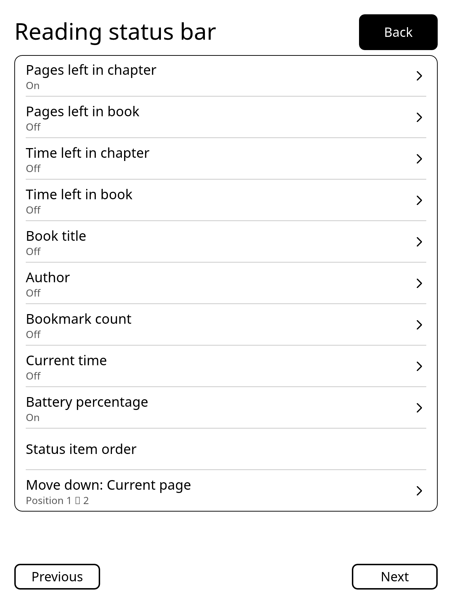

# Battery percentage in the reading footer

The custom reading footer can show the Kindle battery level as `Battery 57%`;
while plugged in it shows `Charging 57%`. Enable **Battery percentage** under
Reading Status Bar → Visible status items. The item is optional and off by
default. Its battery check uses the existing **Auto refresh items** setting;
refresh pauses while the device sleeps and stops when the item is hidden.

The desktop host does not provide Kindle battery state, so the simulator capture
shows the control enabled rather than a fabricated battery value. Formatting
tests cover battery level bounds and charging text. The full desktop suite passes
952 Reader tests (62 ignored), one Kindle binary test, 14 EPUB package tests and
four layout probes. Actual battery data and E Ink appearance still need the
foreground Kindle acceptance run.

This matches KOReader's selectable battery-percentage status item and respects
the Reader/Launcher boundary: it reports state while reading but does not change
device power settings. [Pinned KOReader footer source](https://github.com/koreader/koreader/blob/9192014d8bd82a91dc1012473be0f238dedfdb54/frontend/apps/reader/modules/readerfooter.lua#L1105-L1174)
