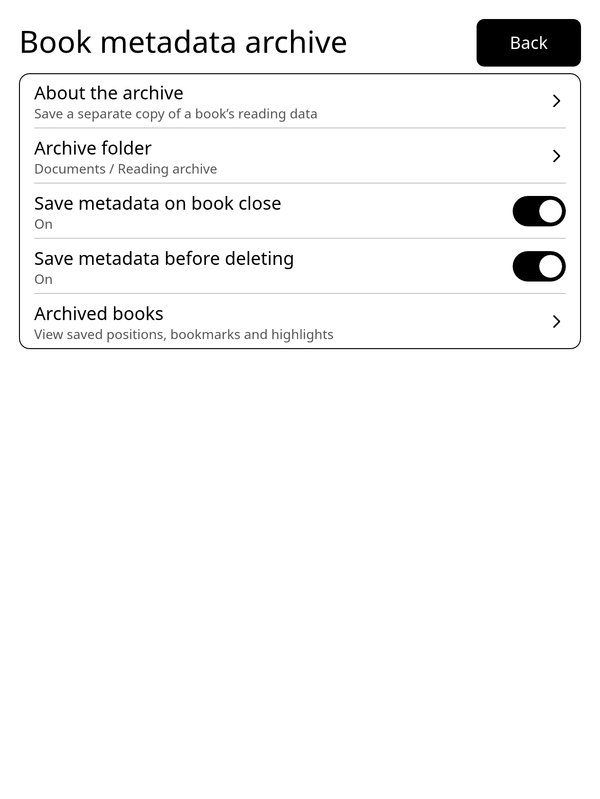
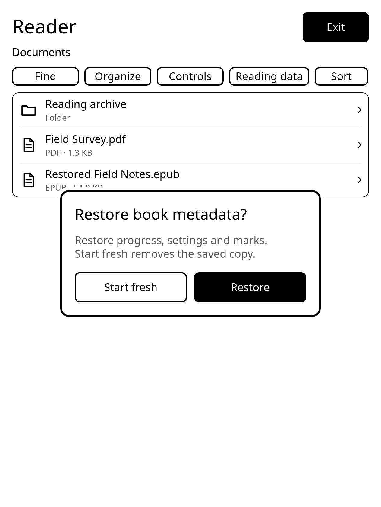

# Book metadata archive

Open **Settings › Book metadata archive** while reading or **Reading data › Book metadata archive** from the Library. Choose an existing folder in Documents. Reader writes `primitive-reader-book-metadata.json` there.



**Save metadata on book close** is off until you enable it. It saves a copy when you exit, return to the Library or successfully switch books. Sleeping or running a manual save writes the normal reading state. **Save metadata before deleting** starts on after you choose a folder. For a deletion from Reader, the archive write must succeed before Reader removes the file. Reader still keeps its regular records when you turn archive saving off.

**Archived books** shows the title, checkpoint date, whether it came from a close or deletion, and the saved bookmarks, highlights and notes. Tap a mark for a read-only preview. Removing one saved copy leaves the book and its regular reading data in place.


When you open the same edition in a profile without a live reading record, Reader offers to restore its reading position, layout settings and marks. The file can have a different name or be in a different folder. **Restore** saves the recovered reading record before removing the archived copy. **Start fresh** opens the book and saves a new reading record before discarding the archived copy. The physical back button cancels opening and leaves the archive available. If the saved copy changes while the prompt is open, Reader keeps the newer copy.



## Move the archive

Choose **Archive folder**, open the destination and tap **Use this folder**.
Confirm with **Move** to merge the archived books into the new location.
**Cancel** keeps the existing folder and both files as they were. Reader
moves only its archive data and keeps the existing checkpoint switches.
The destination keeps its other archived editions and uses the newest dated
copy of each matching edition. When two different copies share a date
or a date is unavailable, the destination copy stays in the new archive
and the old archive file remains available at its original location.

Reader writes and checks the merged file before saving the new preference.
If the destination cannot be written or read as a Reader archive, the
old archive and folder preference stay available. If saving the setting
fails after the destination has been written, both folders contain
recoverable data and choosing the destination again retries the move.
Reader also keeps the old file if it changes during the move or cannot
be removed safely.


## KOReader comparison

The pinned native KOReader replays use its actual `DocSettings` writer,
archive list, opening callbacks and folder chooser. They check close and
deletion checkpoints, recovery after a rename, live metadata priority, and
the Restore and Discard choices. The relocation replay cancels once,
then confirms a move into a folder with existing copies. KOReader moves its
Lua files and replaces same-name files with the source copies, including
when the destination is newer. Reader merges its native JSON records by
edition with the date rules above and uses folders in Documents.
[KOReader archive settings](https://github.com/koreader/koreader/blob/9192014d8bd82a91dc1012473be0f238dedfdb54/frontend/ui/elements/common_settings_menu_table.lua#L695-L760) ·
[KOReader archive writer](https://github.com/koreader/koreader/blob/9192014d8bd82a91dc1012473be0f238dedfdb54/frontend/docsettings.lua#L609-L649) ·
[KOReader opening callbacks](https://github.com/koreader/koreader/blob/9192014d8bd82a91dc1012473be0f238dedfdb54/frontend/apps/reader/readerui.lua#L634-L664) ·
[KOReader folder choice](screenshots/stock-archive-folder-move.png)

Reader checks the three [live book metadata locations](book-metadata-location.md)
before offering to restore an archive. The three KOReader sidecar locations
also support the existing [read-only custom metadata lookup for profiles](reading-profiles.md#apply-a-profile-on-book-opening).

The Mac simulator checks the workflow through touch controls and normal document opening. It switches from EPUB to PDF, archives on exit, recovers an EPUB’s exact anchor and bookmark after a rename, starts fresh, blocks PDF deletion when the archive cannot be written, preserves live marks when removing an archived copy and keeps a newer archive written while the restore prompt is open. The location tests cover cancellation, merges into a populated destination, newer snapshots on both sides, same-date conflicts and retries after archive or preference failures. The tests use authored documents and separate live library records.

To repeat the stock comparison, run from the pinned KOReader runtime with an empty absolute scratch folder and the Reader repository path:

```sh
KO_HOME="$scratch/profile" ./luajit "$reader/scripts/koreader-book-metadata-archive.lua" \
  "$scratch" "$reader/tests/fixtures/field-notes-epub3.epub"
```

Run `koreader-archive-folder-move-check.lua` with a separate empty scratch
folder and the capture directory as the second argument. The stock capture
used an isolated case folder at `/private/tmp/reader-stock-archive-move-fixture`
and the pinned 1264 × 1680, 300 DPI runtime. Set
`READER_METADATA_ARCHIVE_MOVE` to a file path for the Reader simulator capture.
