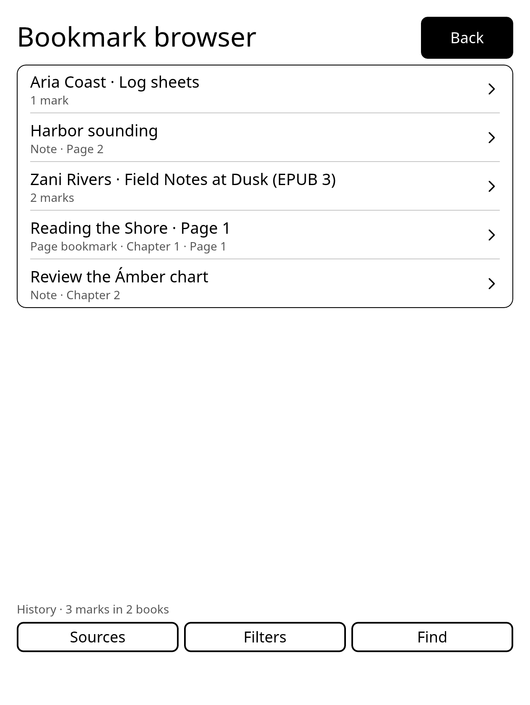
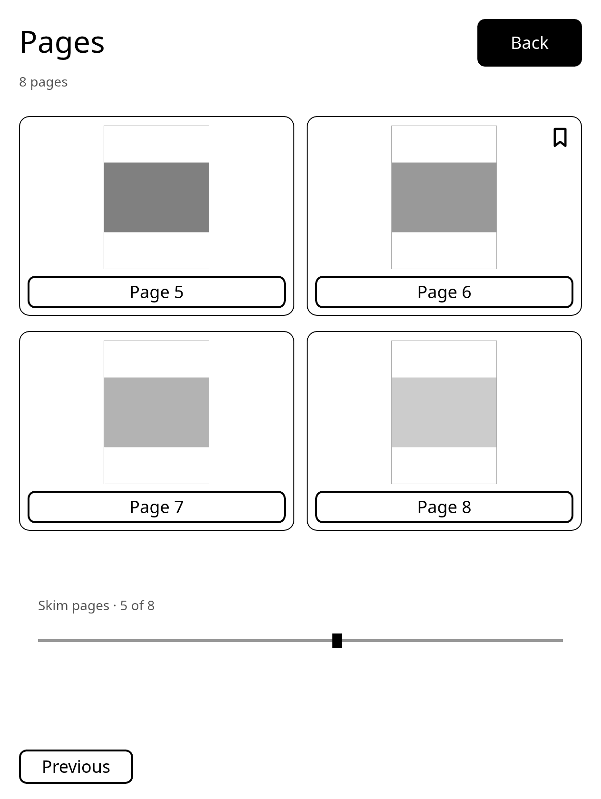
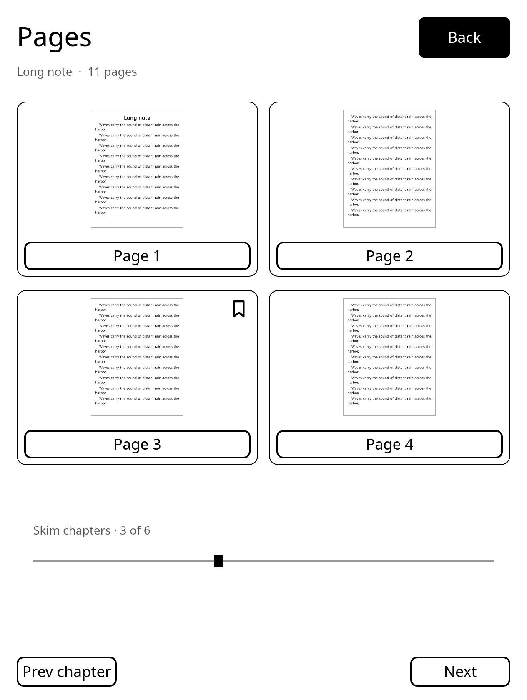

# Bookmark browser

Open **Library › Bookmark browser** in the upper reading bar, or **Organize › Bookmark browser** in the document browser. Choose History, collections, selected books, archived records, Documents, or a folder. Documents and folder sources offer a choice to include subfolders. Books without saved marks stay out of the results.

Results group saved marks under each book's author and title. **Filters** selects page bookmarks, highlights, notes or a drawing style. Select individual books, select all, or replace the selection by author, series, language or keyword. **Find** searches the saved quotation and note with Unicode case folding. Turn on **Match case** for case-sensitive matching. A match stays inside the quotation or note.

When the browser was opened from a book, **Filters → Remove matching notes (this book)** reviews the count and title before an explicit **Delete notes** confirmation. All matching notes begin selected; **Choose notes** lets the reader toggle individual notes, select all, add the notes visible on the current chooser page, or clear the selection before returning to the confirmation. With none selected there is no Delete action. It affects only selected nonblank notes on the current book's rows matching the active source, search and filters; page bookmarks, highlights, quotations and other books remain. Reader snapshots and rechecks each selected complete target mark before saving, aborts if the book or a selected target changed, and restores in-memory state if library persistence fails. More than 512 matching notes requires narrower filters; matching raw-anchor notes are refused rather than modified. Cancellation makes no change. KOReader's [selection-mode Delete note action](https://github.com/koreader/koreader/blob/9192014d8bd82a91dc1012473be0f238dedfdb54/frontend/apps/reader/modules/readerbookmark.lua#L818-L885) is the reference. This destructive workflow has not yet been tested in simulation or on Kindle.

**Filters → Remove matching marks (this book)** is a separate operation for bookmarks and highlights. Nothing starts selected. **Choose marks** offers individual, all, and current-page selection, with Clear selection. The confirmation states the selected count and that selected marks and their notes will be deleted; it offers no Delete action when none are selected. It applies only to matching marks in the current book, revalidates each complete selected snapshot, removes selected indices in descending order, and restores the prior in-memory book if the atomic library save fails. Unselected marks and other books are preserved. More than 512 matches requires narrower filters, and matching raw-anchor marks are refused. KOReader's [confirmed selected-mark removal](https://github.com/koreader/koreader/blob/9192014d8bd82a91dc1012473be0f238dedfdb54/frontend/apps/reader/modules/readerbookmark.lua#L890-L911) is the reference. This destructive workflow has not yet been tested in simulation or on Kindle.

Both review lists show a fixed-document page when available. Reflow rows show a known chapter and, for a resolvable anchor in the current chapter, its current page; unopened chapters do not have a calculated page here. Excerpts and chapter titles are displayed from the saved mark, without modifying them.

Result rows use the Reader's **Show in items** preference: highlighted text, highlighted text and note, or note when present. In the combined mode each part gets an excerpt so both can be seen; an empty note falls back to the saved text. This changes presentation only: searches still inspect both fields, and the mark preview retains the full saved quotation and note. KOReader's [bookmark display choices](https://github.com/koreader/koreader/blob/9192014d8bd82a91dc1012473be0f238dedfdb54/frontend/apps/reader/modules/readerbookmark.lua#L315-L333) and [row rendering](https://github.com/koreader/koreader/blob/9192014d8bd82a91dc1012473be0f238dedfdb54/frontend/apps/reader/modules/readerbookmark.lua#L1145-L1165) motivated this Reader-specific extension to the cross-book browser. The updated row behavior still needs simulation and device validation.

Reading order follows source positions. **Date added** sorts each book's marks by their creation time. **Sort direction** reverses that order. Earlier marks without a recorded creation time appear after dated marks. The original reading order resolves equal or missing dates. The type, style and sorting preferences persist between sessions. Search text and the temporary book filter clear when the browser opens again.

Tap a mark to preview its full quotation and note. **First**, **Previous mark**, **Next mark** and **Last** move between matching marks and skip book headings. The physical page buttons move between marks. Long text has its own text controls and vertical scrolling. **Back** returns to the result page containing the selected mark.

**View in book** opens the source edition and jumps to the saved page or anchored text. Reader retains the target book's previous location in its navigation history. A protected PDF asks for its password before completing the jump. Cancel returns to the mark preview. Archived records remain readable while their source file is unavailable.

Hold a direct source row to save it as the default. For a collection or book selection, hold **Apply collections** or **Apply book selection**. For a chosen folder, hold **Use this folder**. The source chooser includes a visible control to clear the saved default.

Book headings open information with the source path and available publisher metadata. **Read description** opens a paged text view with physical-button and swipe navigation. **View cover** previews a declared EPUB cover or the first page of a fixed document. Closing a cover returns to the same book information. Cached descriptions remain available for archived records. Metadata loads one book per event-loop step and is retained by the existing edition identity. [Metadata and format coverage](bookmark-metadata.md)

## Bookmark from Page browser

Open **Pages** while reading, then hold a thumbnail to add or remove that
page's bookmark. A bookmark icon appears on the marked thumbnail. When PDF
custom chapters or hidden-flow editing are active, choose **Bookmark page**
or **Remove page bookmark** from the held page's actions. Cancel closes the
actions and returns to the same thumbnails.

Reader saves the physical page for a PDF and the thumbnail's source anchor
for an EPUB, including when previewing another chapter. The current reading
position and navigation history stay in place. Saved bookmarks open their
page from **Bookmarks** as usual.

 

The Mac workflow toggled a PDF bookmark on page six while page two remained
current and separately bookmarked. It reopened the exact PDF page, compared
the source bytes, and tested menu cancellation and coexistence with custom
chapters and flows. The EPUB test opened the saved anchor after repagination
and toggled it off in the new layout. A separate Lua check ran the pinned
thumbnail callback and bookmark methods with stubbed providers. Fixed
add and remove, menu selection and dismissal, and reflow anchor matching
after a page change all passed. [KOReader hold callback](https://github.com/koreader/koreader/blob/9192014d8bd82a91dc1012473be0f238dedfdb54/frontend/ui/widget/pagebrowserwidget.lua#L1718-L1739) · [KOReader source-page matching](https://github.com/koreader/koreader/blob/9192014d8bd82a91dc1012473be0f238dedfdb54/frontend/apps/reader/modules/readerbookmark.lua#L384-L462) · [Reader workflow tests](../src/app/overview_bookmarks.rs)

## Chapter titles on saved marks

A new bookmark, highlight or note records the active outline's chapter
title. EPUB marks use the mark's source position. PDF marks use the
first physical page. A page bookmark with a recorded title appears as
**In …** in the in-book list. Highlight rows and details show the saved
title alongside the existing passage and page information. The title is
also available in Bookmark browser details after the book is closed.

**Chapter titles from ticks only** applies the included Contents levels
to newly saved marks. Changing the outline or the level choices preserves
the title already recorded. Moving the beginning of a saved highlight
updates its title at the new source position. Existing marks without chapter
metadata keep their original labels. Cross-spine lookup checks up to 16
nearby outline-bearing sections with a font-free source parse.

The pinned KOReader comparison ran the actual bookmark and highlight save
callbacks on the authored EPUB. Two passages occupy one rendered page.
A source point between two headings follows the earlier heading. A point
beyond the final eligible heading in the outline can retain the first title
on that page. The
following spine item inherits the last preceding title. The test also
checks ignored levels, blank depth placeholders and fixed-page ties.
The Mac workflow checks direct title capture, reopen, backup merge, stable
jump targets and unchanged EPUB and PDF source bytes.

[Annotation details](screenshots/saved-mark-chapter-landscape.png) ·
[Chapter labels in Bookmarks](screenshots/saved-chapter-bookmarks-landscape.png) ·
[Pinned replay](../scripts/koreader-alternative-contents-check.lua) ·
[Bookmark save](https://github.com/koreader/koreader/blob/9192014d8bd82a91dc1012473be0f238dedfdb54/frontend/apps/reader/modules/readerbookmark.lua#L384-L416) ·
[Highlight save](https://github.com/koreader/koreader/blob/9192014d8bd82a91dc1012473be0f238dedfdb54/frontend/apps/reader/modules/readerhighlight.lua#L2211-L2249)

## KOReader comparison

The comparison uses the installed KOReader v2026.07.1 bookmark browser and its source. Its source chooser, grouped results, type and style filters, literal search, date sorting, preview navigation, archived records and jump history provide the reference behavior. The test harness loads KOReader's actual data and preview methods with presentation dependencies replaced in memory. It performs 20 checks without displaying a KOReader screen or changing its saved data. [KOReader browser](https://github.com/koreader/koreader/blob/v2026.07.1/frontend/ui/widget/bookmarkbrowser.lua) · [Comparison harness](../scripts/koreader-bookmark-browser.lua)

The simulator tests drive the normal touch and physical-button inputs through sources, collection selection, property selection, search, previews, PDF authentication and location restoration. Four authorized original Documents files, two EPUBs and two PDFs, also restore saved marks and the previous page while retaining their source bytes. The full Mac suite passes 561 library tests, 14 integration tests and four system tests, with 31 opt-in tests skipped in the ordinary run. The separate original-source verification passes seven tests and preserves all 46 selected source SHA-256 values. Kindle verification for this increment is pending.

The bookmark browser can filter saved highlights and notes by their named
color; page bookmarks have no highlight color and are excluded when a color is
selected. Additional provider metadata remains open in the full
reading-workflow audit. The metadata coverage document identifies the fields
that each provider currently exposes.
