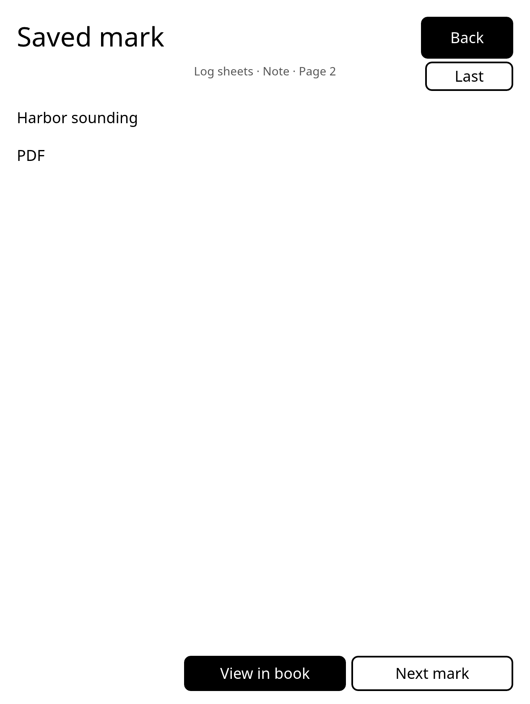

# Bookmark browser

Open **Library › Bookmark browser** in the upper reading bar, or **Organize › Bookmark browser** in the document browser. Choose History, collections, selected books, archived records, Documents, or a folder. Documents and folder sources offer a choice to include subfolders. Books without saved marks stay out of the results.

Results group saved marks under each book's author and title. **Filters** selects page bookmarks, highlights, notes or a drawing style. Select individual books, select all, or replace the selection by author, series, language or keyword. **Find** searches the saved quotation and note with Unicode case folding. Turn on **Match case** for case-sensitive matching. A match stays inside the quotation or note.

Reading order follows source positions. **Date added** sorts each book's marks by their creation time. **Sort direction** reverses that order. Earlier marks without a recorded creation time appear after dated marks. The original reading order resolves equal or missing dates. The type, style and sorting preferences persist between sessions. Search text and the temporary book filter clear when the browser opens again.

Tap a mark to preview its full quotation and note. **First**, **Previous mark**, **Next mark** and **Last** move between matching marks and skip book headings. The physical page buttons move between marks. Long text has its own text controls and vertical scrolling. **Back** returns to the result page containing the selected mark.

**View in book** opens the source edition and jumps to the saved page or anchored text. Reader retains the target book's previous location in its navigation history. A protected PDF asks for its password before completing the jump. Cancel returns to the mark preview. Archived records remain readable while their source file is unavailable.

Hold a direct source row to save it as the default. For a collection or book selection, hold **Apply collections** or **Apply book selection**. For a chosen folder, hold **Use this folder**. The source chooser includes a visible control to clear the saved default.

Book headings open information with the source path and available publisher metadata. **Read description** opens a paged text view with physical-button and swipe navigation. **View cover** previews a declared EPUB cover or the first page of a fixed document. Closing a cover returns to the same book information. Cached descriptions remain available for archived records. Metadata loads one book per event-loop step and is retained by the existing edition identity. [Metadata and format coverage](bookmark-metadata.md)

## KOReader comparison

The comparison uses the installed KOReader v2026.07.1 bookmark browser and its source. Its source chooser, grouped results, type and style filters, literal search, date sorting, preview navigation, archived records and jump history provide the reference behavior. The test harness loads KOReader's actual data and preview methods with presentation dependencies replaced in memory. It performs 20 checks without displaying a KOReader screen or changing its saved data. [KOReader browser](https://github.com/koreader/koreader/blob/v2026.07.1/frontend/ui/widget/bookmarkbrowser.lua) · [Comparison harness](../scripts/koreader-bookmark-browser.lua)

The simulator tests drive the normal touch and physical-button inputs through sources, collection selection, property selection, search, previews, PDF authentication and location restoration. Four authorized original Documents files, two EPUBs and two PDFs, also restore saved marks and the previous page while retaining their source bytes. The full Mac suite passes 561 library tests, 14 integration tests and four system tests, with 31 opt-in tests skipped in the ordinary run. The separate original-source verification passes seven tests and preserves all 46 selected source SHA-256 values. Kindle verification for this increment is pending.

Per-mark color filtering and additional provider metadata remain open in the full reading-workflow audit. The metadata coverage document identifies the fields that each provider currently exposes.
