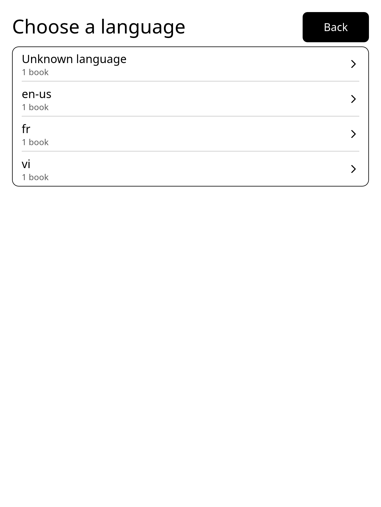

# Bookmark browser metadata

In the bookmark browser, open **Filters › Filter by book** or choose books from Sources. **Select by series**, **Select by language** and **Select by keyword** show the distinct values in the current source with their book counts. Choosing a value replaces the checked book set. Apply the selection to show those books' saved marks. Unknown values appear first when a book has no available value. Language values are lowercase.

Publisher metadata is kept in `reader/data/bookmark-metadata.json`, indexed by the same edition identifier as the saved annotations. Reading position, bookmarks and notes stay in their existing state file. A description remains available after its source is removed. Reader checks source identity before extracting metadata or opening a cover. An unrelated replacement at the same path cannot supply metadata for the earlier edition.

The source chooser returns its results immediately. Metadata extraction runs one book per event-loop step, and property lists show the remaining count while they load. Subsequent requests use the saved cache. Metadata persistence uses the app kit's atomic writer. A failed cache write is retried on a later save and does not prevent the primary reading data from being saved.

## Publisher fields

| Format | Fields retained for the bookmark browser |
|---|---|
| EPUB and extracted EPUB | EPUB 2 and 3 series declarations already supported by Reader, Dublin Core language, subjects and description, declared cover and the source chapter index. |
| HTML | Root `lang` or `xml:lang`, and `keywords` and `description` head metadata. |
| HTMLZ | Language, subjects, description and Calibre series from `metadata.opf`. The HTML head is used when that package metadata is absent. |
| MOBI and KF8/AZW3 | EXTH language, description, repeated subject records and supported primary-header cover records. Existing text conversion and reading revisions continue to use their established inputs. |
| FictionBook 2, including the existing compressed adapters | `title-info` language, keywords, sequence names, annotation and declared PNG/JPEG cover. |
| DOCX | Language and description from the related core-properties part, and core keywords. |
| PDF | PDF Info subject and keywords, plus the catalog language. Existing PDF text decoding handles Unicode metadata. |
| CBZ | A bounded, root-level `ComicInfo.xml` can supply Series, LanguageISO, comma-separated Genre and Tags, and Summary. Earlier cached CBZ entries are refreshed once when their source remains available. |
| Plain text and Markdown | These adapters expose no publisher properties for these filters. Missing values remain explicit. |
| RTF, CHM, DjVu, CBT, CBR and images | Their reading adapters currently expose no descriptive fields for these filters. RTF info groups, CHM language properties, DjVu annotation metadata, other comic-archive metadata and image EXIF descriptive fields remain follow-up work. |

The CBZ metadata addition is an unverified implementation candidate. It reads
only a single UTF-8 or BOM-marked UTF-16 root-level `ComicInfo.xml`, capped at
256 KiB and 4,096 XML nodes, from an existing bounded ZIP archive. Duplicate, encrypted, malformed or
unsupported entries are ignored. Archive identity is checked again after the
read, and existing cached information remains if the source cannot be read.
This addition has not been behaviorally tested or verified on Kindle.

Declared EPUB, FictionBook 2, supported FictionBook 3 and supported MOBI/KF8 covers and the first page of supported fixed documents can be inspected. FB2 PNG and JPEG covers use the same validated, bounded local resources as the reading page. MOBI/KF8 uses the primary header's EXTH 201 cover record when it contains a bounded PNG, JPEG or GIF; other declarations remain open. Missing or unsupported image data does not create a cover. The new FB2 and MOBI/KF8 previews await integrated testing. Fixed covers become a single-image preview, so page buttons stay within that preview. The source book's page and history retain their previous values. An archived source offers its cached description and information. Its cover action is unavailable while the file is missing. [KOReader cover API](https://github.com/koreader/koreader/blob/9192014d8bd82a91dc1012473be0f238dedfdb54/frontend/document/credocument.lua#L556-L561)

The FB2 cover candidate also checks `src-title-info` when the primary
`title-info` coverpage is absent, as in the pinned CREngine, and permits a
uniquely identified GIF cover with a validated first frame. The fallback shares
the existing 32-image, 1 MiB per-image, 4 MiB total and 8 Mi-pixel budgets;
duplicate binary IDs, invalid images and excess resources are skipped. GIF is
cover-only in this path; FB2 reading-page images and generated XHTML remain
unchanged, preserving reading anchors. The fallback has not yet been compared
with KOReader or verified in simulation or on Kindle. [KOReader FB2 cover selection](https://github.com/koreader/crengine/blob/b32a88ffbbf505cf2ea5208c1a49002d70d3609f/crengine/src/lvdocview.cpp#L1039-L1061)

Descriptions are shown as text. The existing bounded markup converter resolves supported character references and paragraph structure. Long descriptions have text paging, swipes and physical-button navigation. Previous and next text controls use expanded 100 px touch targets.

## KOReader comparison and verification

The source reference is KOReader `9192014d8bd82a91dc1012473be0f238dedfdb54`. Its book-property selection clears the previous checked set, then checks the books containing the chosen value. Its book dialog disables a deleted book's cover and permits a cached description. Reader follows those rules. [Property selection and book actions](https://github.com/koreader/koreader/blob/9192014d8bd82a91dc1012473be0f238dedfdb54/frontend/ui/widget/bookmarkbrowser.lua), [cover and description availability](https://github.com/koreader/koreader/blob/9192014d8bd82a91dc1012473be0f238dedfdb54/frontend/apps/filemanager/filemanagerutil.lua)

The simulator drives the ordinary source, filter and book-information controls. Authored fixtures cover EPUB, Unicode PDF metadata, HTML, HTMLZ, DOCX, FictionBook and missing plain-text values. The checks include replacement selection, retained descriptions after deletion, cover return, long-text paging, pressed feedback and primary-state preservation when the derived cache cannot be written.

The full Mac run passes 561 library tests, 14 integration tests and four layout system tests. Thirty-one opt-in tests remain outside the ordinary run. The separate source verification passes seven bookmark-browser tests, including the original-file workflow and metadata audit.

An independent audit reads OPF and EXTH records directly and uses `pdfinfo` for PDF Info fields. It compares 182 fields across 46 authorized original sources, comprising 28 EPUBs, 16 AZW3s and two PDFs. Nineteen sources have descriptions. Reader's extracted values agree with those independent results, and all 46 source SHA-256 values remain intact. Device verification of this increment remains pending the combined Kindle build.

