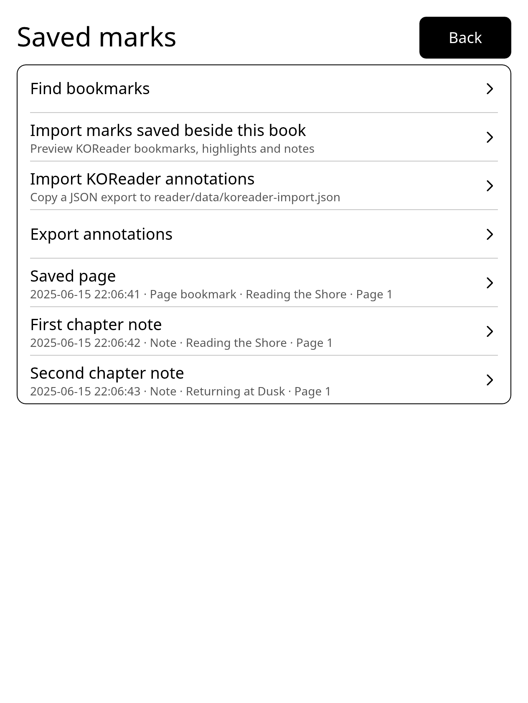
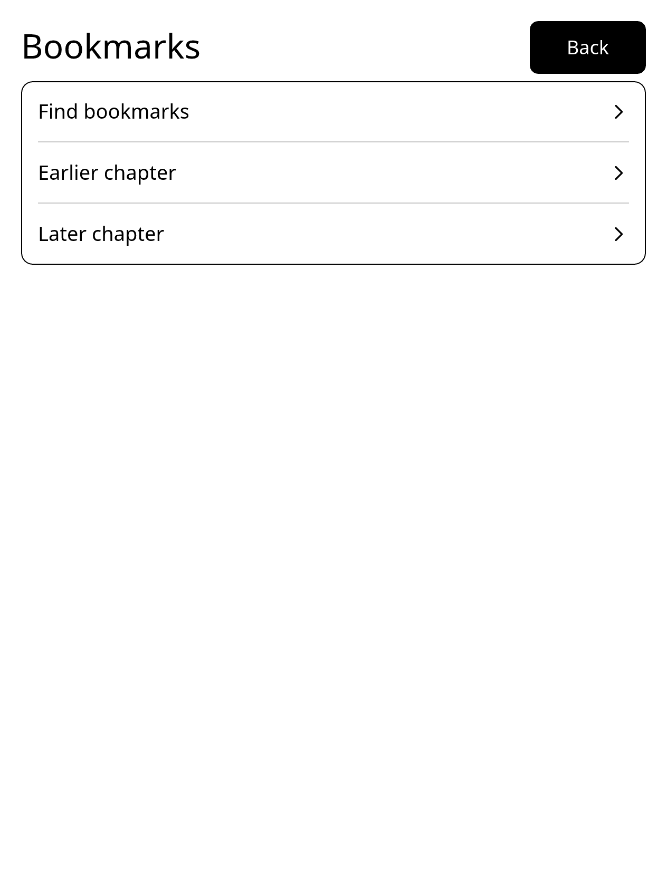
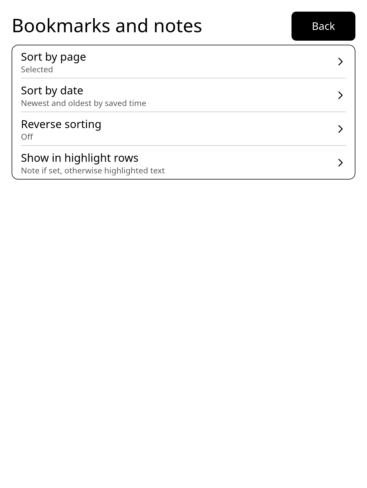
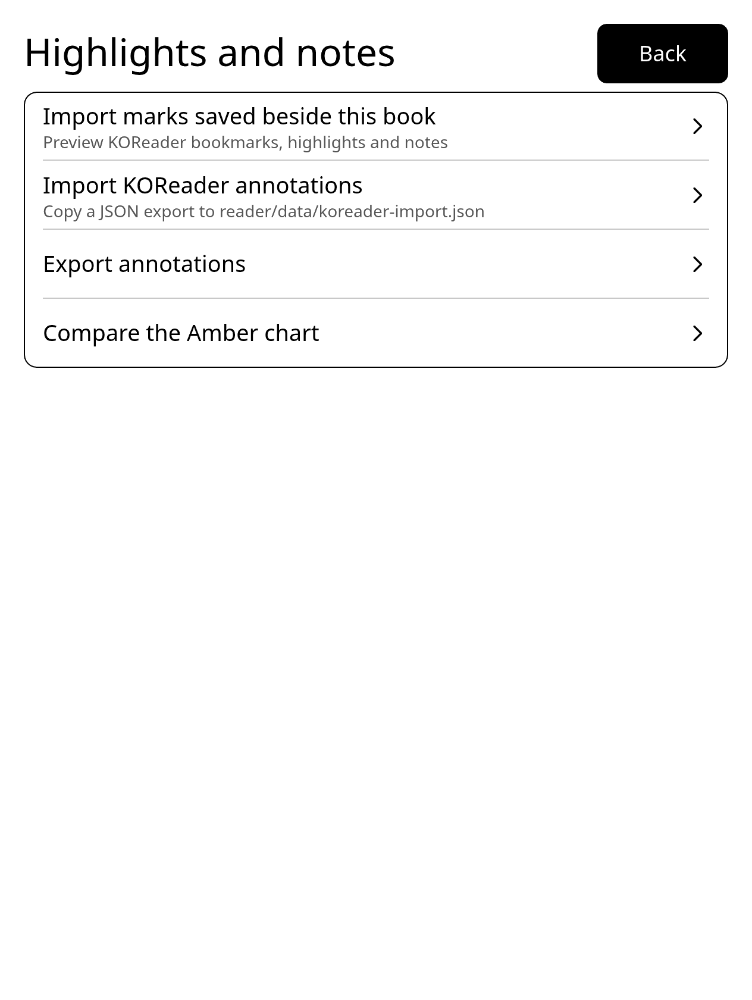

# Bookmark order

KOReader shows bookmarks, highlights and notes in one in-book list. Reader's
**Saved marks** view now combines EPUB page bookmarks and highlights, and PDF
page bookmarks and highlights. Page order uses chapter, page and source position
with creation time for ties; date order uses saved time with document location
for ties and shows the saved timestamp in each row. Reverse sorting applies to
the saved-mark rows. Each row keeps its original storage index as its action
target, so sorting never changes which location opens.

Open **Settings → Bookmarks and notes** to choose page or date order, reverse
the result, and choose how highlight rows display text and notes. Those choices
are saved in Reader's controls file. The shared ordering includes EPUB and PDF
bookmarks and highlights. Tapping a row jumps to its saved location; long
pressing a highlight opens its read, edit, extend, and remove actions. Text
display modes apply to highlight rows; page bookmarks continue to show their
saved label, which remains a display-parity gap against KOReader's bookmark
summary options.

Regressions interleave page bookmarks and EPUB highlights in date order, follow
their original actions, verify page jumps and chapter labels, and cover page
and reverse sorting plus settings persistence. A PDF regression verifies that
its page bookmarks and saved highlights share the list and retain the PDF
passage action. Annotation checks exercise note-first, quote-only and
quote-with-note rows, saved controls and settings navigation. Regenerate the
mixed-list simulator capture with:

```sh
READER_SAVED_MARKS_SCREENSHOT=docs/screenshots/saved-marks.png \
READER_TEST_FONTS=tests/fixtures/fonts/NotoSans-Regular.ttf \
cargo test --locked --lib saved_marks_mix_bookmarks_and_highlights_without_changing_targets
```

The capture shows the combined view:









Bookmark row layout preferences remain open. PDF sorting and Kindle navigation
and physical display acceptance are also pending.
