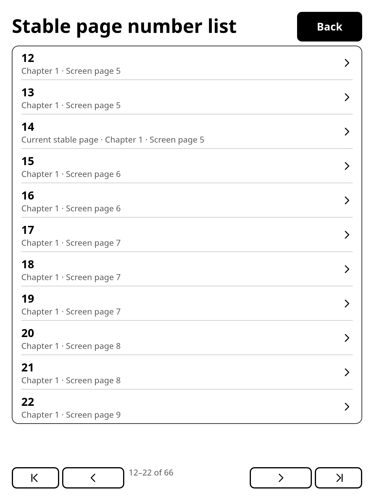

# Character-count pages

In an open EPUB, choose **Navigation › Page numbering › Character-count pages**. Reader starts a new numbered page at each spine item, then counts Unicode characters within that item. The default is 1,500. Choose **Characters per page** to enter any whole number from 500 to 3,000. The numbers stay attached to the text when type size, orientation or margins change. [KOReader’s stable page settings](https://github.com/koreader/koreader/blob/9192014d8bd82a91dc1012473be0f238dedfdb54/frontend/apps/reader/modules/readerpagemap.lua#L452-L548)

Use **Stable page number list** to jump to a boundary or enter `label 125` in **Go to page**. The list shows the corresponding chapter and the current chapter’s screen pages. Previous location returns to the starting passage. The margin and footer switches work independently. Return to **Page numbering** to choose publisher labels again, or screen pages for an edition without printed labels.

Reader builds one chapter at a time and stores the completed map in its own data directory. Reopening checks the edition, chapter count and selected stride before restoring the map. An incomplete or damaged cache can be regenerated from the EPUB. Changing the stride replaces that book’s cache after the new map is complete. The map contains source positions and chapter revisions. The limit is 32,768 labels per edition. [Source mapping](../src/synthetic_pages.rs) · [Reading controls](../src/app/character_page_settings.rs)

## Comparison on original publications

Installed KOReader on the Oasis generated reference maps for three original EPUBs, including Vietnamese and English titles. The Rust engine on the Mac matched all 4,328 structural locations and Unicode offsets. For each edition and stride, the app opened the first, middle and last list entries and returned to the initial passage. The comparison used separate test profiles. Screenshots in this repository use authored material. [KOReader engine traversal](https://github.com/koreader/crengine/blob/b32a88ffbbf505cf2ea5208c1a49002d70d3609f/crengine/src/lvtinydom.cpp#L22529-L22632) · [Installed engine comparison](../scripts/koreader-page-map-check.lua)

| EPUB | 500 characters | 1,500 characters | 3,000 characters |
| --- | ---: | ---: | ---: |
| First edition tested | 926 | 314 | 162 |
| Second edition tested | 919 | 320 | 169 |
| Third edition tested | 1,001 | 341 | 176 |
