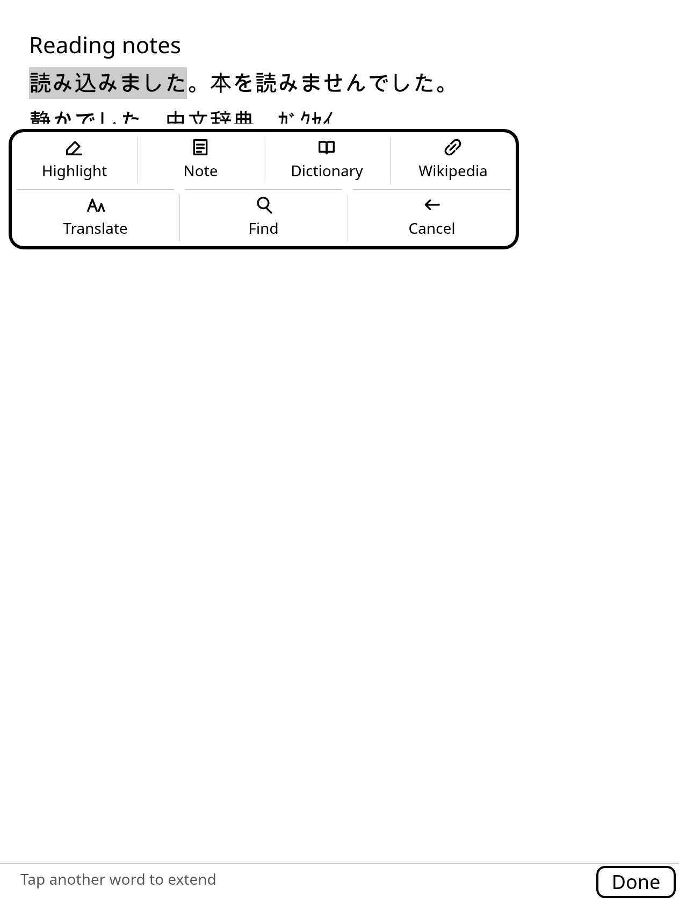

# Japanese and Chinese word lookup

Long-press Japanese or Chinese text to select a word. Reader first shows ICU's word selection, then checks enabled dictionaries in the background for the longest matching source prefix. For example, an installed entry for **読み込む** can select **読み込みました** and show its definition. The selected source wording, lookup history, vocabulary context and saved anchors retain **読み込みました**. Dictionary forms do not replace book text.

**Dictionaries › Word forms by default** and the per-book override also control Japanese forms and Unicode compatibility normalization. Literal headwords and synonyms retain priority within each dictionary. With word forms off, automatic selection can still match literal CJK entries; it does not deinflect or normalize them. Chinese lookup uses ICU segmentation and installed entries, without Japanese suffix handling on Han-only text.

## Comparison with KOReader

| Reference contract | Reader behavior |
|---|---|
| Language support can improve a source selection even when a publication's language is missing or wrong. | Kana/Han script detection starts the bounded scan; it does not depend on a correct publication language tag. |
| Japanese support scans forward from the initial source start and chooses the longest dictionary match. | Scans at most 20 Unicode scalars in one source block, stops at punctuation or non-CJK text, and batches candidates into one pass per dictionary and synonym index. Endpoints retain complete grapheme clusters, including voicing marks and variation sequences. A dictionary match can shorten the initial ICU span, as with the reference's halfwidth overshoot handling. |
| Japanese lookup supplies possible base forms rather than inventing definitions. | Independently authored productive forms cover polite, negative, past/te, adjective/copula, progressive, potential, passive, causative, conditional, volitional, desiderative and supported imperative endings, including common suru/kuru compounds. Only actual installed definitions are returned. |
| Several plausible forms can have dictionary entries. | Japanese morphological candidates tie in priority, so a shorter auxiliary step cannot hide a valid final verb. Existing literal/caseless precedence and English form ordering remain intact. |
| Selection and dictionary overlays retain their book context. | The immediate selection stays usable while the scan runs. Any further input, screen change, sleep or storage return cancels its result. The worker additionally verifies the original selection before applying source endpoints. |

[KOReader language dispatch](https://github.com/koreader/koreader/blob/v2026.07.1/frontend/languagesupport.lua) · [Japanese selection and lookup contracts](https://github.com/koreader/koreader/blob/v2026.07.1/plugins/japanese.koplugin/main.lua)

Reader uses the existing ICU NFKC data for lookup spellings such as halfwidth kana with dakuten. It never normalizes source offsets or strips ideographic variation selectors. The Japanese implementation contains no copied KOReader/Yomichan rule dataset or Lua implementation. The package licence and resource licences are unchanged.

## Segmentation and fonts

Parley's supported **complex-scripts** feature enables its ICU dictionary segmentation models. The previous renderer used the non-complex constructor even though Reader's separate word-selection code already used ICU auto segmentation. The same authored Japanese rendering regression emitted 226 missing-model diagnostics before the feature change and zero afterward. This check covers the primary Parley reading path; it does not claim every optional renderer's transform path uses the same constructor. [Parley features](https://docs.rs/crate/parley/0.12.0/features) · [ICU dictionary segmentation](https://docs.rs/icu_segmenter/2.4.0/icu_segmenter/struct.WordSegmenter.html#method.new_dictionary)

The shared UI renderer now retains Noto Sans first and uses additional supplied font families as ordered fallbacks. This lets a dictionary headword use an available CJK font just as the book page does. No font files were added to the package. A shared-popup regression verifies zero missing glyphs with a supplied CJK font, identical ASCII pixels with and without that fallback, and stable output with duplicate font paths.

## Scope and checks

Candidate generation is bounded to 128 Japanese forms and four transformation steps per prefix. Dictionary processing retains the existing source-count, result, byte and decompression limits. Cancellation is checked during headword and synonym scans and around bounded definition decoding. This is a productive-form subset, not KOReader's complete configurable Japanese plugin: honorific, archaic and colloquial forms, lexical-class verification, kana-reading conversions and configurable scan lengths remain open. An index entry alone cannot prove a verb's conjugation class; ambiguous real entries may be shown together. Automatic expansion is for reflowable source selections. Fixed-page selections can use lookup forms but retain their original geometric selection.

The current implementation pass adds productive colloquial completion and
preparation contractions, progressive contractions, conditional/list endings,
polite imperatives and excess/appearance constructions. For example, it can
propose the same dictionary base for `読んじゃう` and `読む`. Candidate
generation remains bounded, and only installed dictionary entries can supply
definitions. These new forms have not yet been checked against the pinned
KOReader replay, simulator or Kindle. Other colloquial, honorific and archaic
forms and lexical-class matching remain open.

Desktop tests exercise conjugation families, ambiguous entries, normalization precedence, synonyms and dictionary order, complete voiced/variation clusters, cancellation, manual ranges and returning from the popup. The retained W3C Japanese EPUB supplies real publication passages; an unchanged owner EPUB supplies a non-CJK regression. The owner corpus audited earlier has no CJK text, so it cannot supply a Japanese positive case. [Corpus and public-edition provenance](cjk-width.md)

Kindle acceptance remains pending the combined build. These desktop results do not establish complete Japanese lexical coverage or full KOReader reading parity.
