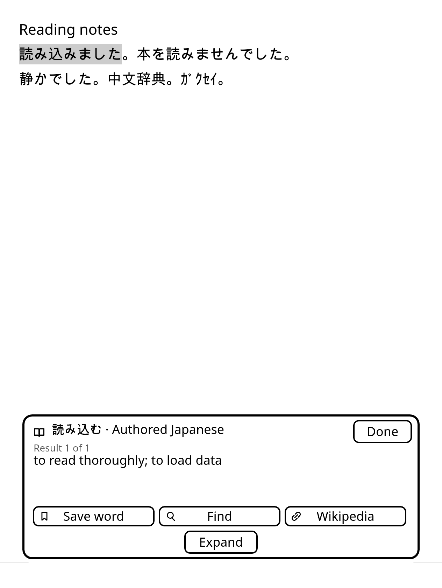

# Japanese, Chinese, and Korean word lookup

Long-press Japanese, Chinese, or Korean text to select a word. Reader first shows ICU's word selection, then checks enabled dictionaries in the background for the longest matching source prefix. For example, an installed entry for **読み込む** can select **読み込みました** and show its definition; a Korean entry for **한국어** can select that prefix inside **한국어사전**. The selected source wording, lookup history, vocabulary context and saved anchors retain the text from the book. Dictionary forms do not replace book text.

**Dictionaries › Word forms by default** and the per-book override control inflection and compatibility lookup forms. **CJK selection look-ahead** is configured in Dictionary settings from 0 to 1,000, with 20 as the default, matching KOReader's Japanese plugin range. It controls the bounded background prefix search for kana, Han, and Hangul text. Japanese text conversions can be enabled independently: halfwidth to fullwidth kana (On by default), hiragana to katakana (Off), katakana to hiragana (On), and emphatic-sequence collapse (Off). Reader tries bounded combinations of the enabled conversions for dictionary lookup; it never changes the selected book text or its anchor. Literal headwords and synonyms retain priority within each dictionary. With word forms off, automatic selection can still match literal CJK or Hangul entries; it does not deinflect or normalize them. Chinese lookup uses ICU segmentation and installed entries, without Japanese suffix handling on Han-only text. Korean currently uses literal Hangul headwords and synonyms.

## Comparison with KOReader

| Reference contract | Reader behavior |
|---|---|
| Language support can improve a source selection even when a publication's language is missing or wrong. | Kana, Han, or Hangul detection starts the bounded scan; it does not depend on a correct publication language tag. |
| Japanese support scans forward from the initial source start and chooses the longest dictionary match. The plugin's look-ahead range is 0–1,000, default 20. | Reader exposes the same range and default, scans the starting character plus the bounded look-ahead within one source block, and stops at punctuation or non-CJK text. It batches candidates into one pass per dictionary and synonym index. Endpoints retain complete grapheme clusters, including voicing marks and variation sequences. A dictionary match can shorten the initial ICU span, as with the reference's halfwidth overshoot handling. |
| Japanese lookup supplies possible base forms rather than inventing definitions. | Independently authored productive forms cover polite, negative, past/te, adjective/copula, progressive, potential, passive, causative, conditional, volitional, desiderative, supported imperative and connective endings, including common suru/kuru compounds, te/de trial/preparation/completion auxiliaries, and higher-politeness i-adjective negatives. Only actual installed definitions are returned. |
| Korean lookup can resolve contiguous Hangul against local dictionary entries. | Hangul syllables, compatibility jamo and conjoining jamo participate in the bounded longest-prefix scan. This does not add Korean inflection handling. |
| Several plausible forms can have dictionary entries. | Japanese morphological candidates tie in priority, so a shorter auxiliary step cannot hide a valid final verb. Existing literal/caseless precedence and English form ordering remain intact. |
| Selection and dictionary overlays retain their book context. | The immediate selection stays usable while the scan runs. Any further input, screen change, sleep or storage return cancels its result. The worker additionally verifies the original selection before applying source endpoints. |

[KOReader language dispatch](https://github.com/koreader/koreader/blob/v2026.07.1/frontend/languagesupport.lua) · [Japanese selection and lookup contracts](https://github.com/koreader/koreader/blob/v2026.07.1/plugins/japanese.koplugin/main.lua) · [Japanese look-ahead setting](https://github.com/koreader/koreader/blob/v2026.07.1/plugins/japanese.koplugin/main.lua#L36-L45) · [Kana conversion options and defaults](https://github.com/koreader/koreader/blob/v2026.07.1/plugins/japanese.koplugin/deinflector.lua#L276-L406)

Reader uses the existing ICU NFKC data for lookup spellings such as halfwidth kana with dakuten. It never normalizes source offsets or strips ideographic variation selectors. The Japanese implementation contains no copied KOReader/Yomichan rule dataset or Lua implementation. The package licence and resource licences are unchanged.

## Segmentation and fonts

Parley's supported **complex-scripts** feature enables its ICU dictionary segmentation models. The previous renderer used the non-complex constructor even though Reader's separate word-selection code already used ICU auto segmentation. The same authored Japanese rendering regression emitted 226 missing-model diagnostics before the feature change and zero afterward. This check covers the primary Parley reading path; it does not claim every optional renderer's transform path uses the same constructor. [Parley features](https://docs.rs/crate/parley/0.12.0/features) · [ICU dictionary segmentation](https://docs.rs/icu_segmenter/2.4.0/icu_segmenter/struct.WordSegmenter.html#method.new_dictionary)

The shared UI renderer now retains Noto Sans first and uses additional supplied font families as ordered fallbacks. This lets a dictionary headword use an available CJK font just as the book page does. No font files were added to the package. A shared-popup regression verifies zero missing glyphs with a supplied CJK font, identical ASCII pixels with and without that fallback, and stable output with duplicate font paths.

## Scope and checks

Candidate generation is bounded to 128 Japanese forms and four transformation steps per prefix. The configured scan is capped at 1,000 look-ahead scalars, 4,096 candidate terms, 3 MiB of candidate text, and 32 kana-conversion variants. Direct source prefixes are collected before morphological variants so a large scan cannot crowd out shorter literal headwords. Dictionary processing retains the existing source-count, result, byte and decompression limits. Cancellation is checked during headword and synonym scans and around bounded definition decoding. The four Japanese conversion toggles now match KOReader's names and defaults, but this new configurable candidate remains unverified. This is a productive-form subset, not KOReader's complete Japanese plugin: broader irregular, archaic, dialectal and lexicalized forms and lexical-class verification remain open. Korean is supported for literal Hangul dictionary-prefix selection, which is the in-scope KOReader behavior; the pinned source has no Korean morphology requirement. An index entry alone cannot prove a verb's conjugation class; ambiguous real entries may be shown together. Automatic expansion is for reflowable source selections. Fixed-page selections can use lookup forms but retain their original geometric selection.

The current implementation pass adds productive colloquial completion and
preparation contractions, progressive contractions, conditional/list endings,
polite imperatives, common honorific godan polite stems, お/ご request and
benefactive auxiliaries, and excess/appearance constructions. For example, it
can propose the same dictionary base for `読んじゃう` and `読む`, resolve
`おっしゃいました` to `おっしゃる`, and resolve `ご確認いただきました`
to `確認する`. It also reduces `読みながら` and `読みつつあります`, unwraps
te/de phrases such as `読んでみたかった` and `書いておきたかった`, and
recognizes higher-politeness adjective forms such as `高くはありませんでした`
and `高くございませんでした`. Candidate generation remains bounded, and
only installed dictionary entries can supply definitions. These new forms
have not yet been checked against the pinned KOReader replay, simulator or
Kindle. Other colloquial forms and lexical-class matching remain open.

The dictionary also tries a hiragana reading of katakana after compatibility
normalization, including half-width katakana, and applies the existing bounded
inflection rules to that reading. The selected passage and literal lookup stay
unchanged. KOReader enables katakana-to-hiragana and half-width conversion by
default; its other configurable conversions remain open. This new fallback has
not yet been tested on the computer or Kindle. [Pinned conversion defaults](https://github.com/koreader/koreader/blob/9192014d8bd82a91dc1012473be0f238dedfdb54/plugins/japanese.koplugin/deinflector.lua#L257-L299)

Desktop tests exercise conjugation families, ambiguous entries, normalization precedence, synonyms and dictionary order, complete voiced/variation clusters, cancellation, manual ranges and returning from the popup. The retained W3C Japanese EPUB supplies real publication passages; an unchanged owner EPUB supplies a non-CJK regression. The owner corpus audited earlier has no CJK text, so it cannot supply a Japanese positive case. [Corpus and public-edition provenance](cjk-width.md)

The Hangul prefix, configurable CJK look-ahead and Japanese conversion controls are unverified candidates and await the deferred test pass. Kindle acceptance remains pending the combined build. Existing desktop results do not establish complete Japanese lexical coverage or full KOReader reading parity.
