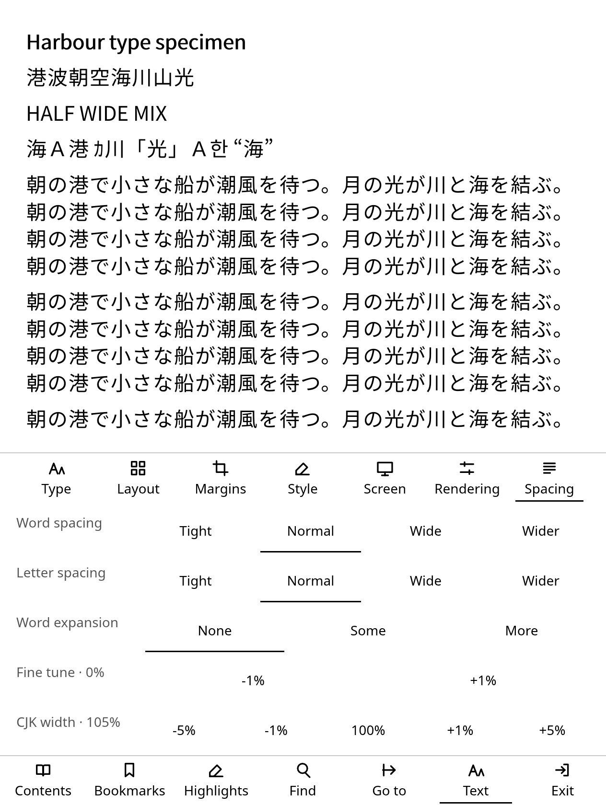

# CJK character width

Open a horizontal reflowable book and tap the lower edge of the page. Choose **Text** and then **Spacing**. The **CJK width** row shows its current percentage. Use the one- or five-point buttons to choose a width between 100% and 150%. Tap **100%** to restore the original spacing. Reader keeps this choice for the book.

The control adds space on both sides of each eligible glyph. The ink keeps its original size. Chinese ideographs, kana, Korean syllables, fullwidth and halfwidth forms, and CJK punctuation use the character ranges defined by CREngine. In a paragraph containing CJK text, curly single or double quotes also qualify when the active font gives them an advance of at least 80% of its size. The selected font supplies the natural width, including embedded fonts. Reader measures the extra space before wrapping, so the next line can start earlier. Search, selection and saved locations continue to refer to the same UTF-8 source. [KOReader’s spacing option](https://github.com/koreader/koreader/blob/9192014d8bd82a91dc1012473be0f238dedfdb54/frontend/ui/data/creoptions.lua#L540-L567) · [CREngine’s character ranges](https://github.com/koreader/crengine/blob/b32a88ffbbf505cf2ea5208c1a49002d70d3609f/crengine/include/lvstring.h#L161-L282) · [Advance and quote handling](https://github.com/koreader/crengine/blob/b32a88ffbbf505cf2ea5208c1a49002d70d3609f/crengine/src/lvtextfm.cpp#L2255-L2280) · [Glyph centering](https://github.com/koreader/crengine/blob/b32a88ffbbf505cf2ea5208c1a49002d70d3609f/crengine/src/lvfntman.cpp#L4458-L4470)

## Reading checks

The eight ideographs in the authored *Harbour type specimen* span 336 px at 100% and 504 px at 150% in Reader and installed KOReader with the same 42 px face. Each glyph gains 21 px of advance. Its original grayscale ink moves 10 px into the wider cell. Its neighboring Latin line retains the same glyph positions. The regression also checks line wrapping, source selection rectangles, restored anchors and the saved per-book setting. [Authored specimen and font attribution](../tests/fixtures/README.md) · [Geometry checks](../src/parley_layout/cjk_width_tests.rs) · [Reading-bar check](../src/app/cjk_width_tests.rs)

A unique seven-character passage in the W3C Japanese edition of *Requirements for Japanese Text Layout* measures 294 px at 100% and 441 px at 150% in both engines with left-aligned text. In KOReader’s normal fully justified layout the same phrase measures 306 and 501 px. Final positions therefore depend on the edition, the selected font, alignment and line breaks. The stock check reapplies 100% and verifies the same navigation anchors, page indices and selection widths. [W3C sample edition](https://github.com/IDPF/epub3-samples/releases/tag/20230704) · [Installed CREngine comparison](../scripts/koreader-cjk-width.lua)
