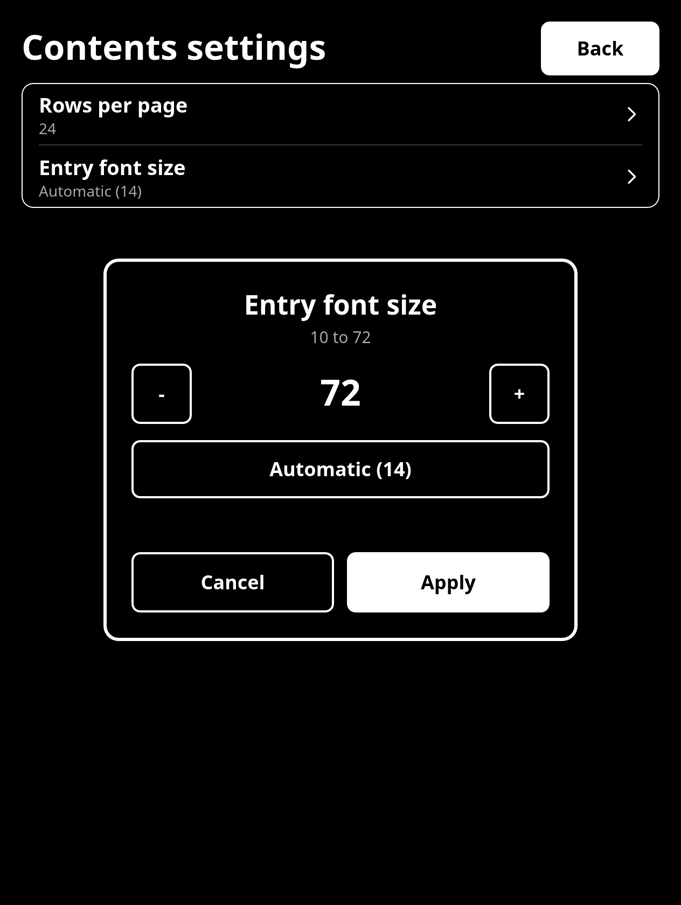

# Contents list settings

Open the upper **Navigation** menu, then choose **Contents settings**. These
preferences apply to publisher and active custom outlines in reflow and
fixed-page books.

| Setting | Behavior |
| --- | --- |
| Rows per page | 6–24 rows, with 14 by default. The Generated and Custom outline actions count as rows in the Reader list. |
| Entry font size | 10–72 logical units. Automatic selects 24 at six rows and decreases to 14 at 24 rows. The default 14 rows use logical size 19. |

Tap plus or minus for one step, or hold for four. Physical page buttons step
the value by one while the picker is open. **Apply** saves the preference.
With **Automatic**, the font follows later changes to the row count. If a
font would exceed the available row height, Reader draws the largest size
that fits one line and retains your chosen value.

At the 1264×1680 reference size, logical 19 becomes 41 rendered pixels. This
uses KOReader's short-side scaling formula without a screen DPI override.
The one-line cap uses the list's actual height in Reader. Dense rows have
separate branch and heading targets within each row.

The EPUB workflow test sets both row limits, exercises the minimum and
maximum font values, checks reopening and resetting preferences, and verifies
that only selecting a heading adds a jump to the reading history. A second
test interrupts the save and checks that the live settings and draft can be
recovered. The simulator captures use the bundled EPUB.

| Six rows with automatic font | Twenty-four rows with a large requested font | Font picker in dark mode |
| --- | --- | --- |
|  |  |  |

[Reader settings tests](../src/app/contents_density/tests.rs) · [KOReader bounds and persistence](https://github.com/koreader/koreader/blob/9192014d8bd82a91dc1012473be0f238dedfdb54/frontend/apps/reader/modules/readertoc.lua#L1345-L1387) · [Automatic font formula](https://github.com/koreader/koreader/blob/9192014d8bd82a91dc1012473be0f238dedfdb54/frontend/ui/widget/menu.lua#L1546-L1550) · [One-line fit](https://github.com/koreader/koreader/blob/9192014d8bd82a91dc1012473be0f238dedfdb54/frontend/ui/widget/menu.lua#L132-L141)
