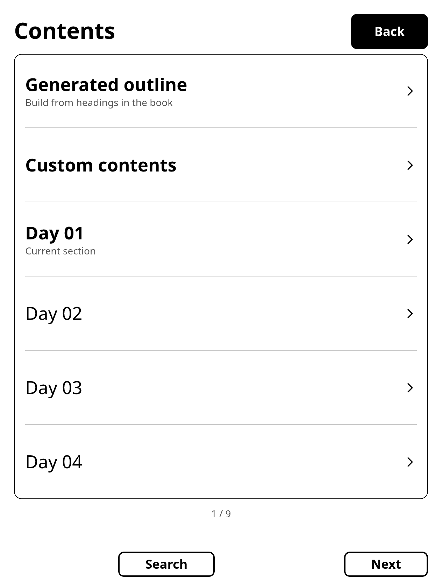
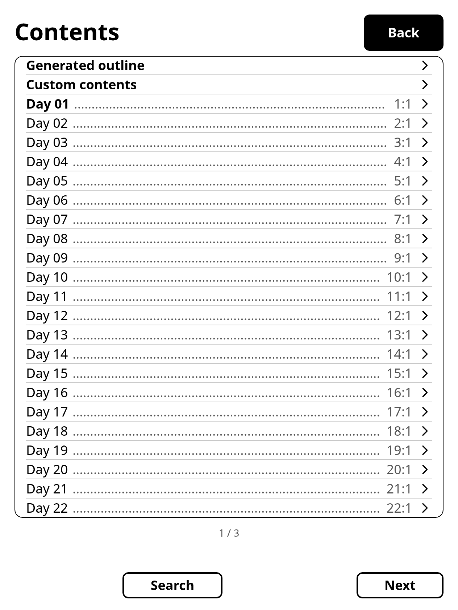
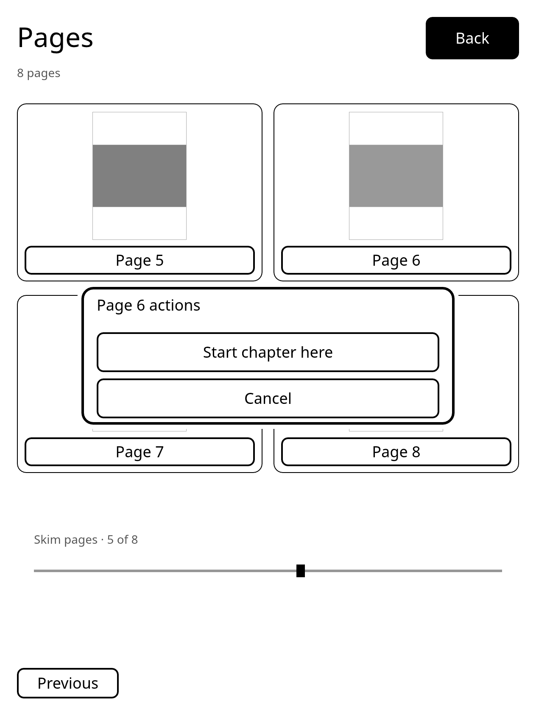
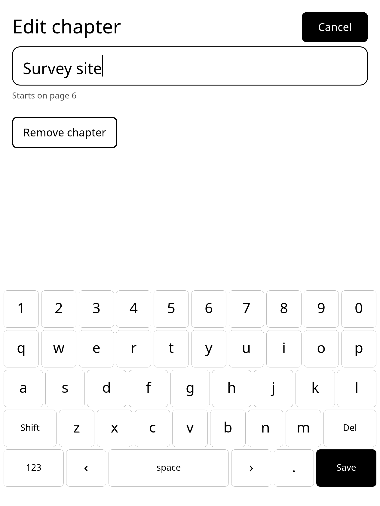

# Contents list settings

Open the upper **Navigation** menu, then choose **Contents settings**. These
list preferences apply to publisher, alternative and custom contents.
The alternative source option is available in reflowable books.

| Setting | Behavior |
| --- | --- |
| Rows per page | 6–24 rows, with 14 by default. The Generated and Custom outline actions count as rows in the Reader list. |
| Entry font size | 10–72 logical units. Automatic selects 24 at six rows and decreases to 14 at 24 rows. The default 14 rows use logical size 19. |

Tap plus or minus for one step, or hold for four. Physical page buttons step
the value by one while the picker is open. **Apply** saves the preference.
With **Automatic**, the font follows later changes to the row count. If a
font would exceed the available row height, Reader draws the largest size
that fits one line and retains your chosen value.

At the 1264×1680 reference size, logical 19 becomes 41 rendered pixels. This
uses KOReader's short-side scaling formula without a screen DPI override.
The one-line cap uses the list's actual height in Reader. Dense rows have
separate branch and heading targets within each row.

The EPUB workflow test sets both row limits, exercises the minimum and
maximum font values, checks reopening and resetting preferences, and verifies
that only selecting a heading adds a jump to the reading history. A second
test interrupts the save and checks that the live settings and draft can be
recovered. The simulator captures use the bundled EPUB.

| Six rows with automatic font | Twenty-four rows with a large requested font | Font picker in dark mode |
| --- | --- | --- |
|  |  |  |

[Reader settings tests](../src/app/contents_density/tests.rs) · [KOReader bounds and persistence](https://github.com/koreader/koreader/blob/9192014d8bd82a91dc1012473be0f238dedfdb54/frontend/apps/reader/modules/readertoc.lua#L1345-L1387) · [Automatic font formula](https://github.com/koreader/koreader/blob/9192014d8bd82a91dc1012473be0f238dedfdb54/frontend/ui/widget/menu.lua#L1546-L1550) · [One-line fit](https://github.com/koreader/koreader/blob/9192014d8bd82a91dc1012473be0f238dedfdb54/frontend/ui/widget/menu.lua#L132-L141)

## Alternative table of contents

In **Navigation › Contents settings**, choose **Alternative table of
contents**, then confirm **Use headings**. Reader opens its normal Contents
list with document headings in their source order. Expand the branches to
see nested headings. When the whole book has no headings, the list points
to the start of each readable spine item. Selecting a row adds a jump to
the reading history. Changing modes keeps the current reading position.

Each edition remembers its mode. Use the same setting and confirm
**Restore** to return to publisher contents. Disable custom contents before
changing this setting. Changing modes clears exclusions tied to the previous
outline's depths. It keeps the preferences for applying depth filters.

The pinned Mac comparison replayed the menu, confirmation, saved mode and
restore callbacks from `readertoc.lua` against the native CREngine provider.
It matched the heading hierarchy, soft-hyphen removal, unnamed
intermediate levels, and fragment fallback across both authored EPUBs.
Reader shares alternative anchors with section jumps and chapter-filtered
search. Its outline scan is bounded. Whole-book footer and Skim marker
reprojection and the separate CSS `-cr-hint` workflow remain open.
[Confirmation](screenshots/alternative-contents-landscape-confirmation.png) ·
[Alternative list](screenshots/alternative-contents-landscape.png) ·
[Reader tests](../src/app/alternative_contents/tests.rs) ·
[KOReader menu](https://github.com/koreader/koreader/blob/9192014d8bd82a91dc1012473be0f238dedfdb54/frontend/apps/reader/modules/readertoc.lua#L1199-L1254) ·
[Native comparison](../scripts/koreader-alternative-contents-check.lua)

## Edit a PDF chapter from Page browser

Open **Contents › Custom contents** and choose **Use custom contents**. Open
**Pages** while reading, or choose **Page browser** from **Manage custom
contents**. Hold a thumbnail and choose **Start chapter here**. On a page with
a saved chapter, **Edit chapter** opens its title and the option to remove it.
Each chapter points to the source page shown in the editor.

Saving, removing or cancelling returns to the same thumbnail group and keeps
the current reading location and bookmarks. Selecting the chapter in Contents
then opens its page. If hidden-flow editing is enabled, the same page action
menu also offers **Mark flow boundary**. **Bookmark page** saves the selected
page independently of its chapter title. [Thumbnail bookmarks](bookmark-browser.md#bookmark-from-page-browser)

 

The reference check ran KOReader's pinned thumbnail-hold callback and TOC
editor in Lua with stubbed dialog, bookmark and update services. Six checks
covered cancelling creation, saving, cancelling a title edit, renaming,
removing, and invoking the coexisting hidden-flow action. The editor received
the held page while the browser kept its previous focus. Reader's Mac tests
checked the same named-edit workflow, compared the restored thumbnail frames
pixel for pixel, reopened the saved destination and verified the source PDF
bytes. [KOReader hold callback](https://github.com/koreader/koreader/blob/9192014d8bd82a91dc1012473be0f238dedfdb54/frontend/ui/widget/pagebrowserwidget.lua#L1718-L1788) · [KOReader chapter editor](https://github.com/koreader/koreader/blob/9192014d8bd82a91dc1012473be0f238dedfdb54/frontend/apps/reader/modules/readerhandmade.lua#L457-L565) · [Reader workflow tests](../src/app/custom_contents.rs)
