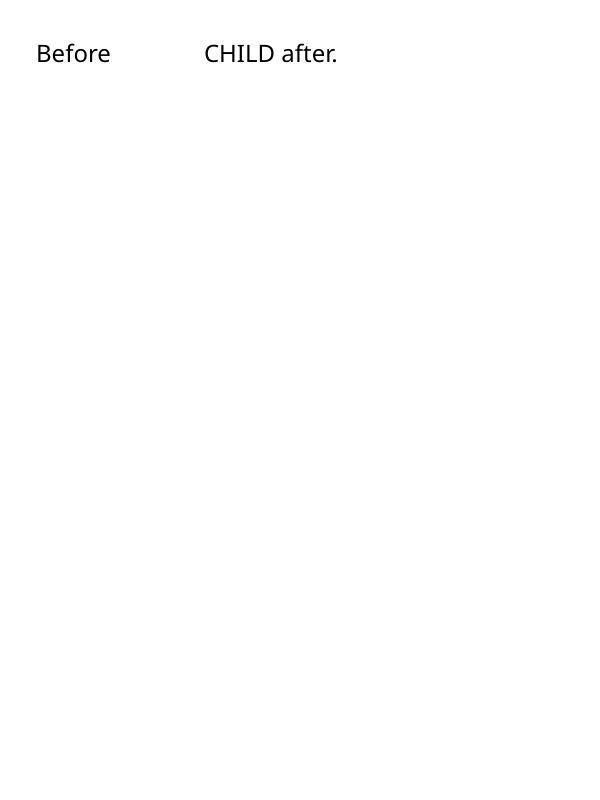

# CSS display and visibility: consumer migration

This phase connects the canonical-source-preserving projection to horizontal and
vertical reflow layout, hit testing, selection, word/context lookup and session
restoration. Publisher `display:none` omits layout/search/copy text;
`visibility:hidden` and `collapse` retain layout/search/selection while removing
that element's paint. A visible descendant may restore paint. Canonical source
text, revision, fragment tuples and saved quote content remain unchanged.
Pinned CRE keeps list-marker height, block padding and borders in the block
flow; an empty block has no content height unless its own height or box edges
add one. See [the pinned block renderer](https://github.com/koreader/crengine/blob/b32a88ffbbf505cf2ea5208c1a49002d70d3609f/crengine/src/lvrend.cpp#L8432-L8545) and [vertical margin collapse](https://github.com/koreader/crengine/blob/b32a88ffbbf505cf2ea5208c1a49002d70d3609f/crengine/src/lvrend.cpp#L6095-L6142).

The unverified user-CSS candidate now accepts ordinary `display:none` and
computed visibility (`visible`, `hidden`, `collapse`) through the same bounded
projection. It does not expose a hiding preset or claim complete CSS box-model
support. Non-`none` box reclassification and the remaining gates below stay open.

The current implementation candidate also keeps layout-only paragraphs for
an empty projected block when an eligible visible native block host (the block
itself or an ancestor) has generated content or explicit box geometry. It
retains canonical source block keys and carries nested host chains across
sibling blocks. Shared ancestors take their leading edge from the first block
and trailing edge from the last; their backgrounds and borders span the merged
range. The candidate accounts for each host's vertical
padding, solid opaque borders, bounded explicit/minimum height, background
paint, before content from outer to inner hosts, and after content from inner
to outer hosts. Empty host spans now enter the same block-margin planner as
ordinary blocks, allowing the planner's sibling and transparent-wrapper
collapse rules to place their outer edges. That planner combines adjacent
positive margins by maximum and negative margins by minimum, following the
pinned CRE flow behavior. This is source-aligned implementation work, not yet
proof of exact CRE geometry. It does not restore suppressed text or images.
Non-solid or translucent borders, reordered/table layouts, and whole-spine/device
behavior remain open. This change is uncompiled and unverified.

## Shared view and stable anchors

`ChapterFlow` binds each affected block's shared `Arc<OwnedProjection>` to the
same immutable parsed source. Layout-only `LayoutBlock` inputs borrow canonical
images and ruby records, with projected text, style spans and media slots. Empty
identity paths do not duplicate canonical text. Parser lifetime/revision plus the
immutable active style snapshot are required cache keys; owned projections cannot
be rebound to a separate parse.

Parley and vertical glyph clusters use projected bytes. Persisted anchors remain
canonical UTF-8 source offsets. `Line.spans` records actual retained canonical
intervals, so a line that joins two surviving words across removed text does not
count or highlight the hidden envelope. Search/nearby workers use the shared
font-free chapter flow and retain canonical disjoint hit intervals (see
[search migration](css-flow-search.md)). The app revalidates the immutable search
configuration before activating a result.

New copy, Unicode word expansion, CJK scan, dictionary context and snippets use
the rendered view. Historical annotation recovery uses `select_source_range` and
canonical source wording; changing publisher CSS must not falsely mark an old
unchanged quote as corrupt. Highlight geometry still intersects only the retained
projected spans. Combining marks and bidi text are tested after hidden inline
content joins the surviving text.

## Layout and navigation

- Text, ruby, media, list markers and background paint use separate computed
  suppression and painting masks. `display:none` images are not decoded; visibility-hidden
  media keeps its dimensions. A removed `rt` has no annotation layout, while an
  unpainted `rt` keeps its ruby geometry.
- Markers retain the list item's own visibility, independently of a visible child
  paragraph. Their displayed counters come from participating computed list
  items; canonical ordinals remain unchanged. A marker moves to the first retained
  paragraph, or keeps an empty marker strut if all its child content is removed.
- Tables, borders, width measurement and padding share the same validated table
  plan. The next retained block decides a cell's end, rather than a skipped hidden
  block. Unsupported changes to specified fractional column hints use the
  narrowly typed readable source-order fallback and report a limitation; they
  never count as grid fidelity. Other layout/parser errors propagate.
- Illustration anchors retain the original image ordinal even when an earlier
  image is removed or canonical text becomes a pure-image display block.
- An explicitly hidden fragment owner is unavailable. A visible container whose
  first text was removed can resolve to retained content inside its own subtree;
  it cannot silently select a following unrelated passage.
- Automatic restore may snap the displayed page to retained content while keeping
  the original valid canonical focus. Reflow, scroll/spread changes and reopening
  retain that focus; actual reading motion clears it. Explicit bookmark/link jumps
  never use this fallback.
- Saved user flow markers retain their source JSON and re-resolve CSS-omitted
  marker text against current pagination. This is boundary resolution, not an
  instruction to reveal the hidden glyph. Synthetic character-page numbering
  remains canonical as in pinned CRE.

## Verification API

`Probe::source_presentation` classifies a source anchor as `Normal`,
`VisibilityHidden` or `CssOmitted`; `fragment_presentation` classifies its actual
DOM owner. Both report intended CSS treatment, not successful layout.
`layout_limitations` reports readable degraded layouts separately.

`coverage()` retains **all canonical non-whitespace characters** in its
denominator and counts only represented retained intervals. A verifier must keep
intentional omissions separate from unexpected unmapped normal or
visibility-hidden content. A visible container with a hidden prefix remains an
eligible fragment even when its original caret points into omitted bytes.

## Authored desktop evidence

The test fixtures exercise the actual reflow engine. They are deliberately small
and contain no copied owner-book content. These pages show the retained text,
paint-only gap with a visible child, vertical paint-only gap and explicit hinted
grid fallback.

| Display omission | Visibility without collapsing space |
| --- | --- |
|  |  |

| Vertical projection | Reported source-order table fallback |
| --- | --- |
|  |  |

Focused tests cover 17 provenance, 6 shared-view, 3 existing vertical, 8 Probe,
2 live session/custom-boundary and 1 marker cases (37 distinct passing focused
cases). The workspace builds successfully on the Mac. The final serial library suite
passed 813 tests with 62 opt-in cases ignored; package 14 and system 4 suites also
passed (831 ordinary tests, zero failures). The authorized original 034 projection
and independent extracted-popup source contract also passed with its unchanged
SHA-256; this does not establish namespace-selector or rendered-spine parity.
Exact Mach-O executable hashes, source hashes, build JSON and screenshots are
retained privately under `build/parity-review/flow-consumer-evidence/`.

## Combined desktop checkpoint

The assembled source `9a5006e2` includes these consumers, immutable styled search,
the four-case footnote-root correction, custom content DPI and explicit verifier
intent accounting. It passes 829 library, 14 package and four system tests on
Mac (847 ordinary cases). Eight original-document defaults, complete-backup and
DPI runs also pass with unchanged EPUB/PDF/AZW3/MOBI hashes. The verifier keeps
all canonical characters in its denominator and reports CSS omissions,
visibility-hidden geometry, fragment-owner intent and layout limitations
separately. Losing visibility-hidden geometry remains a failure.

Its full-original replay is **not accepted**: original EPUB 053 loses layouts in
zero-based sections 29, 32 and 46 that the prior style checkpoint could open.
The failing result and preceding comparison are retained for diagnosis. A
separate tail replay completes the remaining original editions. These results
are desktop-only and do not authorize replacing the official 0.1.22 package.

## Remaining acceptance gates

1. The current candidate supplies canonical hidden-block boundaries and
   layout-only paragraphs for nested visible host chains, with shared sibling
   ancestors attached to their first and last blocks. Verify generated-only
   visible LI/container geometry, list counters and markers, nested
   padding/background/borders, generated text order, sibling extent merging,
   and retained source intent. Empty host spans now use the shared block-margin
   planner; compare its results against CRE for nested, adjacent, positive and
   negative margins. Its source
   intent remains eligible; it must never be relabeled an intentional omission
   to hide missing geometry.
2. The focused correction stops widening an inner-P target to its semantic
   aside and preserves inline attributes. Exact rendered-final ancestry,
   including inline targets inside hidden blocks and visible final ancestors,
   remains a separate source-aware popup integration gate.
3. Arbitrary non-`none` display box reclassification, namespace attribute selectors
   such as the original 034 EPUB footnote rule, and exact changed fractional grid
   fidelity are not claimed. The table fallback is visibly readable but degraded.
4. Partial affected provenance that exceeds the bounded complete map is rejected
   explicitly; unaffected/identity chapters and fully suppressed blocks remain
   usable. Same-text-node whitespace compaction avoids exhausting the event cap
   for ordinary long paragraphs.
5. The combined whole-spine original-document verifier must separately account
   for intentional CSS omissions, retained unpainted content and real failures.
   The earlier 48-original search receipt is not full-layout evidence.
6. Combined aggregate/native compilation, all-original rendered-spine replay and
   connected Kindle storage/paint/input acceptance remain parent integration
   gates. This phase performs no device calls, installation or release.
7. The newly exposed ordinary-element user-CSS hide/show path has a focused
   authored regression but no compile or runtime receipt. Exercise it through
   the actual Style Tweaks edit/apply flow, Reader search/copy, vertical and
   horizontal layout, and original saved-position restoration before release.
