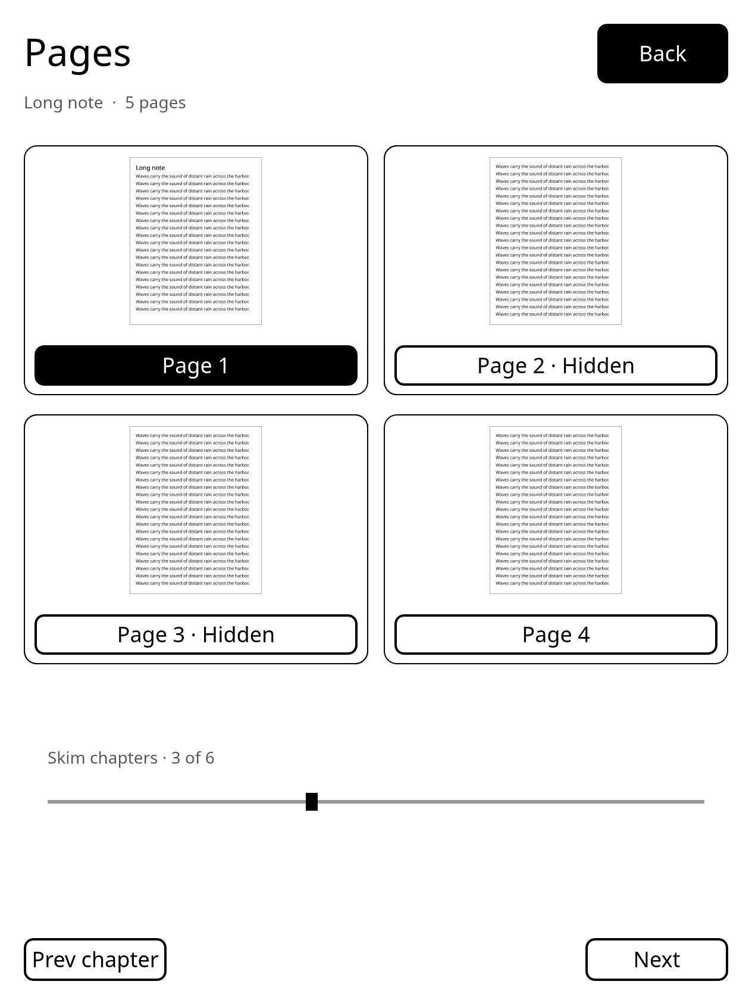
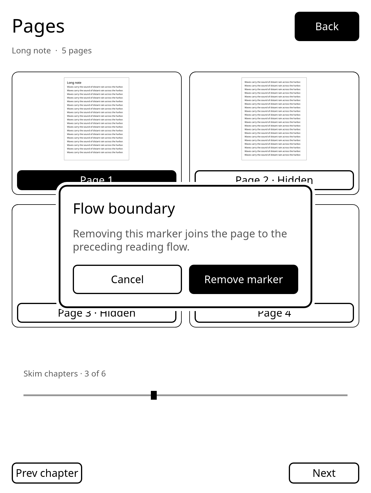
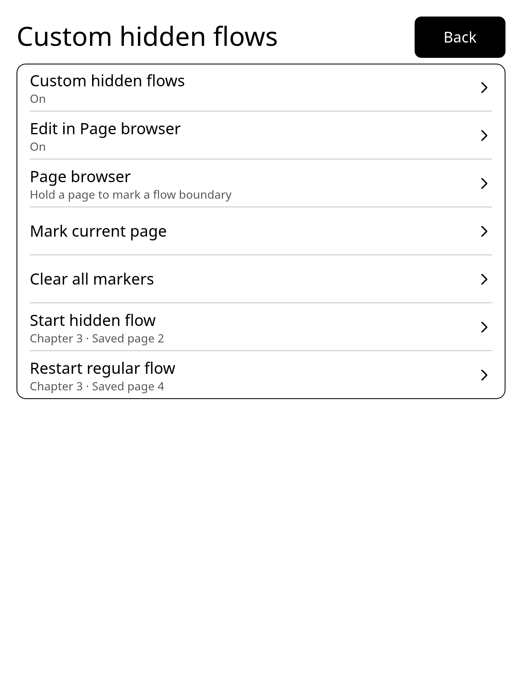
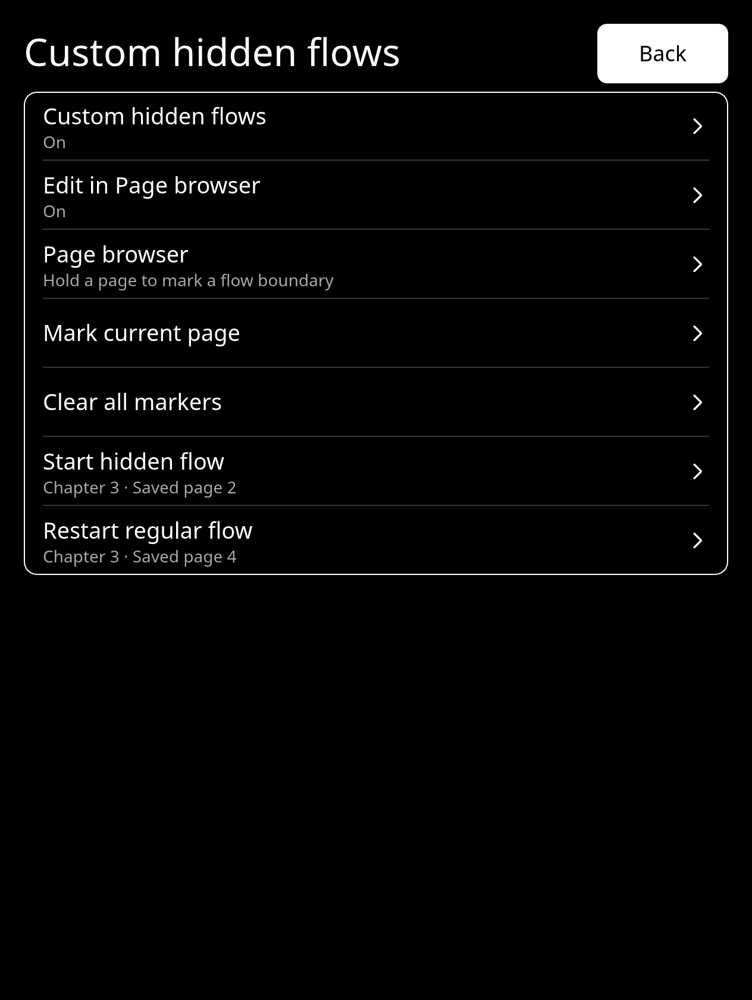

# Custom hidden reading flows

**Navigation → Custom hidden flows** lets you exclude long notes, a bibliography or other source pages from ordinary reading without editing the book. Turn it on, open **Page browser**, and hold the first page to choose **Mark flow boundary**, then **Start hidden flow**. Hold the first page you want to include again and use **Mark flow boundary › Restart regular flow**. **Mark current page** opens the same confirmation. An existing boundary offers **Remove marker**.

Links, Contents, Book map, bookmarks, search results and explicit jumps can still open a hidden page. Forward and back then traverse that hidden flow and the surrounding regular flow. Other hidden flows remain skipped. The footer numbers each opened hidden flow and counts its pages independently. Main-flow page counts, progress, chapter counts and remaining-time estimates exclude hidden pages. Cross-chapter EPUB progress remains a source-size estimate, as in ordinary Reader reading.

 

## Editing and saved locations

- **Edit in Page browser** hides the marking action while retaining the reading flow. Turning **Custom hidden flows** off keeps every marker so you can enable it later.
- Boundary rows open their saved source locations. Reflow markers use text anchors; fixed pages keep their original source index. Font, margin and column changes resolve reflow boundaries in the new pagination. Saved page numbers describe the layout in which a marker was created. Changing a boundary reuses the current chapter's layout instead of reshaping its text.
- Repeated start or restart markers remain saved, matching KOReader's ability to move a boundary without losing another. **Clear inactive markers** removes only currently ineffective markers after confirmation. **Clear all markers** also requires confirmation.
- A missing source location stays listed as unavailable and does not silently attach to another passage. A fully hidden book remains openable so its markers can be disabled or cleared.
- A book can hold up to 512 validated source boundaries.
- Reader's local reading-data backup includes markers, edit mode and enabled state. Merging a backup keeps existing book overrides and adds each source boundary once. The original EPUB, PDF or comic remains unchanged.

Paged reflow, facing pages and continuous scroll use the same source mask. Continuous EPUB views join permitted source regions and retain separate geometry for selection, links, images and margin labels. Fixed PDF continuous views skip hidden source pages. Reopening a short hidden final page restores its saved source page and view under the mask, so bottom-of-document clamping cannot replace it with the preceding regular page. Comic and fixed-layout EPUB spreads preserve physical slots: an excluded partner remains blank instead of moving another page into its place. Direct jumps can still display the excluded source page. The next-volume control remains available when a comic's final regular page precedes a hidden rear page.

 

## Publisher fragments and the reader-wide default

EPUB's publisher-defined non-linear fragments are separate from custom ranges. **Navigation → Hide non-linear fragments** stores an explicit per-book choice. **Default for non-linear fragments** sets the reader-wide starting value for books without an override. Existing saved true/false choices retain their meaning. Publisher suppression applies to single-page paged reading; custom flows take precedence while enabled. [Publisher-fragment behavior and reference checks](nonlinear-reading.md)

## Reference comparison

The reference is KOReader v2026.07.1, commit `9192014d8bd82a91dc1012473be0f238dedfdb54`. The comparison runs the pinned `ReaderHandMade` methods for boundary insertion, inactive markers and flow setup, then `CreDocument`'s actual next/previous methods in a local Lua runtime. Only the reader class, page-count provider and notification callback are stubbed. No private book text appears in the committed traces. [Custom-flow implementation](https://github.com/koreader/koreader/blob/9192014d8bd82a91dc1012473be0f238dedfdb54/frontend/apps/reader/modules/readerhandmade.lua) · [Reference navigation](https://github.com/koreader/koreader/blob/9192014d8bd82a91dc1012473be0f238dedfdb54/frontend/document/credocument.lua)

Eight authored sequences and 64 deterministic randomized sequences cover 4,928 directed next/previous transitions. Reader matches boundary state, inactive markers, main-page count and the navigation traces, with one narrowly recorded correction. In seven transitions, the reference's final-flow bound treats a half-open end as the inclusive page count and reports end-of-book before a final regular page. Reader keeps that user-marked regular final page reachable. The generator accepts only that precise discrepancy; any other difference fails. [Trace generator](../scripts/compare-hidden-flows.py) · [Authored numeric traces and reference hashes](../tests/fixtures/hidden-flows-reference.json) · [Boundary and navigation tests](../src/library/hidden_flows.rs)

Run the source comparison with Python and `lupa` available:

```sh
python3 scripts/compare-hidden-flows.py /path/to/pinned/koreader tests/fixtures/hidden-flows-reference.json
```

Functional tests use the actual Reader actions, thumbnail long press and shared confirmation sheet. They cover page turns, explicit jumps and return, inactive removal and cancellation, font repagination, saved source selection, reopen, global defaults, cross-chapter ranges, facing pages, joined scroll geometry, fixed-page scroll and text reading, spread slots and recovery from unavailable or all-hidden ranges. Private original checks use three original EPUBs and two original PDFs, including PDFs with 229 and 1,066 pages. The tests compare each source file before and after reading; private receipts identify cases without publishing titles or content. [Functional tests](../src/app/hidden_flows/tests.rs) · [Fixed spread tests](../src/fixed_session.rs)

```sh
cargo test --locked --offline --features kindle --lib custom_flow -- --test-threads=1
cargo test --locked --offline --features kindle --lib hidden_flows -- --test-threads=1
```

To include authorized originals, set `READER_CUSTOM_FLOW_ORIGINALS` to the private numbered EPUB corpus and `READER_CUSTOM_FLOW_PDFS` to the numbered PDF directory, then add `--include-ignored`. Optional `READER_CUSTOM_FLOW_ORIGINAL_RECEIPT` and `READER_CUSTOM_FLOW_PDF_RECEIPT` write private machine-readable results. Public screenshots use only the authored fixture.

The final desktop suite passed **571 library tests, 14 EPUB package tests and four system tests**. The 32 opt-in library checks are reported separately from that total. Screenshots were reviewed in both themes; the public images use authored content. [Joined EPUB scroll view](screenshots/custom-flow-scroll.png) · [Fixed PDF scroll view](screenshots/custom-flow-pdf-scroll.png) · [Fixed-page hidden-range map](screenshots/custom-flow-fixed-map.png)

## Acceptance still pending

Desktop unit, functional and system evidence is separate from native execution. This feature still needs the aggregate ARM build, automated native tests, foreground Kindle validation and release/catalog publication. The stock Lua comparison verifies flow algorithms; it does not establish identical CREngine pagination or physical E Ink refresh behavior.
