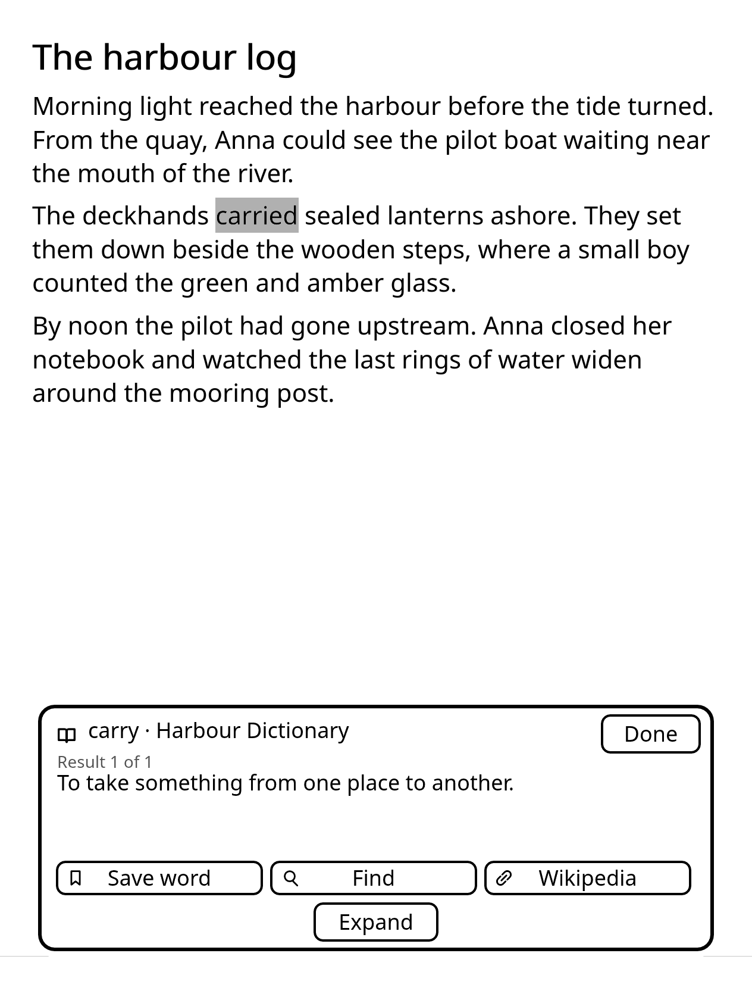

# Looking up inflected words

Long-press a word on the page and tap Dictionary. If an enabled dictionary has an entry for the selected spelling or an alias, Reader shows that entry. Otherwise it tries common English inflections in that dictionary. For example, selecting *carried* can open the headword *carry*. When those steps find nothing, Reader searches the enabled dictionaries for up to ten similar spellings. The popup stays over the book while results arrive. Closing it returns to the selected word. Save word remains a separate action.

In Dictionaries, **Word forms by default** sets the preference for the library. **Word forms in this book** overrides it for the current title. **Use the default word forms setting** returns this book to the library preference. Existing books inherit the default. Each dictionary can contribute a different headword through its headword or synonym index.

## Reference behavior

KOReader routes selections to its dictionary module and passes candidate words to sdcv. Its exact-search setting has global and per-book scope. sdcv first searches direct dictionary entries and synonyms. Its next step considers spelling case and English suffixes, including certain doubled consonants and dropped final letters. With fuzzy matching enabled, sdcv can then suggest words by edit distance. Language-support plugins can supply additional candidates. Reader implements English word forms and edit-distance suggestions. The library and book preferences control both. [KOReader selection and lookup](https://github.com/koreader/koreader/blob/v2026.07.1/frontend/apps/reader/modules/readerdictionary.lua#L1233-L1377) · [sdcv word lookup](https://github.com/Dushistov/sdcv/blob/v0.5.5/src/stardict_lib.cpp#L1026-L1348)

The Reader implementation ranks the candidate spellings while streaming each selected index and keeps the senses for the best available spelling within its existing result and byte limits. Tests cover direct entries, aliases, distinct results across dictionaries, casing, per-book persistence, selecting a word through the reading UI, and returning to that passage.

## Original EPUBs on the Oasis

An independent scan of the four installed StarDict dictionaries found 64 inflected word candidates in eight original EPUBs. For 55 selections, installed sdcv found no exact entry and returned the independently identified roots in ordinary lookup. These covered eight suffix families. On both the Mac and Oasis, Reader opened each original chapter, selected the word with a long press and displayed the same dictionary, headword and visible definition for all 77 results. Closing every popup restored the passage and its selection. The original EPUBs, dictionary files, saved Reader data and Browser session retained their checksums.

The median physical lookup was 0.94 seconds with other device checks running. The observed range was 0.87–9.97 seconds. The comparison covers the 55 word-form cases. The following comparison covers the remaining suggestions.

## Similar spellings

Reader compares Unicode characters and allows an adjacent transposition, an insertion, a deletion or a substitution. It uses sdcv’s cutoff of fewer than three edits and gives closer spellings priority. Each suggestion can open definitions from multiple enabled dictionaries. CJK selections continue to use direct lookup. Closing the popup or putting the Kindle to sleep cancels its background search. [sdcv suggestion ranking](https://github.com/Dushistov/sdcv/blob/v0.5.5/src/stardict_lib.cpp#L1269-L1355) · [KOReader dictionary lookup](https://github.com/koreader/koreader/blob/v2026.07.1/frontend/apps/reader/modules/readerdictionary.lua)

Nine further long presses in five original EPUBs exercised suggestions across four installed dictionaries. Reader on the Mac and the Oasis returned all 82 distinct definitions found by installed sdcv. Each result was checked by dictionary, headword and a digest of the full visible definition. Closing every popup restored the selected passage.

One selection also displayed a direct headword that sdcv missed. An independent scan found its index record and verified its definition bytes in the compressed dictionary. The index had 108 entries out of sort order relative to their neighbors. For this headword, sdcv’s binary search selected index page 2, while the valid entry was on page 49. Reader’s sequential scan recovered it. [sdcv index search](https://github.com/Dushistov/sdcv/blob/v0.5.5/src/stardict_lib.cpp#L687-L745)

On the Oasis, the median time to the final suggestions was 3.25 seconds across these nine selections. The range was 0.90–18.35 seconds. The popup remained dismissible while suggestions were loading. The source documents, dictionaries and saved reading and Browser data retained their checksums.
