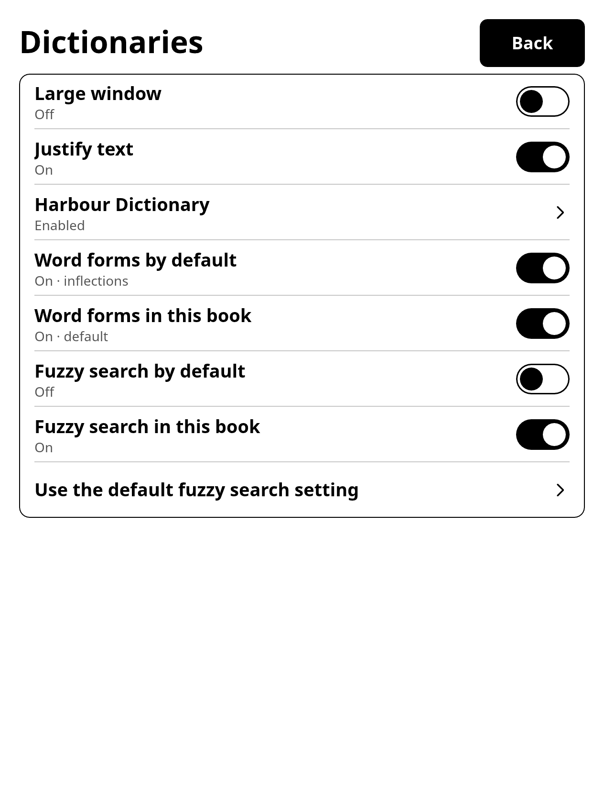
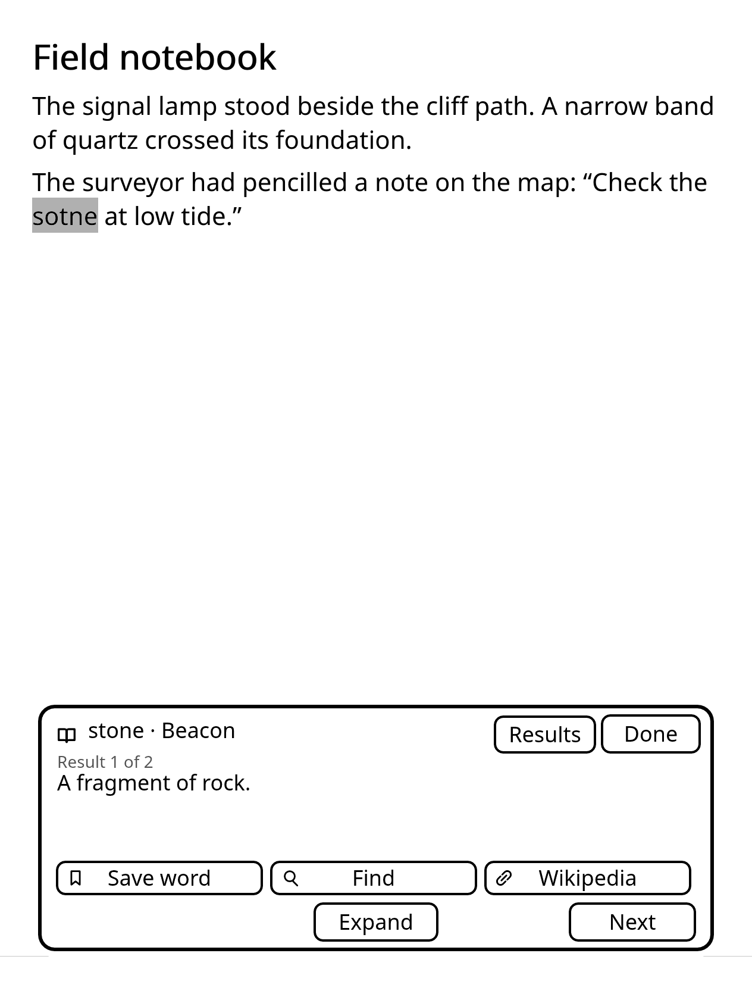

# Looking up inflected words

Long-press a word on the page and tap Dictionary. If an enabled dictionary has an entry for the selected spelling or an alias, Reader shows that entry. When Word forms is on, Reader also tries common English or supported Japanese inflections in that dictionary. For example, selecting *carried* can open the headword *carry*. When those steps find nothing and Fuzzy search is on, Reader searches the enabled dictionaries for up to ten similar spellings. The popup stays over the book while results arrive. Closing it returns to the selected word. Save word remains a separate action.

The English fallback also proposes dictionary forms for adverbs and
comparatives, such as *happily* → *happy*, *happiest* → *happy*,
*bigger* → *big*, and *wider* → *wide*. Literal and previously available
candidate matches retain their order. These newly added forms await integrated
and device testing; they do not imply a complete English morphological model.

## Japanese polite and honorific forms

The current unverified candidate also resolves common polite i-adjective forms
such as `高くありませんでした` to `高い`, and na-adjective or noun copulas
such as `静かではありませんでした` to `静か`. For respectful or humble
phrases, it removes the productive `お`/`ご` prefix and applies the corresponding
verb-stem or `する` noun rule. Examples include `お読みしました` and
`お読みになっていました` → `読む`, and `ご利用になりました` → `利用する`.
Common request and benefactive phrases also reduce through `ください` and
`いただく`: `お読みください` → `読む`, `ご確認ください` and
`ご確認いただきました` → `確認する`, and `ご利用いただけませんでした`
→ `利用する`. These suffixes are considered only after an `お` or `ご`
prefix, so standalone `ください` and `いただく` remain literal lookups. Each
result remains only a bounded lookup candidate; an installed dictionary must
contain the exact headword before Reader shows it. Direct conjugations rank
ahead of candidates that require multiple auxiliary reductions. Original
selected text and its reading anchor are never rewritten.

The candidate also reduces common te/de auxiliary phrases before deconjugating
the underlying verb, including `食べてください` → `食べる`,
`読んでいただきました` → `読む`, `読んでもらえた` → `読む`,
`読んでくれた` → `読む`, and `書いてみました` → `書く`. It covers common
request, benefactive, trial, aspect, and motion auxiliaries in bounded forms.
The expanded candidate also unwraps connective `ながら` / `つつ` forms such as
`読みながら` and `読みつつあります`, and common te/de trial, preparation and
completion forms such as `読んでみたかった`, `書いておきたかった`, and
`読んでしまいたい`. It accepts these auxiliaries only after a te/de stem.
Higher-politeness i-adjective negatives such as `高くはありませんでした`
and `高くございませんでした`, plus classical suppositional forms such as
`高かろう` and `よかろう`, also reduce to bounded dictionary candidates.
Colloquial negative `ねえ` / `ねぇ` / `ねー` forms reduce through `ない` before
the verb or adjective step. The candidate also handles classical adjective
endings such as `美しき` → `美しい`, `しげ` forms such as `悲しげ` → `悲しい`,
and kana-final negative imperatives such as `読むな` → `読む`.
Negative appearance forms such as `高くなさそうでした` also reduce to
`高い`; the irregular `よくなさそう` and `かっこよくなさそう` retain the
`いい` / `よい` dictionary-headword alternatives.
Common obligation and compulsion phrases now reduce through their negative
verb stem, including `読まなくてはならない`, `食べなければいけない`,
`勉強しないといけない`, `読まなきゃならない`, and
`食べなくっちゃいけない`. The same bounded path covers
`読まずにはいられない`, `食べないではいられない`, and
`使わざるを得ない`.
Irregular candidates also include `よかった` → `いい` / `よい`,
`かっこよくない` → `かっこいい` / `かっこよい`, and `信じた` →
`信じる` / `信ずる`. Common `ずる` forms include polite, negative, potential,
causative, `なさい`, and `すぎる` variants; older dictionaries can also match
inflections of `為る`. The bounded negative-form rules cover common `ぬ` / `ん`
endings, and literary or dialectal `うた` / `うて` forms such as `問うた` →
`問う`.
These rules are independently authored: KOReader's bundled Yomichan table is
GPL-3.0-or-later, while this repository uses PolyForm Noncommercial, so that
table is not included. This expanded candidate is not yet behavior-verified.

KOReader's Japanese plugin documents that its deinflection rules come from
Yomichan's data, copied verbatim and licensed GPL-3.0-or-later. Reader uses
independently authored productive morphology and does not bundle that rule
table. Wider irregular, archaic, dialectal and lexicalized forms remain open;
this candidate has not yet had integrated or device verification. [KOReader
Japanese plugin source and data notice](https://github.com/koreader/koreader/blob/9192014d8bd82a91dc1012473be0f238dedfdb54/plugins/japanese.koplugin/README.md)

In Dictionaries, **Word forms by default** sets how Reader handles inflections. **Fuzzy search by default** controls the extra spelling scan after a miss. Both are on for a fresh installation. Each book or PDF can use its own choice for either setting. **Use the default fuzzy search setting** returns that edition to the library preference. On upgrade, any existing Word forms choice supplies the initial fuzzy choice at the same scope. Each setting can then be changed separately.

## Fuzzy retry after a miss

With fuzzy search disabled, an ordinary miss in an enabled dictionary opens a
prefilled editor. Edit the word if needed and choose **Fuzzy search** for this
lookup. The original passage remains selected, and the book and library
preferences retain their saved values. Cancel returns to the passage or the
typed lookup editor. If the retry finds nothing, the result can be dismissed
without another prompt. [Pinned miss and retry callbacks](https://github.com/koreader/koreader/blob/9192014d8bd82a91dc1012473be0f238dedfdb54/frontend/apps/reader/modules/readerdictionary.lua#L1465-L1504)

The Mac tests exercise the visible landscape keyboard, an edited query from
an EPUB selection, and cancelling or exhausting a retry from typed lookup.
The definition close returns to the original selection and reading position.
[Simulator capture](screenshots/landscape-dictionary-fuzzy-retry.png) · [Pinned callback check](../scripts/compare-dictionary-fuzzy-retry.py)

## Reference behavior

Pinned KOReader exposes a global fuzzy default and saves a separate option for each edition. Its lookup picker passes `--exact-search` to sdcv when fuzzy is off. With fuzzy enabled, sdcv can try case and English suffix forms and then edit distance. KOReader's language-support plugins can still supply form candidates when fuzzy is off. Reader handles word forms in its own lookup and applies Fuzzy search only to the bounded spelling scan. Both skip edit-distance suggestions for CJK selection. [KOReader setting and dispatch](https://github.com/koreader/koreader/blob/9192014d8bd82a91dc1012473be0f238dedfdb54/frontend/apps/reader/modules/readerdictionary.lua#L327-L351) · [KOReader candidates](https://github.com/koreader/koreader/blob/9192014d8bd82a91dc1012473be0f238dedfdb54/frontend/apps/reader/modules/readerdictionary.lua#L1341-L1377) · [sdcv word lookup](https://github.com/Dushistov/sdcv/blob/v0.5.5/src/stardict_lib.cpp#L1261-L1355) · [Japanese and Chinese selection](cjk-dictionary-selection.md)

The local comparison exercised the pinned Lua menu callbacks and lookup dispatch. The Reader simulation used an authored EPUB and PDF to verify edition switching, disabling fuzzy while preserving inflections, exact and CJK lookups, restoration of both policies after reopening, and return to the original reading location. The migration test loads the earlier paired settings and changes each policy independently.

The Reader implementation ranks the candidate spellings while streaming each selected index and keeps the senses for the best available spelling within its existing result and byte limits. Tests cover direct entries, aliases, distinct results across dictionaries, casing, per-book persistence, selecting a word through the reading UI, and returning to that passage.

## Original EPUBs on the Oasis

An independent scan of the four installed StarDict dictionaries found 64 inflected word candidates in eight original EPUBs. For 55 selections, installed sdcv found no exact entry and returned the independently identified roots in ordinary lookup. These covered eight suffix families. On both the Mac and Oasis, Reader opened each original chapter, selected the word with a long press and displayed the same dictionary, headword and visible definition for all 77 results. Closing every popup restored the passage and its selection. The original EPUBs, dictionary files, saved Reader data and Browser session retained their checksums.

The median physical lookup was 0.94 seconds with other device checks running. The observed range was 0.87–9.97 seconds. The comparison covers the 55 word-form cases. The following comparison covers the remaining suggestions.

## Similar spellings

Reader compares Unicode characters and allows an adjacent transposition, an insertion, a deletion or a substitution. It uses sdcv’s cutoff of fewer than three edits and gives closer spellings priority. Each suggestion can open definitions from multiple enabled dictionaries. CJK selections use literal lookup and supported Japanese forms; they do not use edit-distance spelling suggestions. Closing the popup or putting the Kindle to sleep cancels its background search. [sdcv suggestion ranking](https://github.com/Dushistov/sdcv/blob/v0.5.5/src/stardict_lib.cpp#L1269-L1355) · [KOReader dictionary lookup](https://github.com/koreader/koreader/blob/v2026.07.1/frontend/apps/reader/modules/readerdictionary.lua)

Nine further long presses in five original EPUBs exercised suggestions across four installed dictionaries. Reader on the Mac and the Oasis returned all 82 distinct definitions found by installed sdcv. Each result was checked by dictionary, headword and a digest of the full visible definition. Closing every popup restored the selected passage.

One selection also displayed a direct headword that sdcv missed. An independent scan found its index record and verified its definition bytes in the compressed dictionary. The index had 108 entries out of sort order relative to their neighbors. For this headword, sdcv’s binary search selected index page 2, while the valid entry was on page 49. Reader’s sequential scan recovered it. [sdcv index search](https://github.com/Dushistov/sdcv/blob/v0.5.5/src/stardict_lib.cpp#L687-L745)

On the Oasis, the median time to the final suggestions was 3.25 seconds across these nine selections. The range was 0.90–18.35 seconds. The popup remained dismissible while suggestions were loading. The source documents, dictionaries and saved reading and Browser data retained their checksums.
