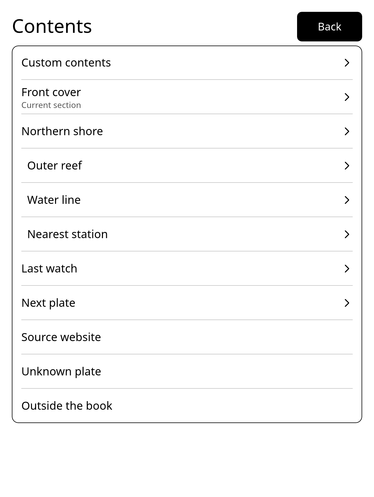

# DjVu publisher contents

Open **Contents** from either reading bar to see the publisher’s chapters in
reading order. A chevron marks each heading that opens a page in the current
book. Nested headings are indented. **Previous location** restores the scan
page and the portion visible before the jump, including a panned, enlarged
view. Physical page buttons continue to work after closing Contents.



## What determines the destination

KOReader’s pinned native DjVu provider reads the outline with
`ddjvu_document_get_outline` and walks the hierarchy in publisher order.
Its Lua binding scans each fragment for its first digit. For example,
`#reef-42.djvu` yields 42 even if the page with that ID is page three.
Reader resolves the complete fragment against the publication’s page
directory. [KOReader native contents binding](https://github.com/koreader/koreader-base/blob/6e4bc81af4e04f78d81677a323a780a71b29702a/djvu.c#L258-L318)

Reader follows DjVuLibre’s precedence for outline links. It checks the
component ID, a signed displacement from the current page, a printed title,
a one-based physical page number, then a component name. Percent-encoded
names are decoded before lookup. Repeated printed titles select the nearest
match at or after the current page, wrapping to the front. Relative and
repeated-title targets update when the reader turns the page. The progress
footer uses headings with fixed destinations. URLs, unknown targets,
non-page components and out-of-range displacements stay as inactive rows.
[DjVuLibre page-reference rules, section 3.2](https://sourceforge.net/p/djvu/djvulibre-git/ci/03e6abd7295c74f795ed70a7118294b25351e0f4/tree/doc/djvuchanges.txt)

The Rust decoder supplies the NAVM tree. Reader traverses at most 512 entries
and 16 levels, the same presentation limits as PDF. The on-screen label is
limited to 256 characters. The decoder’s public component-directory API
exposes identifiers. For named destinations Reader also reads optional
titles and names from the bounded bundled DIRM data. A book without a NAVM
uses normal page controls and custom contents. [Rust decoder](https://docs.rs/djvu-rs/0.46.0/djvu_rs/struct.Document.html#method.bookmarks) · [Reader implementation](../src/djvu_contents.rs)

## Verification

The six pages, drawings and outline in *Beacon Atlas* were authored for this
project. DjVuLibre’s `cjb2`, `djvm` and `djvused` produced the bundled book.
`djvused` independently read all ten headings and `ddjvu` decoded all six
pages at their original dimensions. On the Mac simulator Reader opened the
cover, followed the named third page, selected a later repeated title, and
returned to the original zoomed viewport within one source pixel. It also
reopened the saved cover and advanced and returned with the physical-button
input events. [Authored fixture](../tests/fixtures/beacon-atlas.djvu) · [Fixture generator](../scripts/generate-djvu-contents.py)

Reader also compared every publisher title, depth and target against
`djvused` for five reference files supplied with DjVuLibre 3.5.30. It drew
the first, middle and final page of each. The Russian manual’s 113 headings
target component IDs. The other four files use numeric fragments. All
15 sampled pages contained visible ink. These files come from the public
DjVuLibre documentation. The personal 130-document Kindle library contained
no DjVu files. [Reference documents](https://sourceforge.net/p/djvu/djvulibre-git/ci/03e6abd7295c74f795ed70a7118294b25351e0f4/tree/doc/)

| Reference | Pages | Matching headings and destinations |
| --- | ---: | ---: |
| DjVu 2 specification | 39 | 98 |
| DjVu 3 specification | 71 | 152 |
| DjVuLibre English manual | 57 | 22 |
| DjVuLibre Russian manual | 48 | 113 |
| Lizard 2003 NAVM example | 6 | 6 |
| **Total** | **221** | **391** |

Three additional public-domain scans covering 30 pages had no publisher
outline in either reader comparison. Eight first, middle or last pages drew
with visible ink. [Scan provenance](https://github.com/matyushkin/djvu-rs/blob/c8e86c93214f9f10093c2c696945cfef0c9e500d/tests/corpus/README.md)

The following commands use Python with Pillow, DjVuLibre CLI tools and a
Rust toolchain. The comparison outputs counts for each book.

```sh
cargo test --locked --lib djvu
python3 scripts/generate-djvu-contents.py --check
cargo build --locked --example verify_djvu_contents
python3 scripts/generate-djvu-contents.py --compare target/debug/examples/verify_djvu_contents \
    tests/fixtures/beacon-atlas.djvu
```
