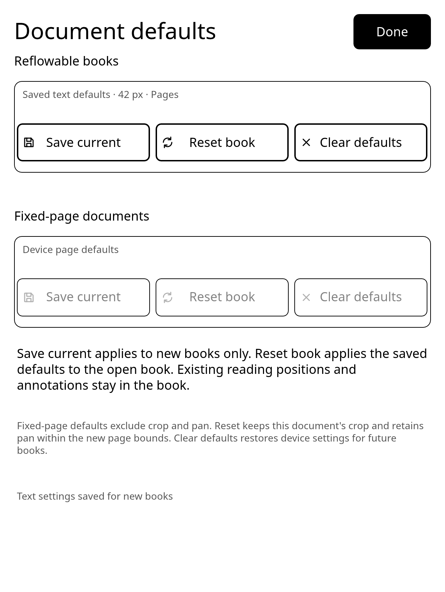
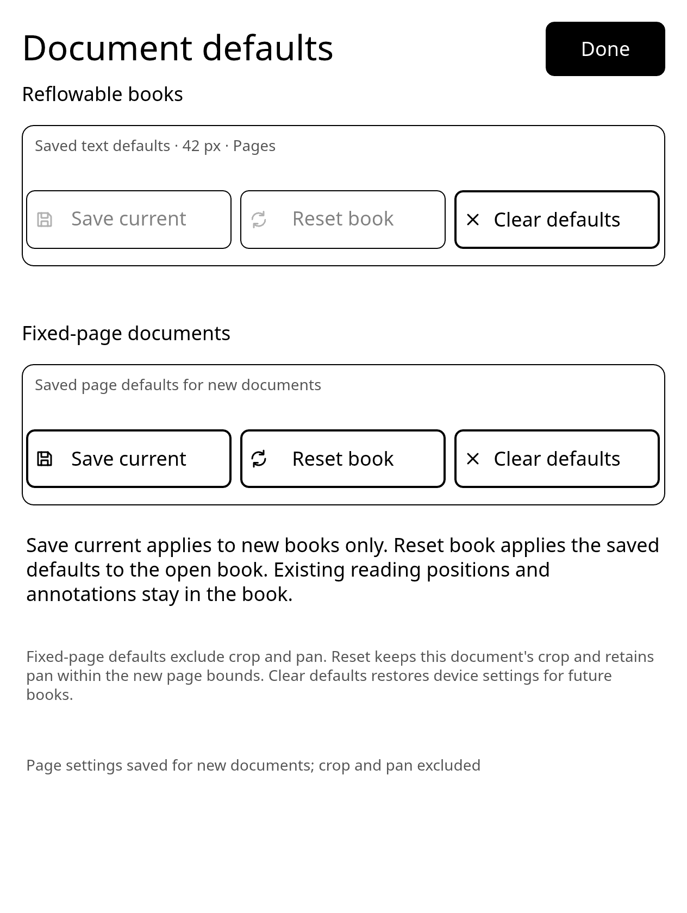

# Document defaults

Open a document, reveal the upper reading bar, and choose **Settings › Document defaults**. Reflowable books and fixed-page documents have separate controls. The same page is available in **Controls**.

| Control | Effect |
|---|---|
| Save current | Saves this document's current text or page settings for previously unseen content. Existing books keep their saved settings. |
| Reset book | Applies that format's saved defaults to the open document. With no saved template, it uses device settings. Reading positions and annotations stay with the document. |
| Clear defaults | Removes that format's template for future books. It does not reset the current document or the other format's template. |

Text defaults include the supported font, spacing, margins, layout, styles and hyphenation preferences. A removed default font falls back to device fonts with a notice. Reader retains the template's requested font name, but does not seed a broken font path into the new book's preferences.

Page defaults include zoom/fit, rotation, page direction, spreads/scroll and supported scan rendering options. **Crop and pan belong to the current document.** They are excluded from the saved template. Reset retains the crop and keeps pan within the new page's bounds; a lower zoom can remove overflow and clamp a pan offset. Source page and annotations remain intact.

## Relation to KOReader

KOReader's **Save document settings as default** writes separate reflow (`copt_`) and fixed-page (`kopt_`) options. Its reader configuration loads and saves document options separately. Reader follows that format separation and provides explicit save, reset and clear actions. This is the existing Rust settings subset; it does not make every KOReader engine option available. [KOReader save-as-default action](https://github.com/koreader/koreader/blob/v2026.07.1/frontend/apps/reader/modules/readermenu.lua#L362-L377) · [Document settings lifecycle](https://github.com/koreader/koreader/blob/v2026.07.1/frontend/apps/reader/modules/readerconfig.lua#L183-L194)

Reader considers a content fingerprint with no saved `BookState` unseen. The first successful open records its effective preferences. Later global changes do not alter that record. Older saved records, including records containing empty/default preferences, retain their existing device-baseline behavior. A failed open does not create a saved default snapshot.

## Storage and failure behavior

The optional `reader/data/document-defaults.json` file uses version 1 with separate `reflow` and `fixed` templates. It has a 64 KiB limit and stores no progress, annotations or source-specific crop/pan geometry. Writes use the app kit's atomic save. Unreadable, oversized, symlinked or unknown-version files remain untouched and read-only. The same typed and range validators are exposed to the user-data backup importer.

Reset prepares the replacement layout/frame and persists the resulting preferences before replacing the visible reading object. If rendering or persistence fails, the prior preferences, frame and reading position remain available. Text profiles reuse the same current-settings snapshot helper, while remaining a separate manual preset feature.

## Verification

Desktop regressions cover separate templates, new and known content across restart, clearing, missing fonts, annotation retention, source positions, and injected reflow/persistence failures. All six active save/reset/clear controls have pressed-frame checks. Storage regressions cover schema/range limits, unknown versions, symlinks, failed saves and crop/pan exclusion.

Four cached owner publications—two EPUBs and two PDFs—exercise first-page save, change, reset and reopen with byte-identical source files. This is a focused defaults workflow, not a complete reading or every-page comparison. An earlier combined candidate also ran the OPDS worker from its copied test executable; acquisition has since been removed from the current Reader source and is not an active acceptance gate. The combined 31612701 candidate repeats these original-file controls and the backup/defaults/DPI interaction regression. Kindle execution and physical acceptance remain pending.
