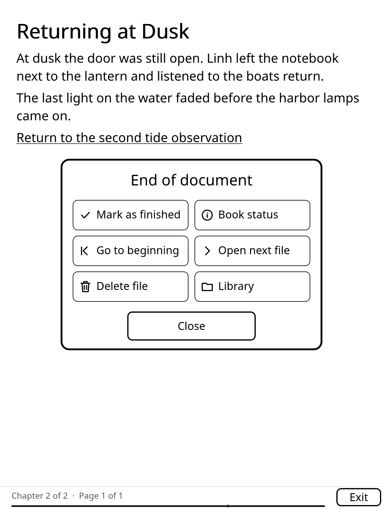

# End-of-book actions

Advance once from the last page or the bottom of a continuous document. Reader opens a compact panel over the page with actions for reading status, restarting, opening the next file in the folder, deleting the file and returning to Library. Dismiss with **Close**, a tap outside the panel or the physical back button. The visible page and saved position stay where they were.

Go to **Reading controls › At the end of a book** to select the default action. **Always mark as finished** can be independent of that choice. **Open next file** walks the folder in the Reader file picker’s order and skips unsupported entries. **Go to beginning** records the last page as a return location when the move changes the page or location. The Library action brings you back to the book’s folder.

**Delete file** presents a separate confirmation. It deletes the source file and keeps Reader’s saved notes, bookmarks and reading position. Reopening the same edition after restoring the file brings those records back. Whole unpacked EPUB folders can be managed in Files.

The end-of-book panel and delete confirmation center on the current reading
viewport in portrait and landscape. Rotation keeps the dialog and the
reading location. Closing the panel or canceling deletion returns to the
same passage. KOReader centers its two-column end-of-book dialog against
the active screen and also opens a separate deletion confirmation.
[Pinned actions](https://github.com/koreader/koreader/blob/9192014d8bd82a91dc1012473be0f238dedfdb54/frontend/apps/reader/modules/readerstatus.lua#L59-L125) · [Pinned layout](https://github.com/koreader/koreader/blob/9192014d8bd82a91dc1012473be0f238dedfdb54/frontend/ui/widget/buttondialog.lua#L246-L274)

## Return to the current book folder

While reading, open the **Library** menu and choose **Current book folder**.
Reader saves your position and marks, then shows the containing folder on
the page where the book appears. This also works when you opened the book
from Continue reading, search or a direct document link. An extracted EPUB
appears as its containing package folder in the parent list.

KOReader’s Home action closes the reader and passes the current file to its
file chooser so the directory opens at that file. The Reader shortcut
uses the same sequence after checking the destination can be read.
[Pinned KOReader Home action](https://github.com/koreader/koreader/blob/9192014d8bd82a91dc1012473be0f238dedfdb54/frontend/apps/reader/readerui.lua#L929-L934) · [Pinned file chooser handoff](https://github.com/koreader/koreader/blob/9192014d8bd82a91dc1012473be0f238dedfdb54/frontend/apps/reader/readerui.lua#L581-L595)

Desktop tests cover a resumed EPUB beyond the first folder page, saved
bookmarks and position after restart, fixed PDF, extracted EPUB, and
failed folder lookup or save. [Reading menu](screenshots/current-book-folder-menu.png) · [Containing folder](screenshots/current-book-folder.png)

## Move a book to archive

While reading, open **Library › Move to archive**. **Archive folder** lets you
save an existing destination within Documents. Reader uses **Documents /
Archive** by default and can create it when you first confirm a move.

Choose **Move current book** and check the displayed book, source folder and
destination. Confirm with **Move book**. The archive folder opens with the
moved file ready to reopen. Reader keeps the book's position, marks, status,
favorites and collections under the same edition. The action moves a single
publication file and its Reader data.

Reader creates the archive copy exclusively, so an existing same-name file
blocks the move. The original stays in place until Reader verifies the
archive copy and saves its new path. This requires room for the copy during
the move. If the source cannot be removed, Reader keeps both complete files
and **Continue reading** uses the archive. An interruption before the save
can leave a partial archive copy alongside the original.
[Choose a folder](screenshots/archive-folder-picker.png) · [Confirm the move](screenshots/archive-move-confirmation.png) · [Reopen the archived book](screenshots/archive-moved-library.png)

The pinned KOReader plugin saves an archive folder, calls its file manager
move, relocates the reading metadata, and offers to reopen the result.
The reference run executed those callbacks and their same-folder and missing
folder checks with in-memory filesystem and settings stubs. Reader's Mac
tests used real scratch EPUB and PDF files and checked cancellation,
destination collisions, source replacement, metadata failure, cleanup
ownership, byte equality and resume after a move or failed removal.
[Pinned archive settings and move](https://github.com/koreader/koreader/blob/9192014d8bd82a91dc1012473be0f238dedfdb54/plugins/movetoarchive.koplugin/main.lua#L60-L174) · [Pinned file manager move](https://github.com/koreader/koreader/blob/9192014d8bd82a91dc1012473be0f238dedfdb54/frontend/apps/filemanager/filemanager.lua#L1332-L1336)

## Switch between files in a folder

From the reading **Library** menu, choose **Previous file in folder** or
**Next file in folder**. Reader looks for the next unfinished publication
in that direction using the file picker’s saved order. It skips unsupported
entries and stops at the folder boundary. Reader saves the outgoing
position and marks before opening the selected document. The selected
document resumes at its saved position. If you cancel a PDF password,
Reader returns to the open book.

KOReader exposes both directions as reading actions and searches its active
folder order for supported files that are still unfinished. Reader uses the
same filtering for its manual actions. **Open previous document** uses
the recently read list. [Pinned KOReader actions](https://github.com/koreader/koreader/blob/9192014d8bd82a91dc1012473be0f238dedfdb54/frontend/dispatcher.lua#L76-L79) · [Pinned folder chooser](https://github.com/koreader/koreader/blob/9192014d8bd82a91dc1012473be0f238dedfdb54/frontend/ui/widget/filechooser.lua#L425-L450)

Desktop tests check both directions across a saved EPUB and PDF, both
folder boundaries, skipping completed and unsupported files, an extracted
EPUB, and wrong-password retry and cancellation. [Reading menu](screenshots/adjacent-folder-files-menu.png) · [Resumed EPUB](screenshots/adjacent-folder-files-target.png)

When the next file is password-protected, Reader keeps its accepted screen turn and lays out the password field, keyboard and Back button for that viewport. A rejected password clears the field. Cancel restores the outgoing book and its touch-lock state. A verified password opens the PDF at the current screen size before applying that PDF’s reading orientation preference. KOReader also shows a masked keyboard prompt, clears the entry on retry and resumes opening only after the document verifies the password. [Pinned KOReader password workflow](https://github.com/koreader/koreader/blob/9192014d8bd82a91dc1012473be0f238dedfdb54/frontend/apps/reader/readerui.lua#L749-L775) · [Pinned prompt callbacks](https://github.com/koreader/koreader/blob/9192014d8bd82a91dc1012473be0f238dedfdb54/frontend/apps/reader/readerui.lua#L794-L837)

## Choose folder order

In Library, tap **Sort**. **Natural name** is the default. **File name**,
**File type**, **Last read**, and **Reading progress** are also available.
Natural name puts Volume 2 before Volume 10. File name
compares names alphabetically and puts Volume 10 before Volume 2. File type
groups files by extension and orders each group by name. Folders stay
above files. **Reverse order** flips the order within folders and within files.

**Last read** follows Reader's saved History order, with the most recently
opened book first. Unopened files follow in natural name order. The list shows
whether Reader has opened each document. This setting serves browsing.
Choose another sort to use the previous and next file actions.

**Reading progress** places books with the highest active progress first.
Older saved reading positions show **In progress** until Reader can record a
percentage on reopen. After active books come **On hold**, **Unopened**, and
**Finished** or **100%**. Ties use natural name order. PDF percentages follow
saved source pages. Reflow percentages are weighted estimates from the saved
reading location and cached chapter sizes. The folder picker uses this saved
data without opening the books to calculate the order.

Reader uses one saved choice across all folders and restores it when you
reopen the app. Manual previous and next file actions follow the selected
traversable order and skip finished books. The explicit **Open next file**
end action considers any readable file in that order. If **Open next file**
is your automatic end action, **Last read** and **Reading progress** show
the end-of-book prompt so the changing order cannot repeat books on its own.
Search retains its ranking and visible page while you change the folder sort.
[Sort choices](screenshots/folder-reading-order-menu.png) · [Progress-sorted folder](screenshots/folder-reading-order-picker.png)

KOReader saves its sort and reverse choices in the file manager. It uses
filesystem access time for Last read and its sidecar percentages for progress.
Reader uses its own saved reading data in both modes. A Lua check executed
the pinned comparer, grouping and reverse methods in both directions, the
Last read traversal guard, and both adjacent actions under progress. The
Mac tests cover older records, physical pagination, reopen, natural ties,
search result retention, progress across EPUB chapters, and the end prompt.
[Pinned sort definitions](https://github.com/koreader/koreader/blob/9192014d8bd82a91dc1012473be0f238dedfdb54/frontend/ui/widget/booklist.lua#L41-L179) · [Pinned chooser settings](https://github.com/koreader/koreader/blob/9192014d8bd82a91dc1012473be0f238dedfdb54/frontend/ui/widget/filechooser.lua#L205-L262) · [Pinned adjacent guard](https://github.com/koreader/koreader/blob/9192014d8bd82a91dc1012473be0f238dedfdb54/frontend/apps/reader/modules/readerstatus.lua#L175-L194)

## Reference and tests

The installed KOReader source matched the v2026.07.1 reference. Thirteen checks exercised its dialog, automatic and manual reading status, next-file access under different sort orders, return to the beginning, Library, and the independent confirmation before deletion. Both reading providers treat a forward attempt at the boundary as the trigger. [KOReader end-of-book actions](https://github.com/koreader/koreader/blob/v2026.07.1/frontend/apps/reader/modules/readerstatus.lua#L38-L222) · [Reflow page turns](https://github.com/koreader/koreader/blob/v2026.07.1/frontend/apps/reader/modules/readerrolling.lua#L911-L945) · [Fixed-page and continuous turns](https://github.com/koreader/koreader/blob/v2026.07.1/frontend/apps/reader/modules/readerpaging.lua#L912-L1047)

The Mac checks exercised all nine action preferences and the separate auto-finish setting, along with the end of a comic spread, confirmation and cancellation, reopening with saved marks, and the previous location after restarting. Four original reflowable books and three original PDFs each passed the same paged and continuous boundary checks. Deletion tests used a disposable authored copy.

The same seven originals passed the boundary checks on the Oasis 3 from its Documents folder. Their SHA-256 checksums matched after the run. The end-of-book panel and the deletion confirmation from the authored test produced byte-identical screenshots on the Mac and Oasis. The Kindle run used temporary Reader state with a separate disposable copy for the deletion check.

[Landscape end-of-book panel](screenshots/landscape-end-of-book.png)
