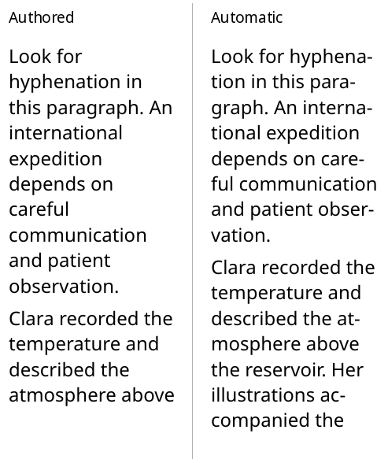

# English hyphenation in horizontal reading

In the lower Text panel, **Automatic** uses the book’s language and publisher
CSS. **Authored** uses discretionary soft hyphens supplied in the text. **Off**
disables both. Reader saves this choice per book and in typography profiles.
An existing saved book that disabled hyphenation still opens with it off.
[Spanish, Italian, and Portuguese dictionaries](multilingual-hyphenation.md)



The two simulator pages use the same Noto Sans face, 24 px text, 11 px margins
and 234 × 540 viewport. The fixture contains no authored soft hyphens. Both
modes mapped all 223 nonspace characters and reported zero missing glyphs.
The first paragraph took ten lines with Authored and eight with Automatic.
An independent comparison of both pattern tables found the same 35 possible
break positions across the fixture’s 19 eligible words.

```sh
for mode in authored automatic; do
    cargo run --locked --bin reader-probe -- parley tests/fixtures/english-hyphenation.epub \
        --font tests/fixtures/fonts/NotoSans-Regular.ttf --width 234 --height 540 \
        --size 24 --margin 11 --hyphenation "$mode" --output "$mode.png"
done
```

## How the two readers choose breaks

KOReader enables embedded language tags and hyphenation by default, with
book-specific settings taking precedence over global settings. Its Lua bridge
initializes the installed hyphenation directory and passes the reading options
to CREngine. [Reader typography](https://github.com/koreader/koreader/blob/9192014d8bd82a91dc1012473be0f238dedfdb54/frontend/apps/reader/modules/readertypography.lua#L698-L735) · [Dictionary initialization](https://github.com/koreader/koreader/blob/9192014d8bd82a91dc1012473be0f238dedfdb54/frontend/document/credocument.lua#L115-L120) · [Native settings](https://github.com/koreader/koreader/blob/9192014d8bd82a91dc1012473be0f238dedfdb54/frontend/document/credocument.lua#L1149-L1175)

The pinned CREngine chooses the full language tag, then its primary language.
Its English table gives British English its own patterns and uses American
English for generic English, with at least two letters before and three
after a break. It also has a US fallback for unrecognized languages.
Its US dictionary adds the TUGboat correction list to the same 4,938 base patterns used by Reader. [CREngine US dictionary](https://github.com/koreader/crengine/blob/b32a88ffbbf505cf2ea5208c1a49002d70d3609f/cr3gui/data/hyph/English_US.pattern#L1-L9)

The formatter uses the CSS permission, measured advances and unused line
space when deciding whether to try a hyphen. [Language table](https://github.com/koreader/crengine/blob/b32a88ffbbf505cf2ea5208c1a49002d70d3609f/crengine/src/textlang.cpp#L61-L66) · [Language selection](https://github.com/koreader/crengine/blob/b32a88ffbbf505cf2ea5208c1a49002d70d3609f/crengine/src/textlang.cpp#L178-L199) · [TeX pattern matching](https://github.com/koreader/crengine/blob/b32a88ffbbf505cf2ea5208c1a49002d70d3609f/crengine/src/hyphman.cpp#L944-L1034) · [Line fit](https://github.com/koreader/crengine/blob/b32a88ffbbf505cf2ea5208c1a49002d70d3609f/crengine/src/lvtextfm.cpp#L5381-L5475)

Reader inherits language from EPUB package metadata or MOBI/KF8 EXTH record
524 when a reading section omits it. A nearer XHTML `lang` or `xml:lang`
takes precedence. Automatic applies to generic, US and British English,
including explicit Latin script. Other English regions,
unsupported languages and explicit empty tags retain authored opportunities.
Publisher `hyphens: none`, `manual` and `auto` inherit across inline markup.
A word with an explicit soft hyphen uses its publisher’s breaks.

For American English, Reader builds the equivalent 6,708 weighted rules from 4,938 original TeX patterns,
14 original exceptions, 1,753 TUGboat corrections and three doubled-consonant
corrections. A higher matching weight takes precedence. This preserves extra
base-pattern opportunities where the published dictionary adds a preferred
break. The sorted normalized rules match the pinned CREngine dictionary
byte for byte (SHA-256 `9185d734d23492ac9872496e617b2a8e6ef19612a74e8f5d9a8e56817ee8b817`).
The Rust test also checks the complete set of resulting source offsets for
all 1,766 distinct exception spellings against an independent evaluator.
[TeX Users Group correction list](https://ctan.org/pkg/hyphenex) · [Reference verifier](../scripts/verify-english-hyphenation.py)

Its matcher checks ASCII words of 5–64 letters and supplies up
to 4,096 offsets per paragraph. The shaper accepts boundaries after complete
single-character LTR shaping atoms. It measures the face’s U+2010 or U+002D,
and paints it only when a line actually ends there. The source word remains
intact for search, selection, annotation and position storage. User exceptions,
spelling-changing breaks and controls for
CREngine’s unused-space threshold remain open. [Publisher source and terms](licenses/ENGLISH-HYPHENATION.txt) · [Shaper contract](../vendor/parley/PRIMITIVEOS-PATCH.md)

## British English and Kindle-format books

The original British pattern file contains 8,527 patterns and eight exceptions.
Reader builds 8,535 weighted rules. The complete normalized table matches the
pinned CREngine British dictionary byte for byte (SHA-256
`a0a2a0834a41bc7c0ce001de5c0d654b19a0475814b234d4dc4ed3d838b6499e`).
The Rust and independent Python tests check all eight corrected spellings.
A word split across style spans keeps its breaks when the spans agree on
the dictionary. If their dictionaries differ, only authored breaks apply.
[British pattern source and terms](licenses/ENGLISH-HYPHENATION.txt) · [CREngine British dictionary](https://github.com/koreader/crengine/blob/b32a88ffbbf505cf2ea5208c1a49002d70d3609f/cr3gui/data/hyph/English_GB.pattern) · [Reference verifier](../scripts/verify-english-hyphenation.py)


The two paragraphs in this single page use the same font and width.
Both regional declarations act inside a document tagged simply English.
The preview mapped all 127 nonspace characters. [Authored page](../tests/fixtures/english-regions.xhtml)

```sh
cargo run --locked --bin reader-probe -- parley tests/fixtures/english-regions.xhtml \
    --font tests/fixtures/fonts/NotoSans-Regular.ttf --width 235 --height 395 \
    --size 25 --margin 13 --output regional-lines.png
```

All 16 AZW3 and one legacy MOBI in the private Mac sample carried EXTH 524.
Ten declared English, five US English and two Chinese. Of the 501 reading
sections, 292 contained words without a markup language. Publication metadata
supplied English in 241 and Chinese in 51. One generically English AZW3
also contained 1,476 British-tagged text nodes in 44 sections. The pinned
CREngine PDB importer sets its publication language from that same EXTH
record. Reader accepts the first valid bounded BCP 47 record and preserves
the normalized XHTML and its source offsets. The pinned engine has no
Vietnamese dictionary. Reader preserves authored Vietnamese breaks. [CREngine PDB importer](https://github.com/koreader/crengine/blob/b32a88ffbbf505cf2ea5208c1a49002d70d3609f/crengine/src/pdbfmt.cpp#L897-L906) · [CREngine language table](https://github.com/koreader/crengine/blob/b32a88ffbbf505cf2ea5208c1a49002d70d3609f/crengine/src/textlang.cpp#L61-L122)

In three Mac comparisons the earlier 0.1.9 layout saved the source anchor
from page two. Each current layout reopened it, with every source character
covered and zero missing glyphs. The simulator used Noto Sans Regular and
Bold at 32 px on a 600 × 800 viewport with 24 px margins.

| Section language | Nonspace characters | Previous pages | Automatic pages | Pixels changed at the saved position | Authored-mode pixels changed |
| --- | ---: | ---: | ---: | ---: | ---: |
| US English from AZW3 metadata | 15,614 | 35 | 34 | 54,964 | 0 |
| British English from AZW3 markup | 8,510 | 21 | 21 | 11,626 | 0 |
| Generic English from legacy MOBI metadata | 58,184 | 160 | 158 | 13,124 | 0 |

### Original-book check on Kindle Oasis 3

The same two AZW3 sections and legacy MOBI section ran offscreen on the
Oasis 3 with its five configured fonts. The 0.1.9 ARMHF probe wrote a
page-two source bookmark. The new ARMHF probe reopened that bookmark in
Automatic and Authored modes for each original. All three yielded the same
page counts and changed-pixel totals as the Mac table above. All 82,308
nonspace characters mapped, with zero missing glyphs. All three source
files matched their pre-test SHA-256 digests after reading.

| Original section | First frame, 0.1.9 → Automatic | Peak process memory, 0.1.9 → Automatic |
| --- | ---: | ---: |
| US English from AZW3 metadata | 350 → 388 ms | 5,504 → 5,900 KiB |
| British English from AZW3 markup | 197 → 234 ms | 5,396 → 5,664 KiB |
| Generic English from legacy MOBI metadata | 833 → 907 ms | 10,912 → 11,396 KiB |

These are single runs in fresh processes at the 600 × 800 comparison size.
The authored regional fixture rendered pixel-for-pixel identically to the
Mac capture above. Two additional ARMHF unit tests checked the complete
US and British pattern tables, all correction spellings and nested changes
of language within one paragraph. The candidate package verification read
the full British MIT text and the dependency notice back from the staged
ARMHF ZIP and compared both with the licensed sources in the repository.

## Tests with existing books

Eleven private EPUB copies, including one duplicate, declared English in ten
packages and Vietnamese in one. Using Reader’s normal archive member loader,
309 of 344 spine records had an English section root after language inheritance,
11 Vietnamese and 23 an undetermined language. One missing spine member
produced the existing recovery placeholder. The counts measure declared language tags.

On a US English source chapter, Reader mapped all 13,306 nonspace characters
over 14 pages with Noto Sans Regular and Bold on the Mac. The audit checked
the EPUB package and every text run in the sampled source block. A single
eight-letter source word occupied one line in Authored and two lines in
Automatic. Tapping either fragment selected the complete word and source
search returned the same UTF-8 endpoints. The two page images differed in
165,541 pixels, including 160 in the 24-pixel strip at the chosen line end.
[Reflow comparison harness](../examples/verify_english_hyphenation.rs)

A Vietnamese chapter provided a negative control. Both modes mapped all
42,733 nonspace characters over 49 pages and produced identical first-page
pixels. A second control with an explicitly empty language tag mapped all
4,682 characters across seven pages and also produced identical first-page pixels. Six fresh Mac debug processes per mode alternated
run order, using Noto Sans Regular at 43 px on a 1,264 × 1,680 viewport.
Median layout time was 3.69 s for Authored and 3.64 s for Automatic.
Median time through the first painted frame was 3.71 s and 3.66 s,
respectively. Other desktop build work overlapped part of the measurement. The simulator test also taps
each fragment of a split word and restores the same serialized anchor after
repagination. [Authored fixture](../tests/fixtures/english-hyphenation.epub) · [Layout and selection tests](../src/parley_layout.rs)

## Kindle Oasis 3

On the same 13,306-character English chapter, a separate static ARMHF build
from the Reader 0.1.8 tag saved a page-four bookmark. The candidate restored
that bookmark in both modes with the five fonts available to the installed
Reader. Four fresh headless processes ran in Authored, Automatic, Automatic,
Authored order after the other device tests completed.

| Oasis measurement | Authored | Automatic |
| --- | ---: | ---: |
| Source characters mapped across 14 pages | 13,306 / 13,306 | 13,306 / 13,306 |
| Missing glyphs | 0 | 0 |
| Lines occupied by the same eight-letter selection | 1 | 2 |
| Time through setup, selection and first painted frame | 4.50–5.31 s | 4.50–4.94 s |
| First paint alone | 27–28 ms | 27 ms |
| Process CPU through first frame, in kernel clock ticks | 429–501 | 432–440 |
| Peak resident memory | 36,924 KiB | 37,268 KiB |

Both taps on the split word returned its entire original spelling, and chapter
search returned its original start and end offsets in every run. Both
automatic renders differed from their control in 165,541 pixels overall and
160 pixels at the chosen line end. On this chapter the additional peak memory
was 344 KiB. The timings overlap across the two samples per mode.

The Vietnamese and explicitly undetermined chapters retained identical
first-page pixels on the Oasis. All three original files had matching SHA-256
digests before and after the comparison. The job used private scratch storage
and rendered its frames offscreen. [Reader 0.1.8](https://github.com/PrimitiveOS/kindle-primitive-reader/releases/tag/v0.1.8)

## Custom word breaks

With Automatic selected, turn on **Custom rules** under **Text › Style**. Long-press a word in a horizontal, language-tagged passage and choose **Hyphenate**. The editor starts with the current break points. Insert spaces or hyphens between letters, or remove every separator to keep the word together. **Save** applies the change to eligible occurrences in books using that language. **Remove rule** restores the previous dictionary or publisher behavior. Turning Custom rules off keeps the saved entries for later. [Selection toolbar](screenshots/custom-hyphenation-selection.png) · [Word break editor](screenshots/custom-hyphenation.png)

KOReader registers Hyphenate in the text selection dialog. Its typography menu controls whether personal rules are active. Its editor compares lowercased spellings, accepts spaces as separators, rejects doubled separators and offers removal. CREngine looks up the personal mask before the pattern dictionary, strips discretionary soft hyphens from the lookup key and draws a hyphen only where the line has enough room. [KOReader selection action](https://github.com/koreader/koreader/blob/v2026.07.1/frontend/apps/reader/modules/readerhighlight.lua#L220-L233) · [Typography menu](https://github.com/koreader/koreader/blob/v2026.07.1/frontend/apps/reader/modules/readertypography.lua#L440) · [Rule editor](https://github.com/koreader/koreader/blob/v2026.07.1/frontend/apps/reader/modules/readeruserhyph.lua#L259-L321) · [CREngine personal masks](https://github.com/koreader/crengine/blob/b32a88ffbbf505cf2ea5208c1a49002d70d3609f/crengine/src/hyphman.cpp#L1391-L1456)

Reader stores up to 4,096 personal entries in its app data. It uses each selected word’s publication language, including inline language changes. US and British English have separate entries. Four or more complete written characters are required. Publisher CSS can suppress automatic hyphenation, and vertical and fixed-layout pages use their own layout engines. KOReader’s editable dictionary file uses a different format. [Rule storage](../src/user_hyphenation.rs) · [Language and publisher styles](../src/hyphenation.rs)

The layout regression places a custom break in an authored word, then compares the page pixel-for-pixel to a separate version with the matching publisher soft hyphen. A third version places a conflicting publisher break within that word. The personal rule produces the same reference frame when the publisher break coincides or conflicts. Search and selection return the original byte positions. Removing the rule restores the baseline frame. [Rendering and source-position checks](../src/user_hyphenation.rs) · [Touch, persistence and removal checks](../src/app/user_hyphenation.rs)

The same original English EPUB was tested on the Mac and on a Kindle Oasis 3 using a separate Reader profile. The sixth section contained a word split after its seventh source character. A long press selected that entire word. The on-screen keyboard rejected changed letters, then saved an entry without breaks. Another book opened with the same language rule. Removing it restored the exact earlier page pixels, reading anchor and navigation history. The native check completed in 37 seconds. The source document, Reader library and Browser session had unchanged checksums after the temporary profile and test binary were removed. [Functional check](../src/app/user_hyphenation.rs)

## Typography language

Open the top reading bar and choose **Appearance › Typography rules**.
**Main language** sets the current book's language for text shaping and
supported line-breaking rules. **Book language** restores its publication
metadata when present. **Respect embedded language tags** lets individual
passages use their own language. Turn it off to use the main language
throughout the book.

**Default language** takes precedence over publication metadata in new
books. **Fallback language** applies when a new book has no language
metadata. Reader stores one of these global choices at a time, as KOReader
does. Once a book has a saved setting, opening it again uses that setting.
A separate global switch controls whether new books respect embedded tags.
The controls are visible in the same panel and work with page buttons.

The pinned KOReader replay runs the live Lua handlers and CREngine bridge.
It verifies the 53 presets, publication and saved-book precedence, both
hold choices, toggling embedded tags, and persistence. Native UK and US
English hyphenation use different break opportunities for “laboratory”.
The Mac Reader test verifies the corresponding break positions, independent
language on a Vietnamese span, an unchanged reading anchor after editing,
and the same position and settings after reopening. The fixture also covers
a numeric character reference and checks that the EPUB bytes remain intact.
[KOReader language settings](https://github.com/koreader/koreader/blob/9192014d8bd82a91dc1012473be0f238dedfdb54/frontend/apps/reader/modules/readertypography.lua#L700-L858) · [Native replay](../scripts/koreader-typography-language-check.lua) · [Mac tests](../src/app/typography_settings/tests.rs)

The 53 choices supply the language to the formatter. Broader CREngine
hyphenation dictionaries, language-specific punctuation and line-breaking
rules, and the stock information panel remain open. The liturgical Latin
choice retains its own saved tag and uses Latin shaping.

[Portrait typography settings](screenshots/typography-language-rules.png) ·
[Landscape language picker](screenshots/typography-language-choices-landscape.png) ·
[KOReader EPUB after changing language](screenshots/stock-typography-language-uk.png)

## Hyphenation options

Open the top reading bar and choose **Appearance › Typography rules ›
Hyphenation**. **Enable hyphenation** keeps the last method when switched off
and on again. Choose a dictionary, algorithmic breaks, or soft hyphens only.
The same choices are available in the bottom Text controls. **Defaults for
new books** sets the initial method and soft-hyphen preference independently
of already saved books. An explicit saved reflow template can supply its own
starting preferences.

**Trust soft hyphens** gives fitting publisher marks priority over automatic
breaks in that word. A mark beyond the available width leaves earlier
dictionary or algorithmic breaks eligible. Personal word rules take priority
when enabled, including in Soft hyphens only. **Hyphenation limits** lets you
set 1–10 letters before and after an automatic break. Apply saves both values
for all books, and **Use language defaults** clears them. The English
dictionaries default to 2 before and 3 after. Algorithmic mode defaults
to 2 on both sides.

The pinned KOReader replay invokes the actual menu callbacks, including
long-press defaults, and checks the first-line boundaries after each setting.
For a word with an early publisher mark, Trust changes the split from
“labo-” to “la-”. For a later mark that cannot fit, the dictionary split
stays “labo-”. The Mac tests compare the same relationships under the
Rust shaper and exercise the saved passage, authored and algorithmic
choices, limits, Cancel, and failed-save rollback. The captures use the
authored EPUB. [Pinned KOReader handlers](https://github.com/koreader/koreader/blob/9192014d8bd82a91dc1012473be0f238dedfdb54/frontend/apps/reader/modules/readertypography.lua#L318-L553) · [Native replay](../scripts/koreader-hyphenation-options-check.lua) · [EPUB specimen](../tests/fixtures/hyphenation-options.epub)

Dictionary patterns are complete for US and British English. Algorithmic
breaks cover the supported horizontal Latin and Cyrillic text with
original UTF-8 offsets. Additional dictionaries, full CREngine letter
classes, and spelling-changing hyphenation remain open.

[Reader options](screenshots/hyphenation-options-settings.png) ·
[Reader limits in landscape](screenshots/hyphenation-limits-landscape.png) ·
[KOReader Trust soft hyphens specimen](screenshots/stock-hyphenation-trust.png)

## Hanging punctuation

Open **Appearance › Typography rules › Hanging punctuation** for the
current book. **Hanging punctuation by default** applies to newly opened
books. The initial default is off. The setting reflows at the saved source
position and remains available through the normal reading settings.

Reader measures the shaped glyph at each visual line edge, applies the
punctuation-specific fraction, and limits it to the usable margin. Left and
right alignment use their respective edges. Justified lines use both edges
where enabled. Centered and preformatted text keep their original placement,
and fixed-pitch fonts skip the adjustment. Line breaks and source offsets
stay intact. The visible part of a quote that crosses the margin still
responds to selection and links.

The pinned stock replay checks the actual tap and default actions and
compares source pointers for left, right, centered, justified, preformatted,
and Arabic paragraphs. The Mac tests compare the edge displacement, paint
on both margins, source anchors, a link on the opening quote, and per-book
persistence. Across four chapters of an original EPUB, 22 paragraphs used
the setting, and all page anchors and original bytes matched. The current
scope is horizontal text at the main column edges.
Narrower publisher columns, boxes with inline media and float contours
retain the ordinary layout. [Pinned typography control](https://github.com/koreader/koreader/blob/9192014d8bd82a91dc1012473be0f238dedfdb54/frontend/apps/reader/modules/readertypography.lua#L561-L635) · [Native replay](../scripts/koreader-hanging-punctuation-check.lua) · [Mac geometry tests](../src/parley_layout/hanging_punctuation_tests.rs)

[Mac setting](screenshots/hanging-punctuation-controls-landscape.png) ·
[Reader margin specimen](screenshots/reader-hanging-punctuation.png) ·
[KOReader margin specimen](screenshots/stock-hanging-punctuation.png)
