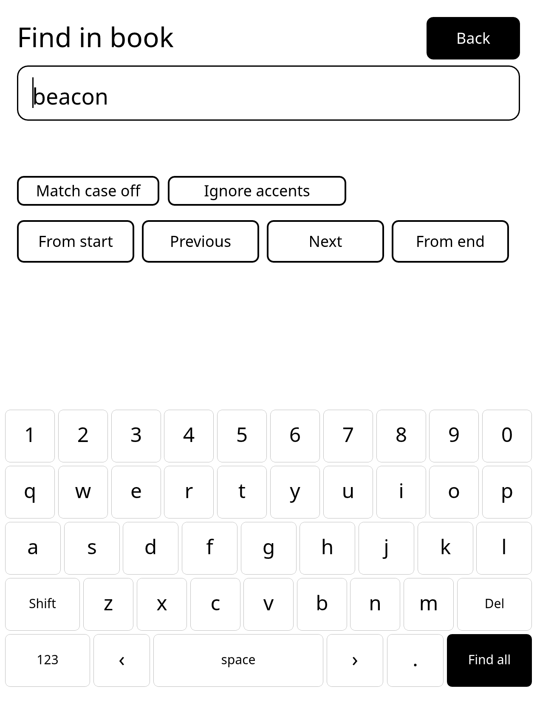
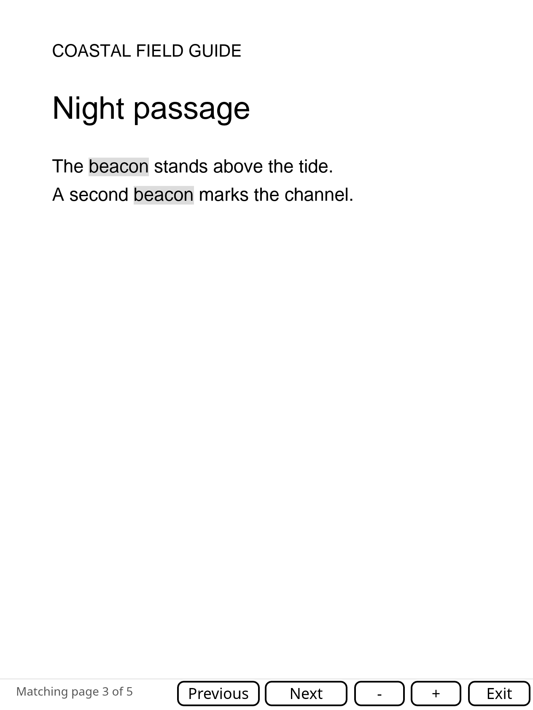

# Find a matching PDF or DjVu page

Open **Find in book**, enter a word or phrase and tap **Previous** or **Next** to start searching on the visible page. **From start** scans forward from page one up to the page before the current page. **From end** scans backward from the last page down to the page after the current page. These searches stop at the current page. If there is no match on the requested side, Reader keeps the current view.

On a matching page, the four footer arrows run the same searches. From left to right they jump to the first earlier match, find the previous matching page, find the next matching page and jump to the last later match. All matching words on that page are highlighted. Return to the previous location restores the original viewport across multiple searches. **Find all** displays individual occurrences from the beginning of the document. [KOReader search dialog and endpoint actions](https://github.com/koreader/koreader/blob/9192014d8bd82a91dc1012473be0f238dedfdb54/frontend/apps/reader/modules/readersearch.lua#L545-L588) · [KOReader fixed-page search intervals](https://github.com/koreader/koreader/blob/9192014d8bd82a91dc1012473be0f238dedfdb54/frontend/document/koptinterface.lua#L1613-L1649)

For a single word, the spaces typed at the ends of the query select which part of a word to match. This also applies to **Find all** and searches repeated from history. For example, entering `sand` anywhere matches *quicksand* and *sandbar*. A space before `sand` matches the start of the word. A space after it matches the end. Spaces on both sides match the whole word. Punctuation belongs to the word box, so a whole-word search for `sand` skips *sand,* but still matches *Sand* when **Match case** is off. Each matching word box counts once, including a word with two occurrences. These switches apply to single-token queries. Multiword and multi-character CJK phrases keep their existing phrase search. [KOReader pattern preparation and word matches](https://github.com/koreader/koreader/blob/9192014d8bd82a91dc1012473be0f238dedfdb54/frontend/document/koptinterface.lua#L1503-L1565)

With **Match case** off, typing three periods finds a printed ellipsis, and ordinary letters find compatible forms such as fullwidth letters or a ligature. **Match case** on preserves the spelling and punctuation as printed. **Ignore accents** applies separately. The overlay covers the original word box, including the original glyphs. An authored timetable illustrates a search for three periods that found one printed character. [Simulator capture](screenshots/fixed-find-ellipsis.png)

| Entering a search | Last matching page |
|---|---|
|  |  |

In the authored coastal guide, the query with a space on both ends selects only the standalone word. The same letters in *sandbar*, *quicksand* and *Sand,* remain visible for comparison. [Simulator screenshot](screenshots/fixed-find-whole-word.png)

KOReader's PDF and DjVu providers call the same fixed-page search implementation. It includes the current page on a new search, skips it when continuing, and returns all matching word rectangles on the first page it finds. Its reading UI remembers the original viewport even when the first match is on that page. [PDF provider](https://github.com/koreader/koreader/blob/9192014d8bd82a91dc1012473be0f238dedfdb54/frontend/document/pdfdocument.lua#L352-L357) · [DjVu provider](https://github.com/koreader/koreader/blob/9192014d8bd82a91dc1012473be0f238dedfdb54/frontend/document/djvudocument.lua#L271-L277) · [Search and page bounds](https://github.com/koreader/koreader/blob/9192014d8bd82a91dc1012473be0f238dedfdb54/frontend/document/koptinterface.lua#L1593-L1648) · [Highlighting and return](https://github.com/koreader/koreader/blob/9192014d8bd82a91dc1012473be0f238dedfdb54/frontend/apps/reader/modules/readersearch.lua#L418-L431)

Reader searches the existing open document and checks one physical page per event-loop turn. Cancel search stops before the next page. Embedded text and previously recognized page text use the same page coordinates as normal selection. Regular expressions are available for reflowable books. A directional search retains up to 5,000 occurrences on its current page. A message identifies a truncated page. The separate fixed-layout Find all list retains its 100-occurrence limit.

## Original PDFs on the Mac

For each original, an independent Poppler extraction located an interior page with a matching word and its preceding and following matching pages. The normal Reader controls first opened that page, then the next matching page, then returned across it to the preceding match. The tests also ran ordinary **Find all** and confirmed its hundredth occurrence came before these pages.

| Original and physical page count | Independent page containing the 100th matching word | Pages opened in Reader | Word boxes highlighted in Reader |
|---|---:|---|---|
| 030, 229 pages | 8 | 115 → 116 → 115 → 114 | 9, 15, 9, 3 |
| 044, 1,041 pages | 9 | 521 → 522 → 521 → 520 | 30, 57, 30, 41 |
| 054, 1,066 pages | 106 | 542 → 543 → 542 → 538 | 1, 2, 1, 2 |
| 056, 41 pages | 11 | 21 → 22 → 21 → 20 | 7, 6, 7, 5 |

All four returned to the original reading position. A separate authored PDF test restored a zoomed and panned source point to within 0.01 PDF points. The five-page authored coastal guide in the screenshots contains repeated terms, an intervening page without a match and two matching words on the displayed page. A rotated DjVu with compressed embedded text verified that an accent-insensitive search selects its original word rectangle. [Functional tests and authored guide](../src/app/nearby_search.rs) · [Installed KOReader comparison](../scripts/koreader-fixed-direction-check.lua)

## Oasis 3 comparison

The installed KOReader fixed-page matcher and the native Reader agreed on all sixteen page destinations and all sixteen word-box counts in the table. The four Reader runs also opened their final passage with the expected marks and restored the original viewport through the normal history control. The installed KOReader comparison used its own unwrapped-page coordinate conversion, page-direction logic and MuPDF text extraction. Four additional native tests used the authored PDF and DjVu fixtures.

| Original | Complete native UI test | Peak resident memory |
|---|---:|---:|
| 030 | 2.09 s | 21,192 KiB |
| 044 | 43.10 s | 186,612 KiB |
| 054 | 4.29 s | 36,868 KiB |
| 056 | 2.72 s | 19,736 KiB |

The elapsed times include opening the book, rendering the target pages, checking the matching regions and returning to the starting position. The low-priority tests ran while another library audit was active. SHA-256 checks before and after each case confirmed the original PDF, Documents inventory, installed Reader, library, reading statistics and Browser session were preserved. All temporary device files were removed.

### Single-word boundaries on original pages

An independent Poppler extraction, the Mac Reader, the ARM Reader on the Oasis 3 and the installed KOReader KOpt search all agreed on the eight counts below. The check compared **Find all** rectangles with **Next** overlays on the same page, restored the starting viewport and replayed the original query from a fresh Reader session. When a constrained query had no match on the current page, cancelling the forward search preserved the viewport.

| Physical page | Anywhere | Space before | Space after | Spaces on both sides |
|---|---:|---:|---:|---:|
| 521 of 1,041 | 30 | 28 | 27 | 27 |
| 542 of 1,066 | 1 | 1 | 0 | 0 |

The Oasis check used the two original PDFs in Documents and an isolated Reader profile. The authored tests, both original checksum checks, retrieval of the KOpt counts and the Reader navigation checks completed in 216 seconds. Both source files retained their original checksums. The test removed its temporary state after collecting these results.

### First and last matches on original pages

A full independent Poppler extraction identified the first and last physical pages containing the query. Reader started inside each original PDF, used **From end**, tapped the first-match arrow, returned with the last-match arrow, then restored the original viewport. A repeated request for an earlier first match or a later last match preserved the displayed page and reported the exhausted direction.

| Physical pages | Starting page | First matching page | Last matching page | Pages containing a match |
|---:|---:|---:|---:|---:|
| 229 | 115 | 2 | 229 | 225 |
| 1,041 | 521 | 1 | 1,041 | 1,025 |
| 1,066 | 542 | 3 | 1,066 | 673 |
| 41 | 21 | 1 | 41 | 41 |

The installed KOReader KOpt search, the ARM Reader on Oasis 3, the Mac Reader and Poppler agreed on all sixteen visited page numbers and twelve counts of highlighted word boxes. Both readers found no match beyond either end of each four-step route. The six authored controls and the four original comparisons ran in 110 seconds on the Kindle. Reader restored each original viewport and the four source files retained their checksums.

### Unicode search on original pages

KOReader passes each fixed-page word and each case-insensitive query token through utf8proc's NFKC case fold. Reader applies that comparison to PDF, DjVu and recognized word boxes. Phrases can span neighboring words on the same reading column. The matches retain the source text's original byte ranges and page geometry. Reader's normalization passed all 1,112,064 scalar values in Unicode 18's independent mapping table. The case-sensitive comparison preserves the original characters. [KOReader word matching](https://github.com/koreader/koreader/blob/9192014d8bd82a91dc1012473be0f238dedfdb54/frontend/document/koptinterface.lua#L1503-L1565) · [KOReader's utf8proc wrapper](https://github.com/koreader/koreader-base/blob/6e4bc81af4e04f78d81677a323a780a71b29702a/ffi/utf8proc.lua#L20-L38) · [Unicode normalization mappings](https://www.unicode.org/Public/18.0.0/ucd/DerivedNormalizationProps.txt)

Mac Reader and an independent extraction using KOReader’s word boundaries agreed on 36 combinations of query and case mode across three original PDFs. For example, three periods found one word containing an ellipsis on one page and three words on another. With **Match case** enabled, three periods found zero words on both pages. The printed ellipsis itself found all four. Leading and trailing ordinary spaces apply their usual word-edge rules. Tabs delimit query tokens without setting those edge rules. A nonbreaking space attached to a query remains part of its token when it is folded.

KOReader’s MuPDF provider closes the current word box just after a general punctuation character such as an ellipsis. On an original page containing an ellipsis immediately followed by a closing quotation mark, the two characters have adjacent source byte ranges and separate selection rectangles. Reader preserves that boundary without inserting a space into the original text. A space after a three-period query therefore finds all three ellipsis-ending words on that page. A whitespace-only extraction groups the closing quotation mark with the preceding word and would count two. [KOReader’s PDF word-box builder](https://github.com/koreader/koreader-base/blob/6e4bc81af4e04f78d81677a323a780a71b29702a/ffi/mupdf.lua#L537-L568)
