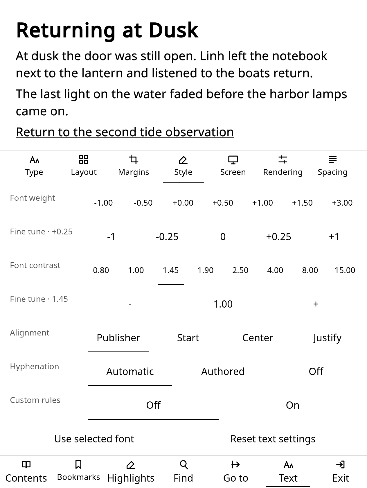

# Numeric font contrast and weight

Open a reflowable book, tap the lower edge, and choose **Text › Style**. **Font contrast** has the eight KOReader presets from 0.80 to 15.00. Its fine controls step through all 57 levels from 0.30 to 15.00. Tap **1.00** to restore normal contrast. **Font weight** offers −1, −½, 0, +½, +1, +1½ and +3. Its fine controls reach −3 to +5.5 in quarter steps. The current fine values stay visible beside the controls. These settings belong to the current book and can be included in a reading profile.

## Reference and behavior

The comparison uses KOReader `9192014d8bd82a91dc1012473be0f238dedfdb54` and its pinned CREngine `b32a88ffbbf505cf2ea5208c1a49002d70d3609f`. The [contrast and weight options](https://github.com/koreader/koreader/blob/9192014d8bd82a91dc1012473be0f238dedfdb54/frontend/ui/data/creoptions.lua#L569-L634) supply the ranges, defaults and presets. [ReaderFont](https://github.com/koreader/koreader/blob/9192014d8bd82a91dc1012473be0f238dedfdb54/frontend/apps/reader/modules/readerfont.lua#L221-L279) distinguishes a weight reflow from a contrast repaint.

Contrast transforms each grayscale glyph mask's coverage `a` using `255 − round(255 × ((255 − a) / 255)^gamma)`. Pure paper and opaque ink retain their values. Image pixels keep their image-rendering settings. A contrast change repaints the current page or scroll position without rebuilding the text layout, moving word hit regions, or changing the source anchor. The normal gamma is 1.00 at index 15. [CREngine's gamma generator](https://github.com/koreader/crengine/blob/b32a88ffbbf505cf2ea5208c1a49002d70d3609f/crengine/Tools/GammaGen/gammagen.cpp)

A weight delta adds 100 weight-class units per whole step to each publisher weight, with an engine range of 1 to 999. Font selection uses real available faces or a variable font's weight axis first. A remaining difference uses a signed outline adjustment, including thinning, and matching fractional advances. Text is then repaginated at the saved source location. Wrapping, intrinsic table measurements, painted glyphs and word selection use the same advances. Vertical text and ruby annotations also receive the selected weight. [CREngine weight calculation](https://github.com/koreader/crengine/blob/b32a88ffbbf505cf2ea5208c1a49002d70d3609f/crengine/src/lvfntman.cpp#L2041-L2097)

Publisher `@font-face` descriptors define the role of an embedded face. A declared bold role can legitimately use a resource whose internal weight is regular. Reader keeps those declared classes with distinct registered font identities, while sharing the original bytes. It computes any remaining synthesis against the declared role. Existing saved boolean bold and contrast preferences continue to load. Choosing a numeric control replaces the corresponding older boolean setting for that book.

## Desktop validation

The independent pinned C++ gamma generator produced 14,592 reference coverage values. Reader matches every byte across all 57 tables. The reference file's SHA-256 is `d97e4854b36826d9e904a218b9e5c84b305fe31bc61f932bfa24d8c6f9877915`. The generator and output remain private build evidence, outside the application package.

The final desktop suite passed 565 library, 14 package integration and 4 layout system tests. A focused run passed 19 checks, including the two optional original-book and pinned-oracle checks. Independent OCR recognized all 60 numeric preset labels in the four captures.

Functional tests exercise the actual lower toolbar, all 57 contrast levels, all 35 quarter-step weight values, saved profiles, per-book reopen, both facing leaves and continuous scroll, signed changes to ink coverage, distinct publisher face classes, and word hits after reflow. Two authorized original EPUBs additionally retain independent saved preferences, original source bytes, their selected words and source positions. Captures cover compact and large controls in light and dark palettes. [Functional and original-book checks](../src/app/font_render_tests.rs) · [Tone checks](../src/font_render.rs) · [Declared-face weight checks](../src/font_synthesis.rs)

Reader uses Skrifa, Kurbo and its existing grayscale rasterizer for synthesized outlines. CREngine uses FreeType. The numeric ranges and gamma tables are verified against pinned source, while pixel equality for synthesized outline shapes has not been established. Native execution, physical e-ink behavior and the combined candidate's full original-publication sweep remain release gates. No device or publication result is implied by the desktop captures.
