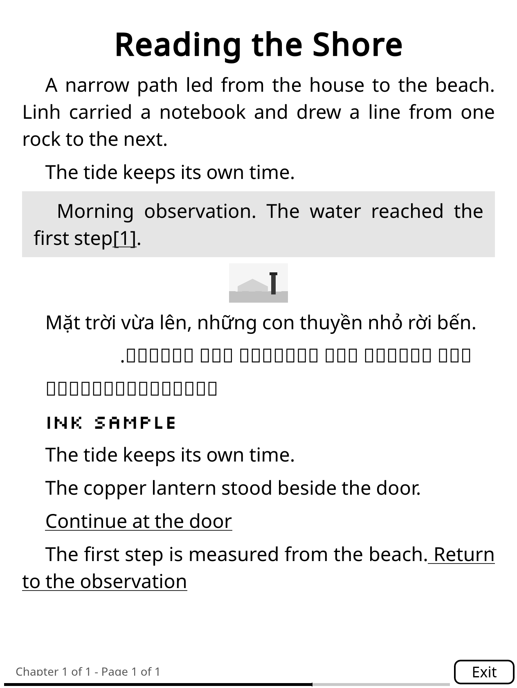
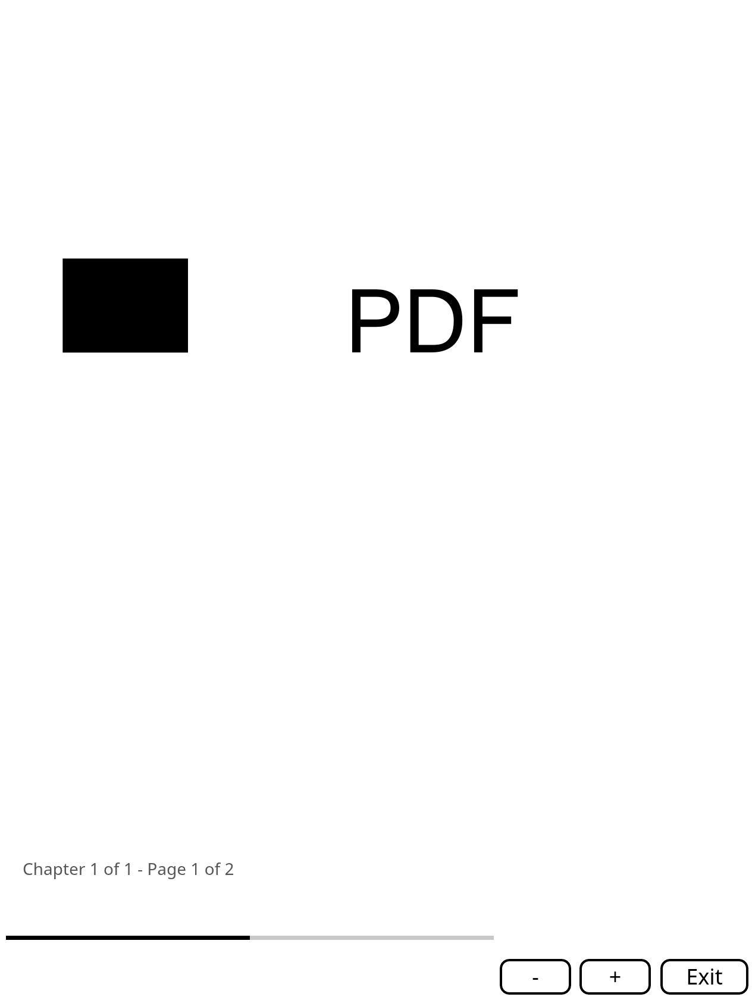
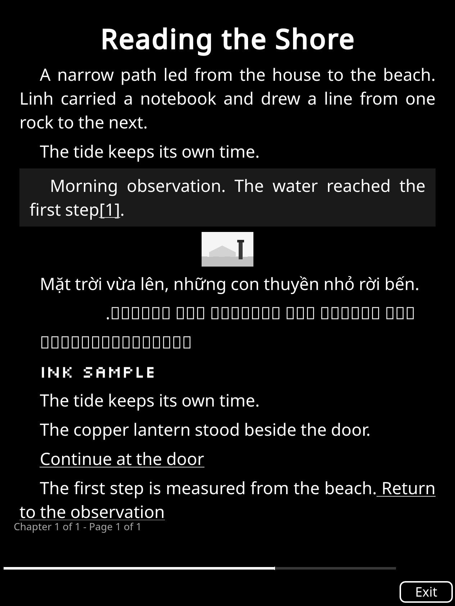
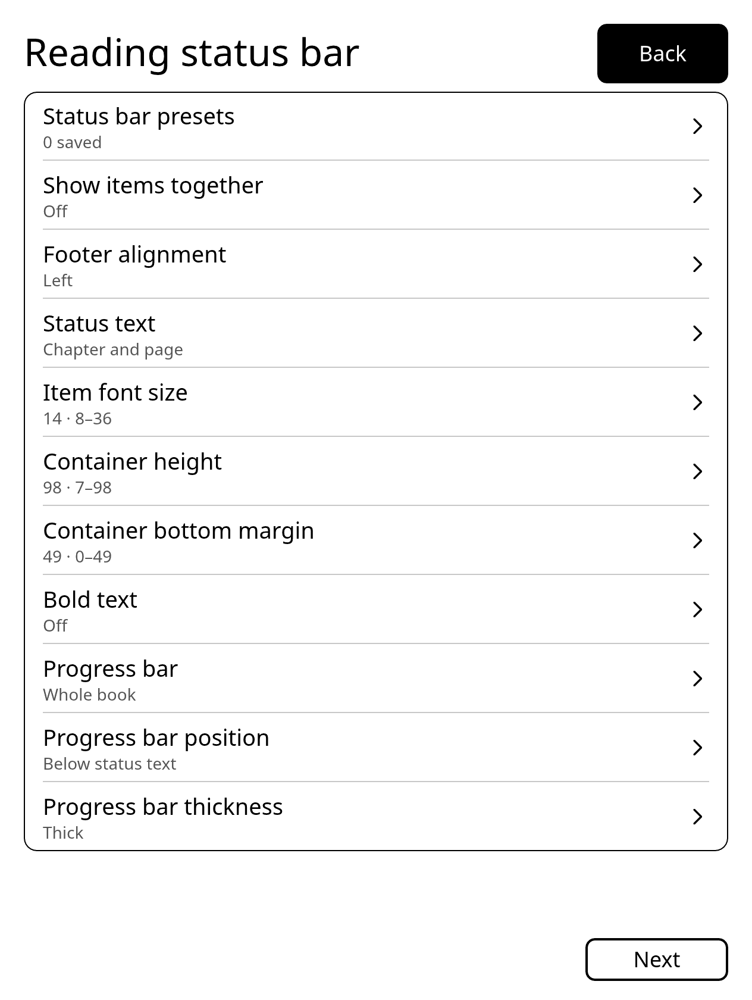

# Footer container height and margin

The custom reading footer now exposes the two geometry controls from KOReader's
item configuration:

| Setting | Range | Default | Effect |
| --- | ---: | ---: | --- |
| Container height | 7–98 | 14 | Sets the status caption's vertical container height. The row remains centered at its current position; large values can extend upward into the page, like KOReader's warning that a taller container may cover the last reading line. |
| Container bottom margin | 0–49 | 1 | Moves the caption and progress track together. Exit remains at the far right in its own hit target. |

Values are saved in `ReadingControls` and in named status-bar presets. At the
Oasis reference size, logical units map to two physical pixels. The old
14/1 defaults retain the current footer positions and the requested
`Chapter x of y - Page m of n` caption above the horizontal track with vertical
chapter ticks.

Large height or margin values can cover lines at the bottom of the document,
matching KOReader's documented height trade-off. Reader clips the document
frame at the expanded footer edge and paints the footer background before
drawing the caption and track, so document text does not show through the
controls. It does not repaginate the book for these values.

The focused application test covers the default, minimum and maximum values,
invalid input, persistence, preset storage, EPUB/PDF drawing, overlap clipping,
and the settings rows. Foreground Kindle appearance remains a device gate.

KOReader source comparison: `container_height` updates the footer container's
scaled height and refreshes the footer ([setter and 7–98 range](https://github.com/koreader/koreader/blob/v2026.07.1/frontend/apps/reader/modules/readerfooter.lua#L1699-L1716));
`container_bottom_padding` updates the scaled bottom padding and refreshes the
footer ([setter and 0–49 range](https://github.com/koreader/koreader/blob/v2026.07.1/frontend/apps/reader/modules/readerfooter.lua#L1722-L1741)).
The pinned default is 14 logical units ([`defaults.lua`](https://github.com/koreader/koreader/blob/v2026.07.1/defaults.lua#L176)); bottom padding defaults to 1 in
[`readerfooter.lua`](https://github.com/koreader/koreader/blob/v2026.07.1/frontend/apps/reader/modules/readerfooter.lua#L527-L528).
