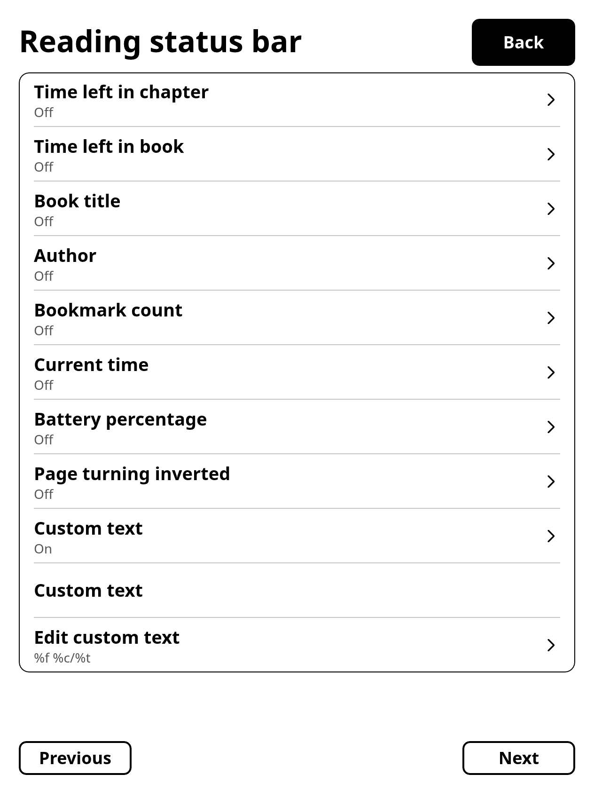
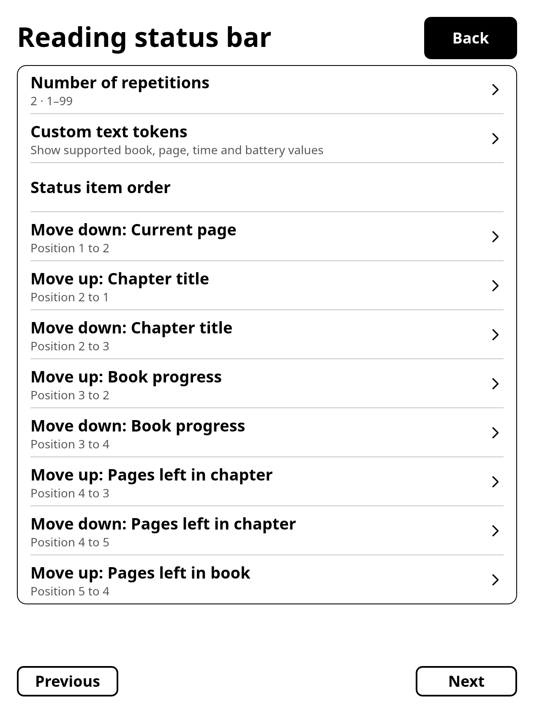
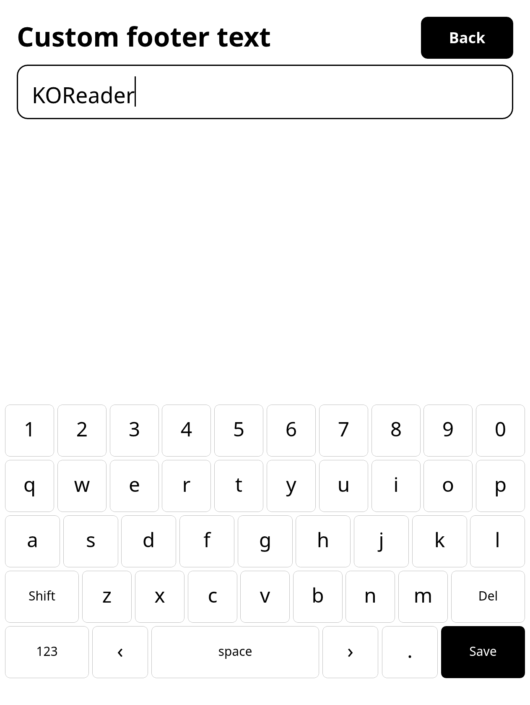
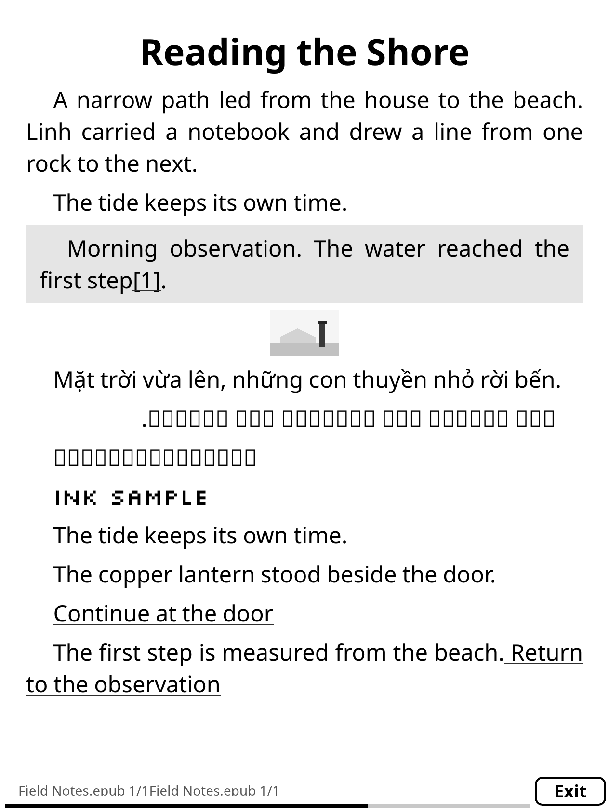

# Custom reading-footer text

The custom status bar includes an editable **Custom text** item. Its default is
`KOReader`. Open **Reading controls → Reading status bar**, select **Custom**,
then choose **Edit custom text**. Set **Number of repetitions** from 1 to 99,
and open **Custom text tokens** for the supported substitutions. The separate
editor and token guide keep editing visible and reachable on the Kindle.

## Supported tokens

| Token | Output |
| --- | --- |
| `%T` | Book title |
| `%A` | Author |
| `%S` | Series name and position, when available |
| `%t` | Total pages |
| `%c` | Current page |
| `%l` | Pages left in the current chapter |
| `%p` | Whole-number book progress percentage |
| `%H` | Estimated time left in the book |
| `%C` | Current chapter title |
| `%P` | Whole-number chapter progress percentage |
| `%h` | Estimated time left in the chapter |
| `%F` | Full document path |
| `%f` | File name |
| `%b` | Battery percentage |
| `%B` | Battery symbol for charge, charging, or level |
| `%r` | Selected status-item separator |
| `%D` | Local date as `yyyy-mm-dd` |
| `%d` | Local date as `mm-dd` |
| `%m` | Local time as `hh:mm` |
| `%M` | Local time as `hh-mm-ss` |

Tokens with unavailable values show `N/A`. Non-token percent sequences remain
literal. A custom item made only of ASCII spaces merges its neighboring status
items without adding an outer separator, matching KOReader's spacer behavior.
Repeated text is appended without an inserted separator. The Reader uses
KOReader's battery glyphs for ten percent bands, charging, and fully charged
state; the symbol font is bundled with the Kindle package.
Clock tokens use 24-hour formatting. On the tested Oasis, a static ARM musl
probe using the same local-time conversion showed UTC while the Kindle clock
showed UTC+07:00. Reader still needs the system's TZif offset for these tokens.
The KOReader 12-hour preference for `%m` also remains open.

## Persistence and safeguards

The preference is stored in `reader/data/status-bar-custom-text.json`, included
in reading-data backups, and captured by named status-bar presets. Older preset
files load with the default custom text. The editor accepts up to 120
characters. Preference files are bounded to 1 KiB, and rendered substitutions
are bounded to 4 KiB to keep malformed or unusually large metadata from
expanding the footer without limit.

## KOReader comparison and validation

KOReader exposes `Custom text (long-press to edit): 'KOReader'` in its
[status-item list](https://github.com/koreader/koreader/blob/9192014d8bd82a91dc1012473be0f238dedfdb54/frontend/apps/reader/modules/readerfooter.lua#L1105-L1117)
and expands the book, page, file, battery and date tokens in
[`BookInfo:expandString`](https://github.com/koreader/koreader/blob/v2026.07.1/frontend/apps/filemanager/filemanagerbookinfo.lua#L991-L1145).
Its generic battery source distinguishes fully charged, charging, and ten
level glyphs in
[`getBatterySymbol`](https://github.com/koreader/koreader/blob/9192014d8bd82a91dc1012473be0f238dedfdb54/frontend/device/generic/powerd.lua#L301-L330).
PrimitiveOS exposes an explicit editor row instead of relying on a hidden
long-press, and uses those same token spellings and battery glyphs.

The test on both Mac and Oasis verifies the settings route, editor save, repetition
bounds, rendered file/page values, and settings after reopening. Unit tests cover the
token engine, file validation, and KOReader battery glyph steps. The rendered
footer screenshot also confirms the chapter/page caption area, horizontal
progress track below it, and Exit at the right edge. Kindle visual acceptance
and the full current-source on-device suite remain open.
