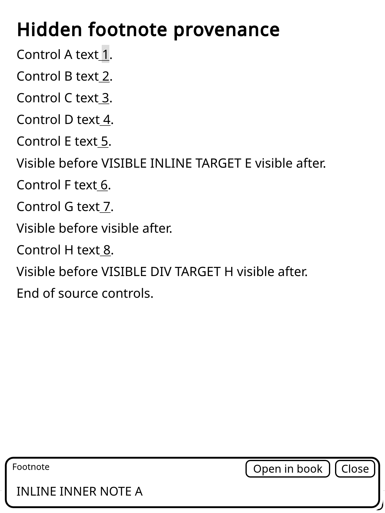
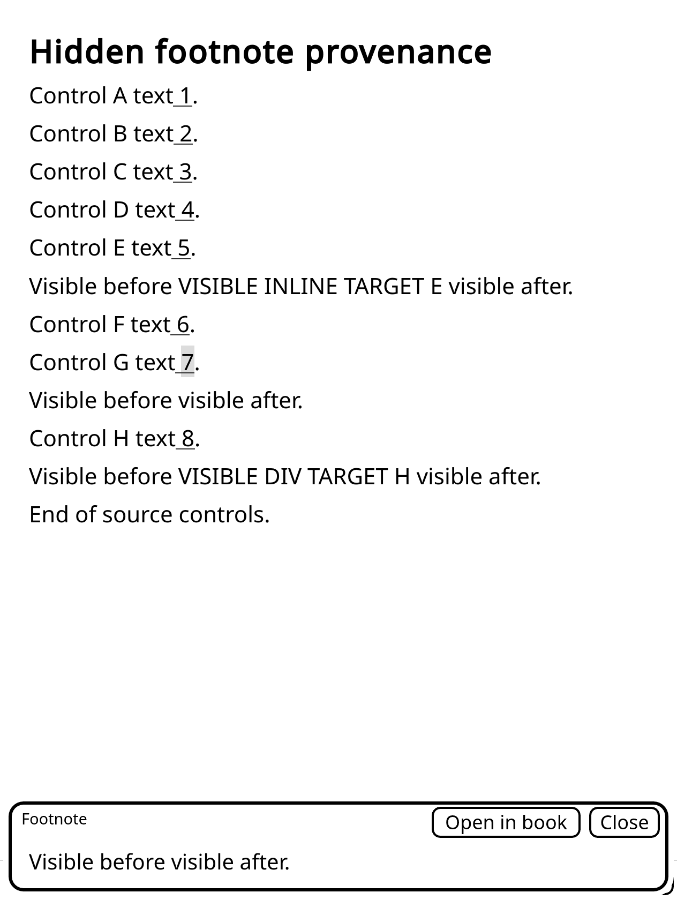

# Footnote export roots

Opening a footnote now computes its export root from the original chapter's supported paragraph flow. It uses the same font-free publisher stylesheet cascade and immutable user-style snapshot as the reading engine. A hidden target does not by itself stop the search: a higher visible paragraph may still own the final text block. If no supported final owner exists, the original target is exported. Semantic footnote recognition remains independent of root selection.

The adapter borrows canonical `Source` metadata, checks its exact raw-input SHA-256 fingerprint, and starts at the fragment's true element owner. The input fingerprint is separate from versioned Ruby/numeric text-model revisions and is bound after those parse stages retain their existing canonical values. It verifies the complete raw tag and sibling-ordinal ancestry before selecting an export slice. This prevents a duplicate ID, an anonymous wrapper or a variable-length numeric-reference conversion from binding the target to a different element's styles. It does not rewrite the source, canonical text, saved anchors or fragment tuples.

`display:none` suppresses a final owner. `visibility:hidden` preserves final ownership because it changes painting rather than paragraph participation. The selected raw XML slice retains its inline styles. Linked stylesheets are outside the separate popup stylesheet context, as in the pinned KOReader export path. Publisher-style policy is honored when choosing the original chapter's root; popup typography remains independently configured.

## Native reference

The reference is KOReader `9192014d8bd82a91dc1012473be0f238dedfdb54`, base `6e4bc81af4e04f78d81677a323a780a71b29702a`, CREngine `b32a88ffbbf505cf2ea5208c1a49002d70d3609f`. The native implementation walks target-to-root inclusively for the first actual `erm_final` node; absent one, it serializes the original target at offset zero. This is distinct from the preceding footnote classification and optional extended-range decision. [Native export](https://github.com/koreader/koreader-base/blob/6e4bc81af4e04f78d81677a323a780a71b29702a/cre.cpp#L2785) · [Final-node search](https://github.com/koreader/crengine/blob/b32a88ffbbf505cf2ea5208c1a49002d70d3609f/crengine/src/lvtinydom.cpp#L9983) · [Popup policy](https://github.com/koreader/koreader/blob/9192014d8bd82a91dc1012473be0f238dedfdb54/frontend/apps/reader/modules/readerlink.lua#L1408)

The byte-identical [authored EPUB](../tests/fixtures/footnote-export-roots.epub) was laid out in the actual stock Mac SDL runtime in run `footnote-oracle-20261122T095415Z`. Ordinary geometry taps invoked `ReaderLink:onTap`, native classification with flags `0xdf7e`, `getHTMLFromXPointer(target,0x1001,true)`, and genuine `FootnoteWidget` construction. All eight kept the source position. No PNG or owner document was used in this oracle, and the frozen runtime and fixture hashes matched before and after. This establishes extraction/controller behavior on Mac, not Kindle acceptance or identical font rasterization.

| Case | Source context | Native export root |
| --- | --- | --- |
| A | ID on P inside an inline-hidden semantic aside | P; ancestor aside/style omitted |
| B | ID on the inline-hidden aside | Aside with its inline `display:none` |
| C | ID on P inside a semantic aside hidden by linked CSS | P |
| D | ID on the linked-hidden aside | Aside and class; linked stylesheet omitted |
| E | ID on a visible span in a visible P | Whole P |
| F | ID on span in P inside a hidden block div | Original span only |
| G | ID on em inside hidden inline span in otherwise visible P | Whole P, retaining the hidden span/style |
| H | ID on visible span in div containing inline flow | Whole div |

Fixture SHA-256: `84fff6bd39157018dd1c3a2495996bf6ee95a3cd6edcc1b955612f9874a9b981`. Private local receipt SHA-256: `8896dec6f33731e5bc87088ac73ed965bcb26e97b29e11d6a2c11f91044092a1`. The fixture and independently authored tests use the repository licence; no stock implementation or GPL/AGPL rule dataset is bundled in Reader.

## Bounds and verification

This implements supported native paragraph/inline-flow ownership using canonical block owners and computed suppression. It is not a complete CREngine box classifier. Affected arbitrary CSS display reclassification and anonymous final boxes decline a popup and leave the ordinary link workflow available. Empty anchors between blocks require a separate extended-range policy; the standalone legacy extraction tests retain their existing fallback independently. Complex tables, floats, cloned render boxes and other engine-specific classification remain separate acceptance work. No inline style is stripped to make a hidden target appear.

The deterministic tests compare all eight roots, linked CSS loading, publisher policy, visibility versus display, duplicate/stale identities, numeric references combined with ruby, unsupported boxes and unchanged canonical positions. The application test taps every source link, checks the actual popup render and hidden-text treatment, closes normally, compares the original page pixels and position, then reopens the saved book. Optional `READER_FOOTNOTE_ROOT_SCREENS` writes light/dark screenshots for visual review. [Root tests](../src/footnotes/layout_roots/tests.rs) · [Popup test](../src/app/footnote_popup/tests.rs)

[Remote CI](https://github.com/PrimitiveOS/kindle-primitive-reader/actions/runs/45012174729) passed at source commit `f08430e9402630498b6602f56aa2cfe1734f8bdc`: 828 library, 14 package and four system tests; 62 opt-in cases were omitted. All eight layout-root test functions and the application popup test passed. This includes the versioned Ruby/numeric source model and exact raw-input binding, with the actual fixture's linked CSS loaded.

The combined Mac candidate `e79c7afe906e84ed382a417d936e1db1b1bbd7f5` passed those same nine focused tests from its immutable copied test executable (SHA-256 `32d049a72f8ddea3100d83a03179a70d82ccbe1b4d2406da325aaca0a0466273`). It produced 16 authored 1264 × 1680 screenshots covering every case in both UI palettes. The complete contact sheet and four full-resolution controls were reviewed. Explicit document and UI fonts were the bundled Noto Sans Regular, SHA-256 `dac8e68fe43fca59d522fa5f763322cfb4a919c28957656c58e7836d915307d0`. The source fixture and executable hashes remained unchanged; no new build cache or device was used for this check. Native Kindle acceptance remains pending.




## Fresh-profile behavior and actual-publication check

A new or missing controls file now enables note previews, matching the pinned
stock default. Valid saved controls keep their on/off value byte for byte;
sparse older files retain their previous deserialization behavior. This avoids
turning a saved preference into an implicit migration. The eight-case app test
uses the real fresh-profile default instead of forcing the option on.

An additional opt-in workflow reads an unchanged authorized EPUB, finds its real
semantic note links, taps their actual rendered hit targets and checks each
popup, close, source frame, history and durable reopen. It neither edits the
publication nor captures its text into public screenshots. Source `13ca6a2`
passes 845 ordinary Mac library tests and the full GitHub workspace suite. Its
five focused runs pass, including all seven actual note links in unchanged
original034, popup close, source-frame/history retention and durable reopen.
The failed first CI only reflected two old test setups toggling the previous
fresh default; both now exercise explicit Off/On transitions through the menu.
The exact logs, source/binary hashes and original SHA are retained privately in
`build/parity-review/footnote-default-evidence/13ca6a2/proof.json`. Aggregate and
native acceptance remain separate.

## Font used in previews

Open the reading **Settings › Links** and turn on **Use book font in popups** to
use the configured reading font in footnote previews. The switch starts off,
including on older profiles without a saved value. Off uses Reader's bundled
Noto Sans and its device fallbacks. Reader also uses these fonts when the chosen
book font becomes unavailable. The preference is available while footnote
previews and at least one link-follow gesture are enabled. [KOReader preference](https://github.com/koreader/koreader/blob/9192014d8bd82a91dc1012473be0f238dedfdb54/frontend/apps/reader/modules/readerlink.lua#L347-L358) · [KOReader popup font selection](https://github.com/koreader/koreader/blob/9192014d8bd82a91dc1012473be0f238dedfdb54/frontend/ui/widget/footnotewidget.lua#L235-L266)

The authored EPUB test selects Silkscreen for the book and uses the actual Links
switch. It compares the note text and popup pixels in both modes, checks the
stored preferences after reopening Reader, and compares the book's page pixels,
location, and navigation history. [Default font](screenshots/footnote-font-default-light.png) · [Book font](screenshots/footnote-font-book-light.png) · [Book font in dark mode](screenshots/footnote-font-book-dark.png)

The comparison script runs the pinned stock menu callbacks and font-selection
Lua with test doubles for the settings store and font loader. It checks the
toggle's default and availability, the configured-face lookup, deduplication
of font variants, and the fallback when the selected face is unavailable.
Run it with a Python environment providing `lupa` and a directory containing
the pinned `readerlink.lua` and `footnotewidget.lua` files.

```sh
python3 scripts/compare-footnote-book-font.py /path/to/pinned/lua/files
cargo test --locked --lib footnote_book_font_toggle
```

## Preview font size

Open reading **Settings › Links › Footnote popup font size**. **Relative**
adds an offset from −10 to +5 pixels to the book's current rendered size. The
default is −2 pixels. **Fixed** accepts 12 to 255 and scales that value with
the screen, independently of the book font size. Both settings apply across
books and take effect when you open a preview. **Set** saves the selected mode.
[KOReader size controls](https://github.com/koreader/koreader/blob/9192014d8bd82a91dc1012473be0f238dedfdb54/frontend/apps/reader/modules/readerlink.lua#L361-L424) · [KOReader size conversion](https://github.com/koreader/koreader/blob/9192014d8bd82a91dc1012473be0f238dedfdb54/frontend/ui/widget/footnotewidget.lua#L224-L232)

Reader saves the full preference range. The preview lays out a base size of 12
to 192 screen pixels and tries 140 pixels for an over-tall line. Short notes
use a compact panel and longer notes paginate within the same height limit.
If an authored box still cannot paginate, the link opens the note in the book.
[Size controls](screenshots/footnote-size-settings.png) · [Small preview](screenshots/footnote-size-small-light.png) · [Largest preview](screenshots/footnote-size-large-light.png)

The stock Lua comparison checks both selector bounds, how actual saved modes
replace each other, and the requested pixel values. The authored Reader test
covers both ends of both ranges, the minimum size when the book text is already
small, an enlarged paginated note, and a note with an authored tall line. It
also checks the original reading location and navigation history after close.

## Preview text alignment

In **Settings › Links**, **Justify text in popups** is on by default. It
justifies wrapped left-to-right lines in footnote previews. Turn it off to
use the text's starting edge. Right-to-left text starts on the right in
both modes and explicit inline alignment is preserved. This preference
applies to footnote previews independently of the book's paragraph setting.

The Mac test checks the changed word hit box, compares the exact
right-to-left preview pixels, and restores the same note selection through
portrait and landscape turns. It also checks that the source location,
reading history, and saved preference survive closing and reopening.
[Justified](screenshots/footnote-justify-on-light.png) ·
[Start aligned](screenshots/footnote-justify-off-light.png) ·
[Stock toggle](https://github.com/koreader/koreader/blob/9192014d8bd82a91dc1012473be0f238dedfdb54/frontend/apps/reader/modules/readerlink.lua#L431-L444) ·
[Stock popup alignment](https://github.com/koreader/koreader/blob/9192014d8bd82a91dc1012473be0f238dedfdb54/frontend/ui/widget/footnotewidget.lua#L266-L270) ·
[Lua callback comparison](../scripts/compare-footnote-book-font.py)
