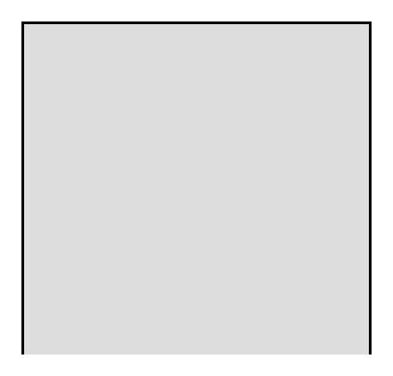
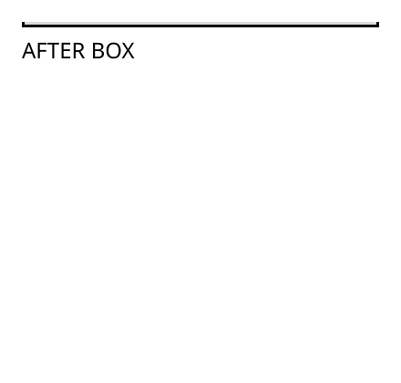
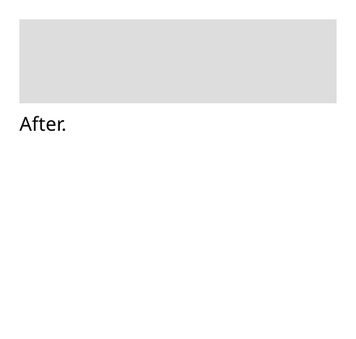

# Durable generated-box targets

This bounded slice preserves named empty document locations without inventing
source text. No strict user CSS hiding syntax is enabled. Full aggregate and
native-device acceptance remain separate from the component evidence below.

`Anchor.boundary` is optional, defaulted and omitted from legacy JSON. It contains
an immutable normalized-XML owner byte origin, plus an optional bounded integer
relative position (0–10000) for later pages inside a generated box. It stores no
parsed element index, fake text or replacement source key. Resolution requires
that exact current source revision, an actual non-selector/non-anonymous owner
and its unchanged canonical fallback pair. Text selection and highlight endpoints
reject boundary targets.

The horizontal renderer retains real LI marker geometry. It also lays out empty
native padded/bordered block containers outside tables/lists, including nested
containers and bare empty containers that have a surrounding canonical fallback.
Background and stroke rendering share existing bounded primitives. Source-order
empty named owners between blocks get precise zero-height DOM boundary targets,
so their canonical tuple cannot alias a following paragraph's text. Valid empty
inline caret targets within a retained paragraph keep their previous caret path.
When a visible empty owner precedes a CSS-removed prefix in that paragraph, its
typed DOM caret resolves through the same paragraph's projected layout. Hidden
owners are rejected; a wholly omitted paragraph does not gain an invented caret.

There are at most 512 nonzero empty boxes and 4096 empty named-point owners per
chapter; nesting uses the existing 64-level source cap. Nonzero boxes consume
bounded real vertical space and can span pages. Only later generated-only page
anchors use a relative position; fragment jumps target the owner start. Reflow or
reopen keeps the exact source owner, and a later style reveal resolves inside
that same owner's retained content.
Real generated boxes participate in viewport pagination even when there is no
text line at their page boundary. A zero-height DOM caret contributes no painted
extent and cannot retain blank pages after trailing line breaks.

Remaining unsupported geometry includes independent empty native-table cells,
list decorations other than the existing LI marker path, inline empty targets
inside wholly omitted paragraph content, arbitrary display reclassification,
fixed-height-only empty boxes and vertical-writing generated boxes. A chapter
with no canonical source block at all cannot create a fallback-key boundary.
These eligible targets must remain visible verifier failures/limitations rather
than being called CSS omissions. Source bytes/text/keys/revisions/fragments and
legacy anchor serialization are not changed by this metadata.

## Scoped border plan

`Style.generated_box_borders` retains the existing parsed border declarations,
cascade, explicit inheritance, units and DPI conversion independently of the
legacy table-only `Style.borders` field. Only proven-empty generated native boxes
consume it. Ordinary nonempty boxes and existing table inheritance keep their
previous rendering contract; a pixel-equality regression enforces that boundary.
Nested generated boxes reserve border widths before resolving child percentage
padding, then use those same bounds for background and stroke paint. Normal
nonempty non-table border painting remains outside this slice.

The opt-in original-files workflow reads authorized cached publications, follows
their existing empty fragment targets, persists positions/bookmarks into a new
isolated library profile, reopens and changes typography through the actual
reading session. It requires unchanged source SHA-256 checks and exact legacy
anchor JSON round trips; no original document or owner reading state is written.

## Version and transfer safety

Text-only libraries keep the exact version1 encoding. A local library containing
a boundary location emits version2; this is checked before writes by the older
version1 reader. New code accepts both versions, but refuses boundary fields in
version1 or legacy bare arrays. Shape bounds and text-only highlight endpoints
are checked on save, load and backup preview. The complete backup-v2 envelope
validates its inner library format before staging any component writes.

Native progress sync version1 explicitly refuses these locations in both
directions, including before an outbound worker/request starts. Boundary-bearing
sync history cannot be saved or reused as a v1 merge base. CFI/KOReader import
creates ordinary text anchors; highlight exports contain text highlights only.
Bookmark previews use the stored label/page, never the canonical fallback as an
invented quote. Boundary-bearing bookmark interchange uses the version2 library
payload.

A bounded stored location can outlive its source file/revision, so library data
retains that durable token. It is not declared source-valid merely because JSON
parses. Applying an invalid, forged or stale boundary fails closed; session restore
and app reopen do not discard the token and open unrelated fallback text. Tests
preserve the profile byte-for-byte when reopening is refused.
Automatic restore and custom-flow resolution also refuse an unavailable typed
DOM location; they cannot reinterpret its legacy fallback as a text location.

## Component verification

The exact Mac source checkpoint `5c17e9e` passed nine authored boundary tests,
the version1/version2 library codec checks, both sync refusal directions,
bookmark label previews and complete-backup/forged-reopen workflows. Its package
and system suites passed 14 and 4 tests. The first complete library suite passed
830 tests and exposed one real trailing-line-break regression: newly recorded
zero-height carets were counted as painted extent. The original assertion was
retained; `11f0faf` limits that extent to actual generated boxes. The other final
follow-up, `7a3c13f`, adds the unavailable-location restore guard and its regression.
Final source `11f0faf` passed [CI45017457353](https://github.com/PrimitiveOS/kindle-primitive-reader/actions/runs/45017457353):
832 library, 14 package and 4 system tests, including both the unchanged
terminal-break assertion and the unavailable-location guard. This receipt is
separate from the earlier Mac binary; the exact final Mac replay is recorded in
the local evidence receipt.
The ordinary library suite skips 63 opt-in private/reference workflows; it is
not a claim that those hardware/provider gates were run by CI.

An independently relinked exact `11f0faf` Mac build also passed all 832 library,
14 package and 4 system tests. Its ten boundary regressions and unchanged
terminal-break test passed in focused runs; the complete serial library run took
209.85 seconds. Only three immutable test executables were copied before the
shared cache was handed to the next task. The earlier failed binary was
losslessly archived with a verified decompressed SHA-256.

The exact final immutable Mac test executable completed 28 actual saved-location
workflows across 10 authorized original EPUB editions: jump, typed bookmark and
position persistence, close/reopen and live typography change. Twenty cases used
new typed boundaries; every original SHA-256 remained unchanged. In edition039,
zero-based chapter7, all 38 eligible existing fragments resolved, including the
previously unmapped empty pagebreak owner. One used new DOM caret geometry;
none was relabeled as CSS-omitted. This is targeted original-file acceptance,
not a replacement for the later full-spine aggregate corpus sweep.

Four authored captures were inspected for border continuity, retained text and
visibility-only geometry:

| First generated-box page | Following page |
| --- | --- |
|  |  |

| Empty inline caret before hidden source | Nested visibility geometry |
| --- | --- |
|  |  |

Private reproducible receipts, exact Mach-O modes/magic/SHA-256 and all 346 source
input hashes are retained under `build/parity-review/generated-boundary-evidence`
in the working repository. Source-publication contents and owner reading state
are not part of the committed screenshots.
