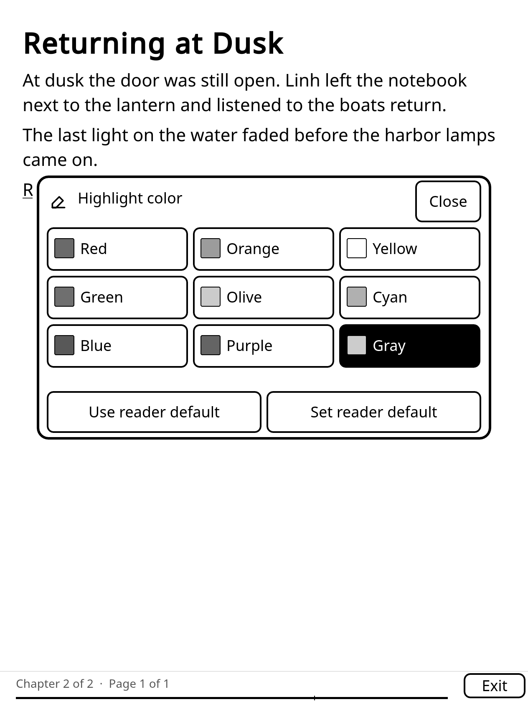
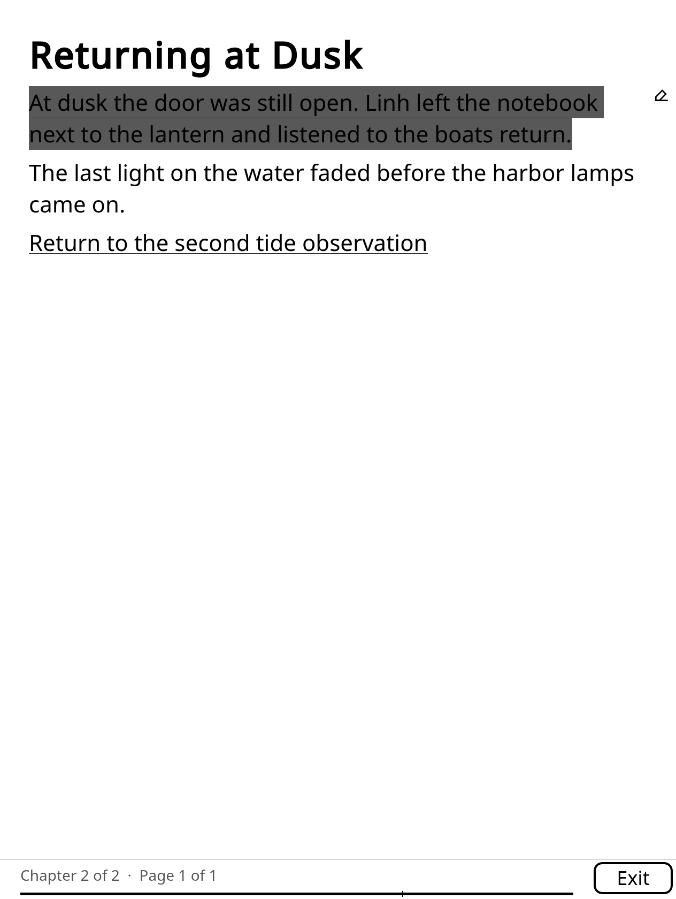

# Highlight colors and note markers

Open the upper reading bar and choose **Settings › Highlight style › Color**. Red, Orange, Yellow, Green, Olive, Cyan, Blue, Purple and Gray retain their color names for annotation interchange. The Kindle displays their grayscale equivalents. The choice applies to new marks in the current book. **Set reader default** copies it to the default for newly opened books. **Use reader default** copies the current Reader default into this book. Previously opened books retain their own choice.

To recolor an existing passage, tap it, choose **Actions › Style › Color**, and select a color. Its text, note, creation time and original location remain intact. Invert continues to reverse the selected tones independently of the stored color.

Choose **Note** in the same highlight settings to set None, Underline, Side line or Side mark. None is the default. Underline adds a black rule to passages with notes. Side line places a colored line in the margin beside every highlighted line. Side mark uses the existing PrimitiveOS pencil icon beside the first visible line. Tap a side indicator to open its note. This preference applies across books, matching the pinned reference's global setting.

## Pinned source comparison

KOReader `9192014d8bd82a91dc1012473be0f238dedfdb54` defines the [nine choices and note modes](https://github.com/koreader/koreader/blob/9192014d8bd82a91dc1012473be0f238dedfdb54/frontend/apps/reader/modules/readerhighlight.lua#L29-L68), [per-book color and new-book default](https://github.com/koreader/koreader/blob/9192014d8bd82a91dc1012473be0f238dedfdb54/frontend/apps/reader/modules/readerhighlight.lua#L423-L460), and [global note preference](https://github.com/koreader/koreader/blob/9192014d8bd82a91dc1012473be0f238dedfdb54/frontend/apps/reader/modules/readerhighlight.lua#L554-L577). [ReaderView](https://github.com/koreader/koreader/blob/9192014d8bd82a91dc1012473be0f238dedfdb54/frontend/apps/reader/modules/readerview.lua#L659-L737) determines blending, rule placement and the first-line symbol. Its [margin calculation](https://github.com/koreader/koreader/blob/9192014d8bd82a91dc1012473be0f238dedfdb54/frontend/apps/reader/modules/readerview.lua#L1409-L1461) distinguishes reflow page margins from the fixed-page screen edge.

The pinned `koreader-base` revision is `6e4bc81af4e04f78d81677a323a780a71b29702a`. Its [color constants](https://github.com/koreader/koreader-base/blob/6e4bc81af4e04f78d81677a323a780a71b29702a/ffi/blitbuffer.lua#L2678-L2698) and [C multiplication](https://github.com/koreader/koreader-base/blob/6e4bc81af4e04f78d81677a323a780a71b29702a/blitbuffer.c#L767-L790) supply the independent tone reference. RGB converts to gray using `(4898R + 9618G + 1869B) >> 14`. Named Lighten colors multiply the original grayscale coverage in ordinary mode. Night mode uses the reference's inverted-RGB alpha blend and selected highlight opacity. Gray retains the existing opacity path and legacy drawing behavior.

At the 1,264-pixel reference width, the default size scaling gives an 11-pixel gap to the margin indicator. The side line is three pixels wide. [Pinned framebuffer scaling](https://github.com/koreader/koreader-base/blob/6e4bc81af4e04f78d81677a323a780a71b29702a/ffi/framebuffer.lua#L414-L426)

The named color is saved with each EPUB anchor range or fixed-page coordinate range. Extending a fixed selection retains its color. Modern KOReader sidecar imports and normalized JSON exports retain supported names. Annotated PDF copies carry both the RGB annotation value and a matching appearance stream. A color change does not alter the original PDF. Copies retain the source document’s existing embedded annotations. Replacing those source records remains separate work. Unsupported custom RGB values remain outside the named palette.

An unopened book's uninitialized color is stored as explicit `null`. A legacy missing field reads as Gray. An explicit Gray value remains canonically omitted. This keeps repeat metadata restore byte-identical while allowing a new, unopened catalog record to inherit the current default after reopening Reader.

## Validation and remaining comparisons

The final source passed 595 library, 14 package integration and 4 layout system tests. A separate focused run passed 12 checks, including the optional pinned-blitter and original-publication comparisons.

The independent stock C blitter produced 47,104 coverage bytes for eight named colors, all 256 input tones, daytime multiply and strokes, and 21 nighttime opacity settings. The Rust painter matches each byte. The [comparison generator](../scripts/compare-highlight-colors.py) reads the palette from that pinned checkout and compiles its original blitbuffer for local QA. Functional checks exercise actual popup hit regions, per-mark and per-book persistence, new-book defaults, an unopened-record reload, repeated backup restore, margin-note taps, rotated and zoomed PDFs, and original EPUB/PDF files. Original mark coordinates, source anchors, notes and creation times remain unchanged. The original file bytes are checked before and after the workflow. [Painter checks](../src/highlight_style.rs) · [Note geometry](../src/note_marker.rs) · [UI and original-file checks](../src/app/highlight_color_tests.rs)

The source comparison verifies the English interface's right-side placement. The [selection, confirmed bulk update and color-filter candidate](highlight-workflows.md) implements the remaining color workflows on desktop. Mirrored interface placement requires an explicit interface-language mirroring state, as documented in that audit. The approved PrimitiveOS pencil replaces KOReader's font symbol, so their glyph pixels are not claimed identical. Physical e-ink and native checks, retained-stock screenshot comparison and the combined candidate's full original-publication sweep remain pending.
