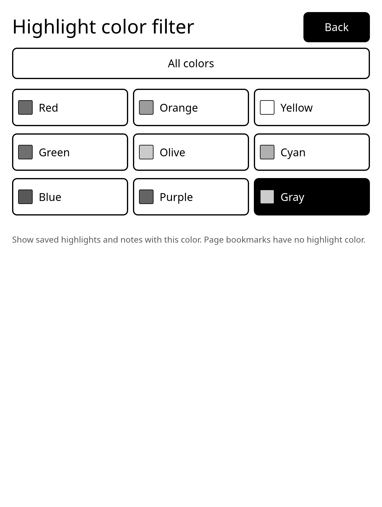
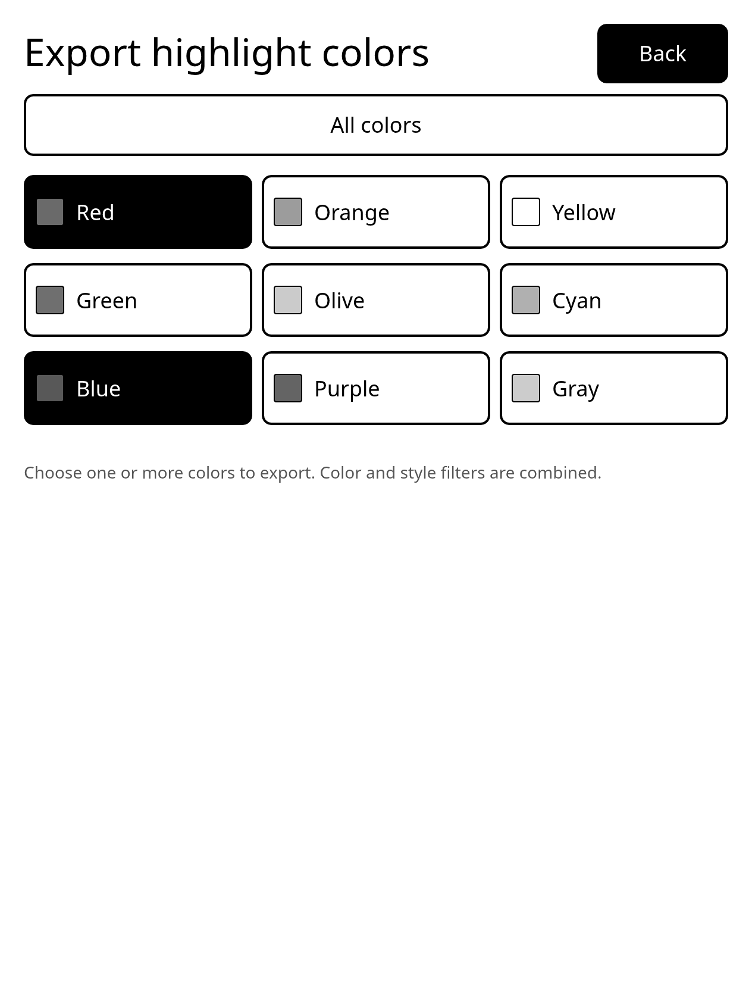

# Selection colors, bulk updates and color filters

Open **Settings › Highlight style** on the upper reading bar. **Selection color** uses the current book's named highlight color while selecting text. The switch is off by default and applies across books. Each book keeps its own saved color; changing the switch does not recolor existing marks. Invert disables the color controls and uses the usual gray selection. Gray retains the selection-opacity setting. Named EPUB and PDF colors use their respective provider's grayscale conversion and rendering rules.

**Apply to all highlights** opens a confirmation over the reading page. Apply updates the style and color of the current book's saved highlights and notes. Page bookmarks, other books, notes, source ranges, creation dates and the reading position are kept. Cancel, the physical back button or dismissal leaves the marks unchanged. The complete library update is saved atomically. A save failure restores all prior fields and leaves the confirmation open for retry. The source EPUB or PDF is never rewritten by this action.

In **Bookmark browser › Filters › Highlight color**, choose a single named color or All colors. Color combines with type, style, source, text and book filters. Page bookmarks have no highlight color, so they are excluded when a color is selected. The filter is remembered after reopening Reader.

In **Reading data › Export highlights › Highlight colors**, select one or more colors. Color and style selections are combined. All colors removes the color restriction. Clearing every selected color matches no highlights; it does not mean all colors. An empty export leaves a previously saved export intact. Older style-only preferences retain their original all-versus-empty meaning. A damaged existing filter is restricted until the user explicitly resets All colors and All styles. Named colors remain present in exported JSON.

## Exact stock source comparison

The reference remains KOReader `9192014d8bd82a91dc1012473be0f238dedfdb54`, koreader-base `6e4bc81af4e04f78d81677a323a780a71b29702a`, and CREngine `b32a88ffbbf505cf2ea5208c1a49002d70d3609f`.

| Reference behavior | Reader implementation |
|---|---|
| Global `highlight_selection_use_highlight_color`, inactive for Invert | Off-by-default reader switch; the open book supplies the named color. |
| Per-book saved drawer/color and reader default for new books | Existing preferences remain separate from the temporary-selection switch. |
| Confirm current drawer/color for every annotation with a drawer | Confirm the open book's update, with an atomic save and rollback on failure. |
| Bookmark browser single-color filter | One color combines with existing filters and excludes colorless page bookmarks. |
| Exporter's multiple color choices | Multiple named colors combine with the existing multiple-style filter. |
| CREngine selection background conversion | Reflow selections use `(R + 2G + B) / 4`, including inverted RGB in night mode. Fixed selections retain the blitbuffer conversion and selection opacity. |

Source: [selection switch and apply-all](https://github.com/koreader/koreader/blob/9192014d8bd82a91dc1012473be0f238dedfdb54/frontend/apps/reader/modules/readerhighlight.lua#L491-L608), [provider selection color](https://github.com/koreader/koreader/blob/9192014d8bd82a91dc1012473be0f238dedfdb54/frontend/apps/reader/modules/readerhighlight.lua#L2758-L2779), [bookmark color filter](https://github.com/koreader/koreader/blob/9192014d8bd82a91dc1012473be0f238dedfdb54/frontend/apps/reader/modules/readerbookmark.lua#L1641-L1660), [export color choices](https://github.com/koreader/koreader/blob/9192014d8bd82a91dc1012473be0f238dedfdb54/plugins/exporter.koplugin/main.lua#L362-L387).

The [independent tone generator](../scripts/compare-selection-colors.py) compiles the original conversion function from the explicitly pinned local reference. It checks eight named colors in both palettes. Reference source is used only for local QA and is not included in Reader packages. The [stock C blitbuffer comparison](../scripts/compare-highlight-colors.py) covers the distinct fixed/saved-mark blend.

## Margin-note mirroring audit

Stock's [setupNoteMarkPosition](https://github.com/koreader/koreader/blob/9192014d8bd82a91dc1012473be0f238dedfdb54/frontend/apps/reader/modules/readerview.lua#L1409-L1461) uses `BD.mirroredUILayout()`: interface-language mirroring, independent of paragraph direction or reversed page-turn order. Current Reader chrome is left-to-right. Its left-hand touch preference and document bidi direction do not implement a mirrored interface. Notes therefore retain the right margin on reflow leaves and right screen edge on fixed pages. Mirroring requires an explicit interface state shared by painting and note hit testing. Inferring it from Arabic text or device rotation would choose the wrong side for ordinary mixed-language books.

## Validation scope

New tests cover confirmation/cancellation, an actual failed atomic write with retry, preserved passages/notes/dates, both provider conversions, color/style/type intersections, persisted filters, legacy preferences, empty exports, pressed feedback in both themes, and authorized original EPUB/PDF workflows. The component binary passed 647 library tests, 14 package tests and four layout tests, with 46 opt-in cases skipped. Separate runs passed the original EPUB/PDF workflow and the independent CRE tone check (two cases), plus the 47,104-byte stock-blitter comparison (one case). Twelve authored light/dark captures were inspected. These receipts precede a final visual correction that fills the confirmation’s Apply button, and a new assertion of its background tone. The combined candidate must validate that final source and recapture the bulk dialog. The public filter screenshots are unaffected by that correction. Native Kindle validation, retained stock-frame comparison and the aggregate original-publication sweep remain pending. Whole-engine pixel equality for colored publisher text or images under a temporary EPUB selection is not claimed.
