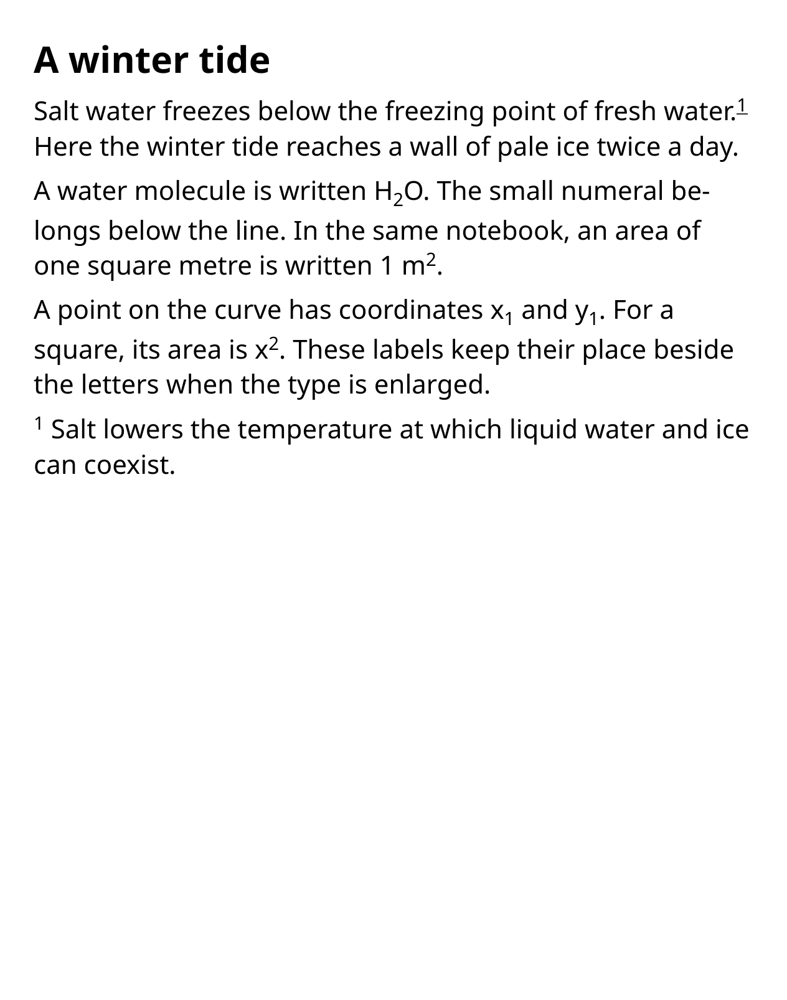

# Footnote numbers and subscripts

Reader raises footnote references, powers and superscript spans, and lowers subscripts in formulas. In horizontal reflow the default text size for a superscript or subscript is 70% of its parent. A publisher can change the size or reset the baseline. A link or emphasis inside a script keeps its position, and a nested script moves relative to its parent. Selection, bookmarks and footnote links keep their locations in the original text.

KOReader's default EPUB stylesheet sets the size. Its layout engine raises a superscript by one quarter of the parent font height and lowers a subscript by four fifths of the parent descent. Reader computes these distances in its own layout engine. Font choice and pixel rounding can affect the final displacement. [KOReader EPUB stylesheet](https://github.com/koreader/crengine/blob/b32a88ffbbf505cf2ea5208c1a49002d70d3609f/cr3gui/data/epub.css#L120-L121) · [CREngine baseline calculation](https://github.com/koreader/crengine/blob/b32a88ffbbf505cf2ea5208c1a49002d70d3609f/crengine/src/lvrend.cpp#L3700-L3745) · [HTML rendering guidance](https://html.spec.whatwg.org/multipage/rendering.html#phrasing-content-3)

## Comparison on original books

An independent spine scan of 30 original EPUBs found 4,451 superscripts and 300 subscripts in 10 books. These are lower bounds because 34 sections could not be parsed by the independent XML reader. Across four of the books, 30 source locations were sampled and paired with an adjacent body character. For each pair the installed KOReader rendered the original twice on an Oasis 3. The second pass reset only the script baseline, preserving its font size. Aligning the rasterized strokes of both characters measured the change relative to the surrounding text. The reference script returns numbers and keeps the page pixels in memory. [KOReader comparison script](../scripts/koreader-inline-baselines.lua)

| Original sample | Positions | Stock KOReader on Oasis | Native Reader layout on Mac |
| --- | ---: | --- | --- |
| Footnote references in the first EPUB | 6 | 12 px above | 14 px above |
| Superscript references in the second EPUB | 6 | 14 px above | 14 px above |
| Superscript references in the third EPUB | 6 | 13 px above | 13 px above |
| Superscripts in the fourth EPUB | 6 | 14 px above | 14 px above |
| Subscripts in the fourth EPUB | 6 | 10 px below | 10 px below |

Both readers placed all 30 scripts on the same side of the baseline. The measured displacement was identical at 24 positions. The other six differed by two pixels. The authored regression checks CSS overrides, nested scripts, baseline alignment, source byte positions and link targets. The comparison at original coordinates also checks that each source glyph paints at its mapped location. [Authored sample](../tests/fixtures/inline-scripts.xhtml) · [Reader layout tests](../src/parley_layout/inline_baseline_tests.rs)

One original book exposed a second issue. Its KOReader position referred to text after a run of source whitespace in a chapter with an ordinary linked stylesheet. Reader now checks whether the stylesheet can change whitespace handling before resolving that offset. Unknown imports, unreadable rules and ambiguous whitespace still require another verified location. [KOReader position import](../src/cre_pointer.rs)
