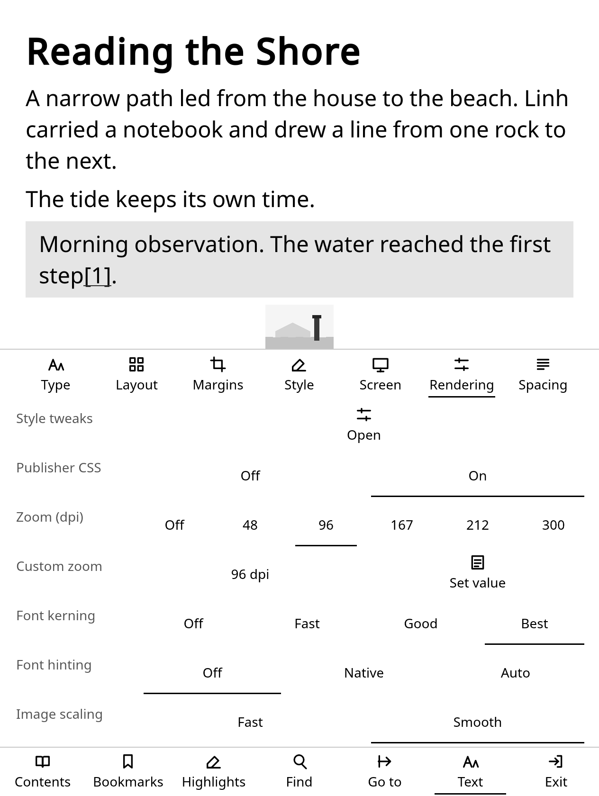

# Font kerning modes

The pinned KOReader Text/Rendering control offers Off, Fast, Good and Best.
The Rust Reader now exposes the same four choices, saves the selected mode per
book, and applies OpenType shaping features during EPUB layout and annotation
layout. Legacy `font_kerning` booleans still load as Off or Best.

| Mode | KOReader behavior | Rust Reader behavior and remaining difference |
| --- | --- | --- |
| Off | No kerning. | Disables horizontal and vertical kerning features. |
| Fast | FreeType pair kerning without ligatures. | Retains `kern`, disables vertical kerning and OpenType substitutions/positioning. Rust does not call FreeType's dedicated pair-kerning path, so glyph selection and advances can differ. |
| Good | HarfBuzz-light shaping: kerning, mark/cursive positioning and localized forms, without ligatures; limited support for non-Western scripts. | Applies the pinned allowlist through Harfrust. The Rust and KOReader engines can still differ in glyph advances, fallback, and script behavior. |
| Best | Full HarfBuzz shaping, including ligatures and joined-script shaping. | Uses Parley's default full shaping through Harfrust. It is the closest conceptual equivalent, but is not pixel- or glyph-identical to KOReader's HarfBuzz/FreeType stack. |

The pinned KOReader configuration documents the four labels and their intended
tradeoffs in [`creoptions.lua`](https://github.com/koreader/koreader/blob/9192014d8bd82a91dc1012473be0f238dedfdb54/frontend/ui/data/creoptions.lua#L635-L649).
Its HarfBuzz-light allowlist is in
[`lvfntman.cpp`](https://github.com/koreader/crengine/blob/b32a88ffbbf505cf2ea5208c1a49002d70d3609f/crengine/src/lvfntman.cpp#L1770-L1815).
KOReader applies the selected mode and restores the reading position in
[`readerfont.lua`](https://github.com/koreader/koreader/blob/9192014d8bd82a91dc1012473be0f238dedfdb54/frontend/apps/reader/modules/readerfont.lua#L223-L227).

## Verification status

Focused layout tests distinguish the feature sets using Noto Sans. The settings
workflow test selects each choice through the rendered bottom bar, verifies the
active mode and per-book saved preference, reopens the EPUB, and checks that the
mode survives. Set `READER_KERNING_SCREENSHOT` while running that test to save
the Rendering panel capture. Arabic, combining-mark and non-Western fallback
comparisons remain open, along with comparison against KOReader on the Kindle.

