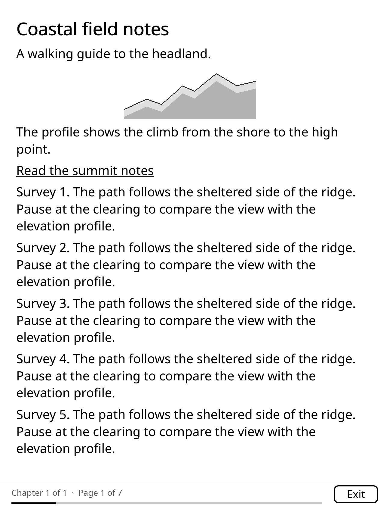
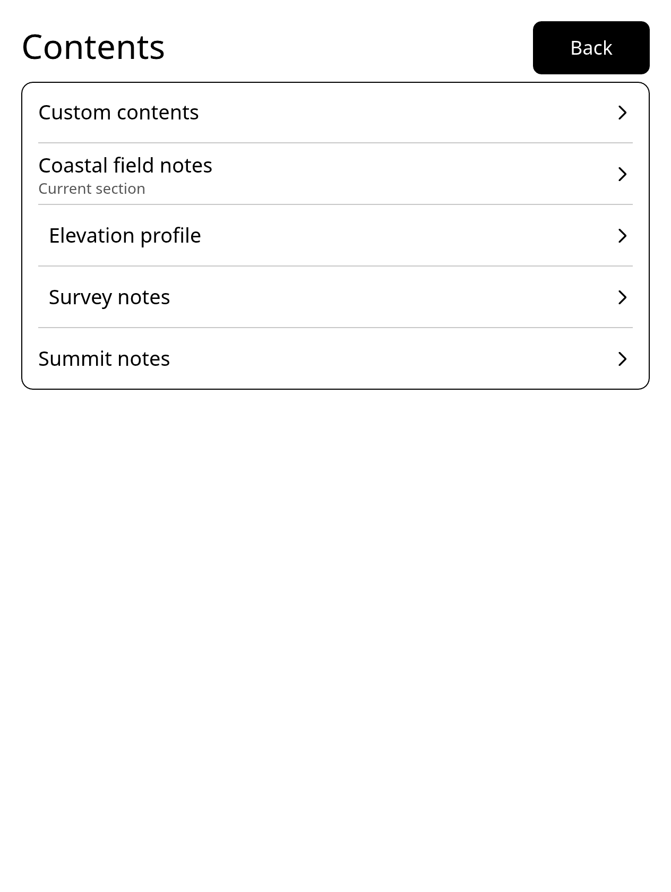
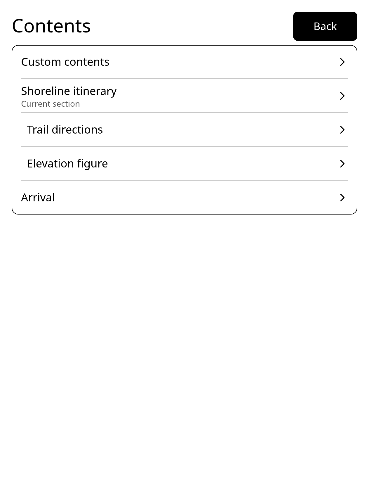
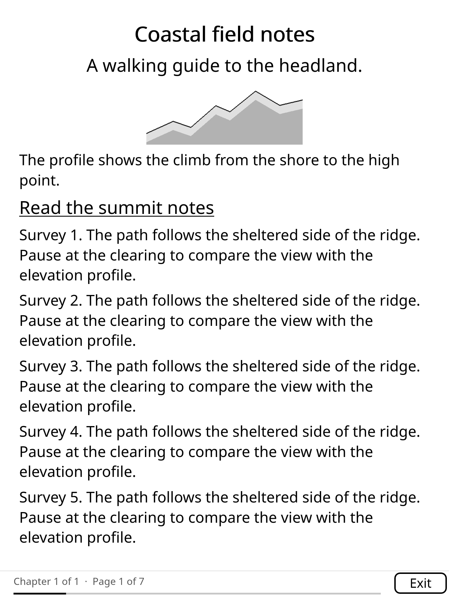

# Reading MOBI, PalmDOC and AZW3

Reader imports DRM-free legacy MOBI with publisher contents, illustrations and internal links, PalmDOC text, and supported reflowable Kindle Format 8 (KF8, commonly stored as AZW3). It uses its Rust importer and the same reading view, page controls and saved-position system as EPUB.

| Reading feature | Implementation |
| --- | --- |
| Text records | Read uncompressed, PalmDOC and HUFF/CDIC records, including multibyte overlap and trailing-data records. Legacy text supports UTF-8 and Windows-1252. KF8 markup uses UTF-8. |
| KF8 chapters | Reassemble skeletons and fragments in reading order. Use the FDST table to locate auxiliary flows when the PalmDOC header declares the length of the main markup flow. |
| Text and links | Accept standalone HTML with or without the XHTML namespace and ordinary XHTML document type declarations. Resolve Kindle fragment offsets against the original source bytes, including text with standard HTML character references. |
| Illustrations and style | Resolve local JPEG and PNG illustrations and first-frame GIFs. Recover supported raster covers from SVG wrappers and load local KindleGen stylesheet flows. The reading engine applies supported publisher styles. |
| Large chapters | Split long text and heavily illustrated sections for layout. Continuations retain nested markup, reading order and cross-section link destinations. Contents lists the original chapter once. |
| Import bounds | The container limit is 32 MiB and the uncompressed text limit is 12 MiB. Separate budgets apply to XML nodes, record counts, images, rendered sections and the accumulated resource bytes. |

A hybrid opens its legacy edition when Reader can read it. If that edition uses an unsupported encoding or compression, Reader can open a reflowable KF8 edition identified by its EXTH 121 record and the corresponding boundary. It resolves illustrations against the shared primary resource records. When a previous Reader release could only read the KF8 half of a hybrid, the same edition and its saved locations remain available. Fixed-layout KF8 is still unsupported. Reader reports protected books at opening.

## Legacy illustrations, links and reading positions



The field guide is an original reproducible fixture with one PNG record and a link to the summit notes. The image above was captured from Reader's normal library picker and reading view. [Fixture generator](../scripts/generate-mobi-fixture.py)

Two unencrypted books from a Kindle had 59 JPEG references and 1,136 links that older Reader builds omitted. An independent libmobi extraction placed all 201 distinct link targets at exact element starts. The Mac simulator opened the original files from the picker, advanced the display and resumed both books. All 59 imported image payloads matched the independently extracted resources. Every original text block mapped to the same text and chapter after the update. Saved highlights from the previous text model returned to the same words and produced visible selection rectangles in both books.

| Original | Historical chapters | Recovered figures | Working links | Distinct targets | Verified saved text blocks |
| --- | ---: | ---: | ---: | ---: | ---: |
| Longer legacy book | 9 | 23 | 1,008 | 175 | 5,466 |
| Illustrated legacy book | 1 | 36 | 128 | 26 | 1,641 |

The same controls ran offscreen on an Oasis 3. Earlier saved highlights reselected the original words and produced visible rectangles. Both originals opened in the normal picker, changed page and resumed from the saved position. First frames took 7.15 and 23.83 seconds, with process peaks of 34,440 and 65,000 KiB. These are single runs during other low-priority device work. The source books, user reading data and Browser session were verified after testing. The installed CREngine recognized the two upstream hybrids as PDB at one and 50 pages, the Windows-1252 book at 31 pages, and the authored field guide at eight pages. Reader displayed the field guide in seven pages with its own margins and font settings.

Reader interprets a decimal `recindex` as a one-based image record and checks its signature. Recognized images use JPEG, PNG or GIF. It resolves `filepos` against the original UTF-8 or Windows-1252 byte stream. Destinations at a supported opening element are available. An offset inside text, an attribute, a comment, or a discarded element remains unavailable. Historical chapter boundaries are determined before new markup is applied. A prior highlight translates through matching text blocks in their original order.

The two unmodified hybrid controls in libmobi v0.12 both open from Reader's picker through their primary edition. The secondary-edition verifier reconstructs three chapters from the NCX sample and two from the Unicode sample. The complete visible non-whitespace text matched independent libmobi reconstruction in both secondary editions, amounting to 94 and 23,136 characters respectively. The latter includes a shared JPEG and a lowercase HTML5 doctype. An authored hybrid tests the automatic fallback through the normal opener, including a link between KF8 chapters and an image present only in the primary resource section. The uncompressed Unicode sample also contains an unrelated later `BOUNDARY` record that the importer ignores. Both editions in the pinned HUFF/CDIC sample use the separate decoder covered below. The Kindle collection included sixteen standalone KF8 books and two legacy MOBIs. Hybrid behavior was therefore measured on the public controls. [Pinned sample files](https://github.com/bfabiszewski/libmobi/tree/85dcfe803fc2a21020ddcf15c3eb66b93d388add/tests/samples) · [Boundary lookup](https://github.com/bfabiszewski/libmobi/blob/85dcfe803fc2a21020ddcf15c3eb66b93d388add/src/util.c#L3016-L3036) · [Shared resource index](https://github.com/bfabiszewski/libmobi/blob/85dcfe803fc2a21020ddcf15c3eb66b93d388add/src/util.c#L2915-L2928)

## Legacy publisher contents



Open **Contents** in either reading toolbar to see the publisher's section names and their nesting. Selecting an entry opens its passage. **Previous location** returns to the earlier reading position. The illustrated field guide in the screenshot contains four entries. Three of their destinations occur only in the publisher’s navigation index. Regenerate it with `python3 scripts/generate-mobi-fixture.py --styled --contents build/coastal-contents.mobi`. [Fixture generator](../scripts/generate-mobi-fixture.py)

| Publication | Publisher entries | Deepest level, counting the root as 0 | Independent reference |
| --- | ---: | ---: | --- |
| Two original legacy books | 168 and 26 | 0 | libmobi supplied all 194 titles and target offsets. The installed KOReader PDB provider returned an empty Contents list for both books. |
| libmobi NCX, Windows-1252 and Unicode samples | 4, 2 and 2 | 1, 0 and 0 | The legacy edition of each matched its independently reconstructed NCX and HTML. |
| Authored field guide | 4 | 1 | libmobi reconstructed the published order, labels, hierarchy and all four links. |

The simulator compared the title and level of each of the 206 entries with libmobi, followed the original byte position to its element, and checked the next 24 visible non-whitespace characters and the resulting reading page. Both original books already used these same targets for body links. Regression tests also map previously saved text and image positions in the authored guide after adding navigation-only IDs. [libmobi index fields](https://github.com/bfabiszewski/libmobi/blob/85dcfe803fc2a21020ddcf15c3eb66b93d388add/src/index.h) · [libmobi NCX builder](https://github.com/bfabiszewski/libmobi/blob/85dcfe803fc2a21020ddcf15c3eb66b93d388add/src/opf.c#L566-L684) · [CREngine PDB importer](https://github.com/koreader/crengine/blob/b32a88ffbbf505cf2ea5208c1a49002d70d3609f/crengine/src/pdbfmt.cpp#L1282-L1355)

On the physical Oasis 3, all 206 entries matched the same publisher labels, levels, text ranges and navigable page positions. The authored toolbar test jumped to the final page and returned to the same opening frame. Its Contents screen was byte-identical to the Mac screenshot. The check verified the two original book hashes, existing Reader data and Browser session before deleting its test files.

Reader consumes the legacy edition's INDX rows and CNCX labels. It accepts up to 4,096 headings, 32 levels below the root and 2,048 encoded bytes per label. The normalized reading text keeps its historical section boundaries. An individually unresolvable destination stays visible and disabled. An absent or damaged navigation index leaves the book readable through the existing section list.

## Publisher contents in AZW3



Reflowable KF8 editions display the publisher’s headings in **Contents**, including passages within a chapter. The parent, first-child and last-child relationships determine reading order even when all the top-level entries come first in the binary index. A heading made entirely of whitespace appears as **Untitled section**. Books without a publisher index retain their chapter list.

Fourteen of sixteen original standalone AZW3s contained a publisher index. Reader resolved all 664 entries. The two remaining books opened with their chapter lists. Each row was checked against the independently extracted publisher title, depth, chapter and following 24 visible non-whitespace characters, or all available characters at the end of a chapter.

| Source destination | Entries | Verification |
| --- | ---: | --- |
| Start of the first fragment in a chapter | 310 | Independent reconstruction showed no text or illustration before the destination. Reader opened the chapter at its beginning. |
| Nonzero offset inside a fragment | 346 | Reader followed the fragment number and its byte offset in the original UTF-8 markup. These passages matched libmobi’s exported NCX targets. |
| Start of a later fragment in the same chapter | 8 | Six destinations were H3 headings and two were H2 headings. The index pointed to the opening byte of every heading. The libmobi NCX exporter links a zero offset to the chapter start. Reader and Calibre’s fragment addressing retain the later position. |

The comparison used libmobi’s independent reconstruction of the unmodified original markup for all eight later-fragment cases. In one other entry the source reused an HTML ID. Reader identified the exact element by its source position and retained its location without inserting any extra markup. An independent build of the preceding importer produced the same 492 section paths and identical XML bytes across all 16 books (14,867,040 bytes). The Mac laid out 36 representative destinations, including all eight later-fragment headings, using the normal reading engine. [libmobi NCX export](https://github.com/bfabiszewski/libmobi/blob/85dcfe803fc2a21020ddcf15c3eb66b93d388add/src/opf.c#L598-L634) · [libmobi fragment coordinates](https://github.com/bfabiszewski/libmobi/blob/85dcfe803fc2a21020ddcf15c3eb66b93d388add/src/parse_rawml.c#L407-L443) · [Calibre’s KF8 position resolver](https://github.com/kovidgoyal/calibre/blob/a03eefa6b684af0c08c44b06c9f2d94345c41255/src/calibre/ebooks/mobi/reader/mobi8.py#L298-L339)

## Legacy publisher alignment and font sizes



Publisher styles retain legacy paragraph alignment and inline HTML font sizes. The screenshot is the original illustrated fixture with the `--styled` option, opened from Reader's normal file picker. Turning off publisher styles restores the unstyled reading layout. Manual alignment in Reader can override a publisher's alignment. [Fixture generator](../scripts/generate-mobi-fixture.py)

Two original legacy MOBIs contain 51 centered paragraphs and 158 inline font elements with sizes 4, 5 or 7. Of the centered paragraphs, 49 contain text and two contain an image. Reader previously discarded these hints during import. A comparative check used the same 17 source passages from these books in Reader and the installed KOReader PDB provider.

| Source controls | Reader with the publisher setting | Installed KOReader |
| --- | --- | --- |
| Five centered passages | All five center axes were at x = 632 on a 1,264 px page. | Centers were at x = 656.5–657 with its stock first-line indent. With that indent removed, the same samples centered at x = 631.5–632. |
| Four size-4 runs | Selected text widened by approximately 1.20×. | Line height rose from 76 to 91 px. |
| Seven size-5 runs | Selected text widened by 1.48–1.50×. | Line height rose from 76 to 116 px. |
| One size-7 run | Selected text widened by 3.00×. | Line height rose from 76 to 232 px. |

Absolute sizes follow seven steps relative to the document's base font. Signed sizes use 3 as the starting step. An inner size declaration replaces the outer size, and closing it restores the enclosing size. Reader recognizes the leading digits, clamps the result to steps 1–7 and ignores a declaration without digits. A separate authored negative boundary distinguishes the implementations. At `size="-4"`, Reader uses step 1 as the HTML algorithm specifies. The installed CREngine uses unsigned subtraction at that boundary and rendered the authored text about three times its normal width. [HTML legacy font sizes](https://html.spec.whatwg.org/multipage/rendering.html#rules-for-parsing-a-legacy-font-size) · [Pinned CREngine conversion](https://github.com/koreader/crengine/blob/b32a88ffbbf505cf2ea5208c1a49002d70d3609f/crengine/src/lvstsheet.cpp#L5002-L5054)

Reader chooses chapter splits from the same normalized source as earlier builds. It projects publisher hints into each resulting section and validates previous text and illustrated block keys against the current words and image offsets. The two original books retained all 59 JPEGs and 1,136 internal links. An authored long paragraph tests font size and alignment across a chapter split. On the Oasis, 10,905 prior block checks in the longer book and 3,318 in the other book mapped to the same text or image position across historical editions. Every native Reader selection rectangle for all 17 original samples and eight authored controls was identical to its Mac counterpart. The native test verified the source-file hashes and existing Reader and Browser state before removing its scratch files.

## HUFF/CDIC editions

Reader decodes text records with compression ID 17480 in ordinary unencrypted legacy MOBI and reflowable KF8. It reads the edition's HUFF prefix and code-length tables and its CDIC phrase records. A phrase can contain literal bytes or other codes. Decoding writes into the same bounded text buffer as PalmDOC before the normal chapter, image and link import. Each edition has its own dictionary, including in a dual-format file.

| Independent source | Edition verified | Text records | Bytes matched to libmobi |
| --- | --- | ---: | ---: |
| libmobi v0.12 Unicode hybrid | Legacy, including its separately exported MOBI | 28 | 111,701 |
| Same unmodified hybrid | KF8, including its separately exported AZW3 | 27 | 108,331 |
| Kindling English dictionary | Legacy reading text | 1 | 3,074 |
| Kindling Japanese dictionary | Legacy reading text | 2 | 4,940 |

These comparisons cover every uncompressed byte across 58 distinct source text records. The two Unicode editions each used two CDIC records, and the two Kindling dictionaries each used three. The legacy Unicode sample also matches its independently distributed uncompressed counterpart. The KF8 comparison uses libmobi's expansion of the actual compressed edition. The two Kindling files exercise reading the dictionary as a book. They do not establish Kindle dictionary-index lookup support. No personal HUFF/CDIC file was present in the Kindle collection. [libmobi sample files](https://github.com/bfabiszewski/libmobi/tree/85dcfe803fc2a21020ddcf15c3eb66b93d388add/tests/samples) · [Kindling fixtures](https://github.com/ciscoriordan/kindling/tree/e4174b70287ddcabfb0490a8141fd05794f7e72d/tests/fixtures/huffdic)

The decoder accepts up to 64 CDIC records, 65,536 phrases and 32 nested phrase references. It checks dictionary offsets and each symbol, stops cyclic expansion and enforces a step budget for each text record and the whole edition. A text record can expand to at most its header's record size, capped at 32 KiB. The 12 MiB book-text limit also applies. Bounds and output tests cover short and long codes, nested phrases, invalid offsets, truncated dictionaries and an exhausted expansion budget. Reader uses its own Rust implementation with borrowed phrase data. In comparison, Kindling’s MIT implementation allocates and caches expanded phrases with a separate 16 MiB output limit. [libmobi decompression](https://github.com/bfabiszewski/libmobi/blob/85dcfe803fc2a21020ddcf15c3eb66b93d388add/src/compression.c#L106-L211) · [Dictionary layout](https://github.com/bfabiszewski/libmobi/blob/85dcfe803fc2a21020ddcf15c3eb66b93d388add/src/read.c#L550-L741) · [Kindling implementation](https://github.com/ciscoriordan/kindling/blob/e4174b70287ddcabfb0490a8141fd05794f7e72d/src/huffcdic.rs) · [Kindling license](https://github.com/ciscoriordan/kindling/blob/e4174b70287ddcabfb0490a8141fd05794f7e72d/Cargo.toml)

The Mac's normal library picker opened all eight test files, changed the reading frame after a forward page turn and resumed the saved page. The complete first-frame PNG matched across the compressed hybrid, its standalone legacy edition and the uncompressed hybrid. The illustrated field guide also produced identical PNGs in plain and compressed form. Both its image bytes and its internal destination matched the original. In the compressed hybrid’s KF8 edition, both reconstructed chapters and all 23,136 visible non-whitespace characters matched independent reconstruction.

The Oasis 3 opened all eight files from the normal picker, advanced after a page-key event and restored their saved pages. Its six HUFF/CDIC first frames took 370–972 ms with process peaks of 24,316–27,072 KiB. The complete rendered PNG matched between both authored encodings and between the compressed hybrid, its standalone legacy edition and the uncompressed hybrid. The compressed primary's image and local link, and both reconstructed KF8 chapters, also passed on ARM. Installed KOReader recognized the two uncompressed controls as PDB. It reported all six compressed files as plain text, including a 427-page text fallback for the hybrid. The tests used separate profiles and verified the original files, active Reader data and Browser state before and after.

A full Mac read with a CJK fallback covered every page of the compressed hybrid, split KF8, English and Japanese books and authored field guide. All 82 pages contained ink and returned to the same source anchor. All 53,600 non-whitespace source characters mapped with zero missing glyphs. A comparison with the previous Reader also preserved identical first frames, book identities and saved positions on a plain hybrid, authored legacy book and one standalone AZW3 from the Kindle collection.

To reproduce the illustrated field guide in both encodings and compare its complete reading frames, generate the two files with the same book name in separate directories. Reader's normal picker verifier accepts a fresh profile for each run.

```sh
mkdir -p build/huff-book build/plain-book
python3 scripts/generate-mobi-fixture.py --huff build/huff-book/field-notes.mobi
python3 scripts/generate-mobi-fixture.py build/plain-book/field-notes.mobi
READER_VERIFY_PICKER=1 READER_VERIFY_FRAME=build/huff.png cargo run --locked --example verify_document -- build/huff-book field-notes.mobi build/huff-profile tests/fixtures/fonts/NotoSans-Regular.ttf
READER_VERIFY_PICKER=1 READER_VERIFY_FRAME=build/plain.png cargo run --locked --example verify_document -- build/plain-book field-notes.mobi build/plain-profile tests/fixtures/fonts/NotoSans-Regular.ttf
cmp build/huff.png build/plain.png
```

## Tests with books from a Kindle

On November 22, 2026, the Mac simulator exercised **16 standalone AZW3 books and one legacy MOBI** drawn from the owner's Kindle Documents. All 17 had failed to open during the earlier device audit. Each test began with a new Reader profile and used the visible library picker. All 17 opened, painted a first frame, changed the frame after a forward page-button event, saved the reading position and reopened through **Continue reading**. The central reading area matched the saved frame after restart, and the stored position matched.

The debug build on this Apple Silicon Mac took 0.206–6.201 seconds from Reader startup through the first painted frame, with a median of 0.490 seconds. The measurements include browsing to each book in the picker. The Kindle hardware timings are listed separately below. This desktop pass sampled the opening and resumed pages of each book. The published evidence contains aggregate results only.

## Interior navigation and illustrations

A second Mac pass checked the entire import structure and selected interior pages of the same 17 books. It included the first, middle and final spine section in every book, plus sections containing illustrations, direct artwork links and numerous fragment destinations. Section numbers refer to Reader's layout sections, including continuations of long chapters.

| Check | Result |
| --- | --- |
| Local references across the full book | All 3,639 local links resolved across 501 sections. The books contained 716 image placements, 406 distinct image resources counted per book, and 72 local CSS resources. All resources passed decoding or loading checks. Adobe XPGT page templates appeared in 61 references and were counted separately from CSS. |
| Interior rendering | Reader rendered 195 selected pages in 83 sections. All 194 pages that supplied a source anchor mapped it back to the same page. All 707 sampled fragment destinations mapped to a page. |
| Artwork inspection | Reader opened all 88 sampled placed illustrations in its original-image viewer. Four links pointed directly to image resources. Both visible link targets opened in the viewer. The other two links occurred inside publisher-hidden list entries. |
| Text coverage | Layout covered all 1,142,259 non-whitespace source characters in the sampled sections. The single desktop Noto Sans test font produced 142 missing-glyph occurrences. The full-section Mac check below uses the Oasis reading stack. |

The aggregate verifier prints counts and numeric section indices. It accepts additional reading fonts as trailing arguments.

```sh
cargo run --locked --example verify_kindle_sections -- book.azw3 path/to/reading-font.ttf
```

## All-section check with Oasis fonts

A further Mac run used the four fonts configured in Reader 0.1.7 on the Oasis. It visited **all 501 sections** of the 16 AZW3 books and one MOBI and painted their first, middle and last pages where distinct. All 8,964,009 non-whitespace characters mapped to text lines, all 716 illustration placements decoded, and all 12,487 fragment anchors resolved. Of 1,281 painted pages, 1,279 contained ink. All 1,279 page anchors supplied by these views returned to the same page. One book contained 134 missing-glyph occurrences in its publisher's private-use symbol range. Text coverage and glyph coverage are measured separately.

The 134 occurrences comprise eight private-use characters in the legacy symbol-font range across 58 text nodes. The two-section AZW3 provides no stylesheet, inherited font-family or face attribute on those nodes, or identifiable embedded font record. Its intended glyph shapes depend on a private mapping absent from the publication. On the Mac, the four-font stack and the additional Code2000 firmware fallback each mapped all 80,710 non-whitespace source characters and reported the same 134 missing glyphs.

Seven fresh Mac processes per configuration opened and painted this AZW3's first page. The test alternated the old and new configurations after a warm-up pair. The original stack had a median first-paint time of 633 ms and median peak resident memory of 33.03 MiB. With the new file-backed firmware stack those medians were 629 ms and 29.53 MiB. [Firmware font coverage](real-document-verification.md#oasis-firmware-font-coverage)

## Oasis 3 device verification

The physical Oasis 3 batch used the installed Documents collection and a fresh scratch profile for each file. All 16 AZW3 books and both legacy MOBI files opened from the picker, changed frame after a hardware page-key input event, and restored the saved page after a Reader restart. The extra MOBI was part of the device collection.

| Device sample | First readable frame | Peak process memory |
| --- | --- | --- |
| 16 AZW3 books | 433–6,833 ms, median 997 ms | Up to 64,548 KiB |
| Two legacy MOBI books | 1,189 ms and 2,986 ms | Up to 50,160 KiB |

Elapsed times cover Reader startup through a software-rendered first frame. The device harness sent page-key events to Reader and compared saved and resumed reading pixels. Physical e-ink panel timing requires a separate measurement.

### Reader 0.1.7 and 0.1.8 firmware glyph comparison

The same Oasis checked the exact 0.1.7 release binary and 0.1.8 candidate from commit `d655e20`, each in a fresh process and private profile. Both builds opened the two original books from the picker, turned the page, resumed at the same reading position and checked every section. The EPUB contained 357,788 mapped characters across 12 sections. The AZW3 contained 80,710 across two. Both builds mapped every source character.

| Original | Reader | Missing glyph occurrences | First software frame | Peak process RSS |
| --- | --- | ---: | ---: | ---: |
| 033 EPUB, standard symbols | 0.1.7 | 63 | 3,081 ms | 76,136 KiB |
| 033 EPUB, standard symbols | 0.1.8 | 0 | 3,069 ms | 72,748 KiB |
| 002 AZW3, private-use symbols | 0.1.7 | 134 | 2,697 ms | 31,268 KiB |
| 002 AZW3, private-use symbols | 0.1.8 | 134 | 2,865 ms | 27,736 KiB |

The 130-document inventory was running throughout these four measurements. Each row is one offscreen run. First-frame time covers opening the library and painting the selected document. The kernel's peak resident memory measurement includes the restart and spine check. The added fallback supplied the EPUB's standard symbols. The AZW3's missing private glyphs remain visible in the diagnostic count. Reader uses font files already installed by the Kindle firmware. The package carries no copies of them. [On-device comparison script](../scripts/compare-kindle-readers.sh)

## How KOReader opens these formats

The comparison uses KOReader v2026.07.1 at commit `9192014d`. Its `base` submodule points to `6e4bc81a`, which pins the KOReader fork of CREngine at `b32a88ff`. These are the revisions compiled for this comparison. [KOReader base pin](https://github.com/koreader/koreader/tree/9192014d8bd82a91dc1012473be0f238dedfdb54/base) · [CREngine pin](https://github.com/koreader/koreader-base/tree/6e4bc81af4e04f78d81677a323a780a71b29702a/thirdparty/kpvcrlib/crengine)

| Stage | What the pinned source does |
| --- | --- |
| Choosing a reader | KOReader checks filename suffixes and ranks registered providers. CREngine has weight 90 for `.mobi` and `.azw`, and handles `.prc`. MuPDF is another `.mobi` provider at weight 80. The `.azw3` suffix is absent from both registration tables. A forced provider or the unknown-extension fallback is a separate test from normal library discovery. [Registry](https://github.com/koreader/koreader/blob/9192014d8bd82a91dc1012473be0f238dedfdb54/frontend/document/documentregistry.lua#L91-L145) · [CREngine registrations](https://github.com/koreader/koreader/blob/9192014d8bd82a91dc1012473be0f238dedfdb54/frontend/document/credocument.lua#L1585-L1618) · [MuPDF registrations](https://github.com/koreader/koreader/blob/9192014d8bd82a91dc1012473be0f238dedfdb54/frontend/document/pdfdocument.lua#L372-L390) |
| Loading legacy content | Lua calls the CREngine document view. The native bridge passes the file to `LVDocView::LoadDocument`. Its PDB path calls `DetectPDBFormat` and `ImportPDBDocument`. The importer exposes the decompressed records as a stream, detects the contained markup, attaches an in-memory resource container, and invokes its HTML or text parser. [Lua entry](https://github.com/koreader/koreader/blob/9192014d8bd82a91dc1012473be0f238dedfdb54/frontend/document/credocument.lua#L298-L310) · [Native bridge](https://github.com/koreader/koreader-base/blob/6e4bc81af4e04f78d81677a323a780a71b29702a/cre.cpp#L690-L705) · [Document dispatch](https://github.com/koreader/crengine/blob/b32a88ffbbf505cf2ea5208c1a49002d70d3609f/crengine/src/lvdocview.cpp#L4442-L4469) · [PDB import](https://github.com/koreader/crengine/blob/b32a88ffbbf505cf2ea5208c1a49002d70d3609f/crengine/src/pdbfmt.cpp#L1282-L1336) |
| Metadata and images | CREngine reads EXTH metadata, walks the image records after the first-image index, recognizes JPEG, PNG and GIF by their bytes, and associates the cover offset with a local resource. The DOM maps the legacy HTML `recindex` attribute to that numbered resource. [MOBI metadata and resources](https://github.com/koreader/crengine/blob/b32a88ffbbf505cf2ea5208c1a49002d70d3609f/crengine/src/pdbfmt.cpp#L806-L953) · [DOM image lookup](https://github.com/koreader/crengine/blob/b32a88ffbbf505cf2ea5208c1a49002d70d3609f/crengine/src/lvtinydom.cpp#L21756-L21775) |
| Compression and KF8 | The CREngine MOBI header accepts uncompressed records or PalmDOC and rejects encrypted MOBI. It reads a single logical legacy text stream. FDST flows, skeleton/fragment indexes and `kindle:pos` reconstruction are absent from its importer. The registered MIME type is a dispatch hint. Reader's native KF8 importer reconstructs these elements explicitly. [Header and validation](https://github.com/koreader/crengine/blob/b32a88ffbbf505cf2ea5208c1a49002d70d3609f/crengine/src/pdbfmt.cpp#L106-L203) · [Record decoding and trailers](https://github.com/koreader/crengine/blob/b32a88ffbbf505cf2ea5208c1a49002d70d3609f/crengine/src/pdbfmt.cpp#L458-L610) |
| Alternate MuPDF provider | KOReader instantiates MuPDF through its PDF document wrapper and pins MuPDF 1.27.2. Its MOBI extractor accepts uncompressed or PalmDOC text, writes one HTML entry, and collects recognized image records into an archive. The compression check rejects HUFF/CDIC. Both the CREngine and MuPDF routes use their own Palm database parser. [KOReader wrapper](https://github.com/koreader/koreader/blob/9192014d8bd82a91dc1012473be0f238dedfdb54/frontend/document/pdfdocument.lua#L23-L42) · [MuPDF pin](https://github.com/koreader/koreader-base/blob/6e4bc81af4e04f78d81677a323a780a71b29702a/thirdparty/mupdf/CMakeLists.txt#L125-L130) · [MuPDF record handling](https://github.com/ArtifexSoftware/mupdf/blob/73d3100d46d8a9ad634f6ef035bbe78f0f947886/source/html/mobi.c#L113-L175) · [HTML and images](https://github.com/ArtifexSoftware/mupdf/blob/73d3100d46d8a9ad634f6ef035bbe78f0f947886/source/html/mobi.c#L295-L332) |

Source inspection establishes the registered routes and parser behavior. A Kindle file can contain more than one representation. For hybrids, the legacy view and the reconstructed KF8 layout require separate checks of reading order, auxiliary flows and cross-chapter destinations.

## Regression fixtures

The repository builds synthetic fixtures in Rust. No files from the private collection are required to run these tests.

| Fixture group | Regression coverage |
| --- | --- |
| MOBI and PalmDOC | Encoding, record trailers, overlapping PalmDOC backreferences, malformed inputs, encryption detection and full-length MOBI. A generated legacy book retains all 26,102 paragraphs after partitioning. |
| KF8 | Fragment and skeleton reconstruction, cross-chapter links and local art, an external declaration, an auxiliary stylesheet beyond the primary text length, namespace-free HTML, misleading image MIME metadata, invalid FDST ranges and malformed index records. |
| Layout sections | A synthetic 30-image chapter retains every placement and links in both directions across sections. A long multibyte paragraph retains its text and character references across cuts. |
| XML preprocessing | Ordinary external declarations, built-in HTML character references in text and attributes, unchanged literal sections, source-byte mapping across expansions and rejection of document-defined entities. |

Run the regression groups from the Reader repository.

```sh
cargo test --locked --lib mobi::
cargo test --locked --lib kf8::
cargo test --locked --lib kindle_sections::
cargo test --locked --lib epub_xml::
```

The format implementation was checked against [calibre's Kindle 8 reader](https://github.com/kovidgoyal/calibre/blob/a03eefa6b684af0c08c44b06c9f2d94345c41255/src/calibre/ebooks/mobi/reader/mobi8.py) and [libmobi's raw markup processing](https://github.com/bfabiszewski/libmobi/blob/906274205c11944b628da1c553b255acb1af7c55/src/parse_rawml.c).
