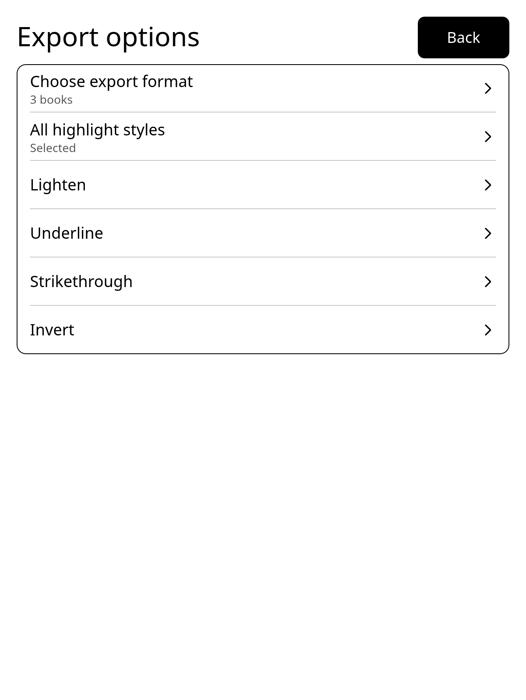

# Library highlight exports

Open **Reading data › Export highlights**. Choose History, select individual books, or choose one or more collections. Select highlight styles and colors, then choose KOReader JSON, plain text, Markdown, HTML or Kindle clippings text. The filters remain selected when Reader reopens. Color and style restrictions are combined; an empty selection matches no highlights. With the default destination, the saved file appears under `reader/data/exports/library-highlights` with the chosen extension.

Each book keeps its own title, author and source file. Different editions with the same title remain separate. Reader’s saved highlights export with their attached notes. With All styles and All colors selected, the export also includes saved page bookmarks and their notes, including books with bookmarks but no highlights. Bookmarks have no highlight style or color, so selecting either filter excludes them, just like unstyled Kindle clippings. History also includes eligible entries from Kindle’s clippings file when available. Books with matching entries appear in the export. A source that has disappeared or changed is skipped and included in the completion count.

For fixed documents, the page reference is the one-based physical source page. For reflowable documents, Reader resolves the saved text anchor with that book's reading preferences and records a chapter-local page label. A reflow label such as “Chapter 3, page 2” identifies the current layout. Exact start and end anchors also appear in the JSON `primitiveos` field. Unknown creation times remain absent. The saved creation time is retained when it exists. Named highlight colors also appear in JSON. Bookmark JSON records identify their type, saved label, note and original position; human-readable output identifies a bookmark as a location rather than a quotation. Kindle clippings use separate bookmark and note records. If a reflow bookmark’s anchor cannot be resolved its label remains available without an invented page. Fixed-layout EPUB bookmarks use their physical page. [Color controls and interchange](highlight-colors-and-note-markers.md)

Reader prepares one book or saved mark per event-loop step. Cancel, Back or sleep cancels an unfinished export. The open book, its reading position, jump history and saved annotations stay available throughout the export.

## Export folder and filenames

Open **Export settings** from the library's Export options or from an open book's **Export annotations** screen. Choose an existing folder in Documents or tap **Use Reader exports** to restore the default. The destination is shared by the annotated-book and library export views and persists when Reader closes. The folder picker lists folders only. If the chosen folder becomes unavailable, the export shows an error, and the picker can start again at Documents.

**Export beside the book** writes to the source folder when exactly one exported book still has a verified local file. A sole book from Kindle clippings has no source file, so it uses the configured export folder. Multi-book exports use the configured folder.

Use **Single-book filename** and **Multiple-book filename** to edit independent templates. The number of books with entries after filtering and clippings merge selects the template. **Clear** clears the draft. **Save** applies it, including an empty field to restore Reader's default. **Back** discards edits. Without a template, single-book exports use the book ID or the **Use book titles for filenames** setting. Library bundles use `library-highlights`, including when one book survives filtering. Each format supplies its own suffix, including `.clippings.txt`.

**Filename tokens** lists the supported placeholders. For example, `%T - %A - %D` uses the title, author and export date. In a multi-book export, book tokens read from the open or most recently read book when available. Date and time use the device clock at export start. Current page, chapter and pace tokens use Reader's known values for the active book. Missing values and unknown letter tokens appear as `N-A`. Literal `%%` remains two percent signs, and `%%T` becomes a percent sign followed by the title. Expanded values stay within one filesystem-safe filename. [Template editor](screenshots/annotation-export-template-editor.png) · [Token guide](screenshots/annotation-export-template-tokens.png)

Default names in Reader data use the app kit's atomic replacement. Documents destinations, book-title filenames and custom templates use exclusive creation and append `-2`, `-3` and so on when the name already exists. The queued library export keeps the settings, clock time and open or recent book values captured when it started. The destination is revalidated at save time under the storage lease. Separate Reader backup files and annotated PDF copies use their own destinations. [Export settings](screenshots/annotation-export-template-settings.png) · [Folder picker](screenshots/annotation-export-folder.png) · [Saved library export](screenshots/annotation-export-template-saved.png)

## KOReader source comparison

The reference is KOReader commit `9192014d8bd82a91dc1012473be0f238dedfdb54`.

| KOReader behavior | Reader behavior |
|---|---|
| Export History or selected previously opened books | History, individual books and collection unions select existing tracked documents. |
| Filter highlight drawers | Choose one or more of Lighten, Underline, Strikethrough and Invert. |
| Filter highlight colors | Choose one or more named colors; All colors clears this restriction. |
| Export highlighted text, note, page reference, chapter, creation time and drawer | Those fields are retained or resolved from the saved location. Missing dates or unresolved reflow pages are omitted. |
| A single book is a JSON object, several books use a `documents` envelope | Both shapes follow the exporter schema and can be read by Reader's KOReader JSON parser. |
| Human-readable text, Markdown and HTML | The quotation and note remain literal. HTML escapes markup and uses one document containing book sections. |
| Choose a custom export folder or its default | Choose an existing folder in Documents or restore Reader data exports. |
| Use the book folder for one exported book | The same opt-in applies to a finalized one-book scope with a verified local source. A clippings-only entry without a source uses the chosen folder. |
| Edit separate filename templates for single and multiple books | Both templates accept plain text and the stock token letters. Empty templates restore Reader's book and library filename defaults. Reader's time token uses its usual 24-hour device clock. |

[KOReader export actions](https://github.com/koreader/koreader/blob/9192014d8bd82a91dc1012473be0f238dedfdb54/plugins/exporter.koplugin/main.lua), [annotation fields](https://github.com/koreader/koreader/blob/9192014d8bd82a91dc1012473be0f238dedfdb54/plugins/exporter.koplugin/clip.lua), [JSON shapes](https://github.com/koreader/koreader/blob/9192014d8bd82a91dc1012473be0f238dedfdb54/plugins/exporter.koplugin/target/json.lua)

## Kindle clippings

History includes `Documents/My Clippings.txt` when present. Use the **Kindle
clippings** switch to choose whether to include it. All colors and all styles
include Kindle entries, which carry their original type, quotation or note,
page or location, and available date. Select a style or color to focus on
Reader’s own marks. Choose books or collections to export those selections.

Reader combines Kindle entries with a unique matching title and author,
preserves distinct editions when the source is ambiguous, and removes exact
duplicate Kindle records. Location-only and chapter-local references keep
their labels. Kindle entries retain metadata from the clippings file. The parser handles English and Simplified Chinese Kindle
records, UTF-8 with a byte-order mark, multiline text, and files up to 8 MiB
and 8,192 recognized records.

**Kindle clippings text** saves a separate `.clippings.txt` file. Export from
an open book to include just its saved highlights and notes, or from Reading
data to include the selected library sources. The original Kindle file stays
in Documents. [Export options](screenshots/export-kindle-clippings-options.png) · [Export formats](screenshots/export-kindle-clippings-format.png)

The pinned KOReader Lua parser and writer run against independent authored
highlight and note fixtures. That comparison checks printed pages, Kindle
location, local dates and the delimiter format. Reader tests also verify
duplicate and same-title handling, combined JSON and text, selection filters,
and byte equality for the original clipping source and saved library state.
[Stock comparison script](../scripts/koreader-kindle-clippings-check.lua) · [Kindle text target](https://github.com/koreader/koreader/blob/9192014d8bd82a91dc1012473be0f238dedfdb54/plugins/exporter.koplugin/target/my_clippings.lua)

## Verification

The addition of page bookmarks and bookmark notes to library-wide exports is an
unverified implementation candidate. Builds, simulator and Kindle tests have
not been run for it. Missing or changed source books keep the existing export
behavior: they are skipped and counted, while stored marks remain untouched.
Archived and deleted records remain subject to the existing History selection.

The earlier functional test uses the normal Reading data controls with two same-title EPUB editions and a PDF. It checks History, collections, selected books, combined style filters, single-book and multi-book JSON, all human-readable formats, sleep cancellation, reading-order sorting, a source replaced during export, and the original reading position and saved state. The JSON is also parsed by the existing KOReader import parser.

The Mac passed 559 library tests, 14 package integration tests and four layout system tests. Thirty opt-in tests were skipped in the ordinary run. A pressed-frame check covers every actionable row in the export screens in both themes and verifies that feedback changes only its row.

An opt-in test reads the authorized original Documents corpus with an isolated Reader state. It selects actual text from two EPUBs and two PDFs and checks the exported quotation, note, date and source anchor or physical page. The originals are read in place. The test records only aggregate counts in its output.

That original-file test passed on the Mac, with all four source SHA-256 values preserved. The installed KOReader JSON exporter also serialized the authored three-book control through its actual Lua module. Its standard single-document and multi-document fields matched Reader's output. The installed module's SHA-256 matched the pinned reference. The comparison used an in-memory writer and created no Kindle files. Native testing of Reader's new export flow is pending the combined Kindle build.

## Export settings verification

The pinned KOReader menu and export callbacks were executed with its macOS LuaJIT and authored metadata. The single-book default expands date, time, author and title. The multi-book default expands date and time followed by `all-books`. Stock also exposes free-form filename templates with metadata, source filename and path, calendar/time, reading progress, chapter, page, and device placeholders. The callback check exercises all token letters, missing values, percent escaping, nonrecursive metadata, the last-file fallback, independent per-scope templates, Cancel, Default and the book-folder override. It captures paths in memory. The actual stock local targets also differ in file handling. Text and MyClippings append. JSON, Markdown and HTML open the computed file for replacement. [Stock callback check](../scripts/koreader-export-location-check.lua) · [Filename expansion code](https://github.com/koreader/koreader/blob/9192014d8bd82a91dc1012473be0f238dedfdb54/frontend/apps/filemanager/filemanagerbookinfo.lua#L1031) · [Stock plain text target](https://github.com/koreader/koreader/blob/9192014d8bd82a91dc1012473be0f238dedfdb54/plugins/exporter.koplugin/target/text.lua)

The authored Mac workflow tests navigate the shared settings from both export surfaces. They verify persistence on reopen, the default names and replacement behavior, the single-book source-folder override, existing-file preservation, bundled clippings, library cancellation, and rejection of a destination replaced with a symlink. Simulator captures use Reader's 1264 × 1680 canvas.

The template workflow tests enter a literal percent sign through the native keyboard and edit both templates through Reader's Save button. They verify that cancelling a cleared draft preserves the template, saving an empty draft restores Reader's default, and the settings survive reopen. They also cover nested percent tokens in title metadata, literal percent signs, invalid filename characters, collisions, a queued settings edit, one surviving source and a sole Kindle clipping without a source path. The authored samples run through Reader's usual library and book export commands.
