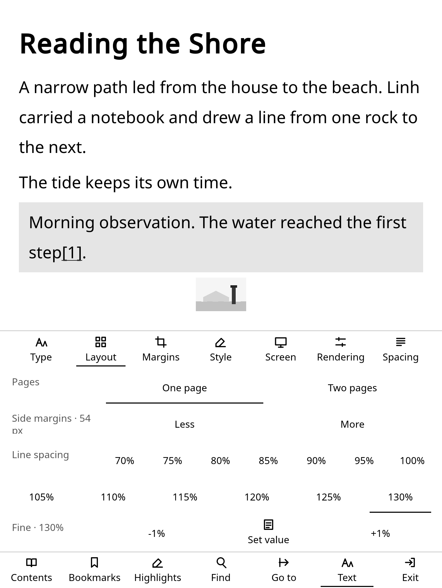

# Line spacing parity

Publisher `line-height` percentages, `em`, and `px` values have a bounded
implementation candidate in the horizontal Parley renderer. Relative heights
resolve against the declaring element's font and inherit as a fixed computed height, so changing a
descendant's font size does not rescale that inherited height. Unitless and
`normal` declarations retain their existing behavior. The reader's line-spacing
control and existing minimum/maximum line-height limits still apply. Generated
content and supported first-line/first-letter styles use the same model.
Pixel values use Reader's configured CSS DPI once and remain fixed when the
descendant font changes. Physical units such as `pt`, other relative units,
relative values outside 0–8, and pixel values outside 0–4096 remain unsupported. This change does not alter
source text or saved positions and has not yet been behaviorally tested.
Vertical and Blitz rendering do not yet consume this new computed height.

KOReader v2026.07.1 exposes thirteen Text/Layout presets from 70% to 130%,
defaults to 100%, and offers a custom range from 50% to 200%. A tap changes
the value by 1%; a held control changes it by 5%. The values and bounds are in
[`creoptions.lua`](https://github.com/koreader/koreader/blob/9192014d8bd82a91dc1012473be0f238dedfdb54/frontend/ui/data/creoptions.lua#L361-L410)
and [`defaults.lua`](https://github.com/koreader/koreader/blob/9192014d8bd82a91dc1012473be0f238dedfdb54/defaults.lua#L140-L152).
`ReaderFont:onSetLineSpace` stores the choice, calls the document engine, then
updates the reading position in
[`readerfont.lua`](https://github.com/koreader/koreader/blob/9192014d8bd82a91dc1012473be0f238dedfdb54/frontend/apps/reader/modules/readerfont.lua#L212-L217).

The desktop Reader candidate presents the same thirteen values in Text ›
Layout, keeps custom editing within 50–200%, and uses the same tap and hold
steps. A successful custom edit rebuilds the current layout at its source
anchor and saves the percentage with that book. New books default to 100%; old
records without an explicit percentage keep their saved multiplier until the
reader changes the value.

Rust currently scales the publisher/default line height through its text
layout engines. This matches the setting's intent, but the Parley, Blitz, and
vertical layout paths are not the same implementation as KOReader's
CREngine. Exact geometry, tight-spacing behavior, mixed CSS line heights, and
the Kindle display comparison remain open. Keep the status **partial** until
the same EPUB has been compared on the Oasis with matching font, margins, and
text size.

## Desktop verification

The focused tests apply every preset, verify that the source anchor survives,
save and reopen the selected value, exercise 1% and 5% editing, reset to the
default, check the 50% and 200% bounds, and confirm that legacy line-height
settings stay unchanged until a percentage is selected. The layout panel is
captured below.

