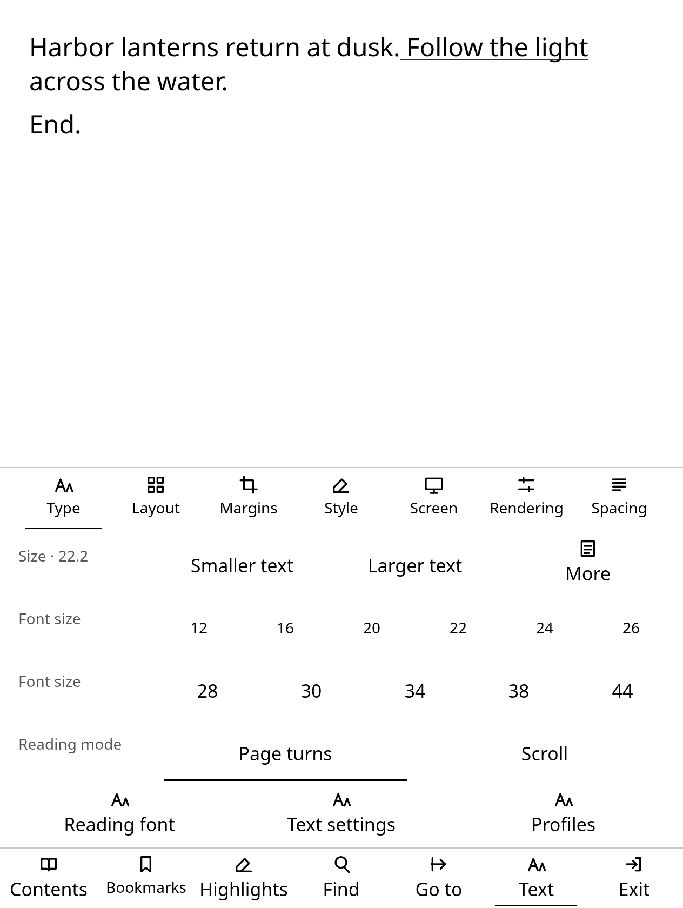
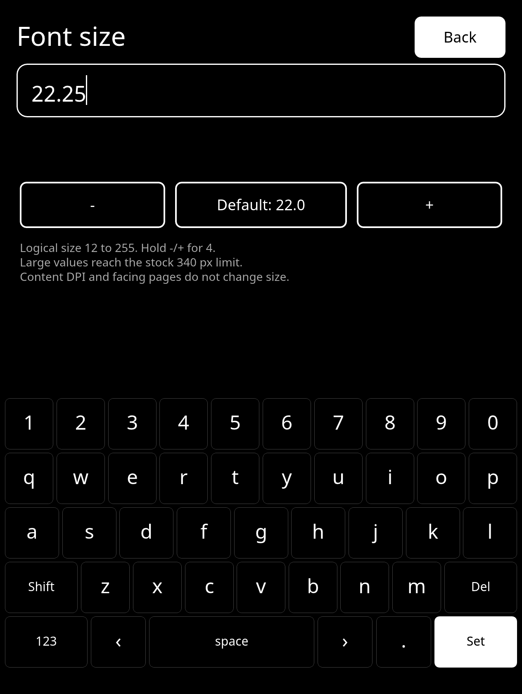

# Logical document font sizes

The development candidate supports **Text › Type** presets and **More** for
logical sizes 12–255. Tap −/+ for half steps, hold for four units, or type a
decimal such as 22.25 with the shared keyboard. Existing books keep their saved
pixel sizes until you explicitly choose a logical value. Their smaller/larger
controls now scale each tap by the same ±0.5 logical interval using the saved
screen and DPI context, without converting the stored pixel preference. Choosing
a preset or entering a value in More switches that book to logical mode.

| Type panel | Decimal picker |
| --- | --- |
|  |  |

## Pinned reference contract

The reference is KOReader `9192014d8bd82a91dc1012473be0f238dedfdb54` with CREngine
`b32a88ffbbf505cf2ea5208c1a49002d70d3609f`. Its font menu uses eleven presets,
±0.5 taps, four-unit holds and a 12–255 picker. Half steps do not quantize typed
decimals. [Font handler](https://github.com/koreader/koreader/blob/9192014d8bd82a91dc1012473be0f238dedfdb54/frontend/apps/reader/modules/readerfont.lua#L203-L210) · [Controls](https://github.com/koreader/koreader/blob/9192014d8bd82a91dc1012473be0f238dedfdb54/frontend/ui/data/creoptions.lua#L416-L454)

`Screen:scaleBySize` uses the full screen's shorter edge divided by 600. With an
explicit Screen DPI override it averages that factor with override/160. Ordinary
physical device DPI does not enter the Auto formula. The immutable font context
is captured before facing-page width, footer overlap and content-DPI changes.
This application uses Auto; it does not expose a partial global Screen DPI
control. [Pinned Screen function](https://github.com/koreader/koreader-base/blob/6e4bc81af4e04f78d81677a323a780a71b29702a/ffi/framebuffer.lua#L414-L426)

Pinned CRE clamps the document base to 12–340 physical pixels and every computed
font to 8–340 pixels. On the Oasis's 1264 px short edge, logical 22 is 47 px.
Logical 255 requests 538 px but renders 340 px. The same plateau is intentional
here. The panel prints one decimal, while the editor and saved setting retain
the entered value. Author absolute font-size interpretation remains the
existing limited parser; this does not establish a complete CRE CSS cascade.

The committed [vector fixture](../tests/fixtures/font-scale/pinned-screen-vectors.json)
contains 7,380 outputs from the actual pinned Screen function: 15 contexts ×
487 half steps and five additional decimals. Its effective-size column applies
the separately inspected CRE clamp. These are not 7,380 executed CRE renderings.
Legacy pixel-size tap behavior is covered at reference, Oasis and DPI-override
scales; the simulator capture shows its Text panel after one fine-size change.
[Legacy-size capture](screenshots/logical-font-legacy-step.png)

## Saved settings and atomic apply

A missing `logical_font_size` remains legacy pixel mode. Missing values are
omitted on serialization, preserving the old preference shape and its 12–144 px
validation, 12–192 px shaping and compact-mask painting. Inactive pixel values
remain stored while a logical choice is active. Unrelated adjustments and saved
profiles retain that value instead of mistaking resolved pixels for logical
units.

An unseen reflowable book without a saved default template explicitly starts at
logical 22. Existing books and templates/profiles without the field remain
legacy. Library, profile, default and typed backup writes reject nonfinite or
out-of-range logical values before JSON can turn them into null.

The shared numeric editor prepares a draft and uses a saved logical default or
22. Cancel restores the Type panel without converting a legacy book. Apply
resolves and paints a candidate at the source anchor, checks edition identity
before and after preparation, saves atomically, then swaps the live page.
Layout or save failure retains the frame, position, preferences and draft.

## Large glyphs and geometry

Logical mode clamps actual text, list and image-em fonts to 8–340 px while
retaining raw inheritance scales for nested percentages. Vertical columns use
the font sizes of actual projected text/ruby owners, so a large text-free
ancestor cannot consume columns. Legacy rendering keeps its original clamps.

The compact glyph cache stays bounded at 2 MiB. A logical glyph that exceeds its
300 px/64 KiB mask uses visible 256×256 tiles. Closed contours are flattened with
explicit segment, depth and coordinate bounds, then clipped before rasterizing.
Holes retain winding. Flatness measures distance to the finite endpoint chord,
so collinear turn-back extrema survive signed stroke expansion.

Signed synthesis is bounded at 54 px, covering the supported 340 px × weight
1–1000 domain with 26.6 rounding. Each clip scratch polygon is capped at 131,072
vertices, and one glyph's visible clipping shares a 16,777,216-visit budget.
Each tile uses 262,160 bytes of raster coverage plus at most two 64 KiB alpha
buffers, separately from the retained cache. Stroke construction first flattens
to closed polylines and preflights a conservative
8×(vertices+contours)+8 ≤ 65,536 element bound before the pinned line-only Miter
builder. It cannot invoke curve-stroke subdivision or round caps. Unsupported
font data fails explicitly instead of becoming an empty valid page.

Logical chapter extent is capped at 16,000,000 px, below 2^24 so every whole-pixel
f32 coordinate remains representable. Legacy extent stays capped at 2,000,000 px.
Existing 512 KiB text, 30,000 line, 90,000 vertical glyph, 12,000 column and image
bounds still limit retained allocations. No chapter-sized bitmap is allocated;
frames remain one viewport. Parley, vertical layout, table preflight and final
pagination use the same mode-specific extent bound.

## Recovering an imported layout

If an otherwise readable source has saved logical geometry that cannot fit the
screen, Reader offers [Reset text](screenshots/font-layout-recovery.png). Cancel
keeps the settings. Reset prepares a fitting device baseline at the canonical
source anchor, archives the old choices under Reader data/layout-recovery, then
saves before swapping. Archive or state-save failure retains the old profile and
page. The reset avoids a potentially unfit global template, preserves notes and
restores that book's numbering/menu state while clearing the previous book's
navigation and timer. CSS-hidden source focus follows ordinary automatic
restoration; invalid source points and parser/DRM/font errors do not become
font-fit recovery.

## Verification and remaining gates

Exact source `5afb8029681e367ca1adcb712f40d804dc1404b6` passed
[Linux CI](https://github.com/PrimitiveOS/kindle-primitive-reader/actions/runs/45023402699)
and the Mac suite: **888 library + 14 package + 4 layout tests**, with 66 opt-in
cases ignored. A focused rerun passed 18 font and 6 painting cases. This includes
all 7,380 stock vectors, all 487 live half-step sizes, actual decimal keyboard
input, legacy pixel/anchor identity, large-glyph ink inside hit rectangles,
source→pixel→source selection, curve/tile seams and clipping/stroke budgets,
profile/default/backup round trips, rollback and recovery.

Ten 1264×1680 authored frames were inspected individually: compact/large Type
and picker controls in light/dark mode plus both recovery themes. Independent
OCR recognized all 44 preset labels, complete help/default captions and recovery
copy. The pictures above come from that exact tested source.

Three unchanged owner-provided EPUB, AZW3 and MOBI files passed normal Reader
opening, logical sizes 12/22.25/80/160/255, source selections and resume. The AZW3
first exposed the old 2-million-pixel cap; the corrected bounded implementation
and a 5,200-line authored regression reach the last passage above that height.

Large-font CJK/RTL original-file acceptance, final aggregate 48-edition replay,
packaging and foreground Kindle checks remain pending. The latest Mac suite and
a test-only ARMHF bundle passed 956 Reader tests (62 ignored), 14 package tests
and four layout probes. After that run, a production ARMHF Reader binary from
the same source replaced only `reader/bin/reader-kindle`; the previous binary
remains available for rollback. Launcher, Store and saved reader data were left
unchanged. Whole-interface Screen DPI scaling and independent popup size
preferences are outside this slice. Footnotes retain the existing compact
18–64 px pixel baseline; stock's separate MuPDF popup and dictionary sizing
require their own gates.
