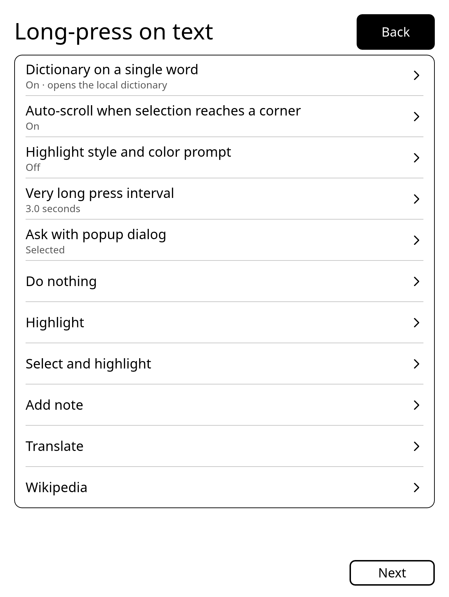

# Long-press reading actions

KOReader v2026.07.1 puts the single-word dictionary preference and the default
text-hold action in **Settings › Long-press on text**. The action choices are
Ask with popup dialog, Do nothing, Highlight, Select and highlight, Add note,
Translate, Wikipedia, Dictionary and Fulltext search. KOReader also has
highlight prompt choices, a configurable very-long-press threshold and
corner-triggered auto-scroll for selection. [Pinned source: action handling and
menu](https://github.com/koreader/koreader/blob/v2026.07.1/frontend/apps/reader/modules/readerhighlight.lua#L1967-L2029)
· [settings and remaining hold behavior](https://github.com/koreader/koreader/blob/v2026.07.1/frontend/apps/reader/modules/readerhighlight.lua#L348-L380)

Reader exposes those nine action choices in **Reader › Settings › Long-press
on text**, plus **Dictionary on a single word**. A single-word hold opens the
local dictionary by default, matching KOReader. Turning that setting off
applies the chosen default action. The value is saved with reading controls;
older settings use the stock defaults.

When a finger remains down for 800 ms, Reader paints the touched word as a
temporary selection without opening the action sheet. Moving at least 6 pixels
updates the selected range at a maximum of five redraws per second. Releasing
the finger runs the configured action. **Very long press interval** uses the
KOReader three-second default and can be adjusted from 0.9 to 20.0 seconds in
0.1-second steps. A release at or beyond that interval opens the Ask action
panel, including for one word that would otherwise open the dictionary.

**Auto-scroll when selection reaches a corner** is an On/Off preference. It is
On by default, matching KOReader. In continuous reflow mode, moving into a
reading corner scrolls by 0.3 of a viewport. For saved PDF selections, the
same preference controls page turns at the corners. In left-to-right books,
top-left moves back and bottom-right moves forward; right-to-left books use
top-right and bottom-left. Leave a corner and re-enter it to trigger the next
scroll. Reflowable selections retain source anchors across chapter movement.
In PDF Select mode, page turns keep the current range active. Tap or hold a word
on another page to extend the range in document order; Reader stores per-page
geometry and a text continuation for the saved highlight. The range can span up
to 64 pages and 8,192 UTF-8 bytes. Every page in the range needs a readable text
layer, including cached OCR where OCR is active. An unreadable or incomplete
intervening page leaves the existing selection intact. [Cross-page selection
simulator capture](screenshots/pdf-cross-page-selection.png)

The **Highlight style and color prompt** setting offers Off, Style, Color, or
Style and color. It defaults to Off, preserving one-tap highlighting. When
enabled, the chooser floats over the reading page and leaves the selected text
available; the current choice is marked. Selecting Invert skips the color step,
and Cancel leaves the selection unsaved. The chosen appearance applies to that
mark without changing the book's future highlight defaults. [Style chooser](screenshots/highlight-style-prompt.png) · [Color chooser](screenshots/highlight-color-prompt.png)

The selection action grid also has **Copy**. It applies KOReader's selected-text
whitespace cleanup, stores the text in Reader's in-process clipboard and closes
the selection. **Paste** inserts it at the caret in note, book search, bookmark
search, dictionary and vocabulary fields. PDF selections that span pages copy
their document-order text with page breaks. PDF link Copy uses the same clipboard.
[Selection Copy screenshot](screenshots/selection-copy.png)

Tap **Select** in the same action grid to start extending the marked text.
Tap or hold the other end, then choose **Highlight**, **Copy**, or **Cancel**.
Reader keeps an unfinished range in memory until Highlight saves it. This
action works with the Ask preference and leaves that preference in place for
the next hold. The Mac workflow exercises the visible button on an EPUB and a
PDF. The pinned KOReader replay exercises its Select callback, which creates
a temporary mark, and checks when the saved-mark Extend action is available.
[Reader Select button](screenshots/selection-select-action.png) · [Pinned KOReader Select callback](https://github.com/koreader/koreader/blob/9192014d8bd82a91dc1012473be0f238dedfdb54/frontend/apps/reader/modules/readerhighlight.lua#L91-L105) · [Executable Mac replay](../scripts/koreader-dictionary-header-selection-check.lua)

| Action | Reader behavior |
| --- | --- |
| Ask with popup dialog | Keep the selection and show the in-page action panel. |
| Do nothing | Clear the temporary selection. |
| Highlight | Save the selected words with the current appearance, or open the optional style/color prompt. |
| Select and highlight | Enter a dedicated selection mode. Tap or hold words to extend the passage, then choose Highlight, Copy or Cancel. Reflowable text and same-page or cross-page PDF selection are covered by desktop workflow tests. |
| Add note | Open the note editor for the selected passage. |
| Translate / Wikipedia | Open the existing contextual lookup panel with the passage prefilled. |
| Dictionary | Open the local dictionary and preserve the selected passage for return. |
| Full-text search | Search the current book for the selected text. |

The desktop regression suite exercises settings persistence, both states of
corner auto-scroll, every action on a
real fixture EPUB, the single-word dictionary default and its opt-out,
selection-location preservation, the optional prompt on EPUB and PDF,
cancellation without saving, per-mark style/color without changing book defaults,
EPUB selected-text cleanup and paste, cross-page PDF Copy, and Select mode in
reflowable text plus same-page and cross-page PDF selection.
PDF workflow tests cover forward and reverse extension, continuation persistence
after restart, and rejection of unreadable intervening pages. The hold lifecycle is exercised on
EPUB and PDF fixtures, including drag extension, release actions, the very-long
Ask override, and corner direction. The temporary-selection simulator capture
is [hold-selection.png](screenshots/hold-selection.png).
Select mode keeps Cancel, Copy and Highlight in a compact floating sheet away
from the selected passage, so the range stays visible while it grows. All three
buttons use the shared black-and-white pressed feedback and meet the Kindle
touch-target minimum. [Select mode on the simulator](screenshots/select-mode.png).
The settings capture shows the available choices and interval setting:

Regenerate the Select-mode screenshot with
`READER_SELECT_MODE_SCREENSHOT=docs/screenshots/select-mode.png cargo test --locked --features kindle --lib select_and_highlight_mode`.

Regenerate the temporary-selection capture with
`READER_HOLD_SELECTION_SCREENSHOT=docs/screenshots/hold-selection.png cargo test --locked --features kindle --lib held_drag_extends_epub_selection_and_very_long_release_uses_ask`.

Regenerate both appearance prompt screenshots with
`READER_HIGHLIGHT_STYLE_PROMPT_SCREENSHOT=docs/screenshots/highlight-style-prompt.png READER_HIGHLIGHT_COLOR_PROMPT_SCREENSHOT=docs/screenshots/highlight-color-prompt.png cargo test --locked --features kindle --lib highlight_prompt_applies_chosen_style_and_color`.

Regenerate the cross-page PDF capture with
`READER_PDF_CROSS_PAGE_SELECTION_SCREENSHOT=docs/screenshots/pdf-cross-page-selection.png cargo test --locked --features kindle --lib pdf_select_mode_spans_pages_in_both_directions_and_saves_continuations`.

The selected-text dialog position is configured separately in
[Selection dialog positions](selection-dialog.md). Remaining parity work is
on-device gesture timing and corner-region comparison, testing with the owner's
real documents, and on-device verification of cross-page fixed-document
selection. KOReader disables its corner-scroll setting in paged reflow mode;
Reader enables the preference only for continuous reflow, while retaining
cross-page PDF selection when enabled. The shared input
library now reports hold start, paced pan and release events; its release still
maps to a normal long press for Launcher compatibility. The Kindle acceptance
gate remains open while the device is unavailable.
