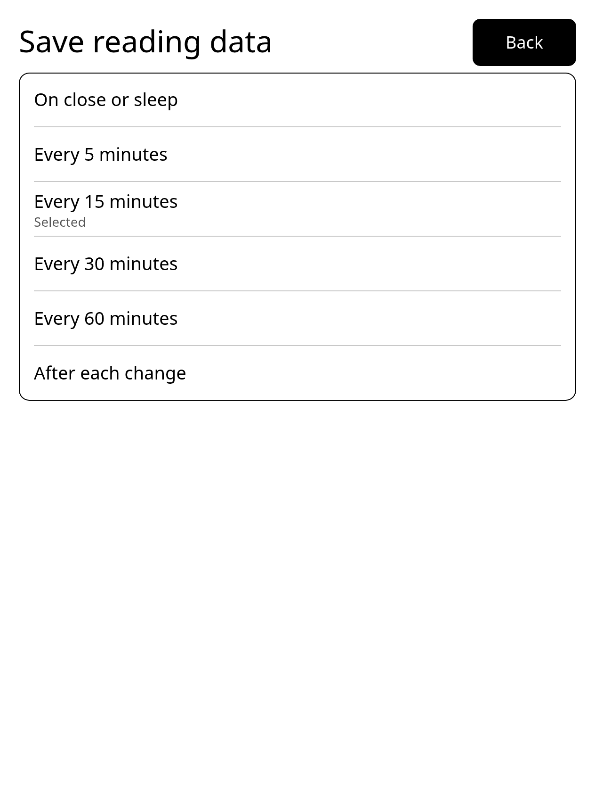

# Save reading data

In **Reading controls › Save reading data**, choose to save a book when closing it or putting the Kindle to sleep, or choose an interval of 5, 15, 30, or 60 minutes. A periodic check waits for the next page turn or scroll after the interval. The save happens after the page is drawn. Position, bookmarks, notes, highlights, and reading preferences go into the same Reader library record.

Reader saves book changes when you switch books, exit, or put the Kindle to sleep. **After each change** preserves the behavior of earlier Reader installations. New installations start at 15 minutes. A resumed session starts a new interval. Backup imports and operations that need immediate confirmation still commit their own changes.

In an open document, **Tools › Save reading data** writes the current position and marks immediately and keeps the document open. [KOReader's manual save action](https://github.com/koreader/koreader/blob/v2026.07.1/frontend/dispatcher.lua#L232)

Choose how Reader stores its per-book sidecar in [Book metadata location](book-metadata-location.md).

The installed KOReader exercised the four interval choices and the close-and-sleep setting using its actual page and scroll callbacks with a controlled clock. The checks covered when a save was scheduled, how consecutive page turns share a pending write, and when the interval resets on resume. [KOReader's save settings](https://github.com/koreader/koreader/blob/v2026.07.1/frontend/ui/elements/common_settings_menu_table.lua#L532-L572) · [KOReader's page and scroll callbacks](https://github.com/koreader/koreader/blob/v2026.07.1/frontend/apps/reader/modules/readerview.lua#L1011-L1024) · [KOReader's resume and save timing](https://github.com/koreader/koreader/blob/v2026.07.1/frontend/apps/reader/modules/readerview.lua#L1266-L1296)

Desktop checks covered earlier setting files, closing, switching books, sleep, wake and reopening. Two original EPUBs and two original PDFs each advanced using a normal page input, wrote the new position after the configured interval and restored it on reopening. The test used separate Reader state to verify the disk writes.

The same four originals passed on the Oasis. The test sent sleep and wake through the normal app lifecycle in a separate session and kept the Kindle awake. All four source hashes matched, and the authored settings screenshot was byte-identical to the Mac capture.

### Annotation creation times

Reader records the creation time of each new page bookmark, reflow highlight and fixed-page highlight. Editing a note, drawing style or passage preserves that time. A backup restores the time with the mark. On repeated imports, a matching mark keeps its existing time and can acquire a missing one from the source.

KOReader JSON exports provide Unix seconds for each highlight. Adjacent EPUB sidecars record the creation date in `datetime` and the editing date separately. Reader interprets a date without an offset in the importing device’s time zone, just as KOReader does. Earlier Reader marks and imported marks without a usable creation date remain undated. [KOReader annotation dates](https://github.com/koreader/koreader/blob/v2026.07.1/frontend/apps/reader/modules/readerannotation.lua#L505-L519) · [KOReader export timestamps](https://github.com/koreader/koreader/blob/v2026.07.1/plugins/exporter.koplugin/clip.lua#L258-L274)
