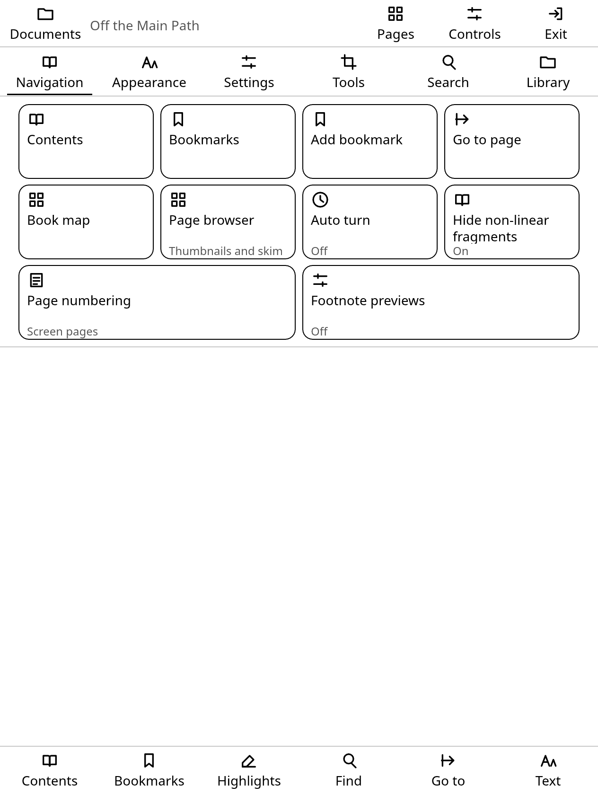

# Non-linear EPUB fragments

In an EPUB that declares non-linear spine items, **Navigation → Hide non-linear fragments** skips those items during ordinary page turns. The setting applies to single-page paged reading. Switching to continuous scroll or facing pages retains the preference and shows the complete spine in reading order.

Consecutive non-linear spine items form one flow. A link, Contents entry, bookmark, search result or explicit chapter/page jump can still open that flow. Once there, page turns traverse its pages and any adjacent non-linear spine items, then return to the main flow. Closing and reopening preserves the selected source passage. The setting is stored independently for each book. [KOReader navigation](https://github.com/koreader/koreader/blob/9192014d8bd82a91dc1012473be0f238dedfdb54/frontend/document/credocument.lua#L395-L473) · [Reference control](https://github.com/koreader/koreader/blob/9192014d8bd82a91dc1012473be0f238dedfdb54/frontend/apps/reader/modules/readerrolling.lua#L419-L442)

Reader retains every source spine index and text anchor. Percentage jumps use the main flow's chapter lengths while hiding is active. The reading footer estimates progress using the main flow or the opened non-linear flow. The original publication and its navigation resources remain intact.

## Comparison

Five original EPUB editions declared a non-linear first spine item. They contained 20, 32, 59, 2 and 46 spine items. The installed KOReader engine identified one non-linear cover page in each, followed by the first linear page at physical page 2. Its actual next/previous functions passed 5,114 navigation checks across 2,557 rendered pages. Source hashes matched before and after the comparison. The comparison reads the installed Lua methods unchanged and uses the installed CREngine's own flow assignments. [Reproducible reference check](../scripts/koreader-nonlinear-check.lua)

The authored EPUB contains front and rear fragments, two main chapters and two consecutive note chapters. KOReader rendered 11 pages with nine non-linear pages and three separate non-linear flows. All 22 next/previous checks passed. This verifies that adjacent non-linear spine items remain part of the same flow.

The Reader functional test exercises the visible setting's action, ordinary main-flow traversal, a long linked note, cross-item movement inside the note flow, previous-location return, percentage jumps, source-based progress weights, scroll and spread modes, saved positions and reopening. Its five-original test checks each cover marker, the first linear chapter, returning from the cover and preserving the source file. [Functional tests](../src/app/nonlinear_tests.rs)

The Mac passed 555 library tests, 14 EPUB package tests and four system tests. The two nonlinear-flow tests also passed together with the original-file check enabled. The reference source hashes matched the pinned KOReader checkout, and all five local EPUB copies matched their device originals byte for byte.

Run `cargo test --locked --offline --features kindle --lib nonlinear`. The optional original-file check uses `READER_NONLINEAR_ORIGINALS` with the private corpus and `--include-ignored`. `READER_NONLINEAR_SCREENSHOT` and `READER_NONLINEAR_DARK_SCREENSHOT` capture the authored controls in both themes.

## Remaining work

The per-book publisher marker workflow has Mac functional and installed KOReader reference evidence. Native Reader execution and foreground Kindle validation are pending the aggregate build. A reader-wide default and reader-authored hidden ranges have their own acceptance work. Source-weighted progress remains an estimate across chapters, as in Reader's ordinary EPUB progress display.
