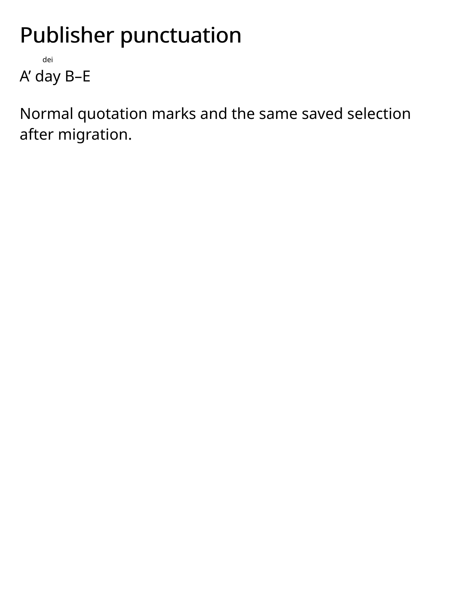

# Publisher numeric character references

Some books encode curly quotation marks as `&#146;` rather than `&#8217;`. Reader follows CREngine's compatibility table for the 27 defined Windows-1252 numeric references between 128 and 159. For example, `&#146;` displays and searches as `’`, `&#150;` as `–`, and `&#133;` as `…`. Decimal and hexadecimal references use the same table. The five undefined codes remain unchanged. [CREngine conversion table](https://github.com/koreader/crengine/blob/b32a88ffbbf505cf2ea5208c1a49002d70d3609f/crengine/src/lvxml.cpp#L5419-L5481) · [Numeric-reference decoding](https://github.com/koreader/crengine/blob/b32a88ffbbf505cf2ea5208c1a49002d70d3609f/crengine/src/lvxml.cpp#L5551-L5585)

This conversion applies to numeric references in text and attributes. Literal C1 characters, CDATA, comments, processing instructions and escaped ampersands keep their original meaning. Existing XML validation still rejects malformed references. Reader leaves the source file unchanged.

Bookmarks and saved selections created before this conversion retain their publisher block identity and UTF-8 caret positions. A two-byte control can become a three-byte punctuation character. The position history maps both byte boundaries correctly and composes this mapping with older ruby pronunciation offsets. Publisher links, fragment targets and source styles use the converted document. Historical fragment names remain accepted where they do not replace a current target.

A newly visible ellipsis in a loose inline run can create a new paragraph box. Existing paragraphs retain their own identities, including when their wording is repeated. The normalizer matches publisher DOM origins rather than text or paragraph index. Historical MOBI positions use the same mapping after image and link restoration.

## Desktop evidence

The authored regressions cover all 27 defined codes and five unassigned codes, decimal and hexadecimal notation, attributes, CDATA and literal controls, byte boundaries, saved selections, quotation search, text painting, named targets and duplicate paragraphs. Ruby cases include the older flat text revision, the ruby-aware revision, unsupported nested ruby, and an annotation that crosses the supported size limit after conversion. The existing tab regression checks text positions and missing glyph boxes separately.

One unchanged original EPUB chapter previously produced a single missing-glyph cluster for U+0092. With the same fonts and viewport, the numeric-reference conversion removes that cluster. This is a chapter-specific desktop result. It does not establish complete glyph coverage for the collection.

The remaining private-use characters in a separate original book require an identified source font or explicit publisher character mapping. Reader does not guess a Unicode mapping for those glyphs. [Source font provenance](symbol-font-provenance.md) Native acceptance of this change is pending the next combined Kindle build.
