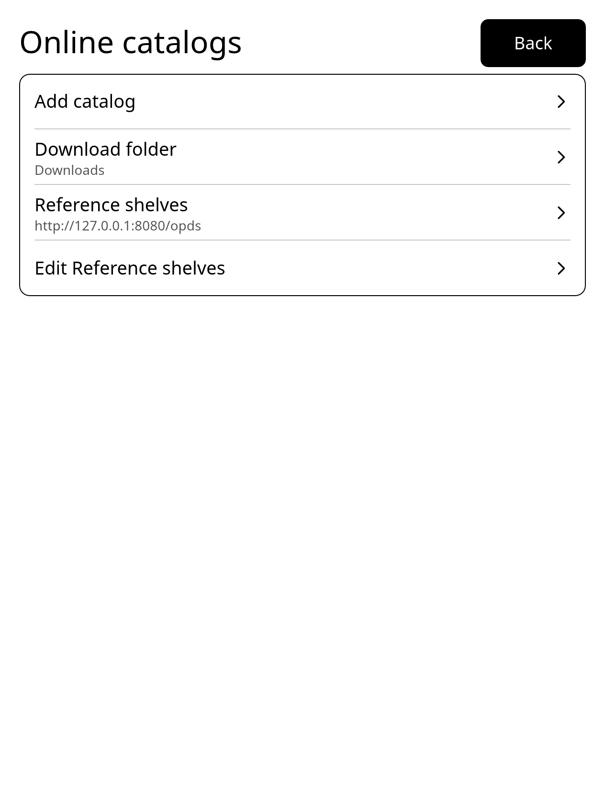
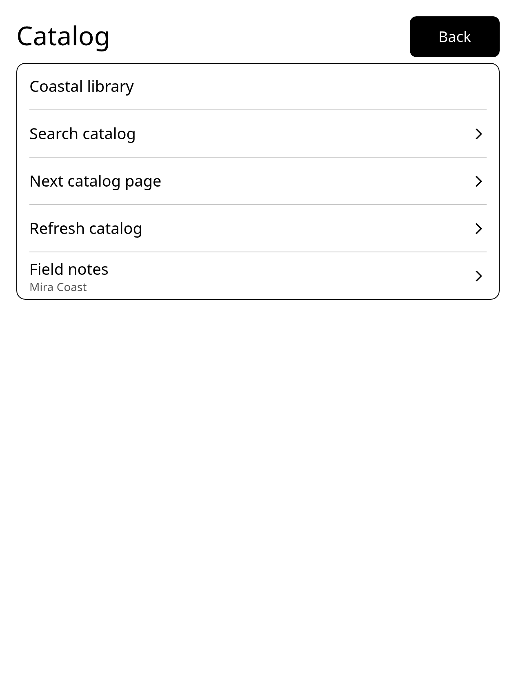
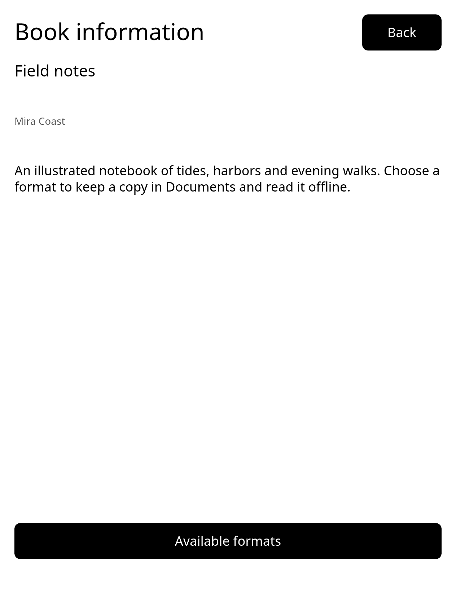
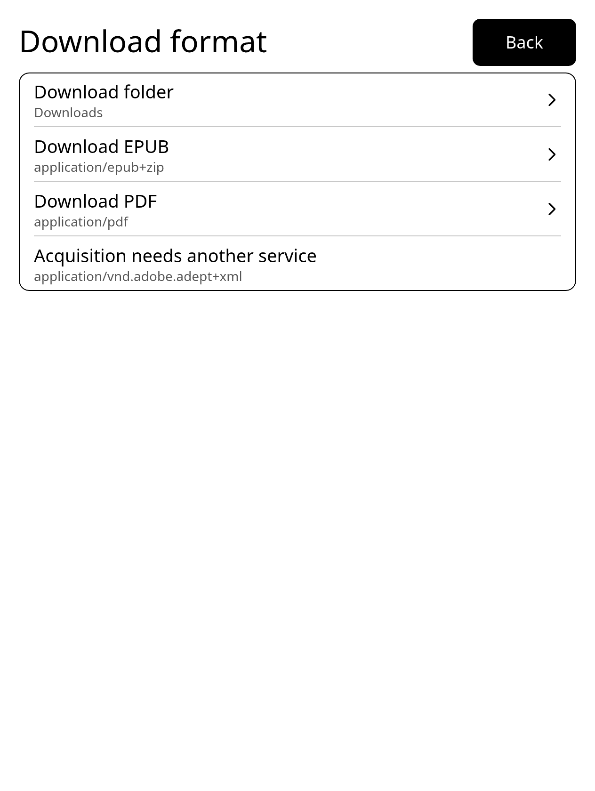

# Archived implementation note: online catalogs and book acquisition

Online book acquisition is outside the current Reader goal. Its OPDS modules,
UI, and worker entry points have been removed from the current source candidate.
Previously published releases are unchanged. The design and verification
details below are historical engineering records only; do not treat them as
current product instructions, active milestones, or parity checklist items.

Historical implementation and verification record

An earlier development candidate implemented OPDS browsing, search and
publication acquisition for K21. That workflow is excluded from the current
Reader goal and removed from the current source. The separate
calibre wireless-device protocol, loan services and other provider integrations
were not included in that historical implementation.

## Previous catalog workflow (removed from current source)

Open **Library › Online catalogs**, or **Library › Organize library › Online
catalogs** from the document list. Choose **Add catalog**, enter its name and
complete HTTP or HTTPS address, and save it. Enter a username and password only
when the catalog requires HTTP Basic authentication. Use the provider's HTTPS
address for credentials. Reader also accepts a search-only address containing
`{searchTerms}`, `{query}` or the older `%s` placeholder.

Tap the saved catalog to connect. Navigation entries open collections. Search
appears only when the catalog advertises it. **Next catalog page** and **Previous
catalog page** fetch the server's pages; the ordinary list controls move within
the loaded page. Back returns through up to eight loaded feeds without another
request. Refresh is explicit. Adding or editing a catalog makes no request.

Open a publication to inspect its title, author and description. **Available
formats** shows the offered acquisitions. Choose **Download folder** to select
Documents or an existing subfolder, then tap the required format. Completed books
join the normal library; **Open publication** opens the local copy. Reader does
not start reading or perform a network request automatically after a download.

Cancel or Back stops and reaps the network child. Sleep, storage handoff and app
exit also cancel active requests. Reopening Reader removes its recorded stale
partial. A completed local publication remains readable without the catalog.

| Catalogs | Collection | Publication | Formats |
| --- | --- | --- | --- |
|  |  |  |  |

[Dark appearance](screenshots/opds-dark.png). These 1264 × 1680 desktop captures
use an original redistributable fixture and the shared PrimitiveOS rows, keyboard,
sheets and existing book icon. They do not contain private document metadata.

## Supported protocol slice

| Area | Implemented behavior |
| --- | --- |
| OPDS 1.2 | Atom navigation and acquisition feeds, standalone entries, prefixed namespaces, inherited `xml:base`, relative links, search links and OpenSearch descriptions, next/previous/start links and facets. UTF-8 and UTF-16 XML, CDATA and well-formed XHTML descriptions. |
| OPDS 2 | UTF-8 JSON navigation/publication feeds, publication documents, groups, facets, localized titles, author strings or objects, relation arrays and pagination. |
| Search | OpenSearch `searchTerms`, optional count/start page/index; URI-template simple variables and query operators `?` and `&` for `query` or `searchTerms`. UTF-8 queries are percent encoded. Unknown mandatory variables produce an error. Query-only templates retain the current catalog path. |
| Authentication | No authentication or HTTP Basic, configured per catalog. Credentials are sent only to the exact configured origin. Cross-origin redirects and HTTP-to-HTTPS changes do not inherit them. HTTPS-to-HTTP redirects are rejected. Configure the final HTTPS endpoint if it needs credentials. |
| Acquisition | Direct `acquisition`, `acquisition/open-access` and OPDS 2 `download` links. An explicit format choice precedes any download. Indirect, borrow and buy links stay visible without an active download action. |
| Reader routing | EPUB, PDF, FB2, unprotected MOBI/AZW3, DOCX, CHM, TCR, HTML/HTMLZ/XHTML, text/Markdown/RTF, supported comic archives, DjVu and supported standalone images. MIME type selects the suffix; a supported URL suffix is used for generic binary/ZIP responses. The actual Reader adapter must accept the completed data. A protected PDF can be saved and then prompts through the usual password workflow. |
| Catalog limits | 2 MiB response, 100,000 XML nodes, 512 entries per server page and bounded retained metadata. Up to 32 configured catalogs. |
| Transfer limits | 64 MiB per publication, 150-second network timeout and 180-second parent deadline; catalog requests use 20-second network and 30-second parent deadlines. Up to six requests in a redirect chain. Both fixed-length and chunked transfers are supported. |

The protocol references are the [OPDS 1.2 specification](https://specs.opds.io/opds-1.2)
and [OPDS 2 specification](https://specs.opds.io/opds-2.0). This is a bounded reading
client, not a claim of implementing every extension or every URI-template operator.

## Storage and publication

The worker streams into a unique, hidden Reader-owned file beside the chosen
final destination. It requests identity encoding, bounds the actual received
bytes and checks a supplied Content-Length. Truncated responses, HTML login pages
in place of a book and failed document validation are rejected. It syncs the
staged file before returning success. The UI then reserves an unused filename and
publishes through one same-directory rename over that reservation. Existing files
and symlinks are skipped; duplicate titles receive numbered suffixes. Unicode names
are bounded in bytes for FAT as well as Unix filesystems.

The destination must remain a regular, non-symlink folder beneath canonical
Documents. Traversal, hidden folders, `.sdr` sidecars and folders beyond Reader's
browsing depth are excluded. Cleanup only targets Reader's recorded staging
namespace. A failure to create an occupied staging filename does not delete it.
No original source, adjacent metadata or existing publication is edited.

Catalog credentials and the selected folder live in `data/opds-catalogs.json`.
The file is saved with mode 0600 where the filesystem supports Unix permissions;
these credentials are stored locally, not encrypted. Worker requests travel over
private standard input, rather than command arguments. Passwords are masked in
the editor and omitted from worker logs. No reading history, annotations or
library documents are uploaded by this module.

A process or power failure between reserving a final name and renaming can leave
an empty reservation. Recovery removes the recorded partial, while completed
books remain intact. Physical FAT storage exhaustion, USB interruption during an
active download and power-loss durability still require device acceptance; host
atomic-rename tests do not establish those hardware results.

## Reference comparison

The pinned reference is KOReader **v2026.07.1**, commit
`9192014d8bd82a91dc1012473be0f238dedfdb54`:

| Primary source | Compared behavior |
| --- | --- |
| `plugins/opds.koplugin/opdsbrowser.lua:411–498` | Requests, Basic authentication, redirects and Atom/JSON response selection. |
| `plugins/opds.koplugin/opdsbrowser.lua:566–758` | OPDS 2 navigation, grouped publications, search, metadata and direct/indirect acquisition. |
| `plugins/opds.koplugin/opdsbrowser.lua:759–1021` | Atom feeds, search templates, pagination and calibre links. |
| `plugins/opds.koplugin/opdsbrowser.lua:1022` onward | Explicit acquisition format choice, destination and download actions. |
| `plugins/opds.koplugin/opdsparser.lua` | XML content/CDATA handling. Reader accepts well-formed XML; the reference's additional repairs for broken HTML inside XML are not all replicated. |

The former implementation is preserved at the frozen baseline
[`ff03a146`](https://github.com/PrimitiveOS/kindle-primitive-reader/tree/ff03a14609bad09cdb390776ec93190d07ffbbea).
Its OPDS modules, application screens, and `--opds-worker` entry point have been
removed from the current source candidate.

## Desktop verification

The tests exercise the actual process worker and the normal Reader UI, not just
successful parser returns. All network fixtures and the actual provider used
loopback only. Private Documents copies remain in ignored local evidence.

- Namespace prefixes, XML base inheritance, inline text, CDATA, UTF-16 byte order,
  OPDS 2 groups/facets, localized metadata, OpenSearch and Unicode query templates.
- Malformed, truncated, oversized and unsupported responses; unavailable endpoints;
  invalid credentials; redirect loops and credential withholding across origins.
- Chunked and fixed-length downloads, actual adapter validation, duplicate names,
  Unicode names, destination traversal/symlinks and preservation of occupied files.
- Actual child cancellation/reaping and owned-partial cleanup; configuration
  reopen; stale-partial recovery; browse/search/format choice/download/open through
  UI commands; saved position reopen without a network request.
- Authorized unchanged original EPUB `036.epub` served by a private fixture, then
  opened and reopened offline. Its bytes are checked before and after.

Actual calibre provider results and final executable hashes are recorded in the
local receipt `build/parity-review/opds/delivery.json`; no private books or account
state are checked into Git. Final focused tests passed **13/13**, including the real child worker, cancelled
transfer and unchanged original EPUB. The actual calibre workflow also passed
once anonymously and once with Basic authentication, including wrong credentials,
one-item server pagination, advertised search, format choice, acquisition, all
original spine documents and saved-position reopen. Both acquired files matched
the exact served response checksum. The final ordinary library suite passed **631/631**, with 45 explicitly opt-in
cases skipped. The provider workflow is one of those opt-in cases and was run
separately in both authentication modes. Its exact executable and source hashes
are recorded in the local receipt; aggregate package/system and native acceptance
are owned by the combined release gate.

## calibre provider and remaining integrations

For a calibre Content server, configure its `/opds` address. Reader uses the
published catalog and acquisition links, rather than calibre's wireless-device
protocol. An authenticated server must offer HTTP Basic; calibre's default
non-TLS `auto` mode can choose Digest, which this candidate does not implement.
[Official server CLI](https://manual.calibre-ebook.com/generated/en/calibre-server.html)
· [Content server guide](https://manual.calibre-ebook.com/server.html)

The local provider gate uses official **calibre 9.19.0**, downloaded from its
[macOS distribution](https://calibre-ebook.com/download_osx), with an isolated
configuration and library under the ignored review folder. The test server binds
only `127.0.0.1`, disables interface fallback and Bonjour, and sets one item per
OPDS page. The installer checksum and cleanup are retained in the local receipt.
The original EPUB input is unchanged; calibre can rewrite acquired OPF metadata,
so the server response checksum is compared separately from the input checksum.
Both authenticated and anonymous workflows compared every original spine document
and saved Reader position successfully. The server processes, temporary libraries,
configuration, user database, acquired copies, disk image, mount and extracted tools
were removed afterward; only receipts, logs and sanitized screenshots remain.

[Actual calibre search result in Reader](screenshots/opds-calibre.png).
The repeatable gate is `scripts/verify-opds-calibre.py`; supply `--calibre-bin`,
`--tests`, `--worker`, `--original` and `--output`. It creates its own isolated
library/configuration, runs both authentication cases, checks original and served
checksums, stops both servers and removes temporary book copies even on failure.

Remaining provider work is explicit: OAuth or Digest, OPDS authentication
documents, DRM/loan/purchase fulfillment, indirect acquisition chains, PSE streaming,
external URI-template operators, persistent offline catalog caching, cover
thumbnails, automatic discovery, calibre wireless transfer, additional real
providers and native Kindle acceptance. Unsupported service links remain inactive
instead of pretending a loan or purchase is a direct book file. K21 was open
when this historical record was written; acquisition is now excluded from the
active Reader goal and checklist.

