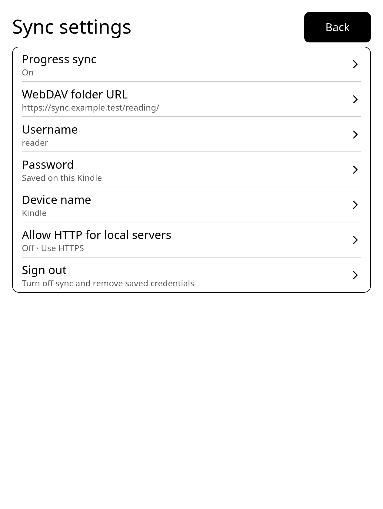
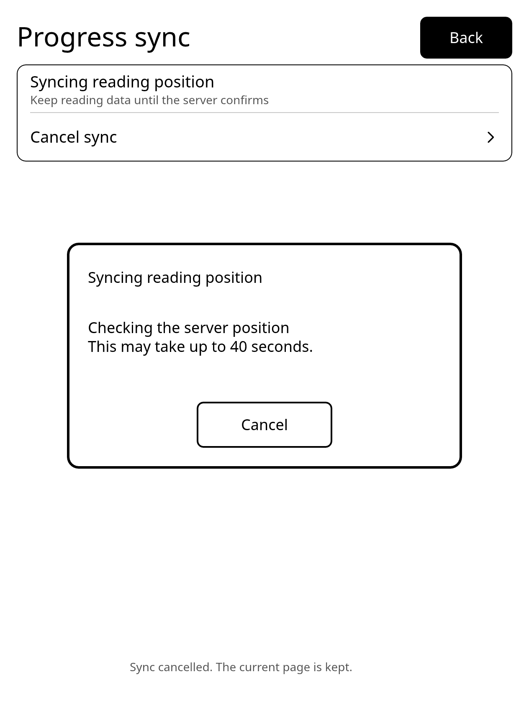
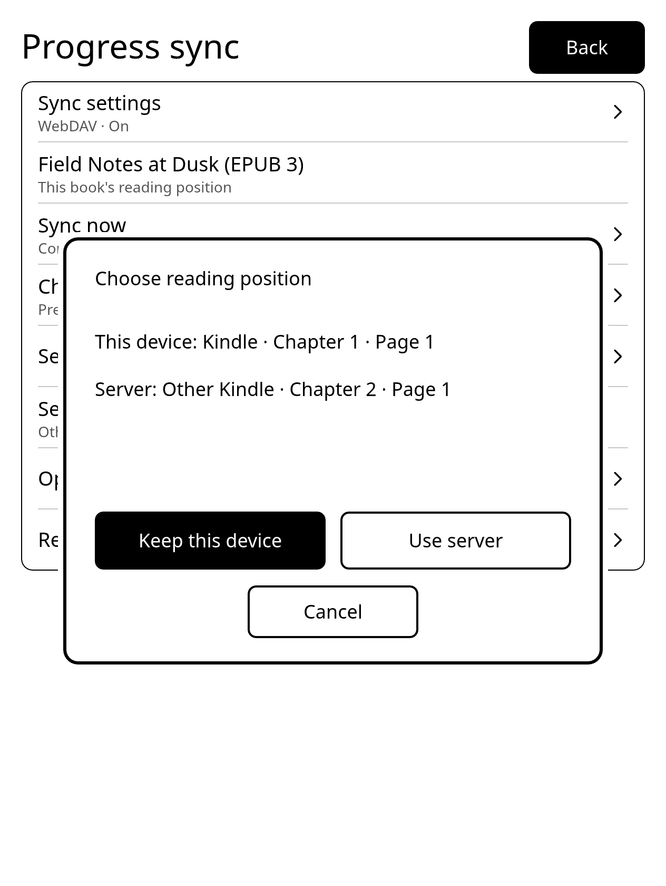
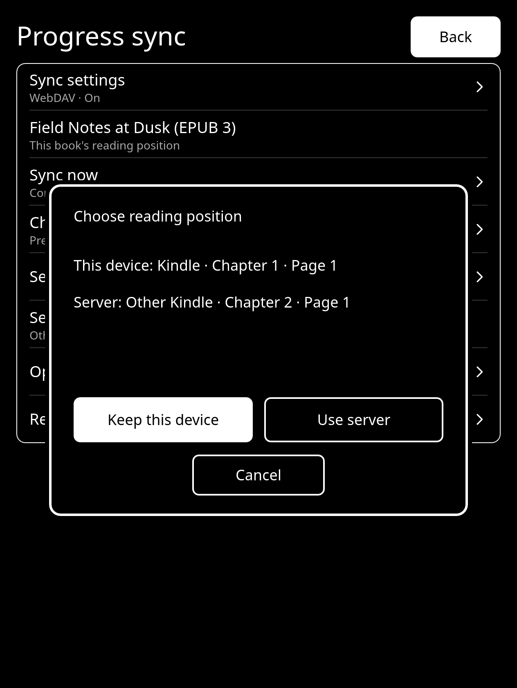

# Progress sync

Progress sync is an opt-in native Reader workflow for a user-configured WebDAV folder. Open **Tools → Progress sync → Sync settings**, enter the folder URL and credentials, choose a device name, then enable it. Creating or editing settings does not contact the server. **Sync now**, **Check server position** and **Send this device's position** are explicit actions. Reading, annotation export and local backups remain available without a server or account.

This implements the documented-progress-provider alternative in K22. It compares the familiar push, pull, conflict and sign-out workflows with the pinned KOReader sync plug-in. The native record format and WebDAV endpoint are separate from KOReader's sync-server account and position protocol. Annotation synchronization, automatic push/pull, and direct KOReader-server interoperability retain separate acceptance work.

## Reading behavior

| Server and local state | Sync now |
| --- | --- |
| Same source passage | Acknowledge the server version and keep the displayed page. Different layout page numbers at the same EPUB source anchor do not create a conflict. |
| Only this device changed since its last acknowledged position | Send its current durable position conditionally. |
| Only the server position changed | Validate and open the server passage, retaining a return location. |
| Both changed, or the existing position has no common baseline | Show a choice of this device, the server, or Cancel. |
| Position was cleared | Keep the cleared shared state and retain this device's local page. Sending a position again requires an explicit action. |
| Request failed or was cancelled | Keep local reading. A later fetch checks the current server version before any replacement. |

EPUB positions use source anchors. Fixed documents share the source page number and retain each device's own zoom settings. The library edition identity and an anchor's publication identity are separate values. A received source anchor must resolve in the current publication before its session is changed. Oversized records, unknown versions, wrong editions, out-of-range destinations and unresolved passages produce an error.

The conflict comparison uses the current local position when a reply arrives. Changing books invalidates cached replies and prevents an old book's pending request from being submitted for a new one. Account changes, including folder, username or password, clear the cached comparison baseline. Renaming the device retains that baseline.

Sleep, USB handoff, leaving the sync view and sign-out cancel the owned worker. Requests and credentials go through the worker's standard input rather than process arguments. The settings file is atomically replaced and created with private permissions where the filesystem supports them. Credentials are outside the reading-library backup and progress payload. HTTPS is required for public servers. HTTP for local-network addresses requires its explicit setting; loopback HTTP is available for local verification.

## Native protocol version 1

Each book uses one `primitive-reader-v1-{edition}.json` resource within the configured existing folder. The edition key is a SHA-256 digest of a versioned tuple containing Reader's existing format-specific library identity and input size. It is independent of the library path. It is not a full-file checksum or the KOReader document namespace.

The UTF-8 JSON record contains `version`, `edition`, `book`, `position`, `device` and optional `updated_at`. Non-null positions use Reader's serialized `ReadingPosition` and source `Anchor` types. The version is 1. A null `position` is a cleared-position record. Clearing removes the passage, device name and timestamp while retaining the edition identity and a server version, so an offline client can recognize the clear after reconnecting. Native clients retain local reading data when they acknowledge this record. They do not automatically recreate its former position.

GET retrieves a bounded record and its strong ETag. A first creation uses `If-None-Match: *`; replacing an observed version uses `If-Match`. A failed precondition triggers a fresh comparison instead of an unconditional retry. PUT is followed by GET to acknowledge the stored representation. The protocol follows HTTP conditional-request semantics and WebDAV's strong-validator guidance. [HTTP conditions](https://www.rfc-editor.org/rfc/rfc9110.html#section-13.1) · [WebDAV ETags](https://www.rfc-editor.org/rfc/rfc4918.html#section-8.6)

The payload limit is 32 KiB. Redirects are not followed. Basic authentication and anonymous configured folders are supported. Other authentication mechanisms and actual server products need individual provider checks. Timestamps are informational; conflict resolution never treats one device's clock as authoritative. An interrupted acknowledged write is recovered by fetching the matching position. Cleared records likewise remain versioned across restarts and new clients.

## Acceptance

The development unit and functional checks cover conditional two-client changes, genuine lost PUT replies, versioned clears, first-sync conflicts, different-font source positions, account changes, wrong-book request rejection, rollback after a fixed-page save failure, malformed and truncated records, credentials, bounds, cancellation, sleep and wake. The opt-in system scenario uses two Reader profiles, the actual subprocess worker, touch controls, a local HTTP server and authorized original EPUB/PDF inputs. It checks unchanged original bytes and reopened positions.

The component passed 642 ordinary library tests, 14 EPUB package tests and four system tests, with 43 opt-in cases omitted from that run. Its focused sync suite passed 18 ordinary cases and the separate two-profile original EPUB/PDF worker scenario. Eleven authored screens were inspected. The combined candidate verifies the compact conflict dialog through its actual touch controls and repeats the two-profile original-file scenario. Native acceptance and individual production WebDAV provider checks remain pending while the Kindle is disconnected. No server configuration is included in the package.

