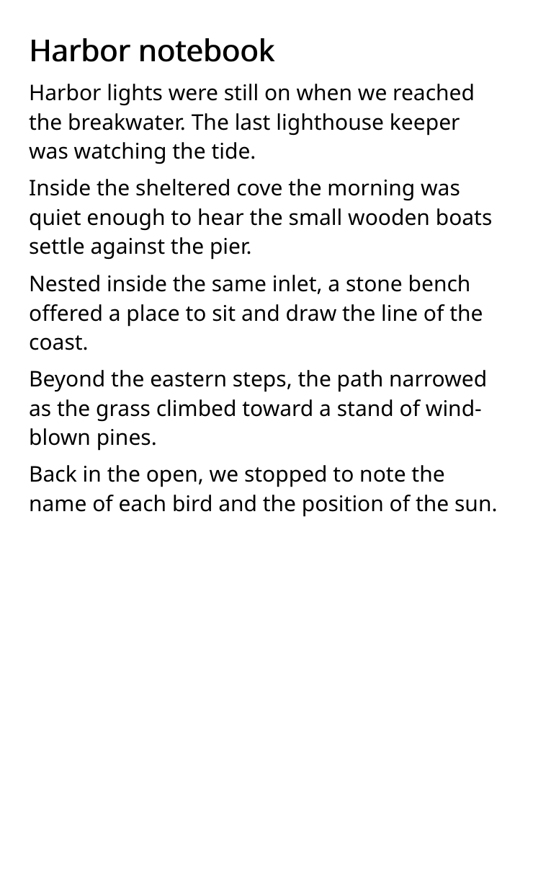

# Horizontal padding in published books

Reader now applies the left and right padding that EPUB publishers use to set off quotations, notes, list-like paragraphs and table cells. Every line wraps to the available width. A first-line indent can still move one line independently. The user’s page margins continue to set the outside boundary.

| Ordinary paragraph boxes | The same text with publisher padding |
| --- | --- |
|  |  |

Both images show the same authored document at 740 × 1240 pixels with 30 px type. The quotation gains 53 px on either side. A 36 px inset on its second paragraph brings that paragraph’s total displacement to 89 px. The paragraph after the quotation returns to the page edge. [Screenshot fixture](../tests/fixtures/publisher-box-padding.xhtml) · [Source-position and hit-testing checks](../src/parley_layout/publisher_padding_tests.rs)

## Publisher rules

The horizontal renderer supports physical left and right padding, the one- to four-value CSS shorthand, percentages of the containing box, and font-relative or absolute lengths. Nested boxes contribute their own padding once. An explicit zero clears the current box’s padding. A negative first-line indent can use the leading padding, including the right edge of a right-to-left paragraph. A 70 px left inset paired with a −70 px first-line indent keeps the first line flush and moves following lines 70 px. Oversize padding leaves room for text within the reading column.

KOReader v2026.07.1 uses CREngine’s shorthand expansion, content-box measurement and negative-indent correction. This comparison covers horizontal reflow. [Shorthand expansion](https://github.com/koreader/crengine/blob/b32a88ffbbf505cf2ea5208c1a49002d70d3609f/crengine/src/lvstsheet.cpp#L4292-L4326) · [Table-cell content boxes](https://github.com/koreader/crengine/blob/b32a88ffbbf505cf2ea5208c1a49002d70d3609f/crengine/src/lvrend.cpp#L1652-L1685) · [Negative indent against leading padding](https://github.com/koreader/crengine/blob/b32a88ffbbf505cf2ea5208c1a49002d70d3609f/crengine/src/lvrend.cpp#L8854-L8900)

## Original publications

The Mac comparison held fonts, page size, source markup and remaining publisher styles constant. It removed only horizontal padding for the control. Across 16 sections from seven original EPUBs, the reader changed the geometry of 322 paragraphs. Of these, 34 changed line count. Selections still resolved the same original text in both layouts. Sampled pages rendered and returned to their saved source positions. The authored regression also checks search matches and word taps.

| Anonymous EPUB | Chapters checked | Paragraphs with changed geometry | Paragraphs with changed line count |
| --- | ---: | ---: | ---: |
| 033 | 2 | 198 | 19 |
| 036 | 3 | 31 | 8 |
| 042 | 2 | 0 | 0 |
| 047 | 2 | 0 | 0 |
| 058 | 2 | 25 | 0 |
| 061 | 2 | 52 | 6 |
| 062 | 3 | 16 | 1 |

Original 047 contains 811 matching paragraphs in the sampled chapters. The publisher offsets their leading padding with an equal negative first-line indent. Their text geometry remained identical in both modes. Original 036 also uses unequal lengths. Its displaced paragraphs began 61 to 84 px farther inward when the complete rule was applied. The chapter and byte positions in both comparisons refer to the same original publication.
