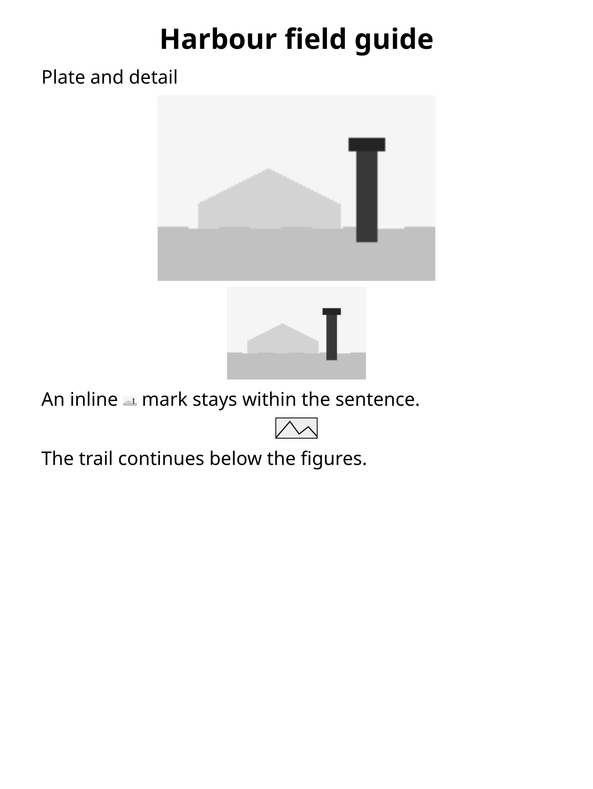
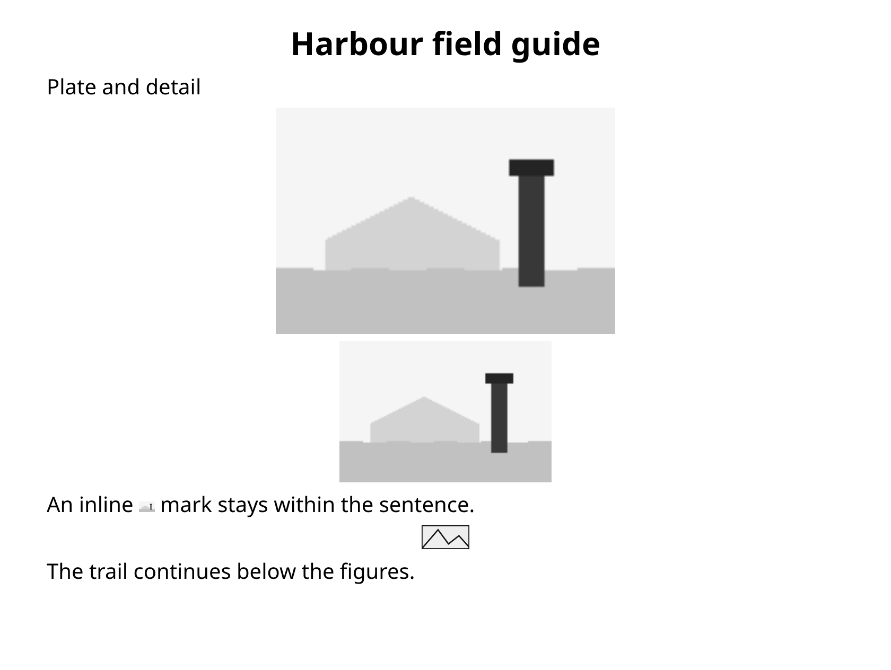

# Publisher image size limits

Reader honors positive CSS `max-width` and `max-height` on illustrations in horizontal reflow. Percent width uses the available text column, including after rotation. Physical units follow Render DPI and font-relative units follow the book’s computed font sizes. `none` clears a limit through the normal stylesheet cascade. The same rules apply to raster images and to static SVG illustrations selected by the EPUB stylesheet. [CREngine CSS size resolution](https://github.com/koreader/crengine/blob/b32a88ffbbf505cf2ea5208c1a49002d70d3609f/crengine/src/lvrend.cpp#L2727-L2769)

An image with automatic width and height keeps its aspect ratio when either limit reduces it. A definite width is capped before computing an automatic height. A height limit can shorten that box while keeping the resolved width. When the width is automatic and the height is definite, a smaller height can also reduce the width. Those cases were checked against the pinned CREngine used-size routine. Reader applies its existing viewport fit and rounds the resulting size to whole pixels. [CREngine used-size calculations](https://github.com/koreader/crengine/blob/b32a88ffbbf505cf2ea5208c1a49002d70d3609f/crengine/src/lvrend.cpp#L2917-L3016)

The authored Harbour Field Guide shows the same raster at different widths, a small raster inside a sentence and an SVG capped by height. The test rotates the viewport, checks the text anchors and image hit area, and opens the original illustration at full size. A column without a definite height leaves a percentage `max-height` unresolved. Minimum limits, zero-sized limits and propagation of definite containing heights are outside this slice. [Reader simulation and regressions](../src/parley_layout.rs)

| Portrait | Landscape |
| --- | --- |
|  |  |

The reflow Image scaling control selects a raster filter. Reader’s choices are Fast and Smooth, with Smooth as the default. KOReader’s choices are Fast and Best, with Fast as the default. [Pinned KOReader image control](https://github.com/koreader/koreader/blob/9192014d8bd82a91dc1012473be0f238dedfdb54/frontend/ui/data/creoptions.lua#L719-L727)
