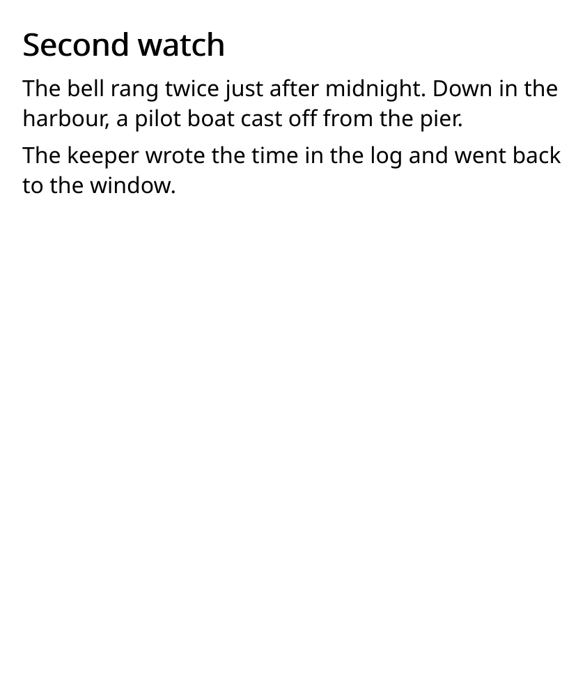

# Publisher page breaks

In horizontal reflow, an EPUB can start a new page at a heading, a figure or an empty separator. It can also keep short groups together. Reader resolves these instructions against the same source text used for selection, history, bookmarks and links. Turning Publisher styles off removes the author's break rules. [Authored reading sample](../tests/fixtures/page-breaks.xhtml)

## How the page is divided

The CSS cascade supplies before, after and inside rules for each block. Reader finds its first and last painted lines, including child paragraphs and illustrations. An empty break element uses the next available line. Reader’s current shared-edge rule gives a keep priority over a forced break at the same edge. CREngine’s enhanced block layout can resolve a forced opening margin before applying its final line-split priorities. Groups taller than the screen can still break between lines. An internal policy lets oversized ordinary text groups use the rest of the current page. [Final CREngine split flags](https://github.com/koreader/crengine/blob/b32a88ffbbf505cf2ea5208c1a49002d70d3609f/crengine/src/lvpagesplitter.cpp#L257-L266) · [Forced block margins](https://github.com/koreader/crengine/blob/b32a88ffbbf505cf2ea5208c1a49002d70d3609f/crengine/src/lvrend.cpp#L6475-L6501) · [Oversized group comparison](render-modes.md#oversized-text-groups-with-an-authored-keep)

Reader handles forced page breaks, automatic breaks, blocks kept together, adjacent blocks kept together, and explicit inheritance. The modern break properties and the legacy page-break properties share the cascade. Horizontal paragraphs also honor inherited widow and orphan line counts. Left and right page parity remains a separate layout feature. [Paragraph line protection](paragraph-ends.md)

## Original documents

An independent XML and CSS scan found 166 forced breaks before elements and 151 after them in the collection. Some occur at existing chapter boundaries. For 31 interior locations in five original EPUBs, an independent script located a text passage on each side. Installed KOReader placed the passages on different pages in all 31 cases. Desktop Reader did the same. When the KOReader comparison overrode the break rules, 16 pairs still fell on different pages naturally. With publisher styles disabled in Reader, 11 pairs still fell on different pages. The selections track source text across layout changes. [Installed KOReader comparator](../scripts/koreader-publisher-breaks.lua)

The native Oasis Reader produced the same page numbers as the desktop Reader at all 31 forced breaks. An additional 36 pairs in four original EPUBs exercised requests to keep content together. Reader and installed KOReader agreed on whether 33 of the 36 pairs shared a page. Their pagination and text metrics differ at the remaining 3 pairs. The comparison uses visible passages and excludes alternate HTML tables marked hidden by the publisher. All original files retained their checksums.
